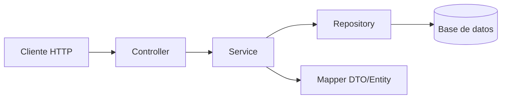

# Guía paso a paso: Tienda Virtual (Microservicio) con Spring Boot

Microservicio de tienda virtual con **Productos**, **Clientes** y **Facturas**, arquitectura por capas (DTO, modelo/entidad, repositorio, servicio, controlador), empaquetado con **Docker**, desplegado en **Kubernetes**, con **logging** (SLF4J/Logback) y **observabilidad** con **Prometheus + Grafana** (y opcionalmente Zipkin/OpenTelemetry para trazas).

---

## 1. Requisitos previos

- JDK 17+
- Maven 3.9+
- Docker Desktop (o Colima/Podman)
- Un clúster de Kubernetes local: Minikube o Kind
- kubectl instalado
- IDE (IntelliJ / VS Code con extensión Java)

---

## 2. Inicializar el proyecto

Usar [Spring Initializr](https://start.spring.io) (web o `curl`) con:

- **Group**: `com.example`
- **Artifact**: `tienda-virtual`
- **Packaging**: Jar
- **Java**: 17
- **Dependencias**:
  - Spring Web
  - Spring Data JPA
  - Validation
  - PostgreSQL Driver (o H2 para pruebas)
  - Spring Boot Actuator
  - Lombok

```bash
curl https://start.spring.io/starter.zip \
  -d dependencies=web,data-jpa,validation,postgresql,actuator,lombok \
  -d type=maven-project -d language=java -d bootVersion=3.3.4 \
  -d groupId=com.example -d artifactId=tienda-virtual \
  -d name=tienda-virtual -d packageName=com.example.tiendavirtual \
  -d javaVersion=17 -o tienda-virtual.zip

unzip tienda-virtual.zip -d tienda-virtual
cd tienda-virtual
```

Agregar dependencias de observabilidad y logging en `pom.xml`:

```xml
<dependency>
    <groupId>io.micrometer</groupId>
    <artifactId>micrometer-registry-prometheus</artifactId>
</dependency>
<dependency>
    <groupId>io.micrometer</groupId>
    <artifactId>micrometer-tracing-bridge-brave</artifactId>
</dependency>
<dependency>
    <groupId>io.zipkin.reporter2</groupId>
    <artifactId>zipkin-reporter-brave</artifactId>
</dependency>
```

---

## 3. Estructura de paquetes (arquitectura por capas)

```
com.example.tiendavirtual
├── controller      -> Controladores REST (entrada HTTP)
├── dto             -> Objetos de transferencia (request/response)
├── model           -> Entidades JPA
├── repository      -> Interfaces Spring Data JPA
├── service          -> Interfaces de servicio
│   └── impl        -> Implementaciones de servicio (lógica de negocio)
├── exception       -> Excepciones personalizadas y manejador global
├── mapper          -> Conversión Entity <-> DTO (opcional: MapStruct)
└── config          -> Configuración (Swagger, seguridad, etc.)
```

Flujo de una petición:



---

## 4. Modelos (entidades JPA)

`model/Cliente.java`:

```java
@Entity
@Table(name = "clientes")
@Getter @Setter @NoArgsConstructor @AllArgsConstructor
public class Cliente {

    @Id
    @GeneratedValue(strategy = GenerationType.IDENTITY)
    private Long id;

    @Column(nullable = false)
    private String nombre;

    @Column(unique = true, nullable = false)
    private String email;

    private String direccion;
}
```

`model/Producto.java`:

```java
@Entity
@Table(name = "productos")
@Getter @Setter @NoArgsConstructor @AllArgsConstructor
public class Producto {

    @Id
    @GeneratedValue(strategy = GenerationType.IDENTITY)
    private Long id;

    @Column(nullable = false)
    private String nombre;

    private String descripcion;

    @Column(nullable = false)
    private BigDecimal precio;

    @Column(nullable = false)
    private Integer stock;
}
```

`model/Factura.java` y `model/FacturaItem.java`:

```java
@Entity
@Table(name = "facturas")
@Getter @Setter @NoArgsConstructor @AllArgsConstructor
public class Factura {

    @Id
    @GeneratedValue(strategy = GenerationType.IDENTITY)
    private Long id;

    @ManyToOne(optional = false)
    @JoinColumn(name = "cliente_id")
    private Cliente cliente;

    private LocalDateTime fecha;

    @Column(nullable = false)
    private BigDecimal total;

    @OneToMany(mappedBy = "factura", cascade = CascadeType.ALL, orphanRemoval = true)
    private List<FacturaItem> items = new ArrayList<>();
}

@Entity
@Table(name = "factura_items")
@Getter @Setter @NoArgsConstructor @AllArgsConstructor
public class FacturaItem {

    @Id
    @GeneratedValue(strategy = GenerationType.IDENTITY)
    private Long id;

    @ManyToOne(optional = false)
    @JoinColumn(name = "factura_id")
    private Factura factura;

    @ManyToOne(optional = false)
    @JoinColumn(name = "producto_id")
    private Producto producto;

    private Integer cantidad;
    private BigDecimal precioUnitario;
}
```

---

## 5. DTOs

`dto/ProductoDTO.java`:

```java
public record ProductoDTO(
        Long id,
        @NotBlank String nombre,
        String descripcion,
        @NotNull @Positive BigDecimal precio,
        @NotNull @PositiveOrZero Integer stock
) {}
```

`dto/ClienteDTO.java`:

```java
public record ClienteDTO(
        Long id,
        @NotBlank String nombre,
        @Email @NotBlank String email,
        String direccion
) {}
```

`dto/FacturaRequestDTO.java` y `dto/FacturaResponseDTO.java`:

```java
public record FacturaItemRequestDTO(
        @NotNull Long productoId,
        @NotNull @Positive Integer cantidad
) {}

public record FacturaRequestDTO(
        @NotNull Long clienteId,
        @NotEmpty List<FacturaItemRequestDTO> items
) {}

public record FacturaResponseDTO(
        Long id,
        ClienteDTO cliente,
        LocalDateTime fecha,
        BigDecimal total,
        List<FacturaItemResponseDTO> items
) {}

public record FacturaItemResponseDTO(
        Long productoId,
        String nombreProducto,
        Integer cantidad,
        BigDecimal precioUnitario,
        BigDecimal subtotal
) {}
```

Usar records + `spring-boot-starter-validation` para validar entradas en los controladores con `@Valid`.

---

## 6. Mappers (Entity <-> DTO)

Se puede hacer manualmente o con MapStruct. Ejemplo manual en `mapper/ProductoMapper.java`:

```java
@Component
public class ProductoMapper {

    public ProductoDTO toDTO(Producto p) {
        return new ProductoDTO(p.getId(), p.getNombre(), p.getDescripcion(), p.getPrecio(), p.getStock());
    }

    public Producto toEntity(ProductoDTO dto) {
        Producto p = new Producto();
        p.setId(dto.id());
        p.setNombre(dto.nombre());
        p.setDescripcion(dto.descripcion());
        p.setPrecio(dto.precio());
        p.setStock(dto.stock());
        return p;
    }
}
```

---

## 7. Repositorios

```java
public interface ProductoRepository extends JpaRepository<Producto, Long> {
    Optional<Producto> findByNombreIgnoreCase(String nombre);
}

public interface ClienteRepository extends JpaRepository<Cliente, Long> {
    Optional<Cliente> findByEmail(String email);
}

public interface FacturaRepository extends JpaRepository<Factura, Long> {
    List<Factura> findByClienteId(Long clienteId);
}
```

---

## 8. Servicios (lógica de negocio + logging)

`service/ProductoService.java` (interfaz) y `service/impl/ProductoServiceImpl.java`:

```java
public interface ProductoService {
    ProductoDTO crear(ProductoDTO dto);
    ProductoDTO obtenerPorId(Long id);
    List<ProductoDTO> listar();
    ProductoDTO actualizar(Long id, ProductoDTO dto);
    void eliminar(Long id);
}
```

```java
@Service
@RequiredArgsConstructor
@Slf4j
public class ProductoServiceImpl implements ProductoService {

    private final ProductoRepository productoRepository;
    private final ProductoMapper productoMapper;

    @Override
    public ProductoDTO crear(ProductoDTO dto) {
        log.info("Creando producto: {}", dto.nombre());
        Producto guardado = productoRepository.save(productoMapper.toEntity(dto));
        log.debug("Producto creado con id={}", guardado.getId());
        return productoMapper.toDTO(guardado);
    }

    @Override
    public ProductoDTO obtenerPorId(Long id) {
        return productoRepository.findById(id)
                .map(productoMapper::toDTO)
                .orElseThrow(() -> {
                    log.warn("Producto no encontrado id={}", id);
                    return new ResourceNotFoundException("Producto no encontrado: " + id);
                });
    }

    @Override
    public List<ProductoDTO> listar() {
        return productoRepository.findAll().stream().map(productoMapper::toDTO).toList();
    }

    @Override
    public ProductoDTO actualizar(Long id, ProductoDTO dto) {
        Producto existente = productoRepository.findById(id)
                .orElseThrow(() -> new ResourceNotFoundException("Producto no encontrado: " + id));
        existente.setNombre(dto.nombre());
        existente.setDescripcion(dto.descripcion());
        existente.setPrecio(dto.precio());
        existente.setStock(dto.stock());
        log.info("Producto actualizado id={}", id);
        return productoMapper.toDTO(productoRepository.save(existente));
    }

    @Override
    public void eliminar(Long id) {
        productoRepository.deleteById(id);
        log.info("Producto eliminado id={}", id);
    }
}
```

`FacturaServiceImpl` (lógica más compleja: valida stock, calcula total):

```java
@Service
@RequiredArgsConstructor
@Slf4j
public class FacturaServiceImpl implements FacturaService {

    private final FacturaRepository facturaRepository;
    private final ClienteRepository clienteRepository;
    private final ProductoRepository productoRepository;

    @Override
    @Transactional
    public FacturaResponseDTO crear(FacturaRequestDTO request) {
        Cliente cliente = clienteRepository.findById(request.clienteId())
                .orElseThrow(() -> new ResourceNotFoundException("Cliente no encontrado"));

        Factura factura = new Factura();
        factura.setCliente(cliente);
        factura.setFecha(LocalDateTime.now());

        BigDecimal total = BigDecimal.ZERO;
        for (FacturaItemRequestDTO itemReq : request.items()) {
            Producto producto = productoRepository.findById(itemReq.productoId())
                    .orElseThrow(() -> new ResourceNotFoundException("Producto no encontrado"));

            if (producto.getStock() < itemReq.cantidad()) {
                log.warn("Stock insuficiente para producto id={}", producto.getId());
                throw new BusinessException("Stock insuficiente para " + producto.getNombre());
            }
            producto.setStock(producto.getStock() - itemReq.cantidad());

            FacturaItem item = new FacturaItem();
            item.setFactura(factura);
            item.setProducto(producto);
            item.setCantidad(itemReq.cantidad());
            item.setPrecioUnitario(producto.getPrecio());
            factura.getItems().add(item);

            total = total.add(producto.getPrecio().multiply(BigDecimal.valueOf(itemReq.cantidad())));
        }
        factura.setTotal(total);

        Factura guardada = facturaRepository.save(factura);
        log.info("Factura creada id={} total={}", guardada.getId(), total);
        return toResponseDTO(guardada);
    }

    // toResponseDTO(...) mapea Factura -> FacturaResponseDTO
}
```

---

## 9. Manejo de excepciones global

```java
public class ResourceNotFoundException extends RuntimeException {
    public ResourceNotFoundException(String msg) { super(msg); }
}

public class BusinessException extends RuntimeException {
    public BusinessException(String msg) { super(msg); }
}
```

```java
@RestControllerAdvice
@Slf4j
public class GlobalExceptionHandler {

    @ExceptionHandler(ResourceNotFoundException.class)
    public ResponseEntity<ErrorResponse> handleNotFound(ResourceNotFoundException ex) {
        log.warn("Recurso no encontrado: {}", ex.getMessage());
        return ResponseEntity.status(HttpStatus.NOT_FOUND)
                .body(new ErrorResponse(HttpStatus.NOT_FOUND.value(), ex.getMessage()));
    }

    @ExceptionHandler(BusinessException.class)
    public ResponseEntity<ErrorResponse> handleBusiness(BusinessException ex) {
        log.warn("Error de negocio: {}", ex.getMessage());
        return ResponseEntity.status(HttpStatus.BAD_REQUEST)
                .body(new ErrorResponse(HttpStatus.BAD_REQUEST.value(), ex.getMessage()));
    }

    @ExceptionHandler(MethodArgumentNotValidException.class)
    public ResponseEntity<ErrorResponse> handleValidation(MethodArgumentNotValidException ex) {
        String mensaje = ex.getBindingResult().getFieldErrors().stream()
                .map(f -> f.getField() + ": " + f.getDefaultMessage())
                .collect(Collectors.joining(", "));
        return ResponseEntity.badRequest().body(new ErrorResponse(400, mensaje));
    }

    @ExceptionHandler(Exception.class)
    public ResponseEntity<ErrorResponse> handleGeneric(Exception ex) {
        log.error("Error inesperado", ex);
        return ResponseEntity.internalServerError()
                .body(new ErrorResponse(500, "Error interno del servidor"));
    }
}

public record ErrorResponse(int status, String mensaje) {}
```

---

## 10. Controladores REST

```java
@RestController
@RequestMapping("/api/productos")
@RequiredArgsConstructor
@Slf4j
public class ProductoController {

    private final ProductoService productoService;

    @PostMapping
    public ResponseEntity<ProductoDTO> crear(@Valid @RequestBody ProductoDTO dto) {
        log.info("POST /api/productos");
        ProductoDTO creado = productoService.crear(dto);
        return ResponseEntity.status(HttpStatus.CREATED).body(creado);
    }

    @GetMapping("/{id}")
    public ResponseEntity<ProductoDTO> obtener(@PathVariable Long id) {
        return ResponseEntity.ok(productoService.obtenerPorId(id));
    }

    @GetMapping
    public ResponseEntity<List<ProductoDTO>> listar() {
        return ResponseEntity.ok(productoService.listar());
    }

    @PutMapping("/{id}")
    public ResponseEntity<ProductoDTO> actualizar(@PathVariable Long id, @Valid @RequestBody ProductoDTO dto) {
        return ResponseEntity.ok(productoService.actualizar(id, dto));
    }

    @DeleteMapping("/{id}")
    public ResponseEntity<Void> eliminar(@PathVariable Long id) {
        productoService.eliminar(id);
        return ResponseEntity.noContent().build();
    }
}
```

Repetir el mismo patrón para `ClienteController` (`/api/clientes`) y `FacturaController` (`/api/facturas`).

---

## 11. Configuración (`application.yml`)

```yaml
server:
  port: 8080

spring:
  application:
    name: tienda-virtual
  datasource:
    url: jdbc:postgresql://localhost:5432/tienda
    username: tienda
    password: tienda
  jpa:
    hibernate:
      ddl-auto: update
    show-sql: false

logging:
  level:
    root: INFO
    com.example.tiendavirtual: DEBUG
  pattern:
    console: "%d{yyyy-MM-dd HH:mm:ss} [%thread] %-5level %logger{36} - %msg%n"

management:
  endpoints:
    web:
      exposure:
        include: health,info,metrics,prometheus
  endpoint:
    health:
      show-details: always
  tracing:
    sampling:
      probability: 1.0
  zipkin:
    tracing:
      endpoint: http://zipkin:9411/api/v2/spans
```

### 11.1 Logging estructurado (opcional, recomendado para observabilidad)

Agregar `logback-spring.xml` en `src/main/resources` para loggear en JSON (facilita ingestión por Loki/ELK):

```xml
<configuration>
    <appender name="STDOUT" class="ch.qos.logback.core.ConsoleAppender">
        <encoder class="net.logstash.logback.encoder.LogstashEncoder"/>
    </appender>
    <root level="INFO">
        <appender-ref ref="STDOUT"/>
    </root>
</configuration>
```

(requiere dependencia `net.logstash.logback:logstash-logback-encoder`)

---

## 12. Observabilidad con Prometheus + Grafana

1. Actuator + Micrometer ya exponen métricas en `/actuator/prometheus`.
2. `docker-compose.yml` para levantar Prometheus y Grafana localmente:

```yaml
version: "3.8"
services:
  app:
    build: .
    ports:
      - "8080:8080"
    depends_on:
      - db
    environment:
      SPRING_DATASOURCE_URL: jdbc:postgresql://db:5432/tienda

  db:
    image: postgres:16
    environment:
      POSTGRES_DB: tienda
      POSTGRES_USER: tienda
      POSTGRES_PASSWORD: tienda
    ports:
      - "5432:5432"

  prometheus:
    image: prom/prometheus:latest
    volumes:
      - ./prometheus.yml:/etc/prometheus/prometheus.yml
    ports:
      - "9090:9090"

  grafana:
    image: grafana/grafana:latest
    ports:
      - "3000:3000"

  zipkin:
    image: openzipkin/zipkin:latest
    ports:
      - "9411:9411"
```

`prometheus.yml`:

```yaml
global:
  scrape_interval: 5s

scrape_configs:
  - job_name: "tienda-virtual"
    metrics_path: "/actuator/prometheus"
    static_configs:
      - targets: ["app:8080"]
```

3. En Grafana (`http://localhost:3000`), agregar Prometheus como data source (`http://prometheus:9090`) e importar un dashboard de JVM/Spring Boot (ej. dashboard ID `4701` o `12900`).
4. Zipkin queda disponible en `http://localhost:9411` para ver trazas distribuidas.

---

## 13. Dockerización

`Dockerfile` (multi-stage):

```dockerfile
# Etapa de build
FROM maven:3.9-eclipse-temurin-17 AS build
WORKDIR /app
COPY pom.xml .
RUN mvn dependency:go-offline -B
COPY src ./src
RUN mvn clean package -DskipTests

# Etapa de ejecución
FROM eclipse-temurin:17-jre-alpine
WORKDIR /app
COPY --from=build /app/target/tienda-virtual-0.0.1-SNAPSHOT.jar app.jar
EXPOSE 8080
ENTRYPOINT ["java", "-jar", "app.jar"]
```

Construir y probar localmente:

```bash
docker build -t tienda-virtual:1.0.0 .
docker run -p 8080:8080 tienda-virtual:1.0.0
```

O levantar todo el stack (app + db + observabilidad):

```bash
docker compose up -d --build
```

---

## 14. Despliegue en Kubernetes

Crear carpeta `k8s/` con los manifiestos.

`k8s/configmap.yaml`:

```yaml
apiVersion: v1
kind: ConfigMap
metadata:
  name: tienda-config
data:
  SPRING_DATASOURCE_URL: jdbc:postgresql://tienda-db:5432/tienda
```

`k8s/secret.yaml`:

```yaml
apiVersion: v1
kind: Secret
metadata:
  name: tienda-secret
type: Opaque
stringData:
  SPRING_DATASOURCE_USERNAME: tienda
  SPRING_DATASOURCE_PASSWORD: tienda
```

`k8s/deployment.yaml`:

```yaml
apiVersion: apps/v1
kind: Deployment
metadata:
  name: tienda-virtual
spec:
  replicas: 2
  selector:
    matchLabels:
      app: tienda-virtual
  template:
    metadata:
      labels:
        app: tienda-virtual
    spec:
      containers:
        - name: tienda-virtual
          image: tienda-virtual:1.0.0
          ports:
            - containerPort: 8080
          envFrom:
            - configMapRef:
                name: tienda-config
            - secretRef:
                name: tienda-secret
          livenessProbe:
            httpGet:
              path: /actuator/health/liveness
              port: 8080
            initialDelaySeconds: 30
            periodSeconds: 10
          readinessProbe:
            httpGet:
              path: /actuator/health/readiness
              port: 8080
            initialDelaySeconds: 20
            periodSeconds: 10
          resources:
            requests:
              cpu: "250m"
              memory: "256Mi"
            limits:
              cpu: "500m"
              memory: "512Mi"
```

`k8s/service.yaml`:

```yaml
apiVersion: v1
kind: Service
metadata:
  name: tienda-virtual
spec:
  selector:
    app: tienda-virtual
  ports:
    - port: 80
      targetPort: 8080
  type: ClusterIP
```

`k8s/ingress.yaml` (opcional, requiere ingress controller):

```yaml
apiVersion: networking.k8s.io/v1
kind: Ingress
metadata:
  name: tienda-virtual
  annotations:
    nginx.ingress.kubernetes.io/rewrite-target: /
spec:
  rules:
    - host: tienda.local
      http:
        paths:
          - path: /
            pathType: Prefix
            backend:
              service:
                name: tienda-virtual
                port:
                  number: 80
```

Habilitar los health groups en `application.yml`:

```yaml
management:
  endpoint:
    health:
      probes:
        enabled: true
  health:
    livenessstate:
      enabled: true
    readinessstate:
      enabled: true
```

### Pasos de despliegue

```bash
# 1. Levantar clúster local
minikube start

# 2. Construir imagen dentro del contexto de Docker de Minikube
eval $(minikube docker-env)
docker build -t tienda-virtual:1.0.0 .

# 3. Aplicar manifiestos
kubectl apply -f k8s/configmap.yaml
kubectl apply -f k8s/secret.yaml
kubectl apply -f k8s/deployment.yaml
kubectl apply -f k8s/service.yaml
kubectl apply -f k8s/ingress.yaml   # si aplica

# 4. Verificar
kubectl get pods
kubectl get svc
kubectl logs -f deployment/tienda-virtual
```

---

## 15. Pruebas

- **Unitarias**: JUnit 5 + Mockito para los servicios (mockear repositorios).
- **Integración**: `@SpringBootTest` + Testcontainers (PostgreSQL real en Docker) para repositorios/controladores.

### 15.1 Dependencias de prueba (`pom.xml`)

`spring-boot-starter-test` ya incluye JUnit 5, Mockito y AssertJ:

```xml
<dependency>
    <groupId>org.springframework.boot</groupId>
    <artifactId>spring-boot-starter-test</artifactId>
    <scope>test</scope>
</dependency>
```

### 15.2 Test 1 — `ProductoServiceImpl.crear()` (caso feliz)

```java
@ExtendWith(MockitoExtension.class)
class ProductoServiceImplTest {

    @Mock private ProductoRepository productoRepository;
    @Mock private ProductoMapper productoMapper;
    @InjectMocks private ProductoServiceImpl productoService;

    @Test
    void deberiaCrearProducto() {
        // given
        ProductoDTO dtoEntrada = new ProductoDTO(null, "Teclado", "Mecánico", new BigDecimal("120.00"), 10);
        Producto entidadSinGuardar = new Producto(null, "Teclado", "Mecánico", new BigDecimal("120.00"), 10);
        Producto entidadGuardada = new Producto(1L, "Teclado", "Mecánico", new BigDecimal("120.00"), 10);
        ProductoDTO dtoEsperado = new ProductoDTO(1L, "Teclado", "Mecánico", new BigDecimal("120.00"), 10);

        when(productoMapper.toEntity(dtoEntrada)).thenReturn(entidadSinGuardar);
        when(productoRepository.save(entidadSinGuardar)).thenReturn(entidadGuardada);
        when(productoMapper.toDTO(entidadGuardada)).thenReturn(dtoEsperado);

        // when
        ProductoDTO resultado = productoService.crear(dtoEntrada);

        // then
        assertThat(resultado.id()).isEqualTo(1L);
        assertThat(resultado.nombre()).isEqualTo("Teclado");
        verify(productoRepository, times(1)).save(entidadSinGuardar);
    }
}
```

### 15.3 Test 2 — `ProductoServiceImpl.obtenerPorId()` (caso de error)

```java
@ExtendWith(MockitoExtension.class)
class ProductoServiceImplNotFoundTest {

    @Mock private ProductoRepository productoRepository;
    @Mock private ProductoMapper productoMapper;
    @InjectMocks private ProductoServiceImpl productoService;

    @Test
    void deberiaLanzarExcepcionSiProductoNoExiste() {
        // given
        when(productoRepository.findById(99L)).thenReturn(Optional.empty());

        // when / then
        assertThatThrownBy(() -> productoService.obtenerPorId(99L))
                .isInstanceOf(ResourceNotFoundException.class)
                .hasMessageContaining("Producto no encontrado");

        verify(productoMapper, never()).toDTO(any());
    }
}
```

### 15.4 Test 3 — `FacturaServiceImpl.crear()` (stock insuficiente)

```java
@ExtendWith(MockitoExtension.class)
class FacturaServiceImplTest {

    @Mock private FacturaRepository facturaRepository;
    @Mock private ClienteRepository clienteRepository;
    @Mock private ProductoRepository productoRepository;
    @InjectMocks private FacturaServiceImpl facturaService;

    @Test
    void deberiaLanzarExcepcionSiStockEsInsuficiente() {
        // given
        Cliente cliente = new Cliente(1L, "Ana Pérez", "ana@mail.com", "Calle 123");
        Producto producto = new Producto(1L, "Mouse", "Inalámbrico", new BigDecimal("50.00"), 2);

        FacturaItemRequestDTO itemRequest = new FacturaItemRequestDTO(1L, 5); // pide más de lo disponible
        FacturaRequestDTO facturaRequest = new FacturaRequestDTO(1L, List.of(itemRequest));

        when(clienteRepository.findById(1L)).thenReturn(Optional.of(cliente));
        when(productoRepository.findById(1L)).thenReturn(Optional.of(producto));

        // when / then
        assertThatThrownBy(() -> facturaService.crear(facturaRequest))
                .isInstanceOf(BusinessException.class)
                .hasMessageContaining("Stock insuficiente");

        verify(facturaRepository, never()).save(any());
    }
}
```

### 15.5 Test 4 — `FacturaServiceImpl.crear()` (caso feliz, calcula total)

```java
@ExtendWith(MockitoExtension.class)
class FacturaServiceImplCrearTest {

    @Mock private FacturaRepository facturaRepository;
    @Mock private ClienteRepository clienteRepository;
    @Mock private ProductoRepository productoRepository;
    @InjectMocks private FacturaServiceImpl facturaService;

    @Test
    void deberiaCrearFacturaYCalcularTotalCorrectamente() {
        // given
        Cliente cliente = new Cliente(1L, "Ana Pérez", "ana@mail.com", "Calle 123");
        Producto producto = new Producto(1L, "Mouse", "Inalámbrico", new BigDecimal("50.00"), 10);

        FacturaItemRequestDTO itemRequest = new FacturaItemRequestDTO(1L, 3);
        FacturaRequestDTO facturaRequest = new FacturaRequestDTO(1L, List.of(itemRequest));

        when(clienteRepository.findById(1L)).thenReturn(Optional.of(cliente));
        when(productoRepository.findById(1L)).thenReturn(Optional.of(producto));
        when(facturaRepository.save(any(Factura.class))).thenAnswer(invocation -> {
            Factura f = invocation.getArgument(0);
            f.setId(1L);
            return f;
        });

        // when
        FacturaResponseDTO resultado = facturaService.crear(facturaRequest);

        // then
        assertThat(resultado.id()).isEqualTo(1L);
        assertThat(resultado.total()).isEqualByComparingTo(new BigDecimal("150.00"));
        assertThat(producto.getStock()).isEqualTo(7); // 10 - 3
        verify(facturaRepository, times(1)).save(any(Factura.class));
    }
}
```

---

## 16. Resumen del flujo completo

1. Diseñar modelo de dominio (Cliente, Producto, Factura, FacturaItem).
2. Crear capas: `model` → `repository` → `dto`/`mapper` → `service` → `controller`.
3. Agregar validaciones y manejo global de excepciones.
4. Configurar logging (Logback + niveles + formato JSON opcional).
5. Exponer métricas con Actuator/Micrometer y probarlas en `/actuator/prometheus`.
6. Escribir pruebas unitarias/integración.
7. Crear `Dockerfile` multi-stage y validar con `docker compose up`.
8. Escribir manifiestos de Kubernetes (ConfigMap, Secret, Deployment, Service, Ingress) con probes de salud.
9. Desplegar en Minikube/Kind y validar con `kubectl get pods/svc/logs`.
10. Instalar stack de observabilidad (Prometheus, Grafana, Loki/Zipkin) y crear dashboards/alertas.
</content>
