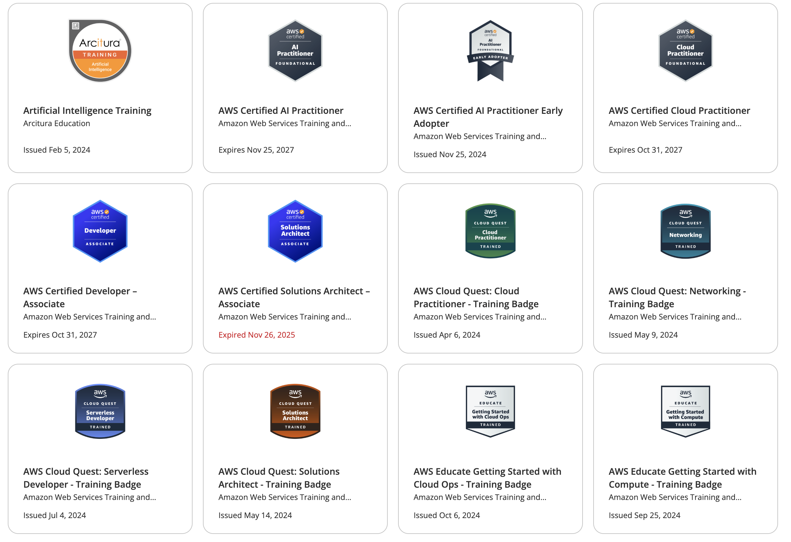
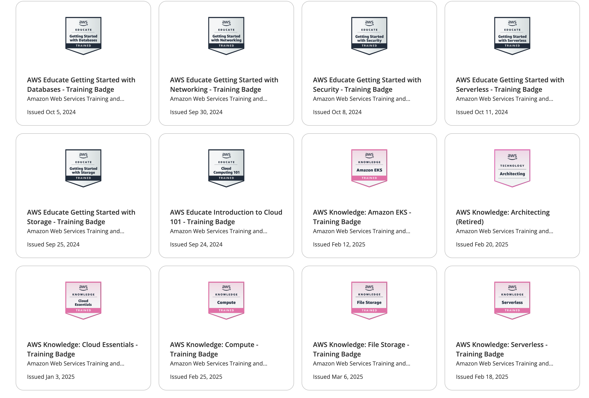

# Desarrollo de Software — Planificación ampliada de 26 clases (2 horas c/u)

---

## Docente Jorge Alejandro Aguirre Gutierrez

**Ingeniero de Software | SRE | AWS Certified ×4**

Profesional con experiencia en diseño, desarrollo y operación de sistemas de software a escala, especializado en arquitecturas cloud, prácticas DevOps e IA.

**Certificaciones y especialidades técnicas:**

- ☁️ **AWS Certified** × 4: Solutions Architect, Developer, AI Practitioner y DevOps Engineer
- 🖥️ **Desarrollo frontend:** Angular, React
- ⚙️ **Desarrollo backend:** Spring (Java), NestJS (Node.js)
- 🗄️ **Administración de bases de datos:** Relacionales y NoSQL
- 🏗️ **Infraestructura como código (IaC):** Terraform, CloudFormation
- 🚀 **AWS DevOps:** CI/CD, automatización de infraestructura, observabilidad en nube

**Experiencia docente:**

| Institución | Programa | Nivel |
|---|---|---|
| Universidad de Caldas | Ingeniería de Sistemas | Pregrado |
| Universidad Autónoma de Manizales | Ingeniería de Sistemas | Pregrado |
| Universidad Autónoma de Manizales | Especialización en Ingeniería del Software con Énfasis en Pruebas | Posgrado |
| Universidad Autónoma de Manizales | Maestría en Ingeniería de Sistemas | Posgrado |




## Distribución del curso

| Unidad | Clases | Horas |
|---|---|---|
| Unidad 1: Análisis y diseño orientado a objetos | Clases 1–6 | 12 h |
| Unidad 2: Construcción, persistencia e integración | Clases 7–11 | 10 h |
| Unidad 3: Pruebas, calidad y desarrollo con IA | Clases 12–17 | 12 h |
| Unidad 4: Seguridad, concurrencia, DevOps y despliegue | Clases 18–23 | 12 h |
| Unidad 5: Proyecto integrador | Clases 24–26 | 6 h |
| **Total** | **26 clases** | **52 h** |

## Mapa de clases recomendado

La secuencia está pensada para que los estudiantes pasen de comprender el problema y modelar el dominio, a construir código mantenible, probarlo, asegurarlo, automatizar su entrega y finalmente integrarlo en un proyecto completo.

| Clase | Título | Unidad |
|---|---|---|
| 01 | Introducción al curso y fundamentos del desarrollo iterativo | 1 |
| 02 | Casos de uso: estructura, flujos y escenarios | 1 |
| 03 | Historias de usuario, criterios de aceptación y trazabilidad | 1 |
| 04 | Modelo del dominio: entidades, objetos de valor e invariantes | 1 |
| 05 | Patrones GRASP: asignación de responsabilidades | 1 |
| 06 | SOLID, diagramas de secuencia e inyección de dependencias | 1 |
| 07 | Construcción limpia: funciones, abstracciones y nombres | 2 |
| 08 | Validaciones, excepciones, logging y principios YAGNI/KISS/DRY | 2 |
| 09 | Persistencia: patrón Repository y ORM | 2 |
| 10 | Transacciones e integración con servicios externos | 2 |
| 11 | DTOs, contratos y uso de IA para código repetitivo | 2 |
| 12 | Pruebas unitarias: fundamentos y estructura | 3 |
| 13 | Dobles de prueba: stubs, mocks y fakes | 3 |
| 14 | TDD: ciclo rojo-verde-refactor | 3 |
| 15 | Pruebas de integración y de aceptación | 3 |
| 16 | Automatización de pruebas E2E con Playwright | 3 |
| 17 | Calidad interna: análisis estático, deuda técnica y SDD con IA | 3 |
| 18 | Seguridad en el desarrollo: OWASP, autenticación y autorización | 4 |
| 19 | Diseño de APIs REST, versionado y contratos OpenAPI | 4 |
| 20 | Concurrencia, asincronía y procesamiento en segundo plano | 4 |
| 21 | CI/CD, automatización de calidad y GitHub Actions | 4 |
| 22 | Contenedores, Docker Compose y configuración por ambiente | 4 |
| 23 | Observabilidad, monitoreo y diagnóstico en producción | 4 |
| 24 | Sprints, pull requests y trazabilidad | 5 |
| 25 | Gestión del cambio y refactorización | 5 |
| 26 | Demostración funcional, defensa técnica y cierre | 5 |

---

#### Presentación del curso
- Programa, metodología de evaluación, criterios de aprobación.
- Herramientas que se usarán: IDE (IntelliJ / VS Code), Git, GitHub, herramientas de IA.
- Dinámica de clases: teoría + práctica en cada sesión.

## Evaluación

| Componente | Porcentaje |
|---|---|
| Primer parcial | 20% |
| Segundo parcial | 20% |
| Tercer parcial | 20% |
| Talleres | 20% |
| Proyecto final | 20% |
---

# UNIDAD 1. Análisis y diseño orientado a objetos

---

## CLASE 1 — Introducción al curso y fundamentos del desarrollo iterativo
**Duración:** 2 horas | **Unidad:** 1 — Análisis del comportamiento

### Objetivos
- Presentar la materia, metodología de evaluación y herramientas del curso.
- Comprender la diferencia entre el desarrollo en cascada y el desarrollo iterativo-incremental.
- Repasar los cuatro pilares de la orientación a objetos.

---

### Bloque 1 (50 min) — Presentación del curso y desarrollo iterativo

#### ¿Por qué fracasan los proyectos de software?

Imagina que tu jefe te encarga construir un edificio. Hay dos formas de hacerlo:

**Forma antigua (cascada):** Planeamos TODO, diseñamos TODO, construimos TODO, y solo al final lo mostramos al cliente. Si al terminar el cliente dice "esto no es lo que quería", fue porque la comunicación falló hace meses.

**Forma moderna (iterativa):** Entregamos el proyecto en pequeñas fases. Cada mes hacemos una demo: "Mira lo que tenemos." El cliente da feedback → ajustamos → continuamos. Mucho menos riesgo.

Los datos muestran que solo el 29% de los proyectos terminan a tiempo y presupuesto. La razón principal: la gente no entendió bien qué quería el cliente, y se descubrió cuando era demasiado tarde.

**La respuesta: entregar valor en pequeños pasos**

En lugar de construir todo el sistema en 6 meses y mostrarlo al cliente, trabajamos en ciclos cortos de 1–2 semanas. Cada ciclo entrega algo que funciona y el cliente puede usar.

| Aspecto | Cascada (antiguo) | Iterativo (moderno) |
|---|---|---|
| **Cómo empezamos** | Analizamos TODO por 2 meses | Analizamos lo más importante |
| **Qué mostramos** | Nada por 5 meses | Algo funcional cada 2 semanas |
| **Si nos equivocamos** | Descubrimos en mes 6 (muy tarde) | Descubrimos en semana 2 (tiempo de arreglar) |
| **Cambios del cliente** | Cuesta mucho, requiere re-análisis completo | Se agregan al backlog del siguiente ciclo |

**Ventajas prácticas:**
- ✅ Riesgo menor: ves avance real cada 2 semanas.
- ✅ Feedback temprano: el cliente valida cada entrega.
- ✅ Flexibilidad: cambios se manejan naturalmente.
- ✅ Motivación: el equipo ve su trabajo funcionando, no solo "en papel."

```
Cascada (waterfall)                  Iterativo-incremental
─────────────────────                ──────────────────────
Análisis                             Sprint 1 → Incremento 1 (funcional)
    ↓                                Sprint 2 → Incremento 2 (funcional)
Diseño                               Sprint 3 → Incremento 3 (funcional)
    ↓                                ...
Código          ← meses sin feedback  Sprint N → Producto completo
    ↓
Pruebas         ← feedback tardío
    ↓
Deploy
```

**Por qué importa:** Reduce el riesgo, permite cambiar de dirección según retroalimentación temprana y mantiene al equipo enfocado en lo que tiene más valor en cada momento.

**Metodologías ágiles comunes:**
- **Scrum:** Sprints de 1-4 semanas, roles definidos (Product Owner, Scrum Master, Equipo).
- **Kanban:** Flujo continuo, sin sprints fijos, tablero de tareas.
- **XP (Extreme Programming):** Enfocado en prácticas técnicas: TDD, pair programming, integración continua.

---

#### Repaso: Los 4 pilares de la orientación a objetos

La **orientación a objetos** es la forma de pensar en la que organizamos el código. Imagina que estás modelando el mundo real en código:

| Pilar | ¿Qué es? | Ejemplo del mundo real | En código |
|---|---|---|---|
| **Abstracción** | Modelar solo lo importante, ignorar lo irrelevante | Una cuenta bancaria tiene saldo y titular, pero no "color de plástico" | `Cuenta` tiene `saldo` y `titular`, no `colorTarjeta` |
| **Encapsulamiento** | Proteger el estado interno; permitir cambios solo a través de operaciones válidas | No puedes restar directamente de tu cuenta; debes hacer un retiro formal | `saldo` es privado; solo `depositar()` y `retirar()` pueden modificarlo |
| **Herencia** | Reutilizar comportamiento común en una jerarquía | Autos, motos y camiones son todos "vehículos" con propiedades comunes | `Auto` y `Moto` heredan de `Vehiculo` |
| **Polimorfismo** | El mismo mensaje produce distinto comportamiento según el tipo | Si dices "avanza," un auto acelera pero un avión despega | `Vehiculo.avanzar()` se comporta diferente en `Auto` vs `Avion` |

**Principio fundamental:** Los objetos colaboran enviándose mensajes. Cada objeto es responsable de su propio estado.

---

#### Ejemplos de código por cada pilar

##### 1. Abstracción

Modelar solo los atributos y operaciones que son relevantes para el dominio del problema. Todo lo demás se ignora.

```java
// El dominio es una cuenta bancaria.
// Abstraemos: titular, saldo, número de cuenta y las operaciones de negocio.
// Ignoramos: color de la tarjeta, material físico, el banco que la emitió, etc.
public class Cuenta {
    private final String numero;
    private final String titular;
    private BigDecimal saldo;

    public Cuenta(String numero, String titular, BigDecimal saldoInicial) {
        this.numero   = numero;
        this.titular  = titular;
        this.saldo    = saldoInicial;
    }

    // Operación de negocio relevante: depositar
    public void depositar(BigDecimal monto) {
        this.saldo = this.saldo.add(monto);
    }

    // Operación de negocio relevante: consultar saldo
    public BigDecimal getSaldo() {
        return this.saldo;
    }
}
```

> **Clave:** La clase `Cuenta` no tiene `colorDeTarjeta`, `materialPlastico` ni `marcaDelBanco` porque esos conceptos no son relevantes para el dominio financiero que se está modelando.

---

##### 2. Encapsulamiento

Ocultar el estado interno del objeto y exponer solo operaciones bien definidas. El objeto controla cómo cambia su propio estado.

```java
public class Cuenta {
    private BigDecimal saldo;  // ← estado interno oculto (private)

    public Cuenta(BigDecimal saldoInicial) {
        if (saldoInicial.compareTo(BigDecimal.ZERO) < 0)
            throw new IllegalArgumentException("El saldo inicial no puede ser negativo");
        this.saldo = saldoInicial;
    }

    // ✅ Operación pública que controla el cambio de estado
    public void debitar(BigDecimal monto) {
        if (monto.compareTo(BigDecimal.ZERO) <= 0)
            throw new IllegalArgumentException("El monto debe ser positivo");
        if (monto.compareTo(this.saldo) > 0)
            throw new SaldoInsuficienteException("Saldo: " + saldo + ", solicitado: " + monto);
        this.saldo = this.saldo.subtract(monto);
    }

    public BigDecimal getSaldo() { return this.saldo; }
    // No hay setSaldo() — nadie puede cambiar el saldo arbitrariamente desde afuera
}

// ❌ Sin encapsulamiento — cualquier clase puede corromper el estado
cuenta.saldo -= 500;              // acceso directo al campo: no se valida nada

// ✅ Con encapsulamiento — la cuenta es el único guardián de su estado
cuenta.debitar(new BigDecimal("500")); // valida, lanza excepción si hay problema
```

---

##### 3. Herencia

Una clase hija hereda el comportamiento de su clase padre y puede extenderlo o especializarlo.

```java
// Clase base: define el comportamiento común de todas las cuentas
public class Cuenta {
    protected final String numero;
    protected BigDecimal saldo;

    public Cuenta(String numero, BigDecimal saldoInicial) {
        this.numero = numero;
        this.saldo  = saldoInicial;
    }

    public void depositar(BigDecimal monto) {
        this.saldo = this.saldo.add(monto);
    }

    public void debitar(BigDecimal monto) {
        if (monto.compareTo(this.saldo) > 0)
            throw new SaldoInsuficienteException("Saldo insuficiente");
        this.saldo = this.saldo.subtract(monto);
    }

    public BigDecimal getSaldo() { return saldo; }
}

// Clase hija: hereda todo de Cuenta y agrega comportamiento específico
public class CuentaCorriente extends Cuenta {
    private BigDecimal limiteDescubierto; // atributo propio de CuentaCorriente

    public CuentaCorriente(String numero, BigDecimal saldoInicial, BigDecimal limiteDescubierto) {
        super(numero, saldoInicial); // llama al constructor del padre
        this.limiteDescubierto = limiteDescubierto;
    }

    // Sobreescribe el comportamiento para permitir saldo negativo hasta el límite
    @Override
    public void debitar(BigDecimal monto) {
        BigDecimal saldoDisponible = this.saldo.add(limiteDescubierto);
        if (monto.compareTo(saldoDisponible) > 0)
            throw new SaldoInsuficienteException("Supera el límite de descubierto");
        this.saldo = this.saldo.subtract(monto);
    }
}

// Uso:
Cuenta caja     = new Cuenta("001", new BigDecimal("1000"));
Cuenta corriente = new CuentaCorriente("002", new BigDecimal("500"), new BigDecimal("1000"));

caja.depositar(new BigDecimal("200"));       // heredado, funciona igual
corriente.debitar(new BigDecimal("1400"));   // comportamiento especializado: usa el descubierto
```

---

##### 4. Polimorfismo

El mismo mensaje produce comportamientos diferentes según el tipo real del objeto. Permite escribir código que trabaja con abstracciones en lugar de tipos concretos.

```java
// Interfaz común: define el contrato
public interface Pago {
    void procesar(BigDecimal monto);
    String getDescripcion();
}

// Implementación 1: pago con tarjeta de crédito
public class PagoTarjeta implements Pago {
    private final String numeroTarjeta;

    public PagoTarjeta(String numeroTarjeta) { this.numeroTarjeta = numeroTarjeta; }

    @Override
    public void procesar(BigDecimal monto) {
        System.out.println("Cargando $" + monto + " a la tarjeta " + numeroTarjeta);
        // lógica de autorización con la red de tarjetas
    }

    @Override
    public String getDescripcion() { return "Tarjeta " + numeroTarjeta; }
}

// Implementación 2: pago por transferencia bancaria
public class PagoTransferencia implements Pago {
    private final String cbu;

    public PagoTransferencia(String cbu) { this.cbu = cbu; }

    @Override
    public void procesar(BigDecimal monto) {
        System.out.println("Transfiriendo $" + monto + " al CBU " + cbu);
        // lógica de transferencia interbancaria
    }

    @Override
    public String getDescripcion() { return "Transferencia a CBU " + cbu; }
}

// Implementación 3: pago en efectivo
public class PagoEfectivo implements Pago {
    @Override
    public void procesar(BigDecimal monto) {
        System.out.println("Registrando pago en efectivo de $" + monto);
    }

    @Override
    public String getDescripcion() { return "Efectivo"; }
}

// ✅ El servicio de checkout trabaja con la abstracción Pago,
// sin importar cuál es la implementación concreta
public class CheckoutService {
    public void finalizarCompra(Pedido pedido, Pago metodoDePago) {
        // El mismo código funciona para tarjeta, transferencia o efectivo
        metodoDePago.procesar(pedido.getTotal());
        System.out.println("Compra finalizada. Método: " + metodoDePago.getDescripcion());
    }
}

// Uso:
CheckoutService checkout = new CheckoutService();
Pedido pedido = new Pedido(new BigDecimal("2500"));

checkout.finalizarCompra(pedido, new PagoTarjeta("4111-1111-1111-1111")); // con tarjeta
checkout.finalizarCompra(pedido, new PagoTransferencia("0720123456789"));  // con transferencia
checkout.finalizarCompra(pedido, new PagoEfectivo());                      // en efectivo
// CheckoutService no cambió — el polimorfismo permite agregar PagoMercadoPago, etc.
```

---

#### Actividades prácticas por pilar

##### Actividad 1 — Abstracción

**Enunciado:** Se quiere modelar el dominio de una **clínica veterinaria**. El sistema debe gestionar mascotas, sus dueños y las consultas médicas.

**Tarea individual (10 min):**

1. Para cada concepto a continuación, listar solo los atributos y operaciones que son **relevantes para el dominio veterinario**. Tachar los que no corresponden:

   | Concepto | Candidatos | ¿Relevante? |
   |---|---|---|
   | `Mascota` | nombre, especie, raza, edad, color de ojos, peso, número de chip, planeta natal | — |
   | `Duenio` | nombre, teléfono, dirección, talle de ropa, historial de mascotas, DNI | — |
   | `Consulta` | fecha, motivo, diagnóstico, tratamiento, número de serie del estetoscopio del veterinario | — |

2. Escribir en código Java la clase `Mascota` con **solo** los atributos que seleccionaron, sin ningún método todavía.

3. Reflexionar: ¿cambiaría la lista de atributos si el sistema fuera para una **peluquería canina** en lugar de una clínica? ¿Por qué?

**Corrección en clase:** El docente muestra que la abstracción correcta depende siempre del **propósito del sistema**, no de la entidad en abstracto.

---

##### Actividad 2 — Encapsulamiento

**Enunciado:** La siguiente clase `CuentaBancaria` fue escrita sin encapsulamiento. Tiene todos sus campos públicos y no controla su propio estado.

```java
// Código inicial — SIN encapsulamiento
public class CuentaBancaria {
    public String numero;
    public String titular;
    public double saldo;
    public boolean activa;
}

// Código cliente — puede dejar la cuenta en estado inválido
CuentaBancaria cuenta = new CuentaBancaria();
cuenta.saldo = -5000;      // ❌ saldo negativo: nadie lo impide
cuenta.activa = false;
cuenta.saldo += 200;       // ❌ se puede depositar en una cuenta inactiva
```

**Tarea en parejas (15 min):**

1. Hacer **private** todos los campos.
2. Agregar un constructor que valide:
   - El número de cuenta no puede ser nulo ni vacío.
   - El titular no puede ser nulo ni vacío.
   - El saldo inicial no puede ser negativo.
   - La cuenta se crea siempre activa.
3. Implementar los métodos:
   - `depositar(double monto)`: valida que el monto sea positivo y que la cuenta esté activa.
   - `extraer(double monto)`: valida monto positivo, cuenta activa y saldo suficiente.
   - `desactivar()`: marca la cuenta como inactiva.
   - `getSaldo()`, `isActiva()`: solo lectura.
4. **No agregar `setSaldo()`** — ¿por qué no debe existir ese método?

**Pregunta de cierre:** ¿Qué invariantes garantiza ahora la clase que antes no podía garantizar?

---

##### Actividad 3 — Herencia

**Enunciado:** Una empresa de transporte tiene distintos tipos de vehículos: autos, camiones y motocicletas. Todos comparten comportamiento común pero también tienen características propias.

**Comportamiento común a todos los vehículos:**
- Tienen patente, marca, modelo y año.
- Se pueden encender y apagar.
- Tienen un método `descripcion()` que retorna un string con los datos básicos.

**Comportamiento específico:**
- `Auto`: tiene número de puertas. Su `descripcion()` incluye "Auto de N puertas".
- `Camion`: tiene capacidad de carga en toneladas. No se puede encender si la carga supera la capacidad.
- `Motocicleta`: tiene cilindrada. Su `descripcion()` incluye "Moto de Xcc".

**Tarea en grupos de 3 (20 min):**

1. Implementar la clase base `Vehiculo` con los atributos y métodos comunes.
2. Implementar `Auto`, `Camion` y `Motocicleta` extendiendo `Vehiculo`.
3. Sobreescribir `descripcion()` en cada subclase usando `@Override`.
4. En `Camion`, sobreescribir `encender()` para agregar la validación de carga.
5. Escribir un `main()` que cree un vehículo de cada tipo, los encienda y muestre su descripción.

**Pregunta de reflexión:** Si mañana se agrega `Bicicleta` al sistema, ¿qué código existente habría que modificar? ¿Qué código nuevo habría que agregar? ¿Qué principio SOLID garantiza esto?

---

##### Actividad 4 — Polimorfismo

**Enunciado:** Una aplicación de notificaciones debe poder enviar mensajes a través de distintos canales: Email, SMS y WhatsApp. El sistema de facturación llama a `notificar()` sin saber qué canal se está usando.

**Tarea individual (15 min):**

**Paso 1:** Implementar la interfaz y las tres clases:

```java
public interface Notificador {
    void notificar(String destinatario, String mensaje);
    String getNombreCanal();
}

// Implementar: NotificadorEmail, NotificadorSMS, NotificadorWhatsApp
// Cada uno imprime algo como:
// [EMAIL] Para: ana@mail.com | Mensaje: Su factura está lista
// [SMS]   Para: +54911...    | Mensaje: Su factura está lista
// [WA]    Para: +54911...    | Mensaje: Su factura está lista
```

**Paso 2:** Implementar el servicio de facturación que usa la interfaz:

```java
public class ServicioFacturacion {
    private final Notificador notificador; // ← interfaz, no implementación concreta

    public ServicioFacturacion(Notificador notificador) {
        this.notificador = notificador;
    }

    public void emitirFactura(String cliente, String contacto, double monto) {
        // lógica de facturación...
        String mensaje = "Su factura por $" + monto + " está lista.";
        notificador.notificar(contacto, mensaje);
        System.out.println("Factura emitida via " + notificador.getNombreCanal());
    }
}
```

**Paso 3:** En el `main()`, crear tres instancias de `ServicioFacturacion` con distintos notificadores y llamar a `emitirFactura()` en cada una. Observar que el código de `ServicioFacturacion` no cambia.

**Paso 4 (extensión — 5 min extra):** Agregar `NotificadorPush` sin modificar `ServicioFacturacion`. ¿Cuántas líneas de código existente hubo que cambiar?

**Pregunta de cierre:** ¿Qué ventaja concreta tiene esto frente a hacer `if (canal.equals("email"))...`? Pensen en qué pasa cuando hay 10 canales y el código de facturación está en 5 clases distintas.

---

#### Desarrollo integrador en código: Sistema de Gestión de Empleados

**Objetivo:** Construir un sistema completo que aplique los cuatro pilares de forma simultánea y consciente. Cada decisión de diseño debe poder justificarse con el pilar que la respalda.

**Enunciado:** Una empresa necesita un sistema para gestionar su nómina. Existen tres tipos de empleados: empleados de planta (sueldo fijo mensual), empleados por hora (pagan por horas trabajadas) y empleados comisionistas (sueldo base + porcentaje sobre ventas). Todos reciben un recibo de sueldo y pueden ser ascendidos de categoría.

---

##### Paso 1 — Abstracción: definir qué importa del dominio (10 min)

Antes de escribir una sola línea de código, responder en papel:

| Concepto | ¿Qué atributos son relevantes para la nómina? | ¿Qué se ignora? |
|---|---|---|
| Empleado | Nombre, legajo, categoría, departamento | Color de cabello, hobby, red social favorita |
| EmpleadoPorHora | Horas trabajadas en el mes, tarifa por hora | Marca del reloj que usa |
| Comisionista | Sueldo base, monto de ventas, porcentaje de comisión | Número de cliente preferido |

Una vez validada la tabla con el docente, escribir las clases con **solo** esos atributos (sin lógica todavía):

```java
// Solo atributos relevantes — sin lógica aún
public class Empleado {
    private final String legajo;
    private final String nombre;
    private String departamento;
    private Categoria categoria;
    // ¿Qué más? Solo lo que la nómina necesita saber
}

public enum Categoria {
    JUNIOR, SEMI_SENIOR, SENIOR, LIDER
}
```

---

##### Paso 2 — Encapsulamiento: proteger el estado de cada clase (15 min)

Implementar la clase `Empleado` completa con encapsulamiento real. El estado interno debe ser inaccesible desde afuera salvo a través de operaciones con sentido de negocio:

```java
public abstract class Empleado {
    private final String legajo;
    private final String nombre;
    private String departamento;
    private Categoria categoria;

    protected Empleado(String legajo, String nombre, String departamento) {
        // Validar: ningún campo puede ser nulo o vacío
        if (legajo == null || legajo.isBlank())
            throw new IllegalArgumentException("El legajo es obligatorio");
        if (nombre == null || nombre.isBlank())
            throw new IllegalArgumentException("El nombre es obligatorio");
        if (departamento == null || departamento.isBlank())
            throw new IllegalArgumentException("El departamento es obligatorio");
        this.legajo      = legajo;
        this.nombre      = nombre;
        this.departamento = departamento;
        this.categoria   = Categoria.JUNIOR; // todo empleado empieza como JUNIOR
    }

    // Operación de negocio: ascender — controla la invariante de orden de categoría
    public void ascender() {
        if (this.categoria == Categoria.LIDER)
            throw new IllegalStateException("El empleado " + legajo + " ya es LIDER, no puede ascender más");
        this.categoria = Categoria.values()[this.categoria.ordinal() + 1];
    }

    // Solo getters, sin setters directos para campos críticos
    public String getLegajo()       { return legajo; }
    public String getNombre()       { return nombre; }
    public String getDepartamento() { return departamento; }
    public Categoria getCategoria() { return categoria; }

    // Método que TODAS las subclases deben implementar (fuerza la abstracción)
    public abstract BigDecimal calcularSueldo();
}
```

**Tarea:** Verificar que es imposible desde afuera del paquete:
- Crear un empleado con legajo vacío.
- Poner la categoría directamente en LIDER sin pasar por los pasos intermedios.
- Cambiar el nombre de un empleado ya creado.

---

##### Paso 3 — Herencia: especializar el comportamiento por tipo (20 min)

Implementar las tres subclases. Cada una **hereda** lo común de `Empleado` y **especializa** solo lo que es propio de su tipo:

```java
// Empleado de planta: sueldo fijo que puede ajustarse
public class EmpleadoPlanta extends Empleado {
    private BigDecimal sueldoMensual;

    public EmpleadoPlanta(String legajo, String nombre, String departamento, BigDecimal sueldoMensual) {
        super(legajo, nombre, departamento); // delegar validaciones comunes al padre
        if (sueldoMensual == null || sueldoMensual.compareTo(BigDecimal.ZERO) <= 0)
            throw new IllegalArgumentException("El sueldo mensual debe ser positivo");
        this.sueldoMensual = sueldoMensual;
    }

    public void ajustarSueldo(BigDecimal nuevoSueldo) {
        if (nuevoSueldo.compareTo(this.sueldoMensual) < 0)
            throw new IllegalArgumentException("No se puede reducir el sueldo");
        this.sueldoMensual = nuevoSueldo;
    }

    @Override
    public BigDecimal calcularSueldo() {
        return sueldoMensual; // simple: sueldo fijo
    }
}

// Empleado por hora: cobra según horas registradas en el mes
public class EmpleadoPorHora extends Empleado {
    private final BigDecimal tarifaPorHora;
    private int horasTrabajadasEnElMes;

    public EmpleadoPorHora(String legajo, String nombre, String departamento, BigDecimal tarifaPorHora) {
        super(legajo, nombre, departamento);
        if (tarifaPorHora == null || tarifaPorHora.compareTo(BigDecimal.ZERO) <= 0)
            throw new IllegalArgumentException("La tarifa por hora debe ser positiva");
        this.tarifaPorHora          = tarifaPorHora;
        this.horasTrabajadasEnElMes = 0;
    }

    public void registrarHoras(int horas) {
        if (horas <= 0)
            throw new IllegalArgumentException("Las horas a registrar deben ser positivas");
        this.horasTrabajadasEnElMes += horas;
    }

    public void cerrarMes() {
        this.horasTrabajadasEnElMes = 0; // resetear al inicio del nuevo período
    }

    @Override
    public BigDecimal calcularSueldo() {
        return tarifaPorHora.multiply(BigDecimal.valueOf(horasTrabajadasEnElMes));
    }
}

// Comisionista: sueldo base + comisión sobre ventas
public class EmpleadoComisionista extends Empleado {
    private final BigDecimal sueldoBase;
    private final BigDecimal porcentajeComision; // ej: 0.05 para 5%
    private BigDecimal ventasDelMes;

    public EmpleadoComisionista(String legajo, String nombre, String departamento,
                                 BigDecimal sueldoBase, BigDecimal porcentajeComision) {
        super(legajo, nombre, departamento);
        if (sueldoBase == null || sueldoBase.compareTo(BigDecimal.ZERO) < 0)
            throw new IllegalArgumentException("El sueldo base no puede ser negativo");
        if (porcentajeComision == null
                || porcentajeComision.compareTo(BigDecimal.ZERO) < 0
                || porcentajeComision.compareTo(BigDecimal.ONE) > 0)
            throw new IllegalArgumentException("El porcentaje debe estar entre 0 y 1");
        this.sueldoBase          = sueldoBase;
        this.porcentajeComision  = porcentajeComision;
        this.ventasDelMes        = BigDecimal.ZERO;
    }

    public void registrarVenta(BigDecimal monto) {
        if (monto == null || monto.compareTo(BigDecimal.ZERO) <= 0)
            throw new IllegalArgumentException("El monto de venta debe ser positivo");
        this.ventasDelMes = this.ventasDelMes.add(monto);
    }

    @Override
    public BigDecimal calcularSueldo() {
        BigDecimal comision = ventasDelMes.multiply(porcentajeComision);
        return sueldoBase.add(comision);
    }
}
```

**Observar en clase:** Las tres subclases no repiten las validaciones de legajo/nombre/departamento — las heredan del padre. Solo implementan lo que es propio de su tipo.

---

##### Paso 4 — Polimorfismo: procesar toda la nómina sin conocer los tipos (20 min)

Implementar el servicio de liquidación que trabaja con la abstracción `Empleado`, sin distinguir nunca el tipo concreto:

```java
public class ReciboDeSueldo {
    private final String legajo;
    private final String nombre;
    private final Categoria categoria;
    private final BigDecimal bruto;
    private final BigDecimal descuentos;
    private final BigDecimal neto;
    private final LocalDate periodo;

    public ReciboDeSueldo(Empleado empleado, BigDecimal bruto, LocalDate periodo) {
        this.legajo    = empleado.getLegajo();
        this.nombre    = empleado.getNombre();
        this.categoria = empleado.getCategoria();
        this.bruto     = bruto;
        this.descuentos = calcularDescuentos(bruto);
        this.neto      = bruto.subtract(descuentos);
        this.periodo   = periodo;
    }

    private BigDecimal calcularDescuentos(BigDecimal bruto) {
        // 17% de descuentos fijos (jubilación + obra social + impuesto)
        return bruto.multiply(new BigDecimal("0.17")).setScale(2, RoundingMode.HALF_UP);
    }

    @Override
    public String toString() {
        return String.format(
            "RECIBO | Legajo: %s | %s | Categoría: %s | Bruto: $%.2f | Descuentos: $%.2f | Neto: $%.2f | Período: %s",
            legajo, nombre, categoria, bruto, descuentos, neto, periodo
        );
    }
}

// Servicio de liquidación: NUNCA hace instanceof ni if/else por tipo
public class ServicioLiquidacion {

    // Polimorfismo puro: el mismo código procesa los tres tipos de empleado
    public List<ReciboDeSueldo> liquidarNomina(List<Empleado> empleados, LocalDate periodo) {
        return empleados.stream()
            .map(emp -> new ReciboDeSueldo(emp, emp.calcularSueldo(), periodo))
            // ↑ emp.calcularSueldo() invoca el método correcto según el tipo real
            .toList();
    }

    public BigDecimal totalNomina(List<Empleado> empleados) {
        return empleados.stream()
            .map(Empleado::calcularSueldo)
            .reduce(BigDecimal.ZERO, BigDecimal::add);
    }
}
```

**Programa principal para verificar el sistema completo:**

```java
public class Main {
    public static void main(String[] args) {
        // Crear empleados de distintos tipos
        EmpleadoPlanta ana = new EmpleadoPlanta("EMP001", "Ana García", "Sistemas",
            new BigDecimal("150000"));

        EmpleadoPorHora pedro = new EmpleadoPorHora("EMP002", "Pedro Ruiz", "Diseño",
            new BigDecimal("2500"));
        pedro.registrarHoras(80);  // trabajó 80 horas este mes

        EmpleadoComisionista lucia = new EmpleadoComisionista("EMP003", "Lucía Torres", "Ventas",
            new BigDecimal("80000"), new BigDecimal("0.05")); // 5% de comisión
        lucia.registrarVenta(new BigDecimal("500000"));

        // Ascender a Ana (encapsulamiento: no se puede saltar categorías)
        ana.ascender(); // JUNIOR → SEMI_SENIOR
        ana.ascender(); // SEMI_SENIOR → SENIOR

        // Liquidar toda la nómina — polimorfismo: el servicio no sabe qué tipo es cada uno
        List<Empleado> nomina = List.of(ana, pedro, lucia);
        ServicioLiquidacion liquidacion = new ServicioLiquidacion();

        List<ReciboDeSueldo> recibos = liquidacion.liquidarNomina(nomina, LocalDate.now());
        recibos.forEach(System.out::println);

        System.out.println("\nTotal de nómina: $" + liquidacion.totalNomina(nomina));

        // Verificar que el encapsulamiento impide estados inválidos
        try {
            ana.ascender(); // SENIOR → LIDER
            ana.ascender(); // LIDER → ??? debe lanzar excepción
        } catch (IllegalStateException e) {
            System.out.println("\nProtección de invariante: " + e.getMessage());
        }
    }
}
```

**Salida esperada del programa:**
```
RECIBO | Legajo: EMP001 | Ana García | Categoría: SENIOR | Bruto: $150000,00 | Descuentos: $25500,00 | Neto: $124500,00 | Período: 2026-07-31
RECIBO | Legajo: EMP002 | Pedro Ruiz | Categoría: JUNIOR | Bruto: $200000,00 | Descuentos: $34000,00 | Neto: $166000,00 | Período: 2026-07-31
RECIBO | Legajo: EMP003 | Lucía Torres | Categoría: JUNIOR | Bruto: $105000,00 | Descuentos: $17850,00 | Neto: $87150,00 | Período: 2026-07-31

Total de nómina: $455000,00

Protección de invariante: El empleado EMP001 ya es LIDER, no puede ascender más
```

---

##### Preguntas de verificación (5 min, discusión grupal)

Al finalizar el desarrollo, cada estudiante debe poder responder:

1. **Abstracción:** ¿Por qué `Empleado` no tiene `numeroDeCelular`? Si el sistema de RRHH lo necesitara, ¿dónde agregarían ese dato?
2. **Encapsulamiento:** ¿Qué pasaría si `categoria` fuera `public`? ¿Podría alguien crear un `EmpleadoPlanta` directamente como LIDER?
3. **Herencia:** ¿Qué código se habría duplicado en las tres clases si no existiera `Empleado`? ¿Cuántas veces aparecería la validación del legajo?
4. **Polimorfismo:** En `ServicioLiquidacion.liquidarNomina()`, ¿cuántas veces aparece la palabra `instanceof`? ¿Por qué eso es bueno? Si mañana se agrega `EmpleadoBecario`, ¿qué clases hay que modificar?

---

### Bloque 2 (50 min) — Actividad práctica integradora

#### Ejercicio 1: Mapeo de conceptos OO (20 min)
En grupos de 3, dado el siguiente dominio de negocio (sistema de una librería), identificar:
- Al menos 5 entidades del dominio.
- Para cada entidad: 3 atributos relevantes (abstracción).
- Para una entidad a elección: definir qué operaciones expone (encapsulamiento).
- Identificar una relación de herencia natural.
- Describir un caso de polimorfismo.

#### Ejercicio 2: Análisis de iteraciones (20 min)
Dado un sistema de gestión de turnos médicos, el docente proporciona una lista de 15 funcionalidades. El grupo debe:
1. Priorizar las 5 más importantes para una primera iteración.
2. Justificar qué valor entrega esa primera iteración al usuario.
3. Qué quedaría para iteraciones futuras y por qué.

#### Puesta en común (10 min)
Cada grupo presenta sus decisiones. El docente modera la discusión sobre criterios de priorización.

---

### Tarea para la próxima clase
Leer el siguiente caso de uso real: un sistema de e-commerce básico (carrito, producto, orden, usuario). Traer listado de entidades identificadas, sus atributos y relaciones.

---

## CLASE 2 — Casos de uso: estructura, flujos y escenarios
**Duración:** 2 horas | **Unidad:** 1 — Análisis del comportamiento

### Objetivos
- Redactar casos de uso completos con flujo principal, flujos alternativos y excepciones.
- Distinguir entre escenario, flujo alternativo y excepción.
- Identificar los actores y su relación con el sistema.

---

### Bloque 1 (50 min) — Teoría de casos de uso

#### ¿Qué es un caso de uso?

Un **caso de uso** describe una interacción entre una persona (o sistema) y tu sistema para alcanzar un objetivo.

**NO es:**
- Un paso a paso técnico de botones.
- Cómo se implementa ("usa base de datos MySQL").

**SÍ es:**
- Una descripción del flujo de negocio.
- "Un estudiante busca un libro, lo reserva y recibe confirmación."

| Concepto | Qué es | Ejemplo |
|---|---|---|
| **Actor** | Quién interactúa con el sistema | Estudiante, bibliotecario, sistema de emails |
| **Objetivo** | Qué quiere lograr | Reservar un libro disponible |
| **Flujo principal** | El camino feliz sin problemas | Busca → encuentra → reserva → confirma |
| **Flujo alternativo** | Otro camino válido | Busca por autor en lugar de título |
| **Excepción** | Lo que sale mal | Libro no existe, ya está reservado |

#### Estructura completa de un caso de uso

```
ID: CU-03
Nombre: Realizar transferencia bancaria
Actor primario: Cliente autenticado
Actores secundarios: Sistema de notificaciones, Core bancario
Precondiciones:
  - El cliente está autenticado en el sistema
  - La cuenta origen tiene saldo disponible
Postcondiciones (éxito):
  - El saldo de la cuenta origen disminuye en el monto
  - El saldo de la cuenta destino aumenta en el monto
  - Se registra la operación en el historial de ambas cuentas
  - Se envía notificación al cliente

Flujo principal:
  1. El cliente selecciona "Nueva transferencia"
  2. El cliente ingresa el número de cuenta destino y el monto
  3. El sistema valida los datos ingresados
  4. El sistema muestra un resumen para confirmación
  5. El cliente confirma la operación
  6. El sistema procesa la transferencia
  7. El sistema muestra el comprobante

Flujos alternativos:
  3a. Número de cuenta destino inexistente:
      3a.1 El sistema informa "Cuenta destino no encontrada"
      3a.2 El cliente puede corregir el dato (vuelve al paso 2) o cancelar
  5a. El cliente cancela la confirmación:
      5a.1 El sistema descarta la operación
      5a.2 El caso de uso termina sin cambios

Excepciones:
  3b. Saldo insuficiente:
      3b.1 El sistema informa "Saldo insuficiente para realizar la operación"
      3b.2 El caso de uso termina
  6a. Fallo en el servicio de transferencia:
      6a.1 El sistema revierte cualquier cambio parcial (rollback)
      6a.2 El sistema informa "No fue posible completar la transferencia. Intente más tarde"
      6a.3 El sistema registra el error internamente

Reglas de negocio referenciadas:
  - RN-07: El monto máximo de transferencia diaria es $100.000
  - RN-12: No se permiten transferencias a cuentas bloqueadas
```

#### Escenarios, flujos alternativos y excepciones

**Definiciones precisas:**

- **Escenario:** Una traza específica a través del caso de uso, con datos concretos. Es la base para las pruebas.
  - Ejemplo: "Cliente Juan con saldo $5.000 transfiere $1.000 a cuenta 12345 exitosamente."

- **Flujo alternativo:** Camino diferente al principal pero igualmente válido; el actor alcanza su objetivo por otro medio.
  - Ejemplo: Pago en cuotas en lugar de pago único.

- **Excepción:** Situación que impide alcanzar el objetivo; requiere manejo de error.
  - Ejemplo: Servicio externo caído, datos inválidos, restricción de negocio.

**Regla práctica:** Para cada caso de uso, identificar al menos:
- 1 escenario del flujo principal (camino feliz).
- 2 flujos alternativos relevantes.
- 3 excepciones posibles.

---

### Bloque 2 (50 min) — Actividad práctica

#### Ejercicio 1: Redactar casos de uso completos

> **Sistema de pagos de servicios publicos:** Las entidades que intervienen son: Cuenta, Cuenta de Ahorros, Cuenta Corriente, Factura, Cliente y Pago. Construir el CRUD para cada entidad y las funcionalidades de procesarPago, obtenerSaldoCuenta, obtenerPagosPorCliente, ObtenerFacturasPorCliente.

Redactar **los casos de uso completos** de las funcionalidades:
- Actores primarios y secundarios.
- Precondiciones y postcondiciones.
- Flujo principal paso a paso.
- Al menos 2 flujos alternativos.
- Al menos 2 excepciones.
- Reglas de negocio que apliquen.

#### Ejercicio 2: Desarrollo en código aplicando pilares POO (20 min)

Tomando los casos de uso redactados en el ejercicio anterior, se debe implementar un prototipo en Java que use explícitamente los 4 pilares:

1. **Abstracción** 
2. **Encapsulamiento** 
3. **Herencia**
4. **Polimorfismo**

**Entregable mínimo del ejercicio:**
- Diagrama de Clases
- Casos de uso.
- Historias de Usuario
- Código compilable y funcionando

---

## CLASE 3 — Historias de usuario, criterios de aceptación y trazabilidad
**Duración:** 2 horas | **Unidad:** 1 — Análisis del comportamiento

### Objetivos
- Redactar historias de usuario efectivas con criterios de aceptación verificables.
- Comprender las reglas de negocio y su ubicación en el sistema.
- Construir una matriz de trazabilidad básica.

---

### Bloque 1 (50 min) — Historias de usuario y reglas de negocio

#### Historias de usuario (User Stories)

Las historias de usuario describen el **valor** que un tipo de usuario obtiene al realizar algo. Son el vehículo de comunicación en el desarrollo ágil, no un documento formal.

**Formato estándar:**
> **Como** [rol del usuario], **quiero** [acción o funcionalidad], **para** [beneficio o valor obtenido].

**Criterios para una buena historia (INVEST):**
| Criterio | Significado |
|---|---|
| **I**ndependiente | No depende de otra historia para ser implementada o probada |
| **N**egociable | Es un punto de partida para una conversación, no un contrato fijo |
| **V**aliosa | Entrega valor real a un usuario o al negocio |
| **E**stimable | El equipo puede estimar el esfuerzo |
| **S**mall (pequeña) | Se puede implementar en una iteración |
| **T**estable | Tiene criterios claros de verificación |

**Ejemplos — bien vs. mal escritas:**

❌ Historia mal escrita:
> Como sistema, quiero guardar los datos del usuario en la base de datos.

Problemas: El actor es el sistema (no un usuario), no expresa valor, es técnica.

✅ Historia bien escrita:
> Como estudiante, quiero buscar libros por título o autor, para encontrar rápidamente el material que necesito para mis cursadas.

#### Criterios de aceptación (CA)

Los CA son condiciones verificables que deben cumplirse para que la historia esté "terminada". Son el contrato entre el dueño del producto y el equipo.

**Formato Given/When/Then (Gherkin):**
```gherkin
# Historia: Buscar libros

Scenario: Búsqueda exitosa por título
  Given que existen libros con "Programación" en el título
  When el estudiante busca "Programación"
  Then el sistema muestra una lista con todos los libros que contienen "Programación"
  And cada resultado muestra: título, autor, disponibilidad

Scenario: Búsqueda sin resultados
  Given que no existen libros con "XYZ123" en el título o autor
  When el estudiante busca "XYZ123"
  Then el sistema muestra el mensaje "No se encontraron resultados para su búsqueda"

Scenario: Búsqueda con término vacío
  Given que el estudiante está en la pantalla de búsqueda
  When intenta buscar sin ingresar texto
  Then el sistema muestra "Por favor ingrese un término de búsqueda"
  And no se realiza ninguna consulta
```

**Buenas prácticas para CA:**
- Escribirlos **antes** de programar (guía la implementación y las pruebas).
- Ser específicos y medibles, no subjetivos ("rápido" es subjetivo; "en menos de 2 segundos" es medible).
- Cubrir: camino feliz, flujos alternativos y casos de borde.
- Un CA = un escenario = una prueba de aceptación.

#### Reglas de negocio

Las **reglas de negocio** son restricciones o políticas del dominio que el sistema debe respetar, independientemente de cómo se implemente.

Ejemplos:
- RN-01: Un estudiante puede tener como máximo 3 préstamos activos simultáneamente.
- RN-02: Un libro solo puede renovarse una vez por préstamo.
- RN-03: La renovación solo es posible si no hay otro estudiante con reserva activa del mismo libro.

**Dónde van las reglas de negocio:**
- En el **dominio** (entidades o servicios de dominio), no en la UI ni en la base de datos.
- Si la misma regla aparece en múltiples lugares → violación de DRY y fuente de inconsistencias.

#### Trazabilidad

La **trazabilidad** permite responder: *"¿Qué código implementa este requisito y cómo sé que funciona?"*

**Matriz de trazabilidad simplificada:**

| Historia | Regla de negocio | Clase/Método | Prueba |
|---|---|---|---|
| HU-01: Buscar libros | — | `CatalogoService.buscar()` | `BusquedaTest#exitosa` |
| HU-01: Buscar libros | — | `CatalogoService.buscar()` | `BusquedaTest#sinResultados` |
| HU-02: Reservar libro | RN-01: máx 3 préstamos | `PrestamoService.reservar()` | `ReservaTest#limiteAlcanzado` |
| HU-03: Renovar préstamo | RN-02, RN-03 | `PrestamoService.renovar()` | `RenovacionTest#conReservaActiva` |

---

### Bloque 2 (50 min) — Actividad práctica

#### Ejercicio 1: De casos de uso a historias de usuario (20 min)

Retomar los casos de uso redactados en la clase anterior. Para **cada caso de uso**, reformularlo como:
1. Historia de usuario (formato Como/Quiero/Para).
2. Los criterios de aceptación en formato Given/When/Then.
3. Identificar las reglas de negocio que aplican y registrarlas con un ID.

---

## CLASE 4 — Modelo del dominio: entidades, objetos de valor e invariantes
**Duración:** 2 horas | **Unidad:** 1 — Modelo del dominio y diseño

### Objetivos
- Construir un modelo del dominio identificando entidades y objetos de valor.
- Definir invariantes y expresarlos en código.
- Aplicar el concepto de Lenguaje Ubicuo.

---

### Bloque 1 (50 min) — Modelo del dominio

#### ¿Qué es el modelo del dominio?

El **modelo del dominio** es una representación de los conceptos del negocio, sus propiedades y relaciones. Es un **mapa mental compartido** entre el equipo de desarrollo y los expertos del negocio.

No es:
- Un modelo de base de datos (las tablas pueden ser diferentes).
- Un diagrama de clases de implementación (puede no tener métodos técnicos).

Es:
- Un vocabulario común (Lenguaje Ubicuo).
- La base para el diseño de las clases de dominio.

#### Lenguaje Ubicuo (Ubiquitous Language)

Término acuñado por Eric Evans en *Domain-Driven Design*. Es el vocabulario compartido entre desarrolladores y expertos del negocio que se usa en conversaciones, documentos, historias de usuario **y en el código**.

Si el negocio dice "reserva" y el código dice `booking`, hay una brecha que genera confusión.

**Principio:** El código debe hablar el idioma del negocio.

```java
// ❌ Vocabulario técnico desconectado del negocio
public void createBooking(int userId, int itemId) { ... }

// ✅ Lenguaje del dominio
public void reservarLibro(Estudiante estudiante, Libro libro) { ... }
```

#### Entidades

Un objeto es una **entidad** cuando tiene **identidad única** que persiste en el tiempo, independientemente de sus atributos.

Características:
- Se identifican por un ID (UUID, número, etc.), no por sus valores.
- Pueden cambiar sus atributos sin dejar de ser el mismo objeto.
- Ejemplo: `Estudiante` con legajo 12345 es siempre el mismo estudiante, aunque cambie de dirección o carrera.

```java
public class Prestamo {
    private final UUID id;
    private final Estudiante estudiante;
    private final Libro libro;
    private LocalDate fechaVencimiento;
    private EstadoPrestamo estado;
    private int renovaciones;

    public Prestamo(UUID id, Estudiante estudiante, Libro libro) {
        this.id = Objects.requireNonNull(id);
        this.estudiante = Objects.requireNonNull(estudiante);
        this.libro = Objects.requireNonNull(libro);
        this.fechaVencimiento = LocalDate.now().plusDays(14);
        this.estado = EstadoPrestamo.ACTIVO;
        this.renovaciones = 0;
    }
}
```

#### Objetos de valor (Value Objects)

Un **objeto de valor** se define por sus atributos, no por su identidad. Dos objetos de valor con los mismos atributos son iguales.

Características:
- **Inmutables:** no cambian después de crearse.
- **Reemplazables:** si "cambian", se crea uno nuevo.
- Ideales para representar cantidades, medidas, rangos, direcciones, dinero, etc.

```java
public final class ISBN {
    private final String valor;

    public ISBN(String valor) {
        if (valor == null || !valor.matches("\\d{3}-\\d{10}"))
            throw new IllegalArgumentException("ISBN inválido: " + valor);
        this.valor = valor;
    }

    @Override
    public boolean equals(Object o) {
        if (!(o instanceof ISBN)) return false;
        return this.valor.equals(((ISBN) o).valor);
    }

    @Override
    public int hashCode() { return valor.hashCode(); }

    @Override
    public String toString() { return valor; }
}
```

**Ventaja clave:** Eliminan las "obsesiones con tipos primitivos" (primitive obsession).

```java
// ❌ String disperso por todo el sistema — sin validación
public void buscarPorISBN(String isbn) { ... }

// ✅ Tipo expresivo con validación encapsulada
public void buscarPorISBN(ISBN isbn) { ... }
```

#### Invariantes

Las **invariantes** son condiciones que siempre deben ser verdaderas para que un objeto esté en un estado válido. Se verifican en el constructor y en cada operación que modifique el estado.

**Regla de oro:** Un objeto nunca debe existir en un estado inválido.

```java
public class Prestamo {
    // ... campos ...

    public void renovar() {
        if (this.renovaciones >= 1)
            throw new RenovacionNoPermitidaException(
                "El préstamo " + id + " ya fue renovado. Solo se permite una renovación."
            );
        if (this.estado != EstadoPrestamo.ACTIVO)
            throw new EstadoPrestamoInvalidoException(
                "Solo se pueden renovar préstamos activos"
            );
        this.fechaVencimiento = this.fechaVencimiento.plusDays(14);
        this.renovaciones++;
    }
}
```

---

### Bloque 2 (50 min) — Actividad práctica

#### Ejercicio 1: Modelo del dominio del sistema de biblioteca (30 min)

En grupos, construir el modelo del dominio del sistema de biblioteca:
1. Identificar todas las entidades (mínimo 5) y todos los objetos de valor (mínimo 3).
2. Para cada entidad: listar atributos y operaciones de negocio.
3. Para cada objeto de valor: identificar por qué NO es una entidad.
4. Definir las invariantes más importantes de cada entidad (al menos 2 por entidad).
5. Diagramar las relaciones entre entidades.

#### Ejercicio 2: Implementar un Value Object (20 min)

Implementar en Java (o el lenguaje del curso) la clase `NumeroDeLegajo`:
- Formato válido: letras seguidas de números (ej: "LI12345").
- Inmutable.
- Implementar `equals`, `hashCode` y `toString`.
- El constructor debe lanzar excepción con mensaje claro si el formato es inválido.
- Escribir 3 pruebas unitarias básicas (sin framework aún, solo afirmaciones manuales).

#### Ejercicio de código — Clase 04: Implementar un Value Object completo en Java (25 minutos)

**Problema:** las clases del Ejercicio 2 pedían implementar `NumeroDeLegajo`. Aquí lo construimos desde cero con todas las propiedades que debe tener un Value Object real.

**Paso 1 — Crea el archivo `NumeroDeLegajo.java`:**

```java
import java.util.Objects;
import java.util.regex.Pattern;

/**
 * Value Object: NumeroDeLegajo
 * Reglas:
 *   - Formato: 2 letras mayúsculas + 3–6 dígitos. Ej: "LI12345", "CS001".
 *   - Inmutable (final + sin setters).
 *   - Igualdad por valor, no por referencia.
 */
public final class NumeroDeLegajo {

    // Patrón de formato válido
    private static final Pattern FORMATO = Pattern.compile("^[A-Z]{2}\\d{3,6}$");

    private final String valor;

    // Constructor: única entrada al objeto — valida aquí o falla aquí.
    public NumeroDeLegajo(String valor) {
        if (valor == null || valor.isBlank()) {
            throw new IllegalArgumentException("El número de legajo no puede estar vacío.");
        }
        String normalizado = valor.trim().toUpperCase();
        if (!FORMATO.matcher(normalizado).matches()) {
            throw new IllegalArgumentException(
                "Formato inválido: '" + valor + "'. Se esperaba 2 letras + 3-6 dígitos (ej: LI12345)."
            );
        }
        this.valor = normalizado;
    }

    // ---- Acceso al valor ----
    public String getValor() {
        return valor;
    }

    // ---- Igualdad por valor (NO por referencia) ----
    @Override
    public boolean equals(Object o) {
        if (this == o) return true;
        if (!(o instanceof NumeroDeLegajo)) return false;
        NumeroDeLegajo otro = (NumeroDeLegajo) o;
        return this.valor.equals(otro.valor);
    }

    @Override
    public int hashCode() {
        return Objects.hash(valor);
    }

    @Override
    public String toString() {
        return valor;
    }
}
```

**Paso 2 — Crea el archivo de pruebas `TestNumeroDeLegajo.java`:**

```java
public class TestNumeroDeLegajo {

    // Utilidad mínima para afirmar sin framework
    static void assertTrue(boolean condicion, String mensaje) {
        if (!condicion) throw new AssertionError("FALLO: " + mensaje);
        System.out.println("  PASA: " + mensaje);
    }

    public static void main(String[] args) {
        System.out.println("=== Tests NumeroDeLegajo ===\n");

        // --- Pruebas de formato válido ---
        NumeroDeLegajo n1 = new NumeroDeLegajo("LI12345");
        assertTrue("LI12345".equals(n1.getValor()), "Acepta formato válido en mayúsculas");

        NumeroDeLegajo n2 = new NumeroDeLegajo("li12345"); // minúsculas → normaliza
        assertTrue("LI12345".equals(n2.getValor()), "Normaliza a mayúsculas");

        // --- Igualdad por valor ---
        assertTrue(n1.equals(n2), "Dos objetos con mismo valor son iguales");
        assertTrue(n1.hashCode() == n2.hashCode(), "Igual valor → igual hashCode");
        assertTrue(n1 != n2, "Son objetos distintos en memoria (no misma referencia)");

        // --- toString ---
        assertTrue("LI12345".equals(n1.toString()), "toString devuelve el valor normalizado");

        // --- Formatos inválidos ---
        String[] invalidos = { "", " ", "12345", "LI", "L12345", "LI1234567", null };
        for (String inv : invalidos) {
            try {
                new NumeroDeLegajo(inv);
                throw new AssertionError("FALLO: debió rechazar '" + inv + "'");
            } catch (IllegalArgumentException e) {
                System.out.println("  PASA: rechaza inválido '" + inv + "' — " + e.getMessage());
            }
        }

        System.out.println("\n✅ Todas las pruebas pasaron.");
    }
}
```

**Paso 3 — Compila y ejecuta:**
```bash
javac NumeroDeLegajo.java TestNumeroDeLegajo.java
java TestNumeroDeLegajo
```

**Salida esperada:**
```
=== Tests NumeroDeLegajo ===

  PASA: Acepta formato válido en mayúsculas
  PASA: Normaliza a mayúsculas
  PASA: Dos objetos con mismo valor son iguales
  PASA: Igual valor → igual hashCode
  PASA: Son objetos distintos en memoria (no misma referencia)
  PASA: toString devuelve el valor normalizado
  PASA: rechaza inválido '' — El número de legajo no puede estar vacío.
  ...

✅ Todas las pruebas pasaron.
```

**Paso 4 — Extiende el ejercicio:**
1. Crea el Value Object `ISBN` para libros (formato ISBN-13: 13 dígitos, o formato `978-X-XXXX-XXXX-X`).
2. Agrégalo a la clase `Libro` de tu modelo del dominio.
3. Reflexiona: ¿por qué `Libro` sería una entidad e `ISBN` un Value Object?

**Preguntas de cierre:**
- ¿Qué hubiera pasado si usaras un `String` en lugar de `NumeroDeLegajo` como tipo del legajo?
- ¿Dónde debe lanzarse la excepción de formato inválido: en el constructor, en un factory method, o en el servicio que crea el objeto?
- Nombra 3 casos en tu dominio de biblioteca donde usarías un Value Object en lugar de una entidad.

---

### Tarea para la próxima clase
Leer sobre los patrones GRASP: Experto en Información, Creador y Controlador. Traer un ejemplo propio para cada uno aplicado al sistema de biblioteca.

---

## CLASE 5 — Patrones GRASP: asignación de responsabilidades
**Duración:** 2 horas | **Unidad:** 1 — Modelo del dominio y diseño

### Objetivos
- Aplicar los patrones GRASP para decidir qué clase debe tener cada responsabilidad.
- Identificar violaciones de cohesión y acoplamiento.
- Comparar alternativas de diseño usando los patrones.

---

### Bloque 1 (50 min) — Patrones GRASP

**GRASP** (General Responsibility Assignment Software Patterns — Craig Larman) es un conjunto de principios para decidir **qué clase debe tener cada responsabilidad** en un sistema orientado a objetos.

#### Experto en información

**Pregunta:** ¿Quién debe ser responsable de hacer X?
**Respuesta:** La clase que tiene la información necesaria para hacerlo.

Proceso:
1. ¿Qué información se necesita para cumplir la responsabilidad?
2. ¿Qué clase tiene esa información?
3. Esa clase es el experto.

**Ejemplo:** ¿Quién calcula el total de un préstamo (si hubiera multa por días de atraso)?
- Se necesita: fecha de vencimiento, fecha de devolución, tarifa por día.
- `Prestamo` tiene fecha de vencimiento y fecha de devolución.
- `TarifaMulta` tiene la tarifa por día.
- → `Prestamo.calcularMulta(TarifaMulta tarifa)` es la asignación natural.

#### Creador

**Pregunta:** ¿Quién debe crear instancias de la clase B?
**Respuesta:** La clase A que:
- Contiene o agrega instancias de B, o
- Usa estrechamente a B, o
- Tiene los datos para inicializar B.

**Ejemplo:** ¿Quién crea un `Prestamo`?
- `Prestamo` necesita: `Estudiante`, `Libro` y `UUID`.
- `BibliotecaService` (o `PrestamoService`) tiene acceso a ambas entidades.
- → `PrestamoService` es el creador.

#### Controlador

**Pregunta:** ¿Quién debe recibir y manejar un evento del sistema (operación de negocio)?
**Respuesta:** Un objeto que representa el sistema completo, un subsistema o un caso de uso específico. **Nunca la UI.**

Tipos de controladores:
- **Fachada del sistema:** Un único controlador para todo el sistema (válido en sistemas simples).
- **Controlador de caso de uso:** Un controlador por caso de uso o historia (`ReservarLibroUseCase`, `RenovarPrestamoUseCase`).

```java
// ❌ La UI maneja la lógica de negocio — acoplamiento total
@GetMapping("/reservar")
public ResponseEntity<Void> reservar(Long libroId, Long estudianteId) {
    if (prestamosRepository.countByEstudiante(estudianteId) >= 3)
        return ResponseEntity.badRequest().build();
    Prestamo p = new Prestamo(...);
    prestamosRepository.save(p);
    return ResponseEntity.ok().build();
}

// ✅ El controlador delega al caso de uso
@PostMapping("/reservar")
public ResponseEntity<Void> reservar(@RequestBody ReservaRequest req) {
    reservarLibroUseCase.ejecutar(req.getLibroId(), req.getEstudianteId());
    return ResponseEntity.ok().build();
}
```

#### Alta cohesión

**Pregunta:** ¿Está esta clase haciendo demasiadas cosas no relacionadas?
**Guía:** Cada clase debe tener una responsabilidad bien definida y todas sus operaciones deben estar relacionadas entre sí.

**Señales de baja cohesión:**
- La clase tiene más de 10-15 métodos sin relación clara.
- Es difícil describir qué hace la clase en una sola oración.
- Cambios en áreas diferentes del sistema siempre afectan la misma clase.

#### Bajo acoplamiento

**Pregunta:** ¿Esta clase depende de demasiadas otras clases?
**Guía:** Minimizar las dependencias directas entre clases. Depender de abstracciones (interfaces) en lugar de implementaciones concretas.

**Acoplamiento aceptable:** Depender de clases del dominio propio, de la biblioteca estándar.
**Acoplamiento problemático:** Depender de frameworks de infraestructura en el dominio, dependencias circulares.

#### Polimorfismo

**Pregunta:** ¿Cómo manejar distintas variaciones de comportamiento según el tipo?
**Respuesta:** Usar polimorfismo (interfaces o herencia) en lugar de `if/switch` sobre tipos.

```java
// ❌ Con if/switch — agregar un tipo nuevo requiere modificar este código
public void notificar(String tipo, String mensaje) {
    if (tipo.equals("email")) { /* enviar email */ }
    else if (tipo.equals("sms")) { /* enviar SMS */ }
    else if (tipo.equals("push")) { /* enviar push */ }
}

// ✅ Con polimorfismo — agregar un tipo nuevo no requiere modificar nada aquí
public interface Canal {
    void notificar(String mensaje);
}
public class Email implements Canal { ... }
public class SMS implements Canal { ... }
public class PushNotification implements Canal { ... }

public void notificar(Canal canal, String mensaje) {
    canal.notificar(mensaje);
}
```

#### Fabricación pura e Indirección

**Fabricación pura:** Cuando ninguna clase del dominio es la candidata natural para una responsabilidad, se crea una clase de servicio artificial.
- Ejemplo: `GestorDeNotificaciones` no existe en el mundo real del negocio, pero es útil como clase de servicio.

**Indirección:** Introducir un objeto intermediario para desacoplar dos clases que no deben conocerse directamente.
- Ejemplo: `Repository` como intermediario entre el dominio y la base de datos.

---

### Bloque 2 (50 min) — Actividad práctica

#### Ejercicio: Asignación de responsabilidades con GRASP (40 min)

Dado el siguiente conjunto de responsabilidades del sistema de biblioteca, asignar cada una a la clase correcta usando GRASP y justificar con qué patrón:

1. Calcular si un préstamo está vencido.
2. Verificar si un estudiante puede pedir más préstamos.
3. Crear un nuevo préstamo.
4. Enviar el email de recordatorio de vencimiento.
5. Registrar una devolución.
6. Buscar libros disponibles por autor.
7. Calcular la multa de un préstamo devuelto tarde.
8. Generar el reporte mensual de libros más solicitados.

Para cada responsabilidad, documentar:
- Patrón GRASP aplicado.
- Clase elegida y por qué.
- Alternativas consideradas y por qué se descartaron.

#### Debate de alternativas con IA (10 min)
El docente hace una demostración en vivo: pedirle a GitHub Copilot/ChatGPT que compare dos alternativas de diseño para una de las responsabilidades anteriores. Analizar la respuesta críticamente.

#### Ejercicio de código — Clase 05: Detectar y corregir violaciones de GRASP en Java (25 minutos)

**Problema:** el siguiente código funciona, pero tiene responsabilidades mal asignadas. Tu tarea es identificar qué patrón GRASP se viola en cada caso y luego corregirlo.

**Paso 1 — Lee el código con problemas y anota qué falta:**

```java
// ❌ Código con violaciones — ¿puedes identificarlas?

public class GestorPrestamos {

    // Problema A: ¿quién debería calcular si el préstamo está vencido?
    public boolean estaVencido(String fechaVencimientoStr, String fechaActualStr) {
        // parse de fechas incrustado aquí...
        java.time.LocalDate venc = java.time.LocalDate.parse(fechaVencimientoStr);
        java.time.LocalDate hoy  = java.time.LocalDate.parse(fechaActualStr);
        return hoy.isAfter(venc);
    }

    // Problema B: ¿quién debería crear un nuevo Prestamo?
    public Prestamo registrarPrestamo(String estudianteId, String libroId, int diasPlazo) {
        Prestamo p = new Prestamo();   // GestorPrestamos crea el objeto
        p.setEstudianteId(estudianteId);
        p.setLibroId(libroId);
        p.setFechaInicio(java.time.LocalDate.now().toString());
        p.setFechaVencimiento(java.time.LocalDate.now().plusDays(diasPlazo).toString());
        return p;
    }

    // Problema C: ¿esta clase debería también enviar el email?
    public void enviarRecordatorio(Prestamo prestamo) {
        System.out.println("Enviando email a: " + prestamo.getEstudianteId());
        // lógica de envío de email...
    }
}
```

**Paso 2 — Refactoriza el código corrigiendo cada violación:**

```java
import java.time.LocalDate;
import java.util.Objects;

// ✅ Entidad Prestamo con sus propias responsabilidades (Experto en Información)
public final class Prestamo {

    private final String estudianteId;
    private final String libroId;
    private final LocalDate fechaInicio;
    private final LocalDate fechaVencimiento;

    // Creador: el mismo Prestamo sabe inicializarse (o un factory)
    public Prestamo(String estudianteId, String libroId, int diasPlazo) {
        Objects.requireNonNull(estudianteId, "estudianteId requerido");
        Objects.requireNonNull(libroId, "libroId requerido");
        if (diasPlazo <= 0) throw new IllegalArgumentException("diasPlazo debe ser > 0");
        this.estudianteId     = estudianteId;
        this.libroId          = libroId;
        this.fechaInicio      = LocalDate.now();
        this.fechaVencimiento = LocalDate.now().plusDays(diasPlazo);
    }

    // Experto en Información: Prestamo tiene los datos → calcula si está vencido
    public boolean estaVencido() {
        return LocalDate.now().isAfter(fechaVencimiento);
    }

    // Experto en Información: calcula la multa con la tarifa dada
    public double calcularMulta(double tarifaPorDia) {
        if (!estaVencido()) return 0;
        long diasAtraso = java.time.temporal.ChronoUnit.DAYS.between(fechaVencimiento, LocalDate.now());
        return diasAtraso * tarifaPorDia;
    }

    public String getEstudianteId() { return estudianteId; }
    public String getLibroId()      { return libroId; }

    @Override
    public String toString() {
        return String.format("Prestamo{estudiante=%s, libro=%s, vence=%s, vencido=%s}",
            estudianteId, libroId, fechaVencimiento, estaVencido());
    }
}

// ✅ Clase separada para notificaciones (Indirección / bajo acoplamiento)
class ServicioEmail {
    public void enviarRecordatorio(Prestamo prestamo) {
        System.out.println("📧 Recordatorio enviado a: " + prestamo.getEstudianteId());
    }
}

// ✅ GestorPrestamos solo coordina (Controlador)
class GestorPrestamos {
    private final ServicioEmail email;

    public GestorPrestamos(ServicioEmail email) {
        this.email = email;
    }

    public Prestamo registrarPrestamo(String estudianteId, String libroId, int diasPlazo) {
        return new Prestamo(estudianteId, libroId, diasPlazo);
    }

    public void verificarYNotificar(Prestamo prestamo) {
        if (prestamo.estaVencido()) {
            email.enviarRecordatorio(prestamo);
        }
    }
}

// ✅ Demo
class Main {
    public static void main(String[] args) {
        ServicioEmail email = new ServicioEmail();
        GestorPrestamos gestor = new GestorPrestamos(email);

        // Simular préstamo vencido (usando fecha en el pasado no es posible con el constructor actual)
        // Paso de extensión: modifica el constructor para aceptar una fecha de inicio personalizada.
        Prestamo p = gestor.registrarPrestamo("LI12345", "ISBN-978", 14);
        System.out.println(p);
        System.out.println("¿Vencido? " + p.estaVencido());
        System.out.println("Multa ($500/día): $" + p.calcularMulta(500));
    }
}
```

**Paso 3 — Ejecuta y verifica:**
```bash
javac Prestamo.java
java Main
```

**Paso 4 — Asigna el patrón a cada corrección:**
Para cada cambio que hiciste, responde:
1. Clase `estaVencido` movida a `Prestamo` → ¿qué patrón GRASP justifica esto?
2. Constructor de `Prestamo` crea sus propios datos → ¿qué patrón GRASP?
3. `ServicioEmail` separado de `GestorPrestamos` → ¿qué principio GRASP aplica?

**Preguntas de cierre:**
- ¿Cuántas responsabilidades tenía `GestorPrestamos` antes? ¿Cuántas tiene ahora?
- Si mañana cambia la lógica de multas (tarifa progresiva según días), ¿qué clase modificas? ¿Cuántas clases tocas?
- ¿Qué relación ves entre el patrón Experto en Información de GRASP y el principio S de SOLID?

---

### Tarea para la próxima clase
Revisar el modelo del dominio construido en la clase 4 y aplicar los patrones GRASP para asignar métodos a las entidades. Traer el diagrama de clases actualizado.

---

## CLASE 6 — SOLID, diagramas de secuencia e inyección de dependencias
**Duración:** 2 horas | **Unidad:** 1 — Modelo del dominio y diseño

### Objetivos
- Explicar y aplicar los cinco principios SOLID.
- Leer y construir diagramas de secuencia para escenarios clave.
- Implementar la inyección de dependencias por constructor.

---

### Bloque 1 (50 min) — SOLID y diagramas de secuencia

#### Los 5 pilares de buen diseño — SOLID

**¿Qué es SOLID?** Son 5 principios que ayudan a escribir código que es fácil de entender y modificar. Cada uno resuelve un problema común.

---

##### 1. S — "Una persona, un trabajo" (Single Responsibility Principle)

**Idea simple:** Cada clase hace UNA cosa bien. Si le pides que haga dos cosas, algo va a fallar.

**Analogía:** En un restaurante:
- ❌ "El mesero toma pedidos, cocina, cobra y limpia" → Caos total
- ✅ "Mesero toma pedidos. Cocinero cocina. Contador cobra. Limpiador limpia." → Funciona

**Problema:** Si cambias cómo se cobra, solo modificas `CajeroService`. Si cambias cómo se cocina, solo modificas `CocineroService`.

**Código:**

```java
// ❌ Una clase haciendo todo
public class PrestamoService {
    public void crearPrestamo(Estudiante e, Libro l) { /* lógica */ }
    public void enviarEmail(Prestamo p) { /* envío de email */ }
    public void guardarEnBD(Prestamo p) { /* SQL */ }
    public byte[] generarPDF(Prestamo p) { /* PDF */ }
}
// Si falla el email, ¿PrestamoService es culpable o EmailService?

// ✅ Cada clase con una responsabilidad
public class PrestamoService { /* solo crea préstamos */ }
public class EmailService { /* solo envía emails */ }
public class PrestamoRepository { /* solo guarda en BD */ }
public class PrestamoReportService { /* solo genera PDFs */ }
```

---

##### 2. O — "Fácil de expandir, difícil de romper" (Open/Closed Principle)

**Idea simple:** Puedes AGREGAR nuevas características sin MODIFICAR el código viejo.

**Analogía:** Un restaurante bien diseñado:
- ❌ "Agregar un nuevo tipo de plato requiere remodelación" ← Difícil
- ✅ "Agregar un nuevo plato es simplemente un nuevo receta" ← Fácil

**Problema:** Si cada vez que agregas un tipo de notificación tienes que modificar `NotificacionService`, eventualmente esa clase tendrá 100 líneas de `if-else`.

**Código:**

```java
// ❌ Romper esto cada vez que llega un nuevo canal
public void notificar(Prestamo p, String canal) {
    if (canal.equals("email")) { /* envía por email */ }
    else if (canal.equals("sms")) { /* envía por SMS */ }
    else if (canal.equals("whatsapp")) { /* envía por WhatsApp */ }
    // ← Mañana: agregar Telegram requiere modificar AQUÍ
}

// ✅ Usar una interfaz para permitir nuevos tipos SIN modificar nada
public interface CanalNotificacion {
    void enviar(Prestamo p);
}
public class EmailNotificacion implements CanalNotificacion { /* ... */ }
public class SMSNotificacion implements CanalNotificacion { /* ... */ }
public class WhatsAppNotificacion implements CanalNotificacion { /* ... */ }
// Mañana: agregar TelegramNotificacion es solo crear una clase nueva
```

---

##### 3. L — "Reemplazo sin sorpresas" (Liskov Substitution Principle)

**Idea simple:** Si un código espera una `Figura`, debería funcionar igual con un `Rectangulo`, `Cuadrado` o `Círculo`.

**Analogía:**
- ❌ Esperas que el nuevo cocinero haga lo que el anterior, pero cocina todo de forma extraña
- ✅ El nuevo cocinero sigue la misma receta y nadie nota la diferencia

**Problema:** Si la subclase cambia el comportamiento de una manera inesperada, el código que la usa se rompe.

**Código:**

```java
// ❌ Viola el principio: Cuadrado cambia el comportamiento esperado
public class Rectangulo {
    protected int ancho, alto;
    public void setAncho(int a) { this.ancho = a; }
    public void setAlto(int a) { this.alto = a; }
    public int area() { return ancho * alto; }
}
public class Cuadrado extends Rectangulo {
    @Override
    public void setAncho(int a) { ancho = alto = a; } // ← Sorpresa!
    @Override
    public void setAlto(int a) { ancho = alto = a; }  // ← Sorpresa!
}

// Si alguien hace:
Rectangulo r = new Cuadrado();
r.setAncho(5); r.setAlto(10);
System.out.println(r.area()); // Espera 50, obtiene 100 ← Roto

// ✅ No forzar herencias que no tienen sentido
// Cuadrado y Rectángulo son formas; ambas son figuras
public interface Figura { int area(); }
public class Rectangulo implements Figura { /* ... */ }
public class Cuadrado implements Figura { /* ... */ }
```

---

##### 4. I — "Pide solo lo que necesitas" (Interface Segregation Principle)

**Idea simple:** No fuerces a una clase a implementar métodos que no usa. Haz interfaces pequeñas y específicas.

**Analogía:**
- ❌ "El cocinero debe saber limpiar, tomar pedidos, cobrar y hacer postres" ← Imposible
- ✅ "El cocinero solo cocina platos salados. Alguien más cocina postres." ← Especialización

**Problema:** Si le pides a una clase que implemente `GestorBibliotecaCompleto` con 20 métodos, pero solo necesita 3, está forzada a implementar 17 métodos que no usa.

**Código:**

```java
// ❌ Una interfaz gigante
public interface GestorBibliotecaCompleto {
    void reservarLibro(Libro l);
    void devolverLibro(Prestamo p);
    void agregarLibro(Libro l);
    void eliminarLibro(String isbn);
    void generarReporte();
    void enviarNotificacion(String msg);
    void exportarCSV();
    void importarExcel(File f);
    void verificarMultas();
    void bloquearEstudiante(String id);
}

// Un repositorio de préstamos no necesita generar reportes, enviar notificaciones, etc.

// ✅ Interfaces pequeñas y focalizadas
public interface RepositorioPrestamos {
    Prestamo findById(UUID id);
    void save(Prestamo p);
}
public interface GeneradorReportes {
    void generarReporte();
    void exportarCSV();
}
public interface NotificadorPrestamos {
    void enviarConfirmacion(Prestamo p);
}
```

---

##### 5. D — "Depende de conceptos, no de implementaciones" (Dependency Inversion Principle)

**Idea simple:** Tu código debería depender de "qué hace" (interfaz), no de "quién lo hace" (implementación).

**Analogía:**
- ❌ Tu café depende de "máquina De Longhi modelo XYZ" → Si se rompe, no hay café
- ✅ Tu café depende de "una máquina que hace café" → Puedes cambiarla por otra marca sin problema

**Problema:** Si tu `PrestamoService` directamente usa `MySQLPrestamoRepository`, está atado a MySQL. Si mañana necesitas PostgreSQL, tienes que modificar el servicio.

**Código:**

```java
// ❌ Dependencia de implementación concreta
public class PrestamoService {
    private MySQLPrestamoRepository repo = new MySQLPrestamoRepository();
    
    public void crearPrestamo(Estudiante e, Libro l) {
        Prestamo p = new Prestamo(e, l);
        repo.save(p); // acoplado a MySQL
    }
}

// ✅ Dependencia de abstracción (interfaz)
public interface PrestamoRepository {
    void save(Prestamo p);
    Prestamo findById(UUID id);
}

public class PrestamoService {
    private final PrestamoRepository repo; // interfaz del dominio
    
    public PrestamoService(PrestamoRepository repo) {
        this.repo = repo; // inyectada por constructor
    }
    
    public void crearPrestamo(Estudiante e, Libro l) {
        Prestamo p = new Prestamo(e, l);
        repo.save(p); // funciona con cualquier implementación
    }
}

// Ahora puedes usar:
service = new PrestamoService(new MySQLPrestamoRepository());
service = new PrestamoService(new PostgreSQLPrestamoRepository());
service = new PrestamoService(new InMemoryPrestamoRepository()); // para pruebas
```

---

**Resumen en una tabla:**

| Principio | Problema que resuelve | Lo que cambias | Cómo |
|---|---|---|---|
| **S** | Clases haciendo demasiadas cosas | Una clase hace una sola cosa | Separar responsabilidades |
| **O** | Modificar código viejo cada vez que agregas algo | Abierto a extensión sin modificación | Usar polimorfismo + interfaces |
| **L** | Los subtipos rompen el código que los usa | Garantizar que reemplazo seguro | Respetar el contrato de la clase padre |
| **I** | Interfaces grandes obligan a implementar lo no usamos | Interfaces pequeñas y focalizadas | Segregar en interfaces de negocio |
| **D** | Acoplamiento a implementaciones concretas | Depender de abstracciones | Inyectar interfaces, no clases concretas |

#### Diagramas de secuencia

Los **diagramas de secuencia UML** muestran cómo los objetos colaboran en orden temporal para un escenario específico.

**Elementos básicos:**
- **Línea de vida:** columna vertical, representa un objeto o componente.
- **Mensaje (flecha sólida):** llamada a un método.
- **Retorno (flecha punteada):** valor devuelto.
- **Activación (rectángulo):** período de ejecución de un objeto.

**Ejemplo — Escenario "Estudiante reserva un libro":**

```
EstudianteController   ReservarLibroUseCase   PrestamoRepository   LibroRepository
       |                       |                      |                   |
       |---reservar(req)------->|                      |                   |
       |                       |---findById(libroId)--|                   |
       |                       |                      |---findById()------>|
       |                       |                      |<---libro----------|
       |                       |---countActivos(eId)->|                   |
       |                       |<---2-----------------|                   |
       |                       |  [verifica RN-01: 2 < 3 ✅]             |
       |                       |---new Prestamo(...)  |                   |
       |                       |---save(prestamo)---->|                   |
       |<---PrestamoDTO--------|                      |                   |
```

**Cuándo usar diagramas de secuencia:**
- Escenarios con 4 o más participantes.
- Flujos con lógica condicional no obvia.
- Para documentar decisiones de diseño importantes.
- No es necesario para cada método; solo donde agrega claridad.

---

### Bloque 2 (50 min) — Capas e inyección de dependencias (práctica)

#### Arquitectura en capas y la regla de dependencia

```
┌─────────────────────────────────┐
│   Presentación / API            │  Controllers, DTOs, serialización JSON
├─────────────────────────────────┤
│   Aplicación / Casos de uso     │  Orquestación, transacciones, validación entrada
├─────────────────────────────────┤
│   Dominio                       │  Entidades, VO, servicios de dominio, interfaces repo
├─────────────────────────────────┤
│   Infraestructura               │  BD, servicios externos, archivos, email
└─────────────────────────────────┘

Regla: las flechas de dependencia NUNCA apuntan hacia arriba.
El dominio no importa nada de infraestructura.
```

#### Ejercicio de inyección de dependencias (30 min)

Implementar el esqueleto del caso de uso `ReservarLibroUseCase` con:
1. Interfaz `PrestamoRepository` con métodos `countActivosByEstudiante` y `save`.
2. Interfaz `LibroRepository` con método `findById`.
3. Clase `ReservarLibroUseCase` que recibe ambas interfaces por constructor.
4. Implementación de la lógica básica respetando RN-01 (máx. 3 préstamos).
5. Clase `FakePrestamoRepository` (implementación en memoria para pruebas).

#### Dibujar el diagrama de secuencia (10 min)
Dibujar a mano el diagrama de secuencia para el flujo "reserva exitosa" del caso de uso implementado.

#### Revisión y conclusiones (10 min)
El docente muestra la solución y señala dónde cada principio SOLID y patrón GRASP se aplicó.

#### Ejercicio de código — Clase 06: Implementar ReservarLibroUseCase con inyección de dependencias (30 minutos)

**Problema:** el ejercicio de clase pedía implementar el esqueleto. Aquí lo construyes completo y añades una prueba que funciona sin base de datos real.

**Paso 1 — Crea los archivos (un archivo por clase o todo en `Biblioteca.java`):**

```java
import java.util.*;

// ============================================================
// DOMINIO (no depende de nada externo)
// ============================================================

class Libro {
    public final String id;
    public final String titulo;
    public Libro(String id, String titulo) { this.id = id; this.titulo = titulo; }
}

class Prestamo {
    public final String estudianteId;
    public final String libroId;
    public Prestamo(String estudianteId, String libroId) {
        this.estudianteId = estudianteId;
        this.libroId      = libroId;
    }
}

// ============================================================
// INTERFACES DE REPOSITORIO (en el dominio, sin importar BD)
// ============================================================

interface PrestamoRepository {
    int  countActivosByEstudiante(String estudianteId);
    void save(Prestamo prestamo);
}

interface LibroRepository {
    Optional<Libro> findById(String libroId);
}

// ============================================================
// CASO DE USO (depende solo de las interfaces, no de detalles)
// ============================================================

class ReservarLibroUseCase {

    private static final int MAXIMO_PRESTAMOS = 3;   // RN-01

    private final PrestamoRepository prestamos;
    private final LibroRepository    libros;

    // Inyección por constructor: las dependencias vienen de afuera
    public ReservarLibroUseCase(PrestamoRepository prestamos, LibroRepository libros) {
        this.prestamos = prestamos;
        this.libros    = libros;
    }

    public Prestamo ejecutar(String estudianteId, String libroId) {
        // 1. Verificar que el libro existe
        Libro libro = libros.findById(libroId)
            .orElseThrow(() -> new IllegalArgumentException("Libro no encontrado: " + libroId));

        // 2. Verificar límite de préstamos (RN-01)
        int activos = prestamos.countActivosByEstudiante(estudianteId);
        if (activos >= MAXIMO_PRESTAMOS) {
            throw new IllegalStateException(
                "El estudiante ya tiene " + activos + " préstamos activos (máximo " + MAXIMO_PRESTAMOS + ")."
            );
        }

        // 3. Registrar el préstamo
        Prestamo nuevo = new Prestamo(estudianteId, libro.id);
        prestamos.save(nuevo);
        return nuevo;
    }
}

// ============================================================
// IMPLEMENTACIONES FALSAS (solo para pruebas — en memoria)
// ============================================================

class FakePrestamoRepository implements PrestamoRepository {
    private final List<Prestamo> almacen = new ArrayList<>();
    private final int activosIniciales;

    FakePrestamoRepository(int activosIniciales) { this.activosIniciales = activosIniciales; }

    @Override public int countActivosByEstudiante(String id) { return activosIniciales; }
    @Override public void save(Prestamo p)                   { almacen.add(p); }
    public List<Prestamo> getTodos()                          { return Collections.unmodifiableList(almacen); }
}

class FakeLibroRepository implements LibroRepository {
    private final Map<String, Libro> catalogo = new HashMap<>();

    public void agregar(Libro libro) { catalogo.put(libro.id, libro); }

    @Override public Optional<Libro> findById(String id) {
        return Optional.ofNullable(catalogo.get(id));
    }
}

// ============================================================
// PRUEBAS (sin JUnit — afirmaciones manuales)
// ============================================================

class PruebasReservarLibro {

    static void assertEquals(Object esperado, Object real, String mensaje) {
        if (!Objects.equals(esperado, real))
            throw new AssertionError("FALLO [" + mensaje + "]: esperado=" + esperado + " real=" + real);
        System.out.println("  PASA: " + mensaje);
    }

    static void assertThrows(Class<? extends Exception> tipo, Runnable accion, String mensaje) {
        try {
            accion.run();
            throw new AssertionError("FALLO [" + mensaje + "]: no se lanzó la excepción esperada");
        } catch (Exception e) {
            if (!tipo.isInstance(e))
                throw new AssertionError("FALLO [" + mensaje + "]: se esperaba " + tipo.getSimpleName() + " pero se obtuvo " + e.getClass().getSimpleName());
            System.out.println("  PASA: " + mensaje + " (" + e.getMessage() + ")");
        }
    }

    public static void main(String[] args) {
        System.out.println("=== Pruebas ReservarLibroUseCase ===\n");

        // --- Caso 1: reserva exitosa ---
        FakePrestamoRepository prestamos1 = new FakePrestamoRepository(1); // 1 activo
        FakeLibroRepository    libros1    = new FakeLibroRepository();
        libros1.agregar(new Libro("L001", "Clean Code"));

        ReservarLibroUseCase uc1 = new ReservarLibroUseCase(prestamos1, libros1);
        Prestamo resultado = uc1.ejecutar("LI12345", "L001");

        assertEquals("LI12345", resultado.estudianteId, "Prestamo registra estudianteId correcto");
        assertEquals("L001",    resultado.libroId,      "Prestamo registra libroId correcto");
        assertEquals(1,         prestamos1.getTodos().size(), "Se guardó exactamente 1 préstamo");

        // --- Caso 2: límite de préstamos (RN-01) ---
        FakePrestamoRepository prestamos2 = new FakePrestamoRepository(3); // ya tiene 3
        ReservarLibroUseCase   uc2        = new ReservarLibroUseCase(prestamos2, libros1);
        assertThrows(IllegalStateException.class,
            () -> uc2.ejecutar("LI12345", "L001"),
            "Rechaza cuando el estudiante ya tiene 3 préstamos activos");

        // --- Caso 3: libro inexistente ---
        FakePrestamoRepository prestamos3 = new FakePrestamoRepository(0);
        ReservarLibroUseCase   uc3        = new ReservarLibroUseCase(prestamos3, libros1);
        assertThrows(IllegalArgumentException.class,
            () -> uc3.ejecutar("LI12345", "LIBRO_INEXISTENTE"),
            "Rechaza cuando el libro no existe en el catálogo");

        System.out.println("\n✅ Todas las pruebas pasaron.");
    }
}
```

**Paso 2 — Compila y ejecuta:**
```bash
javac Biblioteca.java
java PruebasReservarLibro
```

**Paso 3 — Identifica cada principio SOLID en el código:**
Completa esta tabla localizando en el código dónde se aplica cada principio:

| Principio | ¿Dónde lo ves en el código? |
|---|---|
| S — Single Responsibility | |
| O — Open/Closed | |
| L — Liskov Substitution | |
| I — Interface Segregation | |
| D — Dependency Inversion | |

**Preguntas de cierre:**
- ¿Por qué `ReservarLibroUseCase` no importa ninguna clase de base de datos?
- Si cambias de PostgreSQL a MongoDB, ¿qué clase modifica? ¿Qué clase NO modifica?
- ¿Qué relación tiene `FakePrestamoRepository` con el principio de Liskov?

---

### Tarea para la próxima clase
Crear un e-commerce basico de ventas y aplicar los principios solid.

---

# UNIDAD 2. Construcción, persistencia e integración

---

## CLASE 7 — Construcción limpia: funciones, abstracciones y nombres
**Duración:** 2 horas | **Unidad:** 2 — Construcción limpia

### Objetivos
- Aplicar principios de Clean Code para escribir código legible y mantenible.
- Identificar problemas de abstracción, nombres y tamaño de funciones.
- Refactorizar código existente aplicando los principios vistos.

---

### Bloque 1 (50 min) — Principios de Clean Code

#### ¿Por qué importa el código limpio?

> "Cualquier tonto puede escribir código que una computadora entiende. Los buenos programadores escriben código que los humanos pueden entender." — Martin Fowler

El código se **lee** muchas más veces de las que se **escribe**. La legibilidad es una inversión en mantenibilidad futura.

#### Funciones pequeñas y con una sola responsabilidad

**Reglas prácticas:**
- Una función hace **una sola cosa**.
- Guía de tamaño: 5-20 líneas (orientación, no regla rígida).
- El nivel de abstracción dentro de la función debe ser uniforme.
- Si la función tiene comentarios del tipo `// paso 1: validar...`, es señal de que debe dividirse.

**Niveles de abstracción:**
Una función no debe mezclar operaciones de alto nivel con detalles de bajo nivel en el mismo cuerpo.

```java
// ❌ Mezcla niveles de abstracción — difícil de leer
public void procesarDevolucion(UUID prestamoId) {
    Prestamo p = repository.findById(prestamoId)
        .orElseThrow(() -> new PrestamoNotFoundException(prestamoId));
    long diasRetraso = ChronoUnit.DAYS.between(p.getFechaVencimiento(), LocalDate.now());
    BigDecimal multa = diasRetraso > 0
        ? BigDecimal.valueOf(diasRetraso).multiply(BigDecimal.valueOf(50))
        : BigDecimal.ZERO;
    p.marcarComoDevuelto(multa);
    repository.save(p);
    emailService.send(p.getEstudiante().getEmail(), "Devolución registrada. Multa: $" + multa);
    log.info("Préstamo {} devuelto. Multa: {}", prestamoId, multa);
}

// ✅ Cada función en su nivel de abstracción
public void procesarDevolucion(UUID prestamoId) {
    Prestamo prestamo = buscarPrestamo(prestamoId);
    BigDecimal multa = calcularMulta(prestamo);
    registrarDevolucion(prestamo, multa);
    notificarEstudiante(prestamo, multa);
}

private Prestamo buscarPrestamo(UUID id) {
    return repository.findById(id)
        .orElseThrow(() -> new PrestamoNotFoundException(id));
}

private BigDecimal calcularMulta(Prestamo prestamo) {
    long diasRetraso = ChronoUnit.DAYS.between(prestamo.getFechaVencimiento(), LocalDate.now());
    return diasRetraso > 0
        ? BigDecimal.valueOf(diasRetraso).multiply(TARIFA_MULTA_DIARIA)
        : BigDecimal.ZERO;
}

private void registrarDevolucion(Prestamo prestamo, BigDecimal multa) {
    prestamo.marcarComoDevuelto(multa);
    repository.save(prestamo);
    log.info("Préstamo {} devuelto. Multa: {}", prestamo.getId(), multa);
}
```

#### Nombres que hablan por sí solos

¿Cuál de estas dos líneas entienden mejor?

```java
// ❌ ¿Qué es `d`? ¿Qué es `t`?
if (t.equals("dev")) { long d = ChronoUnit.DAYS.between(fv, LocalDate.now()); ... }

// ✅ El nombre dice exactamente qué es
if (tipo.equals("devolucion")) { 
    long diasDeRetraso = ChronoUnit.DAYS.between(fechaVencimiento, LocalDate.now()); 
}
```

**Reglas de nombres:**
- **Funciones:** verbos que describen qué hacen → `calcular()`, `validar()`, `guardar()`, `notificar()`.
- **Clases:** sustantivos que describen qué son → `Prestamo`, `Biblioteca`, `NotificadorEmail`.
- **Booleanos:** preguntas → `esVencido()`, `tieneDisponibilidad()`, `estaActivo()`.
- **Listas/colecciones:** plural → `prestamosActivos`, `librosDisponibles`, `estudiantesSuscritos`.
- **Números mágicos:** nunca → siempre constantes con nombre.

#### Comentarios: cuándo sí, cuándo no

**Comentarios que no agregan valor (evitar):**
```java
// Obtiene el préstamo por ID    ← el nombre ya lo dice
Prestamo prestamo = repository.findById(id);

// Incrementa en 1
contador++;
```

**Comentarios útiles:**
```java
// RN-07: El límite de multa no puede superar el valor del libro (política de biblioteca)
BigDecimal multaMaxima = libro.getValorSeguro();
BigDecimal multa = multaCalculada.min(multaMaxima);

// Formato requerido por la API del sistema bancario externo: YYYYMMDDHHMMSS
String timestamp = LocalDateTime.now().format(DateTimeFormatter.ofPattern("yyyyMMddHHmmss"));
```

---

### Bloque 2 (50 min) — Actividad práctica: refactorización

#### Ejercicio: Refactorizar código malo (45 min)

El docente entrega el siguiente fragmento de código real (intencionalmente malo):

```java
public class Svc {
    public Object proc(int id, String t) throws Exception {
        Object x = db.query("SELECT * FROM prestamos WHERE id = " + id);
        if (x == null) return null;
        if (t.equals("d")) {
            long d = ChronoUnit.DAYS.between(((Prestamo)x).fv, LocalDate.now());
            double m = 0;
            if (d > 0) m = d * 50;
            if (m > 5000) m = 5000;
            ((Prestamo)x).est = "DEVUELTO";
            ((Prestamo)x).multa = m;
            db.upd(x);
            mail.send(((Prestamo)x).email, "dev ok multa:" + m);
        } else if (t.equals("r")) {
            if (((Prestamo)x).ren >= 1) throw new Exception("ya renovado");
            ((Prestamo)x).fv = ((Prestamo)x).fv.plusDays(14);
            ((Prestamo)x).ren++;
            db.upd(x);
        }
        return x;
    }
}
```

Tareas:
1. Identificar todos los problemas (nombres, SQL injection, números mágicos, responsabilidades, niveles de abstracción).
2. Aplicar los principios de Clean Code para refactorizar.
3. El resultado debe incluir: nombres expresivos, constantes, funciones pequeñas con un nivel de abstracción, sin SQL directo.

#### Discusión (5 min)
Cada grupo presenta una mejora que considera la más importante. ¿En qué coincidieron todos?

---

### Tarea para la próxima clase
Revisar y traer el código del ejercicio de `ReservarLibroUseCase` de la clase 6. Se usará como base para agregar validaciones, excepciones y logging.

---

## CLASE 8 — Validaciones, excepciones, logging y principios YAGNI/KISS/DRY
**Duración:** 2 horas | **Unidad:** 2 — Construcción limpia

### Objetivos
- Diseñar jerarquías de excepciones de dominio.
- Aplicar logging estratégico con niveles correctos.
- Detectar y eliminar violaciones de YAGNI, KISS y DRY.

---

### Bloque 1 (50 min) — Excepciones, logging y principios

#### Validaciones: dónde y cuántas veces

**Regla práctica:** Validar una vez en el lugar correcto, no duplicar en todas las capas.

| Capa | Qué validar |
|---|---|
| **Dominio (entidad/VO)** | Invariantes del objeto (siempre verdaderas) |
| **Aplicación (caso de uso)** | Datos de entrada de la operación (parámetros del request) |
| **Presentación (controller)** | Formato de la petición HTTP (tipos, campos obligatorios) |
| **Infraestructura** | No debería validar lógica de negocio |

**Validar vs. no validar:**
```java
// ❌ Validar en todos lados duplica el código y puede dar mensajes contradictorios
// Controller valida saldo, Service valida saldo, Repository valida saldo

// ✅ La entidad es el único responsable de sus invariantes
public class Prestamo {
    public void renovar() {
        validarEstadoActivo();   // invariante: debe estar activo
        validarLimiteRenovaciones(); // invariante: máx 1 renovación
        this.fechaVencimiento = this.fechaVencimiento.plusDays(14);
        this.renovaciones++;
    }

    private void validarEstadoActivo() {
        if (this.estado != EstadoPrestamo.ACTIVO)
            throw new EstadoInvalidoException("Solo se pueden renovar préstamos activos");
    }

    private void validarLimiteRenovaciones() {
        if (this.renovaciones >= MAX_RENOVACIONES)
            throw new LimiteRenovacionesException("Este préstamo ya fue renovado");
    }
}
```

#### Jerarquía de excepciones de dominio

```
RuntimeException
└── BibliotecaException (base de todas las excepciones del dominio)
    ├── PrestamoException
    │   ├── PrestamoNotFoundException
    │   ├── LimiteRenovacionesException
    │   └── EstadoInvalidoException
    ├── LibroException
    │   ├── LibroNoDisponibleException
    │   └── LibroNotFoundException
    └── EstudianteException
        └── LimitePrestamosAlcanzadoException
```

**Ventajas de esta jerarquía:**
- El controlador puede capturar `BibliotecaException` para dar respuestas HTTP coherentes.
- Cada excepción tiene un mensaje significativo.
- Facilita el logging diferenciado.

```java
// En el controller (capa de presentación)
@ExceptionHandler(PrestamoNotFoundException.class)
public ResponseEntity<ErrorDto> handleNotFound(PrestamoNotFoundException ex) {
    return ResponseEntity.status(HttpStatus.NOT_FOUND)
        .body(new ErrorDto(ex.getMessage()));
}

@ExceptionHandler(LimitePrestamosAlcanzadoException.class)
public ResponseEntity<ErrorDto> handleLimite(LimitePrestamosAlcanzadoException ex) {
    return ResponseEntity.status(HttpStatus.CONFLICT)
        .body(new ErrorDto(ex.getMessage()));
}
```

#### Logging estratégico

```java
// Niveles de log y cuándo usar cada uno:
log.debug("Buscando préstamo con id: {}", prestamoId);        // Solo en desarrollo
log.info("Préstamo {} registrado para estudiante {}", id, estudianteId); // Evento de negocio
log.warn("Préstamo {} vence en 2 días. Enviando recordatorio.", id);     // Situación anómala
log.error("Error al procesar devolución del préstamo {}", id, ex);       // Error inesperado
```

**Anti-patrones de logging:**
```java
// ❌ Log en cada línea — ruido inútil
log.debug("Entrando al método procesarDevolucion");
log.debug("Obteniendo préstamo de la base de datos");
log.debug("Calculando multa");
// ...

// ❌ No loguear la excepción original
} catch (Exception e) {
    log.error("Error"); // ¿Qué error? ¿Cuál fue la causa?
}

// ✅ Loguear el evento de negocio y la excepción completa
} catch (Exception e) {
    log.error("Error inesperado al procesar devolución del préstamo {}", prestamoId, e);
    throw new DevolucionException("No fue posible registrar la devolución", e);
}
```

#### Principios YAGNI, KISS y DRY

| Principio | Nombre completo | Qué evitar |
|---|---|---|
| **YAGNI** | You Aren't Gonna Need It | Implementar funcionalidad "por si acaso" |
| **KISS** | Keep It Simple, Stupid | Complejidad innecesaria |
| **DRY** | Don't Repeat Yourself | Duplicación de lógica |

**YAGNI — ejemplo:**
> El cliente pidió un listado básico de libros. No implementar filtros, ordenamiento, paginación y exportación a Excel "por si los piden" → esperar a que estén en el backlog.

**KISS — ejemplo:**
```java
// ❌ Sobrecomplejo para una lógica simple
public Optional<Prestamo> buscarPrestamoActivo(UUID id) {
    return StreamSupport.stream(
        Spliterators.spliteratorUnknownSize(
            repository.findAll().iterator(), Spliterator.ORDERED), false)
        .filter(p -> p.getId().equals(id))
        .filter(p -> p.getEstado() == EstadoPrestamo.ACTIVO)
        .findFirst();
}

// ✅ Simple y directo
public Optional<Prestamo> buscarPrestamoActivo(UUID id) {
    return repository.findByIdAndEstado(id, EstadoPrestamo.ACTIVO);
}
```

**DRY — detección y solución:**
```java
// ❌ La misma validación de límite duplicada en dos métodos
public void reservar(UUID estudianteId, UUID libroId) {
    int activos = repository.countActivosByEstudiante(estudianteId);
    if (activos >= 3) throw new LimitePrestamosAlcanzadoException(...);
    // ...
}

public void renovar(UUID prestamoId) {
    UUID estudianteId = prestamo.getEstudiante().getId();
    int activos = repository.countActivosByEstudiante(estudianteId);
    if (activos >= 3) throw new LimitePrestamosAlcanzadoException(...); // duplicado!
    // ...
}

// ✅ Extraer a método privado (o a un servicio de dominio)
private void verificarLimitePrestamos(UUID estudianteId) {
    int activos = repository.countActivosByEstudiante(estudianteId);
    if (activos >= MAX_PRESTAMOS_SIMULTANEOS)
        throw new LimitePrestamosAlcanzadoException(estudianteId, activos);
}
```

---

### Bloque 2 (50 min) — Actividad práctica

#### Ejercicio: Completar el caso de uso con excepciones y logging (45 min)

Tomar el `ReservarLibroUseCase` de la clase 6 y:
1. Crear la jerarquía de excepciones del dominio de biblioteca.
2. Agregar excepciones específicas en todos los puntos donde algo puede fallar.
3. Agregar logging en los niveles correctos (`INFO` para el éxito, `WARN` para rechazos de negocio, `ERROR` para fallos técnicos).
4. Identificar si hay alguna duplicación (DRY) o código que no hace falta todavía (YAGNI).
5. Verificar que el código resultante es claro y sin comentarios innecesarios.

---

### Tarea
Investigar la diferencia entre `checked exceptions` y `unchecked exceptions` en Java. ¿Cuál es la recomendación de Robert C. Martin al respecto y por qué?

---

## CLASE 9 — Persistencia: patrón Repository y ORM
**Duración:** 2 horas | **Unidad:** 2 — Persistencia e integración

### Objetivos
- Implementar el patrón Repository para separar dominio de persistencia.
- Entender el mapeo objeto-relacional y sus implicaciones.
- Diseñar repositorios cohesivos y con el nivel correcto de abstracción.

---

### Bloque 1 (50 min) — Persistencia sin acoplar el dominio

#### El problema: la base de datos "contamina" el código

Imagina que mezclas código de negocio con código de base de datos:

```java
// ❌ Problema: el dominio depende de la BD
public class PrestamoService {
    public void guardarPrestamo(Prestamo p) {
        database.connection.update("UPDATE prestamos SET estado = 'activo' WHERE id = ?", p.getId());
    }
}
```

Si mañana cambias de MySQL a PostgreSQL, ¿qué código cambia? **TODO.** Eso es acoplamiento.

**La solución:** El patrón Repository

El repositorio es un intermediario que "esconde" cómo se guarda en la base de datos. El dominio solo conoce la interfaz, no la implementación.

```
┌─────────────────────────────────────────────────┐
│  Dominio (no sabe nada de base de datos)        │
│  PrestamoRepository repo;                       │
│  repo.save(prestamo);                           │
└──────────────┬──────────────────────────────────┘
               │ usa
               ▼
┌──────────────────────────────────────┐
│ Infraestructura                      │
│ MySQLPrestamoRepository              │
│ (implementa guardar en MySQL)        │
└──────────────────────────────────────┘
```

Si cambias a PostgreSQL, solo cambias la implementación del repositorio. El dominio no se entera.

**Separación mediante el patrón Repository:**

```
Dominio (sin dependencias de infraestructura)
┌─────────────────────────────────────────┐
│  interface PrestamoRepository           │
│    Optional<Prestamo> findById(UUID)    │
│    List<Prestamo> findActivosByEstud()  │
│    int countActivosByEstudiante(UUID)   │
│    void save(Prestamo)                  │
│    void delete(UUID)                    │
└──────────────────┬──────────────────────┘
                   │ implementa
                   ▼
Infraestructura (conoce JPA/SQL, no el dominio)
┌─────────────────────────────────────────┐
│  PrestamoRepositoryJPA                  │
│    @PersistenceContext EntityManager em │
│    implementa todos los métodos usando  │
│    JPQL o criteria API                  │
└─────────────────────────────────────────┘
```

#### Diseño de la interfaz del repositorio

La interfaz del repositorio debe hablar el **lenguaje del dominio**, no el lenguaje de la base de datos.

```java
// En el paquete de dominio
public interface PrestamoRepository {
    Optional<Prestamo> findById(UUID id);
    List<Prestamo> findActivosByEstudiante(UUID estudianteId);
    int countActivosByEstudiante(UUID estudianteId);
    boolean existePrestamoPendientePor(UUID libroId);
    void save(Prestamo prestamo);
    void delete(UUID prestamoId);
}
```

**Qué NO poner en la interfaz del repositorio:**
- Métodos técnicos: `executeQuery()`, `flush()`, `merge()`.
- SQL/JPQL: la interfaz no sabe cómo se implementa.
- Métodos genéricos que no tienen significado en el dominio.

#### Repositorio en memoria (Fake) para pruebas

```java
public class InMemoryPrestamoRepository implements PrestamoRepository {
    private final Map<UUID, Prestamo> almacen = new HashMap<>();

    @Override
    public Optional<Prestamo> findById(UUID id) {
        return Optional.ofNullable(almacen.get(id));
    }

    @Override
    public void save(Prestamo prestamo) {
        almacen.put(prestamo.getId(), prestamo);
    }

    @Override
    public List<Prestamo> findActivosByEstudiante(UUID estudianteId) {
        return almacen.values().stream()
            .filter(p -> p.getEstudiante().getId().equals(estudianteId))
            .filter(p -> p.getEstado() == EstadoPrestamo.ACTIVO)
            .toList();
    }

    @Override
    public int countActivosByEstudiante(UUID estudianteId) {
        return (int) almacen.values().stream()
            .filter(p -> p.getEstudiante().getId().equals(estudianteId))
            .filter(p -> p.getEstado() == EstadoPrestamo.ACTIVO)
            .count();
    }
    // ...
}
```

#### Mapeo objeto-relacional

Los objetos del dominio no tienen por qué coincidir con las tablas de la base de datos. El ORM hace la traducción.

**Estrategias comunes:**
- **Mapeo directo:** `Prestamo` → tabla `prestamos` (columnas 1:1 con los campos).
- **Value Object embebido:** `Dinero(monto, moneda)` → columnas `multa_monto`, `multa_moneda` en la misma tabla.
- **Herencia:** tabla por clase, tabla única con discriminador, tabla por tipo concreto.

**El dominio NO debe tener anotaciones JPA (arquitectura hexagonal):**
```java
// ❌ Dominio contaminado con infraestructura
@Entity @Table(name = "prestamos")
public class Prestamo {
    @Id @GeneratedValue private Long id;
    @ManyToOne @JoinColumn(name = "libro_id") private Libro libro;
    // ...
}

// ✅ Entidad JPA separada (en infraestructura)
@Entity @Table(name = "prestamos")
public class PrestamoJpaEntity {
    @Id private UUID id;
    @Column(name = "libro_id") private UUID libroId;
    // campos planos; el repositorio mapea entre esta entidad y el dominio
}
```

---

### Bloque 2 (50 min) — Actividad práctica

#### Ejercicio: Implementar repositorio completo (45 min)

1. Definir la interfaz `LibroRepository` con los métodos necesarios para el sistema de biblioteca.
2. Implementar `InMemoryLibroRepository` para pruebas.
3. Implementar `ReservarLibroUseCase` usando ambos repositorios (préstamo y libro) inyectados por constructor.
4. Escribir 4 pruebas básicas usando los repositorios en memoria (sin framework de pruebas todavía, usando aserciones manuales):
   - Reserva exitosa.
   - Límite de préstamos alcanzado.
   - Libro no encontrado.
   - Libro no disponible.

---

## CLASE 10 — Transacciones e integración con servicios externos
**Duración:** 2 horas | **Unidad:** 2 — Persistencia e integración

### Objetivos
- Entender el rol de las transacciones y dónde administrarlas.
- Diseñar clientes HTTP robustos con timeouts y manejo de errores.
- Aplicar el patrón Adaptador para aislar servicios externos.

---

### Bloque 1 (50 min) — Transacciones y servicios externos

#### Transacciones: "Todo o Nada"

Una **transacción** es una promesa: "Yo haré múltiples cambios en la base de datos, y si algo falla, revierto todos ellos."

**Analogía:** Transferencia bancaria
- ❌ Sin transacción: Se debita de cuenta A ($500 menos), pero falla al acreditar en cuenta B → Dinero desaparece
- ✅ Con transacción: "Debita de A Y acredita en B" juntos. Si falla en B, vuelvo a dejar A como estaba

**Las 4 características (ACID — fácil de recordar):**

| Característica | ¿Qué significa? | Ejemplo |
|---|---|---|
| **Atomicidad** | Todo o nada. No hay medio término | Transfiero $500: Se debita Y se acredita, o NINGUNA de las dos cosas |
| **Consistencia** | Después de terminar, los datos son válidos | Un préstamo siempre tiene estudiante + libro + estado válido |
| **Aislamiento** | Dos transacciones simultáneas no se afectan | Yo transfiero de A a B; otro transfiere de B a C; no se estorban |
| **Durabilidad** | Si termina bien, persiste aunque se apague la computadora | Guardé tu dinero; aunque haya un corte de luz, está guardado |

**¿Dónde escribo transacciones en código?**

No en el repositorio (que solo guarda datos). Las transacciones van en el **caso de uso** porque es el nivel que sabe "qué operación de negocio" se está haciendo:

```java
// ✅ La transacción va en el caso de uso (nivel de aplicación)
@Transactional  // <- Aquí: promete que TODO se hace o NADA se hace
public PrestamoDTO reservarLibro(UUID estudianteId, UUID libroId) {
    Libro libro = libroRepository.findById(libroId)
        .orElseThrow(() -> new LibroNotFoundException(libroId));
    verificarQueLibroEstaDisponible(libro);
    verificarQueEstudianteNoTieneDemasiadosPrestamos(estudianteId);
    
    Prestamo prestamo = new Prestamo(UUID.randomUUID(), estudianteId, libro);
    libro.marcarComoEnPrestamo();  // Cambio 1
    prestamoRepository.save(prestamo);  // Cambio 2
    libroRepository.save(libro);  // Cambio 3
    
    return PrestamoMapper.toDTO(prestamo);
    // Si algo falla aquí, automáticamente revierto los 3 cambios
}

// ❌ Esto es INCORRECTO: poner @Transactional en el repositorio
@Transactional
public class PrestamoRepository {
    public void save(Prestamo p) { /* ... */ }
}
// Los repositorios simplemente guardan; no saben qué operación de negocio estamos haciendo
```

**Regla importante:** 
- ✅ Haz transacciones CORTAS (solo los cambios que necesitas, bien definidos)
- ❌ Nunca hagas una transacción que incluya una llamada a un servicio externo (HTTP a otra API)

¿Por qué? Porque si llamas a un servicio externo y tarda 5 segundos, tienes la base de datos bloqueada 5 segundos. Eso causa caos.

**Si necesitas avisar a otro servicio:**
1. Guarda tu datos en la transacción
2. DESPUÉS de terminar, llama al servicio externo por separado
3. Si el servicio externo falla, el tuyo ya quedó guardado

**Problemas comunes:**

| Problema | Causa | Solución |
|---|---|---|
| **"N+1 queries"** | Leo lista de 10 préstamos, luego por cada uno consulto 1 llamada (1 + 10 = 11 queries) | Usar `fetch` en el query de la lista, traer todo en 1 query |
| **Deadlock** | Dos transacciones quieren lo mismo al mismo tiempo y se bloquean | Ordenar accesos siempre en el mismo orden |
| **Transacción muy larga** | Incluyo 100 cosas en una transacción | Dividir en transacciones más pequeñas |

#### Integración con servicios externos

**Principio:** El dominio no sabe que existe un servicio externo. Ve una interfaz.

```java
// En el dominio
public interface ServicioNotificaciones {
    void notificarVencimientoProximo(UUID estudianteId, UUID prestamoId);
    void notificarDevolucion(UUID estudianteId, UUID prestamoId, BigDecimal multa);
}

// En infraestructura — adapter que habla con el servicio real
public class ServicioNotificacionesHttp implements ServicioNotificaciones {
    private final HttpClient httpClient;
    private final String baseUrl;
    private final Duration timeout;

    @Override
    public void notificarVencimientoProximo(UUID estudianteId, UUID prestamoId) {
        NotificacionDto dto = new NotificacionDto(estudianteId, prestamoId, "VENCIMIENTO");
        try {
            HttpRequest request = HttpRequest.newBuilder()
                .uri(URI.create(baseUrl + "/notificaciones"))
                .header("Content-Type", "application/json")
                .timeout(timeout)
                .POST(HttpRequest.BodyPublishers.ofString(toJson(dto)))
                .build();
            HttpResponse<String> response = httpClient.send(request,
                HttpResponse.BodyHandlers.ofString());
            if (response.statusCode() >= 400)
                throw new NotificacionException("Servicio respondió con error: " + response.statusCode());
        } catch (IOException | InterruptedException e) {
            throw new NotificacionException("No fue posible contactar el servicio de notificaciones", e);
        }
    }
}
```

#### Timeouts, reintentos y Circuit Breaker

**Configurar siempre:**
```java
HttpClient client = HttpClient.newBuilder()
    .connectTimeout(Duration.ofSeconds(3))  // tiempo de conexión
    .build();

HttpRequest request = HttpRequest.newBuilder()
    .timeout(Duration.ofSeconds(10))         // tiempo de respuesta
    .build();
```

**Estrategia de reintentos (backoff exponencial):**
- Intento 1: fallo → esperar 1s
- Intento 2: fallo → esperar 2s
- Intento 3: fallo → esperar 4s → lanzar excepción

**Circuit Breaker (Resilience4j):**
```
CERRADO (normal) → muchos fallos → ABIERTO (no llama al servicio, retorna error rápido)
                                    ↓ tiempo de espera
                                 MEDIO-ABIERTO (prueba una llamada)
                                    ↓ si tiene éxito
                                 CERRADO nuevamente
```

**Contratos y DTOs:**
```java
// DTO: objeto plano para transportar datos, sin lógica de negocio
public record NotificacionDto(
    UUID estudianteId,
    UUID prestamoId,
    String tipo,
    String mensaje
) {}
```

---

### Bloque 2 (50 min) — Actividad práctica

#### Ejercicio: Integración con servicio externo simulado (45 min)

1. Definir la interfaz de dominio `ServicioNotificaciones` con los métodos necesarios.
2. Implementar `FakeServicioNotificaciones` que guarda las notificaciones enviadas en una lista (para verificar en pruebas).
3. Agregar la notificación al caso de uso `ReservarLibroUseCase` después de crear el préstamo.
4. Escribir una prueba que verifique que al reservar exitosamente, se envió una notificación al estudiante.
5. Escribir una prueba que verifique que si el servicio de notificaciones falla, el préstamo **sí** se registra de todas formas (el fallo de notificación no debe revertir el préstamo).

---

## CLASE 11 — DTOs, contratos y uso de IA para código repetitivo
**Duración:** 2 horas | **Unidad:** 2 — Persistencia e integración

### Objetivos
- Diseñar DTOs como contratos explícitos entre capas.
- Aplicar el patrón Mapper para convertir entre dominio y DTOs.
- Usar la IA de manera efectiva para generar código repetitivo con revisión crítica.

---

### Bloque 1 (50 min) — DTOs, Mappers y IA

#### DTOs: "¿Por qué no simplemente devuelvo la entidad?"

**Problema:** Cuando devuelves directamente la entidad del dominio, expones toda su estructura interna.

**Ejemplo del problema:**

```java
// ❌ Devolviendo la entidad directamente
@GetMapping("/prestamos/{id}")
public Prestamo getPrestamo(@PathVariable UUID id) {
    return prestamoRepository.findById(id).orElse(null);
}

// El cliente recibe TODA la entidad, incluyendo cosas que no debería ver:
{
    "id": "123-456",
    "estudiante": {
        "legajo": "12345",
        "nombre": "Juan",
        "password": "hashed-secret", // ← NO debería estar aquí!
        "email": "juan@uni.edu",
        "numeroCuenta": "1234-5678-9012-3456" // ← Información sensible
    },
    "libro": { ... },
    "fechaVencimiento": "2025-12-31"
}
```

**¿Qué salió mal?**
1. Expusiste datos sensibles (contraseña, número de cuenta).
2. Si la entidad `Estudiante` cambia internamente, el cliente se rompe.
3. El cliente ve más información de la que necesita (ruido).

**¿Cómo lo arreglas? Usando un DTO.**

Un **DTO (Data Transfer Object)** es simplemente una clase que contiene solo los datos que quieres mostrar:

```java
// ✅ DTO: solo los datos que el cliente necesita ver
public record PrestamoResponseDTO(
    UUID id,
    String tituloLibro,
    String autorLibro,
    String nombreEstudiante,  // ← solo el nombre, no el legajo ni password
    LocalDate fechaVencimiento,
    String estado,
    int renovacionesRestantes
) {}

// El controller usa el DTO:
@GetMapping("/prestamos/{id}")
public PrestamoResponseDTO getPrestamo(@PathVariable UUID id) {
    Prestamo prestamo = prestamoRepository.findById(id).orElse(null);
    return PrestamoMapper.toDTO(prestamo);  // ← Convierte a DTO
}

// El cliente recibe SOLO lo que debe ver:
{
    "id": "123-456",
    "tituloLibro": "Don Quijote",
    "autorLibro": "Cervantes",
    "nombreEstudiante": "Juan",  // ← sin password, sin número de cuenta
    "fechaVencimiento": "2025-12-31",
    "estado": "ACTIVO",
    "renovacionesRestantes": 1
}
```

**Ventajas de usar DTOs:**

| Ventaja | Beneficio |
|---|---|
| **Seguridad** | No expones datos sensibles de la entidad |
| **Flexibilidad** | Cambiar la entidad no rompe el cliente (la API es un contrato) |
| **Clarity** | El cliente ve exactamente lo que necesita, sin ruido |
| **Separación de conceptos** | Dominio ≠ API. Son dos cosas distintas |

**¿Cuándo crear un DTO?**
- Siempre que devuelvas datos a través de una API REST o web service.
- Si el cliente necesita diferentes campos que la entidad tiene.
- Para proteger datos sensibles.

**¿Cuándo NO necesitas DTO?**
- En métodos internos entre capas (puedes pasar la entidad).
- En utilidades o cálculos internos.
- Cuando el cliente y la entidad son idénticos (raro, pero sucede).

#### Uso de IA para código repetitivo

La IA es especialmente útil para generar:
- Implementaciones de repositorios con métodos estándar.
- Clases de configuración repetitivas.
- Tests con estructura AAA sobre escenarios conocidos.
- Mappers entre entidades y DTOs.

**Flujo correcto con IA:**
1. Escribir la interfaz o la firma del método (la IA no conoce el dominio).
2. Pedir que genere la implementación.
3. Revisar línea por línea:
   - ¿Usa el lenguaje del dominio o inventó nombres?
   - ¿Respeta las interfaces definidas?
   - ¿Hay vulnerabilidades de seguridad (SQL injection, etc.)?
   - ¿El código es coherente con la arquitectura del proyecto?
4. Corregir lo que no corresponde.
5. Ejecutar las pruebas.

**Prompts efectivos:**
```
"Tengo esta interfaz de repositorio [pegar interfaz]. Genera la implementación 
usando JPA/EntityManager. El dominio usa UUID como ID y las entidades de dominio 
son distintas de las entidades JPA."

"Dado este caso de uso [pegar código] y este DTO [pegar DTO], genera el mapper 
que convierte entre la entidad Prestamo y PrestamoResponseDto."

"Genera los casos de prueba JUnit 5 para el método reservarLibro() de este 
caso de uso [pegar código]. Incluye: reserva exitosa, límite alcanzado, 
libro no encontrado, libro no disponible."
```

**Advertencia:** La IA puede generar código que compila pero:
- Viola el diseño establecido.
- Tiene bugs sutiles en casos de borde.
- No respeta la jerarquía de excepciones.
- Usa patrones desactualizados.

---

### Bloque 2 (50 min) — Actividad práctica con IA

#### Ejercicio: Generación asistida y revisión crítica (45 min)

1. Usar GitHub Copilot o ChatGPT para generar el `PrestamoMapper` completo.
2. Revisar el código generado e identificar mínimo 3 cosas que corregirían.
3. Pedirle a la IA que genere el controlador REST completo para las operaciones de préstamo.
4. Revisar el controlador y verificar: ¿respeta la arquitectura en capas? ¿Llama directamente al repositorio? ¿Maneja errores correctamente?
5. Documentar en un comentario las correcciones aplicadas al código generado.

---

# UNIDAD 3. Pruebas, calidad y desarrollo aumentado con IA

---

## CLASE 12 — Pruebas unitarias: fundamentos y estructura
**Duración:** 2 horas | **Unidad:** 3 — Pruebas

### Objetivos
- Escribir pruebas unitarias efectivas con JUnit 5.
- Aplicar la estructura AAA y el principio FIRST.
- Distinguir qué tiene sentido probar y qué no.

---

### Bloque 1 (50 min) — Fundamentos de pruebas unitarias

#### ¿Por qué escribir pruebas?

- **Detección temprana de errores:** Cuanto más tarde se detecta un bug, más caro resulta corregirlo.
- **Documentación viva:** Las pruebas muestran cómo se usa el código y qué se espera de él.
- **Red de seguridad para refactorizar:** Sin pruebas, cambiar código es arriesgado.
- **Diseño emergente:** El código que es difícil de probar suele tener problemas de diseño.

#### Principio FIRST

| Letra | Criterio | Descripción |
|---|---|---|
| **F** | Fast | Ejecución en milisegundos; la suite completa en segundos |
| **I** | Independent | Una prueba no depende del resultado de otra |
| **R** | Repeatable | Mismo resultado siempre, en cualquier máquina |
| **S** | Self-validating | Pasa o falla; no requiere inspección manual |
| **T** | Timely | Se escribe junto con (idealmente antes de) el código de producción |

#### Estructura AAA (Arrange, Act, Assert)

```java
@Test
@DisplayName("Debe calcular la multa correctamente para préstamos vencidos")
void debeCalcularMultaParaPrestamosVencidos() {
    // ARRANGE — preparar el estado inicial
    Prestamo prestamo = new Prestamo(
        UUID.randomUUID(),
        unEstudiante(),
        unLibro(),
        LocalDate.now().minusDays(5) // venció hace 5 días
    );

    // ACT — ejecutar la acción bajo prueba
    BigDecimal multa = prestamo.calcularMulta();

    // ASSERT — verificar el resultado esperado
    BigDecimal multaEsperada = BigDecimal.valueOf(5).multiply(Prestamo.MULTA_POR_DIA);
    assertEquals(multaEsperada, multa,
        "La multa debe ser de 5 días * tarifa diaria");
}
```

#### Casos a probar: la regla de los tres

Para cada función o método, identificar mínimo:
1. **Camino feliz (happy path):** El caso normal donde todo sale bien.
2. **Caso de borde (edge case):** Valores límite, colecciones vacías, valores nulos.
3. **Caso de error:** La excepción que se lanza ante entrada inválida.

```java
// Camino feliz
@Test void debeRenovarPrestamoActivoSinRenovacionesPrevias() { ... }

// Caso de borde — exactamente en el límite
@Test void debeCalcularMultaCeroParaDevolucionEnFechaExacta() { ... }

// Caso de error
@Test void debeLanzarExcepcionAlRenovarPrestamoYaRenovado() {
    Prestamo prestamo = unPrestamoActivoYaRenovado();
    assertThrows(LimiteRenovacionesException.class, () -> prestamo.renovar());
}
```

#### Nombres expresivos en las pruebas

Un buen nombre de prueba describe: qué se prueba, bajo qué condición, cuál es el resultado esperado.

```java
// ❌ Nombres que no dicen nada
@Test void testRenovar() { ... }
@Test void test2() { ... }
@Test void renovarThrowsException() { ... }

// ✅ Nombres descriptivos
@Test void renovar_conPrestamoYaRenovado_lanzaLimiteRenovacionesException() { ... }
@Test void calcularMulta_conDevolucionATiempo_retornaCero() { ... }
@Test void reservar_conEstudianteConTresPrestamosActivos_lanzaLimitePrestamosException() { ... }
```

#### Qué probar y qué no

**Sí probar:**
- Lógica de negocio (métodos del dominio con reglas).
- Casos de uso con repositorios fake.
- Casos de borde y excepciones.

**No probar (o probar poco):**
- Getters y setters simples.
- Constructores que solo asignan valores.
- Código generado automáticamente.
- Frameworks externos (ya tienen sus propias pruebas).

---

### Bloque 2 (50 min) — Actividad práctica: suite de pruebas del dominio

#### Ejercicio: Pruebas completas para las entidades del dominio (45 min)

Escribir pruebas unitarias completas para las clases `Prestamo` e `ISBN`:

Para `Prestamo`:
1. `renovar_conPrestamoActivo_incrementaFechaVencimiento`
2. `renovar_conPrestamoActivo_incrementaContadorDeRenovaciones`
3. `renovar_conPrestamoYaRenovado_lanzaLimiteRenovacionesException`
4. `renovar_conPrestamoDevuelto_lanzaEstadoInvalidoException`
5. `calcularMulta_conDevolucionEnFecha_retornaCero`
6. `calcularMulta_con3DiasDeRetraso_retornaMultaCorrecta`
7. `marcarComoDevuelto_cambiaEstadoADevuelto`

Para `ISBN`:
1. `constructor_conFormatoValido_creaISBN`
2. `constructor_conFormatoInvalido_lanzaExcepcion`
3. `equals_conDosISBNiguales_retornaTrue`
4. `equals_conISBNdistintos_retornaFalse`

---

## CLASE 13 — Dobles de prueba: stubs, mocks y fakes
**Duración:** 2 horas | **Unidad:** 3 — Pruebas

### Objetivos
- Distinguir y aplicar correctamente los diferentes tipos de dobles de prueba.
- Usar Mockito para crear stubs y mocks.
- Verificar comportamiento (no solo estado) con mocks.

---

### Bloque 1 (50 min) — Tipos de dobles de prueba

#### ¿Por qué necesitamos dobles de prueba?

Las unidades de código raramente existen de forma aislada: dependen de repositorios, servicios externos, APIs. Para probar una unidad **sola**, necesitamos reemplazar sus dependencias con versiones controladas: los **dobles de prueba**.

#### Taxonomía de dobles (Gerard Meszaros)

| Tipo | Qué hace | Verifica |
|---|---|---|
| **Dummy** | Se pasa pero nunca se usa | Nada |
| **Stub** | Retorna respuestas predefinidas | Estado (resultado de la acción) |
| **Fake** | Implementación funcional simplificada | Estado |
| **Mock** | Registra llamadas, verifica interacciones | Comportamiento (si se llamó y con qué) |
| **Spy** | Envuelve una implementación real, registra llamadas | Comportamiento + Estado |

#### Stub con Mockito

```java
@Test
void reservar_conLibroDisponible_creaPrestamo() {
    // Stub del repositorio de libros: siempre retorna un libro disponible
    LibroRepository libroRepo = mock(LibroRepository.class);
    when(libroRepo.findById(LIBRO_ID)).thenReturn(Optional.of(unLibroDisponible()));

    // Stub del repositorio de préstamos: el estudiante tiene 0 préstamos activos
    PrestamoRepository prestamoRepo = mock(PrestamoRepository.class);
    when(prestamoRepo.countActivosByEstudiante(ESTUDIANTE_ID)).thenReturn(0);

    // Fake de notificaciones
    ServicioNotificaciones notif = mock(ServicioNotificaciones.class);

    ReservarLibroUseCase useCase = new ReservarLibroUseCase(prestamoRepo, libroRepo, notif);

    PrestamoResponseDto resultado = useCase.ejecutar(ESTUDIANTE_ID, LIBRO_ID);

    assertNotNull(resultado);
    assertEquals(LIBRO_ID, resultado.libroId());
    assertEquals("ACTIVO", resultado.estado());
}
```

#### Mock: verificar comportamiento

```java
@Test
void reservar_exitosamente_notificaAlEstudiante() {
    LibroRepository libroRepo = mock(LibroRepository.class);
    when(libroRepo.findById(LIBRO_ID)).thenReturn(Optional.of(unLibroDisponible()));

    PrestamoRepository prestamoRepo = mock(PrestamoRepository.class);
    when(prestamoRepo.countActivosByEstudiante(ESTUDIANTE_ID)).thenReturn(0);

    ServicioNotificaciones notificaciones = mock(ServicioNotificaciones.class);

    new ReservarLibroUseCase(prestamoRepo, libroRepo, notificaciones)
        .ejecutar(ESTUDIANTE_ID, LIBRO_ID);

    // Verificación de comportamiento: ¿se llamó al servicio de notificaciones?
    verify(notificaciones).notificarReserva(eq(ESTUDIANTE_ID), any(UUID.class));
    verifyNoMoreInteractions(notificaciones); // no se llamó a nada más
}
```

#### Fake: implementación en memoria

```java
// Fake completo — sin Mockito, solo implementación en memoria
public class InMemoryPrestamoRepository implements PrestamoRepository {
    private final Map<UUID, Prestamo> store = new HashMap<>();

    @Override public void save(Prestamo p) { store.put(p.getId(), p); }
    @Override public Optional<Prestamo> findById(UUID id) { return Optional.ofNullable(store.get(id)); }

    @Override
    public int countActivosByEstudiante(UUID eId) {
        return (int) store.values().stream()
            .filter(p -> p.getEstudiante().getId().equals(eId))
            .filter(p -> p.getEstado() == EstadoPrestamo.ACTIVO)
            .count();
    }

    // Método de utilidad para el test
    public Collection<Prestamo> todos() { return store.values(); }
}
```

**Cuándo usar cada uno:**
- **Fake:** Para repositorios con lógica de consulta compleja que se reutiliza en muchas pruebas.
- **Stub:** Para dependencias simples que solo retornan datos.
- **Mock:** Para verificar que se llamó a un método externo (email, notificación, auditoría).

#### Anti-patrones con mocks

```java
// ❌ Mockear todo — hace la prueba acoplada a la implementación, no al comportamiento
when(repo.findById(id)).thenReturn(Optional.of(p));
when(repo.save(any())).thenReturn(p);
when(repo.countActivos(any())).thenReturn(0);
// ... 10 líneas de setup para probar 1 línea de lógica

// ❌ Verificar demasiado — prueba de implementación, no de comportamiento
verify(repo).findById(id);
verify(repo, times(1)).save(any());
verify(repo).countActivos(estudianteId);
// Si cambia la implementación sin cambiar el comportamiento, la prueba falla ← frágil
```

---

### Bloque 2 (50 min) — Actividad práctica

#### Ejercicio: Pruebas completas del caso de uso con dobles (45 min)

Escribir las pruebas completas para `ReservarLibroUseCase` usando Mockito:

1. `ejecutar_conLibroDisponibleYEstudianteConCapacidad_retornaPrestamoActivo` (Stub)
2. `ejecutar_conLibroNoEncontrado_lanzaLibroNotFoundException` (Stub que retorna empty)
3. `ejecutar_conLibroNoDisponible_lanzaLibroNoDisponibleException` (Stub con libro no disponible)
4. `ejecutar_conLimitePrestamosAlcanzado_lanzaLimiteException` (Stub que retorna 3)
5. `ejecutar_exitosamente_guardaPrestamoEnRepositorio` (verificar que se llamó a `save`)
6. `ejecutar_exitosamente_notificaAlEstudiante` (Mock de notificaciones)
7. `ejecutar_conErrorEnNotificacion_elPrestamoIgualSeGuarda` (Mock que lanza excepción)

---

## CLASE 14 — TDD: ciclo rojo-verde-refactor
**Duración:** 2 horas | **Unidad:** 3 — Pruebas

### Objetivos
- Aplicar el ciclo TDD completo en una kata de programación.
- Experimentar cómo TDD guía el diseño emergente.
- Refactorizar con confianza gracias a la cobertura de pruebas.

---

### Bloque 1 (30 min) — TDD: concepto y ciclo

#### El ciclo TDD

```
┌─────────────────────────────────────────────────────────────────┐
│                         Ciclo TDD                               │
│                                                                 │
│   ROJO           →         VERDE         →      REFACTOR        │
│                                                                 │
│  Escribir la          Escribir el MÍNIMO      Mejorar el        │
│  prueba más           código necesario        código SIN        │
│  pequeña posible      para que la             cambiar el        │
│  que falla            prueba pase             comportamiento    │
│                                                                 │
│  (el código ni        (puede ser feo,         (las pruebas      │
│  compila todavía)     mientras compile        siguen pasando)   │
└─────────────────────────────────────────────────────────────────┘
```

**Reglas de TDD:**
1. No escribir código de producción hasta tener una prueba en rojo.
2. No escribir más prueba de la necesaria para que falle.
3. No escribir más código de producción del necesario para que la prueba pase.

**Por qué TDD mejora el diseño:**
- Obliga a pensar en la interfaz antes que en la implementación.
- El código que es difícil de escribir como prueba → señal de diseño acoplado.
- El resultado es código más simple (YAGNI natural): solo se implementa lo que necesita una prueba.

#### Beneficios de la refactorización con pruebas

Sin pruebas: refactorizar es arriesgado (¿rompí algo?).
Con pruebas: refactorizar es mecánico y seguro.

Operaciones de refactorización comunes:
- **Extract Method:** Extraer un bloque de código a un método con nombre.
- **Rename:** Renombrar clase, método o variable a algo más expresivo.
- **Extract Interface:** Crear una interfaz a partir de una clase concreta.
- **Move Method:** Mover un método a la clase que debería tenerlo (GRASP Experto).
- **Replace Magic Number with Constant:** Extraer valores literales a constantes.

---

### Bloque 2 (90 min) — Kata TDD: Sistema de puntos de fidelidad

**Enunciado:** Una librería implementa un programa de puntos de fidelidad. Las reglas son:
- Por cada libro comprado, el cliente gana 1 punto por cada $100 del precio.
- Los libros con precio mayor a $1.000 dan el doble de puntos.
- Los clientes con más de 100 puntos acumulados tienen categoría "Premium".
- Los clientes Premium obtienen 50% más de puntos en cada compra.
- Los puntos se pueden canjear: 10 puntos = $50 de descuento.

**Instrucciones del kata:**
- Trabajar en parejas (pair programming).
- Seguir estrictamente el ciclo rojo → verde → refactorizar.
- Cada paso debe durar menos de 5 minutos.
- No avanzar al siguiente caso sin haber refactorizado el anterior.

**Secuencia sugerida de casos:**
1. Un libro de $200 da 2 puntos.
2. Un libro de $1.500 da 30 puntos (doble).
3. Un cliente sin historial no es Premium.
4. Un cliente con 100 puntos exactos no es Premium.
5. Un cliente con 101 puntos es Premium.
6. Un cliente Premium gana 50% más puntos (libro $200 → 3 puntos).
7. Canjear 10 puntos da $50 de descuento.
8. No se puede canjear más puntos de los que se tienen.

---

## CLASE 15 — Pruebas de integración y de aceptación
**Duración:** 2 horas | **Unidad:** 3 — Pruebas

### Objetivos
- Distinguir pruebas unitarias, de integración y de aceptación.
- Implementar pruebas de integración con base de datos embebida.
- Redactar pruebas de aceptación a partir de criterios de aceptación.

---

### Bloque 1 (50 min) — Tipos de pruebas y pirámide

#### La pirámide de pruebas

```
              /\
             /  \
            / E2E \          ← Pocas (5-10). Lentas. Frágiles. Alto valor funcional.
           /──────\             Playwright, Selenium. Prueban el sistema completo.
          /        \
         /Integración\      ← Moderadas (20-40%). Medias en velocidad y fragilidad.
        /────────────\         Prueban la colaboración entre componentes reales.
       /              \
      /   Unitarias    \    ← Muchas (50-70%). Rápidas. Robustas. Prueban unidades aisladas.
     /──────────────────\
```

**Costos y beneficios:**

| Tipo | Velocidad | Confiabilidad | Mantenimiento | Cobertura |
|---|---|---|---|---|
| Unitarias | Muy rápida (ms) | Alta | Bajo | Lógica de negocio |
| Integración | Media (segundos) | Media | Medio | Colaboración entre componentes |
| E2E | Lenta (minutos) | Baja | Alto | Flujos de usuario completos |

#### Pruebas de integración

Verifican que dos o más componentes funcionan correctamente **juntos** con sus implementaciones reales (no dobles).

**Qué integrar en pruebas de integración:**
- Caso de uso + repositorio JPA + base de datos H2/SQLite en memoria.
- Controlador HTTP + caso de uso + repositorio.
- Cliente HTTP + servicio externo (usando WireMock para simular el servicio).

**Ejemplo con Spring Boot Test y H2:**
```java
@SpringBootTest
@Transactional
class ReservarLibroIntegrationTest {

    @Autowired ReservarLibroUseCase useCase;
    @Autowired LibroRepository libroRepo;
    @Autowired EstudianteRepository estudianteRepo;

    @Test
    void reservar_conDatosValidosEnBD_creaPrestamoYloGuarda() {
        // Arrange: datos reales en la BD H2
        Libro libro = libroRepo.save(unLibroDisponible());
        Estudiante estudiante = estudianteRepo.save(unEstudiante());

        // Act: llama al caso de uso real
        PrestamoResponseDto dto = useCase.ejecutar(estudiante.getId(), libro.getId());

        // Assert: el préstamo existe en la BD
        assertNotNull(dto.id());
        assertEquals("ACTIVO", dto.estado());
        // La BD refleja el cambio de disponibilidad del libro
        Libro libroActualizado = libroRepo.findById(libro.getId()).orElseThrow();
        assertFalse(libroActualizado.isDisponible());
    }
}
```

**Testcontainers — BD real en Docker para pruebas:**
```java
@Testcontainers
class PrestamoRepositoryIntegrationTest {

    @Container
    static PostgreSQLContainer<?> postgres = new PostgreSQLContainer<>("postgres:15")
        .withDatabaseName("biblioteca_test")
        .withUsername("test")
        .withPassword("test");

    @Test
    void save_yFindById_retornanElMismoObjeto() {
        // Usa un PostgreSQL real en Docker, igual al de producción
        ...
    }
}
```

#### Pruebas de aceptación

Verifican que el sistema cumple los **criterios de aceptación** definidos por el Product Owner.

**Características:**
- Se escriben desde la perspectiva del usuario, antes de implementar.
- Cada criterio de aceptación (Given/When/Then) es una prueba de aceptación.
- Pueden ser automáticas (Playwright, Cucumber) o manuales.

**Cucumber (BDD — Behavior Driven Development):**
```gherkin
# features/reservar_libro.feature

Feature: Reservar un libro

  Scenario: Reserva exitosa
    Given el estudiante "Ana García" está registrado con legajo "LI12345"
    And el libro "Clean Code" está disponible en el catálogo
    When Ana reserva "Clean Code"
    Then el sistema confirma la reserva con fecha de vencimiento en 14 días
    And "Clean Code" aparece como no disponible en el catálogo
    And Ana recibe una notificación de confirmación

  Scenario: Límite de préstamos alcanzado
    Given el estudiante "Pedro Ruiz" ya tiene 3 préstamos activos
    When Pedro intenta reservar "Domain-Driven Design"
    Then el sistema rechaza la operación con el mensaje "Límite de préstamos alcanzado"
    And el libro no se reserva
```

---

### Bloque 2 (50 min) — Actividad práctica

#### Ejercicio: Prueba de integración completa (45 min)

1. Configurar H2 en memoria para las pruebas (agregar dependencia y `application-test.properties`).
2. Escribir una prueba de integración que verifique el flujo completo de reserva: desde el caso de uso hasta la base de datos.
3. Escribir una prueba de integración que verifique que la transacción hace rollback si el libro no existe.
4. Escribir las pruebas de aceptación en formato Gherkin para las historias de usuario de la clase 3 (sin implementar el Step Definitions todavía).

---

## CLASE 16 — Automatización de pruebas E2E con Playwright
**Duración:** 2 horas | **Unidad:** 3 — Pruebas

### Objetivos
- Configurar Playwright para pruebas end-to-end.
- Escribir pruebas E2E robustas usando locators semánticos.
- Integrar las pruebas en un flujo de CI/CD.

---

### Bloque 1 (40 min) — Playwright: conceptos y buenas prácticas

#### ¿Por qué Playwright?

**Playwright** (Microsoft) y **Selenium** permiten automatizar un navegador real para simular las acciones de un usuario. La diferencia:

| | Playwright | Selenium |
|---|---|---|
| Velocidad | Más rápido (esperas automáticas) | Más lento (esperas manuales comunes) |
| API | Moderna, async/await | Más verbosa |
| Soporte multi-browser | Chromium, Firefox, WebKit | Chromium, Firefox, IE |
| Mantenimiento | Menor (locators robustos) | Mayor (selectores CSS frágiles) |

#### Locators semánticos (robustos vs. frágiles)

```typescript
// ❌ Frágiles — se rompen si cambia el HTML
page.locator('#btn-submit-form-v2')
page.locator('.container > div:nth-child(3) > button')
page.locator('xpath=//div[@class="modal"]/button[1]')

// ✅ Robustos — basados en la accesibilidad y el contenido visible
page.getByRole('button', { name: 'Reservar libro' })
page.getByLabel('ISBN del libro')
page.getByText('Reserva confirmada')
page.getByTestId('prestamo-card')  // atributo data-testid en el HTML
```

#### Estructura de una prueba Playwright

```typescript
import { test, expect } from '@playwright/test';

test.describe('Reservar libro', () => {

    test.beforeEach(async ({ page }) => {
        // Autenticar al estudiante antes de cada prueba
        await page.goto('/login');
        await page.getByLabel('Email').fill('ana.garcia@universidad.edu');
        await page.getByLabel('Contraseña').fill('clave123');
        await page.getByRole('button', { name: 'Ingresar' }).click();
        await expect(page).toHaveURL('/catalogo');
    });

    test('debe reservar un libro disponible exitosamente', async ({ page }) => {
        // Buscar el libro
        await page.getByLabel('Buscar libro').fill('Clean Code');
        await page.getByRole('button', { name: 'Buscar' }).click();

        // Verificar que aparece en los resultados
        const resultado = page.getByTestId('libro-card').filter({ hasText: 'Clean Code' });
        await expect(resultado).toBeVisible();
        await expect(resultado.getByText('Disponible')).toBeVisible();

        // Reservar
        await resultado.getByRole('button', { name: 'Reservar' }).click();

        // Confirmar
        await page.getByRole('button', { name: 'Confirmar reserva' }).click();

        // Verificar éxito
        await expect(page.getByRole('alert')).toContainText('Reserva confirmada');
        await expect(page.getByText('Vence el')).toBeVisible();
    });

    test('debe mostrar error cuando el libro no está disponible', async ({ page }) => {
        await page.getByLabel('Buscar libro').fill('Libro No Disponible');
        await page.getByRole('button', { name: 'Buscar' }).click();

        const resultado = page.getByTestId('libro-card').first();
        await expect(resultado.getByText('No disponible')).toBeVisible();
        await expect(resultado.getByRole('button', { name: 'Reservar' })).toBeDisabled();
    });
});
```

#### Manejo de estado entre pruebas

```typescript
// playwright.config.ts
export default defineConfig({
    use: {
        baseURL: 'http://localhost:3000',
        trace: 'on-first-retry', // guardar trazas para debugging
    },
    // Limpiar BD antes de cada prueba
    globalSetup: './tests/global-setup.ts',
});
```

#### Page Object Model (POM)

```typescript
// pages/CatalogoPage.ts
export class CatalogoPage {
    constructor(private page: Page) {}

    async buscar(termino: string) {
        await this.page.getByLabel('Buscar libro').fill(termino);
        await this.page.getByRole('button', { name: 'Buscar' }).click();
    }

    async reservar(titulo: string) {
        const card = this.page.getByTestId('libro-card').filter({ hasText: titulo });
        await card.getByRole('button', { name: 'Reservar' }).click();
    }
}

// En la prueba
test('debe reservar', async ({ page }) => {
    const catalogo = new CatalogoPage(page);
    await catalogo.buscar('Clean Code');
    await catalogo.reservar('Clean Code');
    // ...
});
```

---

### Bloque 2 (80 min) — Actividad práctica

#### Ejercicio: Escribir pruebas E2E para el sistema de biblioteca (75 min)

Dado que la aplicación está corriendo en `localhost:3000`:

1. Configurar Playwright en el proyecto.
2. Escribir el Page Object para la página de catálogo.
3. Escribir 4 pruebas E2E:
   - Búsqueda exitosa de un libro.
   - Reserva exitosa (flujo completo desde login hasta confirmación).
   - Intento de reserva de libro no disponible (botón deshabilitado).
   - Visualización del préstamo en "Mis préstamos".
4. Ejecutar las pruebas y analizar los resultados.

---

## CLASE 17 — Calidad interna: análisis estático, deuda técnica y SDD con IA
**Duración:** 2 horas | **Unidad:** 3 — Calidad y IA

### Objetivos
- Interpretar resultados de análisis estático y actuar sobre ellos.
- Identificar y cuantificar la deuda técnica.
- Aplicar Spec-Driven Development con IA en un flujo completo.

---

### Bloque 1 (50 min) — Calidad interna y SDD con IA

#### Análisis estático: herramientas y métricas

El análisis estático examina el código **sin ejecutarlo** para detectar problemas.

**Herramientas:**

| Herramienta | Lenguaje | Detecta |
|---|---|---|
| SonarQube / SonarLint | Multi | Bugs, vulnerabilidades, code smells, cobertura |
| SpotBugs | Java | Bugs comunes (null pointer, resource leaks) |
| Checkstyle | Java | Estilo y convenciones de código |
| ESLint | JS/TS | Errores de estilo y lógica |
| Pylint / Ruff | Python | Estilo y errores |

**Métricas clave:**

- **Complejidad ciclomática:** Número de caminos independientes. CC = 1 + número de decisiones (if, while, for, case). Objetivo: < 10. CC > 15 → refactorizar.
- **Duplicación:** % de código idéntico o casi idéntico. Objetivo: < 3%.
- **Cobertura de pruebas:** % de líneas/ramas ejecutadas. Meta orientativa: > 80% en el dominio.
- **Deuda técnica acumulada:** Tiempo estimado para corregir todos los problemas. SonarQube lo calcula automáticamente.

**Cómo interpretar SonarLint en el IDE:**
- 🔴 Bug: Posible comportamiento incorrecto. Corregir siempre.
- 🟠 Vulnerability: Problema de seguridad. Corregir siempre.
- 🟡 Code Smell: Problema de mantenibilidad. Evaluar y corregir.
- ℹ️ Security Hotspot: Revisar si aplica en el contexto.

#### Deuda técnica

La **deuda técnica** es el costo futuro de trabajo causado por decisiones de diseño subóptimas tomadas en el presente.

**Tipos:**
- **Deliberada:** Decisión consciente de ir rápido ahora para pagar después. Debe documentarse.
- **Inadvertida:** Resultante de falta de conocimiento o descuido. Más peligrosa.
- **Acumulada:** Suma de pequeñas decisiones subóptimas a lo largo del tiempo.

**Code smells comunes:**

| Smell | Descripción | Cómo detectarlo | Solución |
|---|---|---|---|
| **Método largo** | > 20-30 líneas | SonarLint | Extract Method |
| **Clase Dios** | Una clase que lo hace todo | > 500 líneas, > 20 métodos | Separar responsabilidades (SRP) |
| **Duplicación** | Misma lógica en 2+ lugares | SonarQube, copia/pega reciente | Extract Method / clase |
| **Envidia de características** | Método usa más datos de otra clase que de la propia | Muchos getters de otra clase | Move Method |
| **Números mágicos** | `if (dias > 14)`, `* 50` | Literales sin nombre | Constantes con nombre |
| **Comentarios obsoletos** | Comentario que ya no refleja el código | Revisión manual | Borrar o actualizar |

#### Spec-Driven Development (SDD) con IA

**Flujo completo:**

```
1. Historia de usuario
   + Criterios de aceptación
        │
        ▼
2. Prompt a la IA con la especificación completa
        │
        ▼
3. IA genera:
   - Esqueleto de clases
   - Pruebas unitarias
   - Casos de borde sugeridos
        │
        ▼
4. Desarrollador revisa y valida:
   - ¿Respeta el dominio?
   - ¿Los tests cubren lo necesario?
   - ¿Hay casos de borde faltantes?
        │
        ▼
5. Completar la implementación
   guiado por las pruebas (TDD)
        │
        ▼
6. Ejecutar suite completa
```

**Archivo AGENTS.md — contexto del proyecto para la IA:**
```markdown
# AGENTS.md

## Proyecto: Sistema de Biblioteca Universitaria

## Tecnologías
- Java 21 + Spring Boot 3.2
- PostgreSQL (H2 para pruebas)
- JPA/Hibernate (entidades JPA separadas del dominio)
- JUnit 5 + Mockito + AssertJ

## Arquitectura
- Arquitectura hexagonal: dominio / aplicación / infraestructura / presentación
- El dominio NO usa anotaciones JPA ni Spring
- Las interfaces de repositorio viven en el dominio
- Las implementaciones JPA viven en infraestructura

## Lenguaje ubicuo
- Estudiante (no: Usuario, User)
- Prestamo (no: Loan, Booking)
- Reservar (no: book, create)
- Renovar (no: extend, renew)

## Convenciones de código
- Excepciones en español, en paquete domain.exception
- MAX_RENOVACIONES = 1; MAX_PRESTAMOS = 3; MULTA_DIARIA = 50
- Pruebas: NombreClaseTest, métodos: accion_condicion_resultado

## Lo que NO hacer
- No usar @Autowired en clases de dominio
- No usar Long como ID (usar UUID)
- No lanzar RuntimeException directamente (usar excepciones del dominio)
```

---

### Bloque 2 (50 min) — Actividad práctica

#### Ejercicio 1: Análisis estático del proyecto (20 min)

1. Ejecutar SonarLint sobre el código del sistema de biblioteca.
2. Listar todos los issues encontrados y clasificarlos (bug, smell, vulnerability).
3. Priorizar: ¿cuáles se corrigen ahora? ¿cuáles son deuda técnica documentada?
4. Corregir los 3 más importantes.

#### Ejercicio 2: Flujo SDD completo (25 min)

Nueva historia: *"Como bibliotecario, quiero ver el reporte de libros más solicitados del mes, para planificar las nuevas adquisiciones."*

Usar el flujo SDD:
1. Redactar la historia con criterios de aceptación detallados.
2. Crear/actualizar el `AGENTS.md` con el contexto.
3. Pedirle a la IA el esqueleto del caso de uso y las pruebas.
4. Revisar críticamente lo generado e identificar correcciones.
5. Decidir qué se implementa (en esta iteración) y qué va al backlog (YAGNI).

---

# UNIDAD 4. Seguridad, concurrencia, DevOps y despliegue

---

## CLASE 18 — Seguridad en el desarrollo: OWASP, autenticación y autorización
**Duración:** 2 horas | **Unidad:** 4 — Seguridad aplicada

### Objetivos
- Reconocer vulnerabilidades comunes según OWASP Top 10.
- Diferenciar autenticación, autorización y auditoría.
- Aplicar validación de entrada, hashing de contraseñas y control de acceso por roles.
- Implementar pruebas básicas para verificar reglas de seguridad.

---

### Bloque 1 (50 min) — Fundamentos de seguridad para desarrolladores

#### Seguridad como parte del desarrollo

La seguridad no es una fase posterior ni un trabajo exclusivo de infraestructura. Cada decisión de código puede abrir o cerrar riesgos: consultas SQL, validación de entrada, exposición de DTOs, logs con datos sensibles, permisos y manejo de errores.

**Riesgos OWASP frecuentes en aplicaciones web:**

| Riesgo | Ejemplo | Mitigación |
|---|---|---|
| Broken Access Control | Un paciente ve turnos de otro paciente | Validar permisos en cada caso de uso |
| Cryptographic Failures | Guardar contraseñas en texto plano | Hash con bcrypt/Argon2 |
| Injection | SQL construido con concatenación | Consultas parametrizadas |
| Insecure Design | No hay regla para acciones críticas | Modelar amenazas y reglas explícitas |
| Security Misconfiguration | Endpoint admin abierto | Configuración por ambiente y mínimos privilegios |

#### Autenticación vs autorización

- **Autenticación:** comprobar quién es el usuario.
- **Autorización:** comprobar qué puede hacer.
- **Auditoría:** registrar qué hizo, cuándo y con qué resultado.

```text
Login correcto -> Usuario autenticado
Usuario autenticado -> intenta cancelar turno
Autorización -> ¿ese turno pertenece al usuario o tiene rol ADMIN?
Auditoría -> registrar intento exitoso o rechazado
```

#### Reglas prácticas

- Nunca confiar en datos del cliente.
- Nunca guardar contraseñas reversibles.
- No filtrar información sensible en errores ni logs.
- Validar permisos en el caso de uso, no solo en la interfaz.
- Escribir pruebas para los rechazos de seguridad.

---

### Bloque 2 (50 min) — Actividad práctica

#### Ejercicio de código: autorización por rol y propiedad del recurso

**Problema:** en el sistema de turnos médicos, un paciente solo puede consultar sus propios turnos. Un administrador puede consultar cualquier turno.

**Paso 1 — Crea `AutorizacionTurnos.java`:**

```java
import java.util.Objects;

enum Rol { PACIENTE, MEDICO, ADMIN }

record Usuario(String id, Rol rol) {}
record Turno(String id, String pacienteId, String medicoId) {}

class AccesoDenegadoException extends RuntimeException {
        AccesoDenegadoException(String mensaje) { super(mensaje); }
}

class PoliticaAutorizacionTurnos {
        boolean puedeVerTurno(Usuario usuario, Turno turno) {
                Objects.requireNonNull(usuario);
                Objects.requireNonNull(turno);
                return usuario.rol() == Rol.ADMIN
                        || usuario.id().equals(turno.pacienteId())
                        || usuario.id().equals(turno.medicoId());
        }

        void exigirPermisoLectura(Usuario usuario, Turno turno) {
                if (!puedeVerTurno(usuario, turno)) {
                        throw new AccesoDenegadoException("El usuario no puede consultar este turno");
                }
        }
}

public class AutorizacionTurnos {
        static void assertTrue(boolean condicion, String mensaje) {
                if (!condicion) throw new AssertionError(mensaje);
                System.out.println("PASA: " + mensaje);
        }

        public static void main(String[] args) {
                PoliticaAutorizacionTurnos politica = new PoliticaAutorizacionTurnos();
                Turno turno = new Turno("T-1", "PAC-1", "MED-1");

                assertTrue(politica.puedeVerTurno(new Usuario("PAC-1", Rol.PACIENTE), turno), "Paciente dueño puede ver");
                assertTrue(politica.puedeVerTurno(new Usuario("MED-1", Rol.MEDICO), turno), "Médico asignado puede ver");
                assertTrue(politica.puedeVerTurno(new Usuario("ADM-1", Rol.ADMIN), turno), "Admin puede ver");
                assertTrue(!politica.puedeVerTurno(new Usuario("PAC-2", Rol.PACIENTE), turno), "Paciente ajeno no puede ver");
        }
}
```

**Paso 2 — Ejecuta:**

```bash
javac AutorizacionTurnos.java
java AutorizacionTurnos
```

**Extensión:** agrega una política para cancelar turnos: el paciente puede cancelar solo con 24 horas de anticipación, el administrador puede cancelar siempre dejando motivo de auditoría.

---

## CLASE 19 — Diseño de APIs REST, versionado y contratos OpenAPI
**Duración:** 2 horas | **Unidad:** 4 — APIs y contratos

### Objetivos
- Diseñar recursos REST usando nombres, códigos HTTP y verbos adecuados.
- Separar entidades de dominio de contratos públicos de API.
- Documentar endpoints con OpenAPI.
- Escribir pruebas de contrato básicas.

---

### Bloque 1 (50 min) — Diseño de APIs mantenibles

#### Recursos y operaciones

Una API REST debe modelar recursos del negocio, no acciones técnicas.

| Necesidad | Diseño recomendado | Evitar |
|---|---|---|
| Crear turno | `POST /api/v1/turnos` | `POST /crearTurno` |
| Consultar turno | `GET /api/v1/turnos/{id}` | `GET /getTurno?id=...` |
| Cancelar turno | `POST /api/v1/turnos/{id}/cancelaciones` | `GET /cancelarTurno` |
| Listar agenda médica | `GET /api/v1/medicos/{id}/turnos` | `POST /buscarAgenda` |

#### Códigos HTTP

| Código | Uso |
|---|---|
| 200 | Consulta exitosa |
| 201 | Recurso creado |
| 204 | Operación exitosa sin cuerpo |
| 400 | Solicitud mal formada |
| 401 | No autenticado |
| 403 | No autorizado |
| 404 | Recurso no encontrado |
| 409 | Conflicto de regla de negocio |

#### Versionado y compatibilidad

Usar `/api/v1` cuando hay clientes externos o móviles que no se actualizan al mismo tiempo que el backend. Una versión nueva se justifica cuando se rompe compatibilidad.

---

### Bloque 2 (50 min) — Actividad práctica

#### Ejercicio práctico: contrato OpenAPI mínimo

**Problema:** documentar el endpoint para reservar un turno.

**Paso 1 — Crea `openapi-turnos.yml`:**

```yaml
openapi: 3.0.3
info:
    title: API de Turnos Médicos
    version: 1.0.0
paths:
    /api/v1/turnos:
        post:
            summary: Reservar un turno médico
            requestBody:
                required: true
                content:
                    application/json:
                        schema:
                            type: object
                            required: [pacienteId, medicoId, fechaHora, motivo]
                            properties:
                                pacienteId: { type: string }
                                medicoId: { type: string }
                                fechaHora: { type: string, format: date-time }
                                motivo: { type: string, minLength: 5, maxLength: 200 }
            responses:
                '201':
                    description: Turno reservado
                '400':
                    description: Datos inválidos
                '409':
                    description: El médico no tiene disponibilidad en ese horario
```

**Paso 2 — Discute:** qué campos pertenecen al DTO y cuáles no deberían exponerse aunque existan en la entidad `Turno`.

**Extensión:** agrega `GET /api/v1/pacientes/{id}/turnos` con paginación y define el formato de error estándar.

---

## CLASE 20 — Concurrencia, asincronía y procesamiento en segundo plano
**Duración:** 2 horas | **Unidad:** 4 — Concurrencia y asincronía

### Objetivos
- Reconocer problemas de concurrencia: race conditions, bloqueos y operaciones duplicadas.
- Implementar tareas en segundo plano para operaciones no críticas.
- Aplicar idempotencia en procesamiento asíncrono.
- Separar trabajo síncrono de trabajo diferido.

---

### Bloque 1 (50 min) — Concurrencia aplicada

#### Problema típico: doble reserva

Dos usuarios intentan reservar el mismo horario al mismo tiempo. Si el sistema solo consulta disponibilidad y luego guarda, ambos podrían pasar la validación antes de que alguno guarde.

**Estrategias:**
- Restricción única en base de datos.
- Transacción con bloqueo optimista o pesimista.
- Reintentos controlados.
- Idempotency keys en operaciones críticas.

#### Trabajo asíncrono

No todo debe ocurrir durante la petición HTTP.

| Operación | Síncrona | Asíncrona |
|---|---|---|
| Validar disponibilidad | Sí | No |
| Guardar turno | Sí | No |
| Enviar email | No obligatorio | Sí |
| Generar reporte mensual | No | Sí |

---

### Bloque 2 (50 min) — Actividad práctica

#### Ejercicio de código: cola en memoria para notificaciones

**Problema:** al reservar un turno, el sistema debe responder rápido y enviar la notificación en segundo plano.

**Paso 1 — Crea `ColaNotificaciones.java`:**

```java
import java.util.Set;
import java.util.concurrent.BlockingQueue;
import java.util.concurrent.ConcurrentHashMap;
import java.util.concurrent.LinkedBlockingQueue;

record Notificacion(String idEvento, String destinatario, String mensaje) {}

class ProcesadorNotificaciones implements Runnable {
        private final BlockingQueue<Notificacion> cola;
        private final Set<String> procesadas = ConcurrentHashMap.newKeySet();

        ProcesadorNotificaciones(BlockingQueue<Notificacion> cola) {
                this.cola = cola;
        }

        @Override
        public void run() {
                while (!Thread.currentThread().isInterrupted()) {
                        try {
                                Notificacion notificacion = cola.take();
                                if (procesadas.add(notificacion.idEvento())) {
                                        System.out.println("Enviando a " + notificacion.destinatario() + ": " + notificacion.mensaje());
                                } else {
                                        System.out.println("Ignorada por idempotencia: " + notificacion.idEvento());
                                }
                        } catch (InterruptedException e) {
                                Thread.currentThread().interrupt();
                        }
                }
        }
}

public class ColaNotificaciones {
        public static void main(String[] args) throws InterruptedException {
                BlockingQueue<Notificacion> cola = new LinkedBlockingQueue<>();
                Thread worker = new Thread(new ProcesadorNotificaciones(cola));
                worker.start();

                cola.put(new Notificacion("evt-1", "ana@mail.com", "Turno confirmado"));
                cola.put(new Notificacion("evt-1", "ana@mail.com", "Turno confirmado"));
                cola.put(new Notificacion("evt-2", "luis@mail.com", "Turno cancelado"));

                Thread.sleep(500);
                worker.interrupt();
        }
}
```

**Extensión:** agrega reintentos con contador de fallos y una lista de mensajes no procesables.

---

## CLASE 21 — CI/CD, automatización de calidad y GitHub Actions
**Duración:** 2 horas | **Unidad:** 4 — Integración y entrega continua

### Objetivos
- Diseñar un pipeline básico de integración continua.
- Automatizar compilación, pruebas y análisis estático.
- Definir gates de calidad antes de integrar código.
- Comprender cómo CI/CD reduce riesgo en equipos.

---

### Bloque 1 (50 min) — Pipeline como red de seguridad

Un pipeline ejecuta de forma repetible lo que el equipo necesita verificar antes de aceptar cambios.

```text
Commit -> Build -> Tests -> Análisis estático -> Empaquetado -> Reporte
```

**Quality gates mínimos:**
- El proyecto compila.
- Todas las pruebas pasan.
- No hay vulnerabilidades críticas conocidas.
- No baja la cobertura mínima acordada.
- El PR tiene revisión de otro estudiante.

---

### Bloque 2 (50 min) — Actividad práctica

#### Ejercicio práctico: pipeline para proyecto Java

**Paso 1 — Crea `.github/workflows/ci.yml`:**

```yaml
name: CI

on:
    pull_request:
    push:
        branches: [main]

jobs:
    build-test:
        runs-on: ubuntu-latest
        steps:
            - uses: actions/checkout@v4
            - uses: actions/setup-java@v4
                with:
                    distribution: temurin
                    java-version: '21'
            - name: Compilar y probar
                run: ./gradlew clean test
            - name: Verificar estilo y análisis estático
                run: ./gradlew check
```

**Paso 2 — Discute:** qué debe pasar si una prueba falla en el PR y qué evidencia debe incluir el autor antes de pedir revisión.

**Extensión:** agregar publicación de reporte de cobertura y bloqueo si la cobertura del dominio baja de 80%.

---

## CLASE 22 — Contenedores, Docker Compose y configuración por ambiente
**Duración:** 2 horas | **Unidad:** 4 — Empaquetado y despliegue local

### Objetivos
- Empaquetar una aplicación como imagen Docker.
- Levantar aplicación y base de datos con Docker Compose.
- Manejar variables de entorno sin exponer secretos en el código.
- Diferenciar configuración de desarrollo, pruebas y producción.

---

### Bloque 1 (50 min) — Aplicaciones reproducibles

Un contenedor permite ejecutar la aplicación de forma consistente en cualquier máquina. Docker Compose permite levantar dependencias locales como PostgreSQL, Redis o servicios simulados.

**Buenas prácticas:**
- No usar `latest` en imágenes base.
- No copiar secretos dentro de la imagen.
- Exponer el puerto por variable de entorno.
- Mantener `.env` fuera del repositorio.
- Separar build y runtime cuando sea necesario.

---

### Bloque 2 (50 min) — Actividad práctica

#### Ejercicio práctico: Docker Compose para turnos médicos

**Paso 1 — Crea `docker-compose.yml`:**

```yaml
services:
    app:
        build: .
        ports:
            - "8080:8080"
        environment:
            SPRING_DATASOURCE_URL: jdbc:postgresql://db:5432/turnos
            SPRING_DATASOURCE_USERNAME: turnos
            SPRING_DATASOURCE_PASSWORD: turnos_dev
        depends_on:
            db:
                condition: service_healthy

    db:
        image: postgres:16-alpine
        environment:
            POSTGRES_DB: turnos
            POSTGRES_USER: turnos
            POSTGRES_PASSWORD: turnos_dev
        ports:
            - "5432:5432"
        healthcheck:
            test: ["CMD-SHELL", "pg_isready -U turnos"]
            interval: 5s
            timeout: 3s
            retries: 5
```

**Paso 2 — Ejecuta:**

```bash
docker compose up --build
```

**Extensión:** agregar perfil `test` con base de datos separada y variables específicas para pruebas de integración.

---

## CLASE 23 — Observabilidad, monitoreo y diagnóstico en producción
**Duración:** 2 horas | **Unidad:** 4 — Operación básica

### Objetivos
- Implementar logs útiles para diagnosticar errores.
- Exponer health checks y métricas básicas.
- Entender los tres pilares de observabilidad: logs, métricas y trazas.
- Analizar un incidente usando evidencia técnica.

---

### Bloque 1 (50 min) — De "funciona en mi máquina" a operar software

Un sistema profesional debe explicar qué le pasa cuando falla. Para eso necesita:
- **Logs:** eventos relevantes con contexto.
- **Métricas:** números agregados para ver salud y tendencias.
- **Trazas:** recorrido de una petición entre componentes.

**Eventos mínimos a registrar:**
- Inicio de caso de uso importante.
- Éxito con identificador de operación.
- Rechazo por regla de negocio.
- Error técnico con causa.

#### Health checks

Un endpoint `/health` permite saber si la aplicación está viva y lista para recibir tráfico. En frameworks como Spring Boot suele implementarse con Actuator.

---

### Bloque 2 (50 min) — Actividad práctica

#### Ejercicio de código: logger de auditoría simple

**Problema:** registrar eventos de negocio con estructura consistente.

**Paso 1 — Crea `Auditoria.java`:**

```java
import java.time.Instant;
import java.util.LinkedHashMap;
import java.util.Map;

class Auditoria {
        void registrar(String evento, String resultado, Map<String, String> datos) {
                Map<String, String> log = new LinkedHashMap<>();
                log.put("timestamp", Instant.now().toString());
                log.put("evento", evento);
                log.put("resultado", resultado);
                log.putAll(datos);
                System.out.println(log);
        }
}

public class AuditoriaDemo {
        public static void main(String[] args) {
                Auditoria auditoria = new Auditoria();
                auditoria.registrar("turno_reservado", "exitoso", Map.of(
                        "turnoId", "T-100",
                        "pacienteId", "PAC-1",
                        "medicoId", "MED-1"
                ));
                auditoria.registrar("turno_cancelado", "rechazado", Map.of(
                        "turnoId", "T-101",
                        "razon", "fuera_de_ventana_24h"
                ));
        }
}
```

**Extensión:** evitar registrar datos sensibles como diagnóstico, documento de identidad completo o tokens de autenticación.

---

# UNIDAD 5. Proyecto integrador: célula de desarrollo

---

## CLASE 24 — Sprints, pull requests y trazabilidad
**Duración:** 2 horas | **Unidad:** 5 — Proyecto integrador

### Objetivos
- Organizar el trabajo del proyecto en sprints con Definition of Done.
- Gestionar el flujo de trabajo con ramas y pull requests.
- Mantener trazabilidad entre requisitos, código y pruebas.

---

### Bloque 1 (50 min) — Scrum aplicado al proyecto

#### Estructura del sprint en el proyecto

```
┌──────────────────────────────────────────────────────────────────────┐
│  Sprint del proyecto (1 semana)                                      │
│                                                                      │
│  Lunes              Miércoles             Viernes                    │
│  Sprint Planning    Daily (10 min)        Sprint Review              │
│  (30 min)           ¿Qué hice?            Demo al docente            │
│                     ¿Qué haré?            Retrospectiva (15 min)     │
│                     ¿Bloqueos?                                       │
└──────────────────────────────────────────────────────────────────────┘
```

**Sprint Planning — qué decidir:**
1. Cuántas historias caben en el sprint (velocidad del equipo).
2. Qué historias tienen mayor prioridad.
3. Cómo se dividirán las tareas técnicas entre los integrantes.
4. Cuál es la Definition of Done del sprint.

**Definition of Done (DoD) del proyecto:**
Una historia está terminada cuando:
- [ ] La funcionalidad está implementada y funciona.
- [ ] Pruebas unitarias escritas y pasando (cobertura > 80% del nuevo código).
- [ ] Sin issues nuevos en SonarLint.
- [ ] Código revisado por otro integrante del equipo (pull request aprobado).
- [ ] Mergeado a la rama principal.
- [ ] Demostrado en la review del sprint.

#### Flujo de trabajo con ramas

```
main (siempre estable)
  └── develop (integración)
        ├── feature/HU-01-reservar-libro
        ├── feature/HU-02-renovar-prestamo
        └── feature/HU-03-buscar-libros
```

**Convención de ramas:**
- `feature/HU-XX-descripcion-breve` para nuevas funcionalidades.
- `fix/HU-XX-descripcion-del-bug` para correcciones.
- `refactor/descripcion` para refactorizaciones sin cambio de comportamiento.

#### Pull Requests: proceso completo

**Plantilla de PR del proyecto:**
```markdown
## Historia relacionada
HU-01: Reservar libro | Cierra #12

## ¿Qué hace este PR?
Implementa el caso de uso de reserva de libros completo, incluyendo:
- Validación del límite de 3 préstamos (RN-01)
- Verificación de disponibilidad del libro
- Notificación al estudiante tras la reserva exitosa

## Cambios
- `ReservarLibroUseCase`: lógica completa de reserva
- `PrestamoController`: endpoint POST /prestamos
- `ReservarLibroUseCaseTest`: 7 pruebas unitarias
- `ReservarLibroIntegrationTest`: 2 pruebas de integración

## Cómo probarlo manualmente
1. `./gradlew bootRun`
2. POST http://localhost:8080/prestamos
   Body: `{"estudianteId": "...", "libroId": "..."}`

## Checklist
- [x] Pruebas unitarias pasando
- [x] Pruebas de integración pasando
- [x] Sin issues en SonarLint
- [x] Se actualizó la matriz de trazabilidad
```

**Proceso de revisión:**
1. Autor abre el PR y completa la plantilla.
2. Revisor asignado lo revisa en 24h.
3. Revisor deja comentarios concretos y accionables.
4. Autor responde y/o corrige.
5. Revisor aprueba cuando cumple el DoD.
6. Autor mergea (o el revisor, según la convención del equipo).

#### Trazabilidad en el proyecto

**Matriz de trazabilidad del proyecto:**

| Historia | Regla negocio | Clase/método principal | Pruebas unitarias | Prueba integración | PR |
|---|---|---|---|---|---|
| HU-01: Reservar | RN-01, RN-02 | `ReservarLibroUseCase.ejecutar()` | 7 pruebas | 2 pruebas | #12 |
| HU-02: Renovar | RN-03, RN-04 | `RenovarPrestamoUseCase.ejecutar()` | 5 pruebas | 1 prueba | #15 |

---

### Bloque 2 (50 min) — Actividad práctica del proyecto

#### Sesión de trabajo del equipo (45 min)

1. Cada equipo realiza su **Sprint Planning** para el sprint actual del proyecto.
2. Definir las historias del sprint, las tareas técnicas y cómo se asignan.
3. Crear las ramas correspondientes en GitHub.
4. Actualizar el tablero Kanban (GitHub Projects o Trello).
5. Revisar el PR pendiente de otro equipo (el docente asignará un PR de otro grupo para revisión cruzada).

---

## CLASE 25 — Gestión del cambio y refactorización
**Duración:** 2 horas | **Unidad:** 5 — Proyecto integrador

### Objetivos
- Analizar el impacto de un cambio no planificado en el sistema.
- Aplicar el proceso de cambio controlado: análisis, pruebas, implementación, refactorización.
- Reconocer el valor de las pruebas como red de seguridad ante cambios.

---

### Bloque 1 (40 min) — Gestión de cambios no planificados

#### Por qué los cambios son inevitables

En todo proyecto real, los requisitos cambian. Las razones más comunes:
- El cliente entiende mejor su negocio al ver el producto funcionando.
- Condiciones del mercado o regulaciones cambian.
- Se detectó un error en el análisis inicial.

El objetivo no es evitar los cambios, sino estar preparados para gestionarlos con bajo costo.

#### Proceso de cambio controlado

```
1. ENTENDER el cambio
   ¿Qué nuevo comportamiento se pide?
   ¿Qué comportamiento actual se modifica o elimina?
        │
        ▼
2. ANALIZAR el impacto
   ¿Qué clases/métodos se ven afectados?
   ¿Qué pruebas existentes van a fallar?
   ¿Hay deuda técnica que dificulte el cambio?
        │
        ▼
3. ESCRIBIR las pruebas del nuevo comportamiento (TDD)
   Antes de tocar el código de producción.
        │
        ▼
4. IMPLEMENTAR el cambio
   El mínimo código para que las nuevas pruebas pasen.
        │
        ▼
5. EJECUTAR toda la suite
   ¿Qué pruebas existentes fallan ahora?
   Corregir o actualizar según corresponda.
        │
        ▼
6. REFACTORIZAR si el cambio reveló problemas de diseño
   Aprovechar la cobertura de pruebas como red de seguridad.
        │
        ▼
7. ABRIR el pull request con análisis de impacto en la descripción
```

#### Ejemplo de cambio no planificado

**Cambio:** El negocio decide que los libros de alto valor (ISBN especial) solo pueden ser prestados a estudiantes de posgrado.

**Análisis de impacto:**
- Afecta: `ReservarLibroUseCase`, reglas de negocio del dominio.
- Nueva regla: RN-08: Libros con categoría "ALTO_VALOR" → solo estudiantes con tipo "POSGRADO".
- Clase afectada: `ReservarLibroUseCase.verificarElegibilidad()` (nueva lógica).
- Nuevas entidades/campos: `Libro.categoria`, `Estudiante.nivelAcademico`.
- Pruebas existentes que fallan: las que crean libros y estudiantes sin especificar estos nuevos campos.
- Nuevas pruebas necesarias: 4 escenarios (posgrado+alto valor, grado+alto valor, posgrado+normal, grado+normal).

**Refactorización aprovechando el cambio:**
Antes: `ReservarLibroUseCase.ejecutar()` tenía toda la validación inline.
Ahora: Extraer `verificarElegibilidad(Estudiante, Libro)` como método privado cohesivo.

---

### Bloque 2 (80 min) — Actividad práctica del proyecto

#### Ejercicio: Gestionar un cambio no planificado (75 min)

El docente anuncia el siguiente cambio no planificado para todos los proyectos:

> **Cambio:** El sistema debe registrar un log de auditoría cada vez que se realiza una operación de préstamo (reservar, renovar, devolver). El log debe incluir: qué operación se realizó, quién la realizó, cuándo, y si fue exitosa o falló (y por qué).

**Tareas:**
1. Analizar el impacto: listar todas las clases afectadas y los cambios necesarios.
2. Definir la interfaz del servicio de auditoría (del dominio).
3. Escribir las pruebas para el nuevo comportamiento.
4. Implementar el cambio con el proceso controlado.
5. Ejecutar toda la suite y corregir lo que falle.
6. Abrir el pull request con el análisis de impacto en la descripción.

---

## CLASE 26 — Demostración funcional, defensa técnica y cierre
**Duración:** 2 horas | **Unidad:** 5 — Cierre del curso

### Objetivos
- Realizar una demostración funcional del proyecto integrador.
- Defender las decisiones técnicas individualmente.
- Reflexionar sobre el aprendizaje del curso y el camino a seguir.

---

### Bloque 1 (80 min) — Demostraciones y defensas

#### Estructura de la demostración (15 min por equipo)

**Primera parte — Demo funcional (8 min):**
- Mostrar el sistema **en funcionamiento**, no slides.
- Flujo completo: UI (o Postman/curl) → API → lógica → BD.
- Demostrar al menos: flujo principal, un flujo alternativo y el manejo de un error.
- El cambio no planificado de la clase 25 debe estar integrado.

**Segunda parte — Defensa técnica individual (5 min por integrante, en paralelo con preguntas del docente durante el día):**

El docente hace preguntas individuales sobre:
- Una decisión de diseño específica del código del estudiante.
- Una prueba que el estudiante escribió: ¿qué prueba? ¿por qué esa forma?
- Una violación SOLID o GRASP que encontraron y cómo la corrigieron.
- La trazabilidad: dado el requisito X, mostrar el código y las pruebas.

**Preguntas típicas de defensa:**
- *"¿Por qué eligieron el patrón Repository y no acceder directamente a la BD desde el caso de uso?"*
- *"¿Cómo probarían este componente si el servicio de notificaciones no está disponible?"*
- *"Muestren el diagrama de secuencia del flujo de reserva. ¿Qué pasaría si el save del préstamo falla?"*
- *"Esta función tiene una complejidad ciclomática de 12 según SonarLint. ¿Cómo la simplificarían?"*
- *"¿Qué es lo que más cambiarían del diseño si tuvieran otra iteración? ¿Por qué?"*
- *"¿Qué deuda técnica identificaron en su proyecto? ¿Cómo la documentaron?"*

---

### Bloque 2 (40 min) — Reflexión y cierre del curso

#### Retrospectiva del curso (20 min)

El docente guía una retrospectiva grupal usando el formato Start/Stop/Continue:

- **Start (qué empezar a hacer):** Prácticas que el grupo identificó como valiosas pero que no hicieron suficiente. Ej: *"Empezar a escribir pruebas antes del código en todos los proyectos."*
- **Stop (qué dejar de hacer):** Prácticas que identificaron como contraproducentes. Ej: *"Dejar de escribir comentarios que solo repiten lo que dice el nombre del método."*
- **Continue (qué mantener):** Prácticas que funcionaron bien. Ej: *"Continuar con las revisiones de código en pull requests."*

#### El camino del desarrollador profesional (10 min)

**Etapas de dominio de las habilidades de este curso:**

```
Novato          Principiante       Competente        Proficiente        Experto
    │                │                  │                 │                │
Aplica las      Aplica las         Las aplica         Las aplica       Las aplica
reglas sin      reglas con         con fluidez        adaptadas al     instintivamente
cuestionarlas   comprensión        en proyectos       contexto         y las enseña
                parcial            reales
```

**Próximos pasos recomendados:**
1. Terminar de leer **Clean Code** (Robert C. Martin).
2. Completar la kata de Bowling Score en TDD (clásica para afianzar el ciclo).
3. Contribuir a un proyecto de código abierto (práctica con código real y revisiones de pares reales).
4. Estudiar **Domain-Driven Design** (Eric Evans) para profundizar en modelado del dominio.
5. Configurar SonarLint en el IDE personal y usarlo en cada proyecto.

#### Cierre (10 min)

El docente hace una síntesis de los conceptos transversales del curso:

> El hilo conductor de todo el curso es una sola idea: **el software es una actividad de comunicación**. Comunicación con el cliente (historias de usuario, criterios de aceptación), comunicación dentro del equipo (código limpio, pull requests, revisiones), comunicación con el futuro (pruebas como documentación, nombres expresivos, diseño claro). La herramienta más poderosa del desarrollador no es el lenguaje de programación ni el framework: es la capacidad de hacer código que otros —y uno mismo en seis meses— puedan leer, entender y cambiar con confianza.

---

# Proyecto Final — Sistema de Gestión de Turnos Médicos

## Descripción general

El proyecto final consiste en desarrollar un **sistema de gestión de turnos médicos** para una clínica universitaria. El sistema permite que pacientes soliciten turnos con médicos de distintas especialidades, que los médicos gestionen su agenda y que el personal administrativo registre atenciones y genere reportes.

Este dominio fue elegido porque:
- Tiene **entidades ricas** con reglas de negocio no triviales (turnos, pacientes, médicos, especialidades, recetas).
- Requiere **distintos tipos de actores** con roles diferenciados.
- Es familiar para todos, lo que facilita el modelado del dominio y la discusión de requisitos.
- Escala naturalmente para cubrir todas las unidades del curso.

---

## Dominio y entidades principales

```
┌──────────────┐       ┌──────────────┐       ┌──────────────────┐
│   Paciente   │ ───── │    Turno     │ ───── │     Medico       │
│              │  0..* │              │  1    │                  │
│ - dni        │       │ - fecha      │       │ - matricula      │
│ - nombre     │       │ - hora       │       │ - nombre         │
│ - telefono   │       │ - estado     │       │ - especialidad   │
│ - obraSocial │       │ - motivo     │       │ - disponibilidad │
└──────────────┘       └──────┬───────┘       └──────────────────┘
                              │
                     ┌────────┴────────┐
                     │    Atencion     │
                     │                 │
                     │ - diagnostico   │
                     │ - tratamiento   │
                     │ - receta        │
                     └─────────────────┘
```

**Lenguaje Ubicuo del dominio:**

| Término del negocio | Lo que significa | Lo que NO es |
|---|---|---|
| `Turno` | Reserva de una franja horaria con un médico | `Appointment`, `Booking`, `Reserva` |
| `Paciente` | Persona que solicita atención médica | `Usuario`, `Cliente`, `User` |
| `Medico` | Profesional con matrícula y especialidad | `Doctor`, `Provider` |
| `Atencion` | Registro de lo ocurrido en el turno | `Consulta`, `Visita`, `Visit` |
| `Especialidad` | Área médica del médico | `Category`, `Type` |
| `Cancelar` | Acción de anular un turno previamente reservado | `Delete`, `Remove` |
| `Matricula` | Identificador profesional del médico | `License`, `Id` |

---

## Reglas de negocio

| ID | Regla |
|---|---|
| RN-01 | Un médico no puede tener dos turnos solapados en el mismo horario. |
| RN-02 | Un paciente no puede tener más de 3 turnos activos simultáneamente. |
| RN-03 | Un turno solo puede cancelarse con al menos 24 horas de anticipación. |
| RN-04 | Los turnos solo pueden solicitarse dentro del horario de atención del médico (lunes a viernes, 8:00–18:00). |
| RN-05 | Un turno en estado CANCELADO no puede pasar a ningún otro estado. |
| RN-06 | Solo un médico puede registrar una atención sobre un turno que le pertenece. |
| RN-07 | La receta médica es opcional; si se emite, debe incluir al menos un medicamento con dosis y frecuencia. |
| RN-08 | Un turno pasa de RESERVADO → EN_ATENCION → COMPLETADO (o CANCELADO en cualquier punto previo). |

---

## Historias de usuario

### Épica 1 — Gestión de turnos (Paciente)

**HU-01:** Como paciente, quiero buscar médicos por especialidad y ver su disponibilidad, para elegir el turno que mejor se adapte a mi horario.

**HU-02:** Como paciente, quiero reservar un turno con un médico disponible, para asegurarme una fecha de atención.

**HU-03:** Como paciente, quiero cancelar un turno reservado, para liberar el horario si no puedo asistir.

**HU-04:** Como paciente, quiero ver el historial de mis turnos anteriores, para recordar diagnósticos y tratamientos previos.

### Épica 2 — Gestión de agenda (Médico)

**HU-05:** Como médico, quiero ver mi agenda del día, para organizarme y saber cuántos pacientes voy a atender.

**HU-06:** Como médico, quiero registrar la atención de un turno (diagnóstico, tratamiento y receta), para dejar constancia de la consulta en el sistema.

**HU-07:** Como médico, quiero configurar mis horarios de disponibilidad semanal, para que solo se puedan reservar turnos en los horarios que yo habilite.

### Épica 3 — Administración (Personal administrativo)

**HU-08:** Como administrativo, quiero registrar nuevos pacientes en el sistema, para que puedan solicitar turnos.

**HU-09:** Como administrativo, quiero ver el reporte de turnos del mes por especialidad, para evaluar la demanda y planificar recursos.

**HU-10:** Como administrativo, quiero marcar a un médico como no disponible (licencia, feriado), para que no aparezca en la búsqueda durante ese período.

---

## Arquitectura requerida

El proyecto debe seguir **arquitectura hexagonal** con las siguientes capas:

```
src/
├── dominio/
│   ├── model/          ← Entidades: Turno, Paciente, Medico, Atencion
│   ├── valueobject/    ← VOs: Matricula, DNI, Horario, EstadoTurno
│   ├── exception/      ← Excepciones del dominio
│   ├── port/
│   │   ├── in/         ← Casos de uso (interfaces)
│   │   └── out/        ← Repositorios (interfaces)
│   └── service/        ← Servicios de dominio
├── aplicacion/
│   └── usecase/        ← Implementaciones de los casos de uso
├── infraestructura/
│   ├── persistence/    ← Repositorios JPA + entidades JPA
│   ├── web/            ← Controllers REST + DTOs
│   └── notification/   ← Adaptadores de notificaciones externas
└── Main.java
```

**Regla de dependencias:** El dominio no importa ninguna clase de aplicación, infraestructura ni frameworks externos.

---

## Requisitos técnicos por unidad

### Unidad 1 — Análisis y diseño OO

- [ ] Al menos **5 casos de uso** redactados con flujo principal, alternativo y excepciones.
- [ ] **Modelo del dominio** con mínimo 4 entidades y 3 objetos de valor identificados.
- [ ] **Diagrama de clases** con relaciones entre entidades.
- [ ] **Diagrama de secuencia** para el flujo "reservar turno" (mínimo 4 participantes).
- [ ] Las reglas RN-01 a RN-08 expresadas en código como invariantes o validaciones en el dominio.
- [ ] Aplicar al menos 4 patrones GRASP, documentados en el `AGENTS.md`.

### Unidad 2 — Construcción limpia

- [ ] Código sin números mágicos (usar constantes con nombre).
- [ ] Funciones de no más de 20 líneas con un solo nivel de abstracción.
- [ ] **Jerarquía de excepciones de dominio** (mínimo 5 excepciones específicas).
- [ ] Logging en los niveles correctos en todos los casos de uso.
- [ ] **Patrón Repository** para todas las entidades (interfaz en dominio, implementación en infraestructura).
- [ ] Al menos **un servicio externo simulado** (ej: servicio de notificaciones por email/SMS al confirmar o cancelar un turno).
- [ ] DTOs separados de las entidades de dominio para todas las respuestas de la API.

### Unidad 3 — Pruebas y calidad

- [ ] Cobertura de pruebas unitarias **> 80 %** en el dominio.
- [ ] Pruebas unitarias para **todos los casos de uso** usando Mockito (stubs y mocks).
- [ ] Pruebas de dominio para las invariantes de cada entidad.
- [ ] Al menos **2 pruebas de integración** con base de datos H2 en memoria.
- [ ] Al menos **2 pruebas E2E** con Playwright sobre la interfaz web o Postman collection documentada.
- [ ] Sin issues de severidad BLOCKER o CRITICAL en SonarLint.
- [ ] Deuda técnica documentada en el `AGENTS.md`.

### Unidad 4 — Seguridad, operación y entrega técnica

- [ ] Al menos **3 controles de seguridad** implementados y probados: autorización, validación de entrada y manejo seguro de errores.
- [ ] Contrato OpenAPI documentado para los endpoints principales.
- [ ] Al menos **1 proceso asíncrono** implementado para notificaciones, reportes o auditoría.
- [ ] Pipeline CI configurado para compilar, ejecutar pruebas y análisis estático.
- [ ] Aplicación levantada localmente con Docker Compose y base de datos configurada por variables de entorno.
- [ ] Logs de auditoría o eventos de negocio en los casos de uso principales.

### Unidad 5 — Proceso y entrega

- [ ] Desarrollo organizado en **al menos 3 sprints** documentados.
- [ ] **Tablero Kanban** actualizado (GitHub Projects o Trello) con las historias por estado.
- [ ] Todos los cambios integrados mediante **Pull Requests** con revisión de al menos un compañero.
- [ ] **Matriz de trazabilidad** completa (HU → Clase/Método → Prueba → PR).
- [ ] `AGENTS.md` con el contexto completo del proyecto para uso con IA.
- [ ] Commit messages en formato Conventional Commits (`feat:`, `fix:`, `test:`, `refactor:`).

---

## Entregables

| Entregable | Descripción | Fecha |
|---|---|---|
| **Sprint 1** | HU-01, HU-02 implementadas con pruebas. PR mergeado. | Semana 12 |
| **Sprint 2** | HU-03, HU-05, HU-06 implementadas con pruebas. PR mergeado. | Semana 13 |
| **Sprint 3** | HU-08, HU-09 + cambio no planificado (clase 25) integrado. | Semana 13 |
| **Demo final** | Sistema funcional demostrado en vivo (Clase 26). | Clase 26 |
| **Repositorio** | Código en GitHub con historial de commits, PRs y tablero visible. | Clase 26 |

---

## Rúbrica de evaluación del proyecto final

### Demo funcional (30 % del proyecto)

| Criterio | Excelente (3) | Satisfactorio (2) | Insuficiente (1) |
|---|---|---|---|
| Sistema en funcionamiento | Todos los flujos demostrados sin errores | Flujo principal funciona, algunos errores menores | No corre o errores críticos |
| Flujo alternativo y error | Se demuestra manejo de error real del dominio | Se menciona pero no se demuestra | No se aborda |
| Cambio no planificado integrado | Integrado y demostrado | Parcialmente implementado | No implementado |

### Calidad del código (30 % del proyecto)

| Criterio | Excelente (3) | Satisfactorio (2) | Insuficiente (1) |
|---|---|---|---|
| Cobertura de pruebas | > 80 % en dominio | 60–80 % | < 60 % |
| Arquitectura en capas | Sin violaciones de dependencia | 1–2 violaciones menores | Dominio depende de infraestructura |
| Clean Code | Sin números mágicos, funciones pequeñas, nombres expresivos | Algunas violaciones | Código difícil de leer |
| SonarLint | Sin issues críticos | 1–3 issues menores | Issues críticos presentes |

### Defensa técnica individual (30 % del proyecto)

| Criterio | Excelente (3) | Satisfactorio (2) | Insuficiente (1) |
|---|---|---|---|
| Justifica decisiones de diseño | Explica por qué con principios concretos | Explica el qué pero no el por qué | No puede explicar las decisiones |
| Conoce el código propio | Navega el código sin dudar | Necesita tiempo para ubicarse | No reconoce el código |
| Responde sobre pruebas | Explica qué prueba y por qué esa forma | Describe la prueba pero no el criterio | No puede explicar las pruebas |

### Trazabilidad y documentación (10 % del proyecto)

| Criterio | Excelente (3) | Satisfactorio (2) | Insuficiente (1) |
|---|---|---|---|
| Matriz de trazabilidad | Completa y actualizada | Incompleta (> 50 % cubierta) | Ausente o desactualizada |
| `AGENTS.md` | Contexto completo y útil para IA | Presente pero incompleto | Ausente |
| PRs con descripción | Todos con análisis de impacto | Algunos sin descripción | Sin PRs o sin descripción |

---

## Cronograma sugerido de avance

```
Clases 1–6   → Diseño: casos de uso, modelo del dominio, arquitectura base, GRASP/SOLID
Clases 7–11  → Construcción: casos de uso implementados, repositorios, servicio externo, DTOs
Clases 12–17 → Pruebas: suite unitaria, TDD en nuevas features, integración, análisis estático
Clases 18–23 → Seguridad, APIs, asincronía, CI/CD, contenedores y observabilidad
Clases 24–25 → Integración final: sprints, PRs, cambio no planificado, retrospectiva
Clase 26     → Demo y defensa técnica individual
```

---

## Recursos recomendados

### Libros fundamentales
- **Clean Code** — Robert C. Martin — Fundamentos de código limpio.
- **Diseño Ágil con TDD** — Carlos Blé Jurado — TDD en español, disponible gratuitamente online.
- **Domain-Driven Design** — Eric Evans — Modelado del dominio profundo.
- **Growing Object-Oriented Software, Guided by Tests** — Freeman & Pryce — TDD y diseño OO.
- **A Philosophy of Software Design** — John Ousterhout — Complejidad y abstracción.
- **Refactoring** — Martin Fowler — Catálogo de refactorizaciones con patrones.

### Herramientas del curso
- **JUnit 5 + Mockito + AssertJ** — Pruebas unitarias Java.
- **Testcontainers** — Pruebas de integración con contenedores Docker.
- **Playwright** — Pruebas E2E automatizadas.
- **SonarLint** — Análisis estático en el IDE.
- **GitHub Actions** — CI/CD: ejecutar pruebas automáticamente en cada push.
- **Resilience4j** — Circuit breaker y reintentos para servicios externos.

### Referencias online
- [Refactoring Guru](https://refactoring.guru/es) — Patrones de diseño y refactorizaciones con ejemplos visuales.
- [OWASP Top 10](https://owasp.org/www-project-top-ten/) — Seguridad en aplicaciones web.
- [Martin Fowler's Bliki](https://martinfowler.com) — Artículos sobre diseño, arquitectura y agilidad.
- [Kata-log.rocks](https://kata-log.rocks) — Katas de programación clasificadas por técnica.
- [Conventional Commits](https://www.conventionalcommits.org/es/v1.0.0/) — Convención para mensajes de commit.

### Katas recomendadas por unidad
- **Unidad 1:** Kata "Bowling Game" — diseño emergente con TDD.
- **Unidad 2:** Kata "Bank Account" — clean code y excepciones de dominio.
- **Unidad 3:** Kata "Roman Numerals" — ciclo TDD clásico.
- **Unidad 4:** Kata "Tennis Game" — refactorización, seguridad básica y pipelines.
- **Unidad 5:** Proyecto integrador — entrega funcional con defensa técnica.

