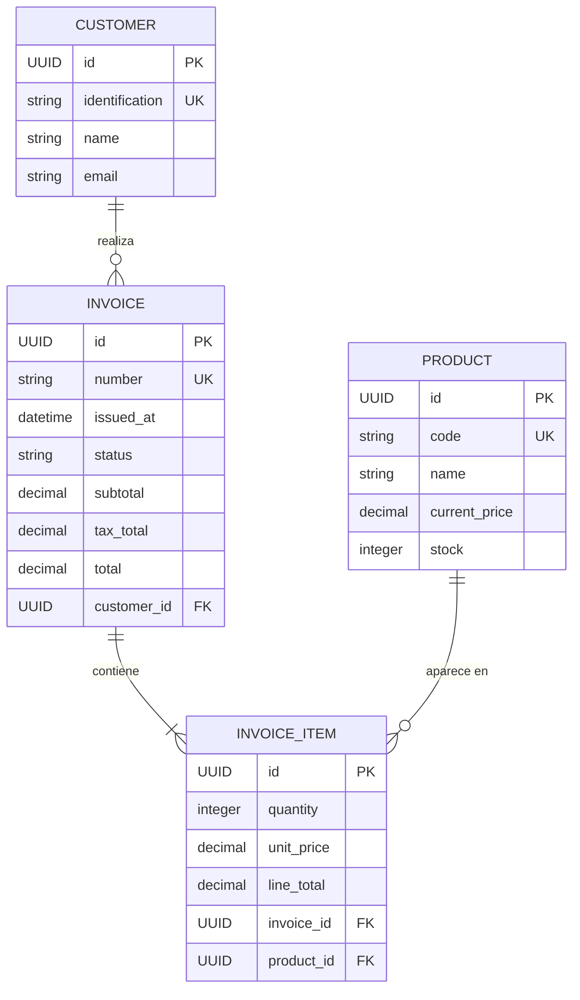

# Tercer corte: CRUD y facturación en Tienda Virtual

## 1. Comprender la arquitectura actual

Una solicitud HTTP atraviesa varias responsabilidades. Mantenerlas separadas reduce el acoplamiento y hace posible probar cada parte de manera independiente.

| Capa | Responsabilidad | Ubicación actual |
|---|---|---|
| Controlador REST | Recibir solicitudes HTTP, extraer parámetros y cuerpo, validar la entrada y construir respuestas HTTP. No debe contener reglas de negocio complejas. | [`controllers`](tiendavirtual/src/main/java/com/example/tiendavirtual/controllers) |
| DTO | Definir los datos que la API acepta o entrega. Evita exponer directamente las entidades de persistencia. | [`dtos`](tiendavirtual/src/main/java/com/example/tiendavirtual/dtos) |
| Mapper | Convertir entre DTO, modelo y entidad. Debe hacer transformaciones explícitas y previsibles. | [`mappers`](tiendavirtual/src/main/java/com/example/tiendavirtual/mappers) |
| Servicio | Coordinar el caso de uso y aplicar reglas del negocio, como existencia, coherencia, stock y transacciones. | [`services`](tiendavirtual/src/main/java/com/example/tiendavirtual/services) |
| Repositorio de aplicación | Expresar las operaciones de persistencia que necesita el servicio, sin exponer detalles innecesarios de JPA. | [`repositories/impl`](tiendavirtual/src/main/java/com/example/tiendavirtual/repositories/impl) y [`repositories/interf`](tiendavirtual/src/main/java/com/example/tiendavirtual/repositories/interf) |
| Repositorio Spring Data JPA | Ejecutar operaciones CRUD y consultas sobre la base de datos. | Interfaces `*JpaRepository` del proyecto |
| Entidad JPA | Representar una tabla y sus relaciones en la base de datos. | [`entitites`](tiendavirtual/src/main/java/com/example/tiendavirtual/entitites) |
| Modelo de dominio | Representar los datos usados por la lógica de la aplicación sin depender de anotaciones JPA. | [`models`](tiendavirtual/src/main/java/com/example/tiendavirtual/models) |

El recorrido esperado es:

1. El controlador recibe el request y obtiene los datos de la ruta o el cuerpo.
2. El DTO limita y valida la forma de entrada.
3. El mapper convierte el DTO a un modelo, si la aplicación mantiene ese modelo separado.
4. El servicio verifica reglas y coordina el caso de uso.
5. El repositorio consulta o modifica la persistencia.
6. El resultado vuelve por las capas, se transforma al DTO de respuesta y se traduce a un estado HTTP.

En este repositorio, los controladores llaman a interfaces de servicio; los servicios convierten modelos y entidades mediante mappers; y los repositorios de aplicación delegan en interfaces `JpaRepository`. Para las operaciones nuevas, se debe conservar el mismo flujo y evitar que el controlador manipule directamente entidades o repositorios JPA.

## 2. Qué significa CRUD y qué existe hoy

CRUD representa las cuatro operaciones básicas de persistencia:

| Operación | Significado | HTTP habitual |
|---|---|---|
| Create | Crear un recurso nuevo. | `POST` |
| Read | Consultar uno o varios recursos. | `GET` |
| Update | Modificar un recurso existente. | `PUT` o `PATCH` |
| Delete | Eliminar o desactivar un recurso. | `DELETE` |

En [`CustomerController`](tiendavirtual/src/main/java/com/example/tiendavirtual/controllers/CustomerController.java) y [`ProductController`](tiendavirtual/src/main/java/com/example/tiendavirtual/controllers/ProductController.java) están implementados `GET` de colección, `GET` de búsqueda y `POST`. Los servicios y repositorios de aplicación también solo declaran consulta y creación. Los identificadores funcionales para las búsquedas actuales son `identification` para Customer y `code` para Product; las entidades además tienen un UUID interno.

### Observaciones que condicionan la siguiente etapa

- Los DTO de respuesta no contienen todos los datos de identidad: `CustomerResponseDto` omite email y UUID, y `ProductResponseDto` omite code y UUID. Una respuesta de recurso normalmente debe incluir un identificador estable para que el cliente pueda volver a consultarlo o referenciarlo.
- Las búsquedas extraen el `Optional` con `.get()` en los repositorios de aplicación. Si el registro no existe, la API no tiene una respuesta 404 explícita definida en el código actual.
- Los DTO no declaran restricciones de validación y los controladores no usan `@Valid`, aunque el proyecto incluye la dependencia de Validation.
- Product guarda el precio en `Double`. Para dinero y cálculos de factura se debe usar `BigDecimal` en el dominio y un tipo decimal adecuado en la base de datos.
- No se observan restricciones de unicidad para la identificación del cliente ni para el código del producto. Las reglas importantes deben protegerse en más de una capa, incluyendo la base de datos.
- La única prueba actual es `contextLoads()`. No verifica el comportamiento del CRUD ni las reglas de negocio.

Estas observaciones son oportunidades de aprendizaje: antes de ampliar un CRUD, conviene definir qué identifica un recurso, cómo se informa que no existe y qué datos son válidos.

## 3. Diseño REST de update y delete

### 3.1 Identificadores y recursos

Una URL representa un recurso o una colección. Para una API uniforme se recomienda elegir una convención de nombres y conservarla en todos los recursos. Por ejemplo:

| Acción propuesta | Customer | Product |
|---|---|---|
| Listar | `GET /api/customers` | `GET /api/products` |
| Consultar uno | `GET /api/customers/{id}` | `GET /api/products/{id}` |
| Crear | `POST /api/customers` | `POST /api/products` |
| Reemplazar | `PUT /api/customers/{id}` | `PUT /api/products/{id}` |
| Actualizar parcialmente | `PATCH /api/customers/{id}` | `PATCH /api/products/{id}` |
| Eliminar | `DELETE /api/customers/{id}` | `DELETE /api/products/{id}` |

El proyecto usa rutas singulares (`/api/customer` y `/api/product`) y búsquedas por atributos funcionales. Se puede mantener esa convención para no romper consumidores, o migrar a rutas plurales e ID UUID; lo importante en un ejercicio es documentar la decisión y usarla consistentemente. Si se usa un código o una identificación como clave de ruta, hay que decidir si ese dato se puede modificar: cambiarlo puede dificultar localizar el recurso después.

### 3.2 PUT frente a PATCH

- **PUT** expresa el reemplazo del estado editable del recurso. En un diseño simple, el cliente envía todos los campos que puede modificar. Si omite un campo, la API debe definir si se considera ausente, nulo o un valor inválido; no se debe dejar el comportamiento accidental.
- **PATCH** expresa una modificación parcial. Solo los campos presentes cambian; los campos omitidos permanecen iguales. Distinguir “no enviado” de “enviado como null” requiere un formato y una estrategia explícitos.
- Ambos deben identificar el recurso en la ruta y actualizar únicamente el registro que existe. Un update no debe crear silenciosamente otro registro.
- No se debe permitir cambiar desde el request campos controlados por el sistema, como UUID, fecha de creación o totales calculados. La lista de campos editables debe estar en el DTO de actualización.

Para enseñar primero el flujo, suele ser más claro implementar `PUT` con un DTO de actualización completo. `PATCH` puede abordarse después, cuando se explique la semántica de campos opcionales.

### 3.3 Flujo conceptual de actualización

1. Recibir el identificador de ruta y el DTO de actualización.
2. Validar formato y restricciones de entrada.
3. Buscar la entidad existente. Si no está, detener el caso de uso con un resultado “no encontrado”.
4. Aplicar únicamente campos permitidos, preservando el ID y cualquier atributo que no se pueda modificar.
5. Guardar la entidad existente y convertir el resultado a un DTO de respuesta.
6. Responder con `200 OK` y el recurso actualizado, o con `204 No Content` si se decide no devolver cuerpo.

Spring Data JPA expone operaciones de persistencia como `findById`, `save` y `delete`; el servicio debe decidir cuándo se usan y qué reglas deben cumplirse. `save` puede insertar o actualizar según la identidad de la entidad, por lo que la búsqueda previa y el mapeo sobre la entidad existente son esenciales para evitar inserciones accidentales o pérdida de campos.

### 3.4 Flujo conceptual de eliminación

1. Buscar el recurso y comprobar sus dependencias.
2. Si no existe, responder `404 Not Found`.
3. Si existe y su eliminación está permitida, eliminarlo o desactivarlo según la política del negocio.
4. Responder `204 No Content` si la operación tuvo éxito y no se devuelve cuerpo.

Se debe definir una política explícita para cada tipo de recurso:

- **Borrado físico:** la fila desaparece de la base de datos. Es sencillo, pero puede destruir información necesaria para auditoría o historial.
- **Borrado lógico:** se conserva la fila y se marca como inactiva, por ejemplo con un estado o una fecha de baja. Conserva trazabilidad, pero todas las consultas deben filtrar correctamente los registros inactivos.
- **Restricción por referencias:** no permitir borrar un cliente con facturas ni un producto ya facturado. Es adecuado cuando se debe conservar la integridad histórica.

Cuando exista facturación, no se debe elegir una cascada de borrado sin analizar su efecto. Borrar en cascada un cliente o producto podría eliminar facturas o detalles que deben conservarse. Para un sistema académico con historial, es preferible impedir el borrado físico de registros referenciados o enseñar una baja lógica; las facturas históricas deben permanecer consultables.

## 4. Responsabilidades a completar por capa

Para cada recurso, las operaciones nuevas atraviesan la misma arquitectura existente:

1. **DTO:** crear un DTO de actualización separado del de creación si las reglas o los campos editables son distintos. Añadir restricciones declarativas, por ejemplo obligatoriedad, longitud, formato, precio positivo y stock no negativo. La validación del request se activa en el controlador con `@Valid`.
2. **Mapper:** añadir una conversión que aplique el DTO sobre el modelo/entidad existente. Para update, no crear una entidad nueva sin ID y no sobrescribir valores que el cliente no puede modificar.
3. **Interfaz de servicio:** declarar operaciones de actualización y eliminación con parámetros y resultados claros. Las interfaces permiten que el controlador dependa del contrato y no de la implementación concreta.
4. **Servicio:** implementar reglas de existencia, modificaciones permitidas y política de eliminación. Cuando una operación coordina varias escrituras, delimitarla transaccionalmente con `@Transactional`.
5. **Interfaz de repositorio de aplicación:** exponer las operaciones de persistencia requeridas por el servicio con nombres del dominio.
6. **Adaptador de repositorio:** delegar en `JpaRepository`, convirtiendo resultados opcionales y gestionando el acceso a la base de datos.
7. **Controlador:** agregar el mapeo HTTP apropiado, transformar DTO/modelo y devolver el estado correcto.
8. **Manejo de errores:** convertir errores de forma consistente a HTTP mediante excepciones de dominio y un manejador global, por ejemplo con `@RestControllerAdvice`.
9. **Pruebas:** cubrir el comportamiento desde servicio y API, incluyendo escenarios válidos e inválidos.

El servicio es el lugar principal de las reglas del caso de uso. La validación de formato del request puede ocurrir en el borde de la API; las restricciones de integridad también deben reflejarse en la base de datos para protegerse frente a otros clientes o procesos.

## 5. Validación, errores y estados HTTP

Validar no significa confiar únicamente en que el formulario del cliente envíe datos correctos. La API debe validar todo request.

Ejemplos de reglas iniciales:

- Customer: nombre e identificación obligatorios, email con formato válido y longitudes razonables. Identificación única si la regla del negocio lo exige.
- Product: código y nombre obligatorios, código único, precio mayor o igual a cero (o estrictamente mayor que cero si así se define), stock entero no negativo.
- Update: verificar que el recurso exista y que una identificación/código nuevo no esté asignado a otro recurso.
- Factura: customer existente, lista de detalles no vacía, productos existentes, cantidad entera positiva y stock suficiente.

Es útil distinguir **validación sintáctica** (el dato tiene formato permitido) de **validación semántica** (el dato tiene sentido dentro del negocio). Por ejemplo, que una cantidad sea un entero positivo es sintáctico; que exista stock suficiente es semántico y depende del estado actual de la base de datos.

| Situación | Estado HTTP usual |
|---|---|
| Creación exitosa | `201 Created` (idealmente con `Location` y representación) |
| Consulta o actualización exitosa con representación | `200 OK` |
| Eliminación exitosa sin cuerpo | `204 No Content` |
| Request inválido o violación de validación | `400 Bad Request` |
| No autenticado (si se implementa seguridad) | `401 Unauthorized` |
| Sin permiso | `403 Forbidden` |
| Recurso inexistente | `404 Not Found` |
| Conflicto, como código duplicado o transición no permitida | `409 Conflict` |
| Error inesperado del servidor | `500 Internal Server Error` |

Los mensajes de error deben ser comprensibles y no filtrar trazas internas, consultas SQL ni secretos. Una respuesta de error uniforme puede incluir código, mensaje, instante y detalles de validación.

## 6. Diseño del dominio de facturación

### 6.1 Por qué se necesita una entidad de detalle

Una factura pertenece a un cliente y contiene uno o más productos. La relación conceptual entre Invoice y Product es muchos-a-muchos: una factura puede incluir muchos productos y un producto puede aparecer en muchas facturas. Sin embargo, esa relación tiene datos propios: cantidad, precio de venta en ese momento, descuento o impuesto. Por eso no se modela correctamente como una relación muchos-a-muchos simple.

Se introduce una entidad asociativa **InvoiceItem** (detalle o línea de factura):



Lectura de las cardinalidades:

- Un Customer puede tener cero o muchas Invoice; cada Invoice pertenece a exactamente un Customer.
- Una Invoice válida contiene una o muchas InvoiceItem; cada detalle pertenece a exactamente una factura.
- Un Product puede aparecer en cero o muchas InvoiceItem; cada detalle referencia exactamente un producto.

En JPA, esto suele expresarse con `@ManyToOne` desde Invoice hacia Customer y desde InvoiceItem hacia Invoice y Product; opcionalmente se agrega `@OneToMany` desde Customer o Invoice hacia sus hijos. El lado `@ManyToOne` normalmente contiene la clave foránea. La relación inversa `@OneToMany` es opcional desde la perspectiva de persistencia: se debe agregar solo si simplifica el dominio y se controla la serialización para evitar ciclos JSON y cargas innecesarias.

### 6.2 Entidades y atributos recomendados

**Invoice** puede contener:

- Identificador interno UUID.
- Número de factura único y legible, si el ejercicio lo requiere.
- Cliente propietario.
- Fecha y hora de emisión.
- Estado del documento (por ejemplo, borrador, emitida, anulada), si el negocio contempla un ciclo de vida.
- Subtotal, impuestos, descuentos y total, según el alcance académico y las reglas locales.
- Uno o más detalles.

**InvoiceItem** puede contener:

- Identificador.
- Factura asociada y producto asociado.
- Cantidad.
- Precio unitario capturado en el momento de la venta.
- Descuento/impuesto de línea si se incluyen en el alcance.
- Subtotal o total de línea calculado.

**Product** conserva su precio actual y su stock actual. **InvoiceItem.unitPrice** conserva el precio histórico aplicado en esa venta. No se debe reconstruir una factura antigua consultando únicamente el precio actual del catálogo: ese precio puede cambiar después.

### 6.3 Normalización frente a conservación histórica

La factura necesita una referencia al producto para conocer su identidad, pero también una copia de ciertos atributos que deben permanecer como fueron vendidos. El detalle conserva al menos el precio unitario histórico y puede conservar una descripción o nombre del producto al emitir la factura. De esta forma:

- Product mantiene el dato comercial vigente para futuras ventas.
- InvoiceItem mantiene los datos usados para calcular esa venta pasada.
- Modificar el catálogo no altera el importe de facturas históricas.

Este patrón no es una duplicación accidental: es una decisión de diseño para preservar evidencia del evento de venta.

## 7. Reglas de cálculo y tipos monetarios

Los importes no deben representarse con `float` o `double`, porque su representación binaria puede introducir errores de redondeo. En Java se recomienda `BigDecimal`, construido desde una cadena decimal o desde datos decimales bien controlados, con escala y regla de redondeo definidas.

Sin descuentos ni impuestos, las reglas básicas son:

$$
L_i = q_i \cdot p_i
$$

$$
T = \sum_{i=1}^{n} L_i
$$

Si se modelan impuestos y descuentos, deben definirse claramente la base de cálculo, la tasa, el orden de aplicación, la precisión intermedia y el momento del redondeo. No se deben inventar esas reglas en la capa del controlador. El cálculo pertenece al dominio o al servicio de facturación, en una política explícita y probada.

Ejemplo conceptual: si una línea contiene tres unidades a un precio histórico de 12,50, su importe antes de impuestos y descuentos es 37,50. El total se obtiene sumando todas las líneas aplicables, usando `BigDecimal` y la política monetaria definida para la moneda.

También se deben validar límites: cantidad positiva, precio no negativo, resultado dentro de la precisión permitida por la columna decimal y moneda definida. El subtotal y total se pueden guardar como fotografía del documento emitido, aunque puedan recalcularse desde las líneas; guardar ambos exige mantenerlos consistentes mediante el mismo caso de uso.

## 8. Caso de uso: crear una factura con varios productos

Una API puede recibir una solicitud similar a esta (estructura ilustrativa):

```json
{
  "customerId": "uuid-del-cliente",
  "items": [
	{ "productId": "uuid-del-producto-a", "quantity": 2 },
	{ "productId": "uuid-del-producto-b", "quantity": 1 }
  ]
}
```

El request no debería aceptar como confiables `unitPrice`, subtotal o total enviados por el cliente. El servidor obtiene los precios del catálogo, valida disponibilidad y calcula los valores. La factura debe guardar la instantánea del precio aplicada.

Flujo recomendado del servicio de aplicación:

1. Validar que el request tenga cliente y una lista de detalles no vacía.
2. Buscar el cliente. Si no existe, rechazar la operación sin guardar nada.
3. Validar que cada cantidad sea positiva y consolidar líneas repetidas del mismo producto o rechazarlas con una regla documentada.
4. Buscar todos los productos. Si falta alguno, rechazar toda la operación.
5. Comprobar que los precios sean válidos y que exista stock suficiente para todas las cantidades. Si dos líneas apuntan al mismo producto, validar la suma total requerida.
6. Crear la factura y cada detalle; copiar a cada detalle el precio unitario vigente en el momento de la compra.
7. Calcular subtotales y total con `BigDecimal` y la regla de redondeo definida.
8. Descontar el stock de los productos involucrados, si el modelo de negocio descuenta stock al facturar.
9. Persistir todos los cambios como una sola unidad de trabajo.
10. Responder `201 Created` con el DTO de factura emitida y sus detalles.

La anotación `@Transactional` en el servicio expresa que todas las escrituras pertenecen a una transacción: si falla una parte, la base de datos debe revertir la factura, los detalles y las modificaciones de stock para no dejar un estado parcial. Una transacción protege la atomicidad, pero no resuelve por sí sola todas las carreras concurrentes.

### Concurrencia de inventario

Dos solicitudes simultáneas podrían leer el mismo stock disponible y vender las mismas unidades. Para un primer ejercicio se puede identificar el riesgo; después se puede enseñar control de concurrencia optimista mediante `@Version`, bloqueo pesimista en la consulta o una actualización condicional de stock. La estrategia debe impedir que el stock quede negativo y producir un conflicto claro cuando otra transacción consumió las unidades primero.

### Cancelación, anulación y borrado de factura

Una factura emitida es un documento histórico. No se recomienda borrarla físicamente como si fuera un registro temporal. Si el alcance incluye cancelaciones, se debe modelar una transición de estado y definir cómo se revierten los movimientos de inventario y los efectos contables, dejando trazabilidad. Esa lógica requiere reglas propias y no debe implementarse como un `DELETE` genérico.

## 9. API sugerida para facturación

Una posible interfaz inicial es:

| Acción | Ruta propuesta | Resultado |
|---|---|---|
| Crear factura | `POST /api/invoices` | `201 Created` con número, fecha, cliente, líneas y total |
| Consultar factura | `GET /api/invoices/{id}` | `200 OK` o `404 Not Found` |
| Listar facturas de cliente | `GET /api/customers/{id}/invoices` | `200 OK` con lista paginada o acotada |

La API debe exponer DTO de request y response propios. El request contiene identificadores y cantidades; la respuesta puede incluir identidad del cliente, número y fecha, detalles con producto, descripción histórica, cantidad, precio unitario, total de línea y total general. No se deben devolver entidades JPA directamente: además de acoplar la API al esquema de persistencia, las relaciones bidireccionales pueden provocar ciclos de serialización o consultas inesperadas.

La paginación y el ordenamiento son recomendables para colecciones que pueden crecer. No es necesario cargar todos los productos o todas las facturas de una tienda en memoria para una sola respuesta.

## 10. Integridad referencial y eliminación de Customer/Product

Cuando se agregue facturación, la base de datos tendrá claves foráneas. Esto obliga a definir la política de borrado:

- Un cliente con facturas históricas normalmente no se elimina físicamente; puede desactivarse.
- Un producto que aparece en detalles históricos normalmente se conserva, puede marcarse inactivo y dejar de ofrecerse para nuevas ventas.
- Una factura no debe perder sus detalles porque se eliminó un registro del catálogo.
- Las restricciones `NOT NULL`, `UNIQUE`, `CHECK` y las claves foráneas deben reflejar reglas esenciales del dominio.
- La estrategia de cascada debe ser deliberada. Cascada entre Invoice e InvoiceItem puede ser razonable para borradores bajo una política definida; no significa que se deba borrar una factura emitida ni otros datos históricos.

La validación de servicio produce mensajes de negocio claros; la restricción de base de datos mantiene la integridad aun cuando una solicitud o proceso alterno intente saltarse la aplicación.

## 11. Pruebas que deberían acompañar la implementación

Una buena prueba verifica el comportamiento observable, no solo que el contexto de Spring arranque.

### CRUD de Customer y Product

- Crear un recurso válido y comprobar los datos devueltos.
- Actualizar un registro existente y comprobar que el mismo ID se conserva.
- Intentar actualizar un registro inexistente y verificar 404.
- Comprobar que update no crea un registro nuevo cuando el ID no existe.
- Eliminar un recurso existente y comprobar que ya no se consulta, o que queda inactivo si se eligió baja lógica.
- Eliminar un identificador inexistente y verificar el comportamiento documentado.
- Rechazar datos inválidos y claves funcionales duplicadas.
- Confirmar qué sucede al intentar borrar un customer/product usado por facturas.

### Facturación

- Crear una factura con un producto y con varios productos.
- Rechazar lista vacía, cantidad cero/negativa, cliente inexistente y producto inexistente.
- Rechazar stock insuficiente y comprobar que no queda factura parcial ni descuento parcial de stock.
- Verificar cálculo de líneas y total con precios decimales.
- Cambiar posteriormente el precio del producto y comprobar que la factura histórica conserva su precio unitario original.
- Probar productos repetidos en varias líneas según la política escogida.
- Probar dos compras concurrentes si se incorpora control de concurrencia.

## 12. Implementación educativa del CRUD de facturación

Esta sección convierte el diseño anterior en código organizado con las capas usadas por `tiendavirtual`: DTO, mapper, modelo, servicio, repositorio de aplicación, repositorio Spring Data, entidad y controlador. El código usa los paquetes `com.example.tiendavirtual` y la ruta singular `/api/invoice`, consistente con el controlador actual de Customer.

### 12.1 Alcance y decisiones del ejemplo

- Una factura contiene un cliente y una o más líneas. Cada línea guarda la cantidad, el precio unitario y el nombre/código del producto como fotografía histórica.
- El cliente solo envía `customerId`, `productId` y `quantity`. El servidor consulta el precio y el stock; ignora cualquier total que el cliente pudiera intentar enviar.
- Al crear una factura se descuenta stock. Al actualizar se devuelve el stock de las líneas anteriores y se descuenta el de las nuevas. Al eliminar se restaura el stock.
- Para mantener el ejemplo pequeño, el precio actual de `ProductEntity` sigue siendo `Double`. Se convierte a `BigDecimal` en el momento de facturar. En una aplicación real también se debe migrar el precio del producto a `BigDecimal`.
- El cálculo no aplica el campo `tax` que existe en `ProductEntity`: antes de cobrar impuestos se debe definir si representa una tasa o un importe, su base y la política de redondeo.
- El CRUD físico de factura sirve para el ejercicio. En producción, una factura emitida debe conservarse: se permitiría modificar/eliminar solo borradores y se modelaría la anulación como un cambio de estado con auditoría.
- La transacción hace atómicas las operaciones de factura y stock, pero no evita por sí sola ventas concurrentes. Para eso se requiere después bloqueo o control optimista.

La dependencia de Validation ya está en el `pom.xml` del proyecto; por tanto, no es necesario agregar otra dependencia para las anotaciones `@NotNull`, `@Positive`, `@Valid` y `@NotEmpty`.

### 12.2 Entidades JPA

Crear `InvoiceEntity` en el paquete `entities`. La relación con Customer se guarda como clave foránea. La factura es el lado dueño de sus detalles y usa `orphanRemoval` para que al reemplazar sus líneas no queden detalles huérfanos.

```java
package com.example.tiendavirtual.entities;

import java.math.BigDecimal;
import java.time.LocalDateTime;
import java.util.ArrayList;
import java.util.List;
import java.util.UUID;

import jakarta.persistence.CascadeType;
import jakarta.persistence.Column;
import jakarta.persistence.Entity;
import jakarta.persistence.FetchType;
import jakarta.persistence.GeneratedValue;
import jakarta.persistence.Id;
import jakarta.persistence.JoinColumn;
import jakarta.persistence.ManyToOne;
import jakarta.persistence.OneToMany;
import jakarta.persistence.Table;
import lombok.Getter;
import lombok.Setter;

@Entity
@Table(name = "invoices")
@Getter
@Setter
public class InvoiceEntity {
	@Id
	@GeneratedValue
	private UUID id;

	@Column(nullable = false, unique = true)
	private String number;

	@Column(nullable = false)
	private LocalDateTime issuedAt;

	@Column(nullable = false, precision = 12, scale = 2)
	private BigDecimal total;

	@ManyToOne(fetch = FetchType.LAZY, optional = false)
	@JoinColumn(name = "customer_id", nullable = false)
	private CustomerEntity customer;

	@OneToMany(mappedBy = "invoice", cascade = CascadeType.ALL, orphanRemoval = true)
	private List<InvoiceItemEntity> items = new ArrayList<>();
}
```

Crear `InvoiceItemEntity`, que es la entidad asociativa entre factura y producto. `productName` y `productCode` son datos históricos; un cambio posterior del catálogo no altera la representación de una factura antigua.

```java
package com.example.tiendavirtual.entities;

import java.math.BigDecimal;
import java.util.UUID;

import jakarta.persistence.Column;
import jakarta.persistence.Entity;
import jakarta.persistence.FetchType;
import jakarta.persistence.GeneratedValue;
import jakarta.persistence.Id;
import jakarta.persistence.JoinColumn;
import jakarta.persistence.ManyToOne;
import jakarta.persistence.Table;
import lombok.Getter;
import lombok.Setter;

@Entity
@Table(name = "invoice_items")
@Getter
@Setter
public class InvoiceItemEntity {
	@Id
	@GeneratedValue
	private UUID id;

	@ManyToOne(fetch = FetchType.LAZY, optional = false)
	@JoinColumn(name = "invoice_id", nullable = false)
	private InvoiceEntity invoice;

	@ManyToOne(fetch = FetchType.LAZY, optional = false)
	@JoinColumn(name = "product_id", nullable = false)
	private ProductEntity product;

	@Column(nullable = false)
	private String productCode;

	@Column(nullable = false)
	private String productName;

	@Column(nullable = false)
	private Integer quantity;

	@Column(nullable = false, precision = 12, scale = 2)
	private BigDecimal unitPrice;

	@Column(nullable = false, precision = 12, scale = 2)
	private BigDecimal lineTotal;
}
```

`@ManyToOne` mantiene las claves foráneas hacia Customer y Product. La cascada se limita a los detalles de la factura; no se propaga el borrado hacia el cliente ni hacia los productos. `@Column(precision = 12, scale = 2)` reserva dos decimales para importes.

### 12.3 DTO de entrada y salida

El DTO de entrada valida la forma del request. Se usan records de Java para DTOs inmutables y concisos. La anotación `@Valid` en la lista activa también las reglas de cada línea.

```java
package com.example.tiendavirtual.dtos;

import java.util.UUID;

import jakarta.validation.constraints.NotNull;
import jakarta.validation.constraints.Positive;

public record InvoiceItemRequestDto(
	@NotNull UUID productId,
	@NotNull @Positive Integer quantity
) {}
```

```java
package com.example.tiendavirtual.dtos;

import java.util.List;
import java.util.UUID;

import jakarta.validation.Valid;
import jakarta.validation.constraints.NotEmpty;
import jakarta.validation.constraints.NotNull;

public record InvoiceRequestDto(
	@NotNull UUID customerId,
	@NotEmpty List<@Valid InvoiceItemRequestDto> items
) {}
```

El request para crear y actualizar comparte estructura: ambos deben enviar el cliente y la lista completa de líneas. El cuerpo no incluye número, fecha, precio unitario ni totales porque son datos controlados por el servidor.

```java
package com.example.tiendavirtual.dtos;

import java.math.BigDecimal;
import java.util.UUID;

public record InvoiceItemResponseDto(
	UUID productId,
	String productCode,
	String productName,
	Integer quantity,
	BigDecimal unitPrice,
	BigDecimal lineTotal
) {}
```

```java
package com.example.tiendavirtual.dtos;

import java.math.BigDecimal;
import java.time.LocalDateTime;
import java.util.List;
import java.util.UUID;

public record InvoiceResponseDto(
	UUID id,
	String number,
	LocalDateTime issuedAt,
	UUID customerId,
	BigDecimal total,
	List<InvoiceItemResponseDto> items
) {}
```

El DTO de respuesta incluye identificadores y los valores usados en la venta, pero no expone las entidades JPA ni sus relaciones internas.

### 12.4 Modelo y mapper

Como Customer ya cuenta con un modelo separado, la factura también usa modelos de dominio. El modelo de una línea distingue los identificadores que llegan en la solicitud de la información histórica que se devuelve.

```java
package com.example.tiendavirtual.models;

import java.util.UUID;
import lombok.Data;

@Data
public class InvoiceItem {
	private UUID productId;
	private String productCode;
	private String productName;
	private Integer quantity;
	private java.math.BigDecimal unitPrice;
	private java.math.BigDecimal lineTotal;
}
```

```java
package com.example.tiendavirtual.models;

import java.math.BigDecimal;
import java.time.LocalDateTime;
import java.util.List;
import java.util.UUID;
import lombok.Data;

@Data
public class Invoice {
	private UUID id;
	private String number;
	private LocalDateTime issuedAt;
	private UUID customerId;
	private BigDecimal total;
	private List<InvoiceItem> items;
}
```

El mapper traduce explícitamente request → modelo y entidad → modelo → DTO. La creación de entidades se completa en el servicio porque requiere consultar Customer y Product y verificar el stock; esa regla no debe quedar escondida en una conversión automática.

```java
package com.example.tiendavirtual.mappers;

import java.util.List;

import com.example.tiendavirtual.dtos.InvoiceItemRequestDto;
import com.example.tiendavirtual.dtos.InvoiceItemResponseDto;
import com.example.tiendavirtual.dtos.InvoiceRequestDto;
import com.example.tiendavirtual.dtos.InvoiceResponseDto;
import com.example.tiendavirtual.entities.InvoiceEntity;
import com.example.tiendavirtual.entities.InvoiceItemEntity;
import com.example.tiendavirtual.models.Invoice;
import com.example.tiendavirtual.models.InvoiceItem;

public final class InvoiceMapper {
	private InvoiceMapper() {}

	public static Invoice requestToModel(InvoiceRequestDto dto) {
		Invoice invoice = new Invoice();
		invoice.setCustomerId(dto.customerId());
		List<InvoiceItem> items = dto.items().stream()
			.map(InvoiceMapper::requestItemToModel)
			.toList();
		invoice.setItems(items);
		return invoice;
	}

	private static InvoiceItem requestItemToModel(InvoiceItemRequestDto dto) {
		InvoiceItem item = new InvoiceItem();
		item.setProductId(dto.productId());
		item.setQuantity(dto.quantity());
		return item;
	}

	public static Invoice entityToModel(InvoiceEntity entity) {
		Invoice invoice = new Invoice();
		invoice.setId(entity.getId());
		invoice.setNumber(entity.getNumber());
		invoice.setIssuedAt(entity.getIssuedAt());
		invoice.setCustomerId(entity.getCustomer().getId());
		invoice.setTotal(entity.getTotal());

		List<InvoiceItem> items = entity.getItems().stream().map(entityItem -> {
			InvoiceItem item = new InvoiceItem();
			item.setProductId(entityItem.getProduct().getId());
			item.setProductCode(entityItem.getProductCode());
			item.setProductName(entityItem.getProductName());
			item.setQuantity(entityItem.getQuantity());
			item.setUnitPrice(entityItem.getUnitPrice());
			item.setLineTotal(entityItem.getLineTotal());
			return item;
		}).toList();
		invoice.setItems(items);
		return invoice;
	}

	public static InvoiceResponseDto modelToResponseDto(Invoice invoice) {
		List<InvoiceItemResponseDto> items = invoice.getItems().stream()
			.map(item -> new InvoiceItemResponseDto(
				item.getProductId(), item.getProductCode(), item.getProductName(),
				item.getQuantity(), item.getUnitPrice(), item.getLineTotal()))
			.toList();

		return new InvoiceResponseDto(
			invoice.getId(), invoice.getNumber(), invoice.getIssuedAt(),
			invoice.getCustomerId(), invoice.getTotal(), items);
	}
}
```

En las entidades se usan `@Getter` y `@Setter` en vez de `@Data`: al existir una relación bidireccional, los `toString`, `equals` y `hashCode` generados por `@Data` podrían recorrer factura → detalles → factura indefinidamente.

### 12.5 Repositorios

El repositorio Spring Data se limita a la persistencia JPA:

```java
package com.example.tiendavirtual.repositories;

import java.util.UUID;
import org.springframework.data.jpa.repository.JpaRepository;
import com.example.tiendavirtual.entities.InvoiceEntity;

public interface IInvoiceJpaRepository extends JpaRepository<InvoiceEntity, UUID> {}
```

El repositorio de aplicación ofrece operaciones del caso de uso y conserva la separación que ya utiliza `CustomerRepository`:

```java
package com.example.tiendavirtual.repositories;

import java.util.List;
import java.util.Optional;
import java.util.UUID;

import org.springframework.stereotype.Repository;
import com.example.tiendavirtual.entities.InvoiceEntity;

@Repository
public class InvoiceRepository {
	private final IInvoiceJpaRepository repository;

	public InvoiceRepository(IInvoiceJpaRepository repository) {
		this.repository = repository;
	}

	public List<InvoiceEntity> findAll() {
		return repository.findAll();
	}

	public Optional<InvoiceEntity> findById(UUID id) {
		return repository.findById(id);
	}

	public InvoiceEntity save(InvoiceEntity invoice) {
		return repository.save(invoice);
	}

	public void delete(InvoiceEntity invoice) {
		repository.delete(invoice);
	}
}
```

Para buscar los productos se necesita completar la capa que aún no existe en el proyecto. Crear `IProductJpaRepository`:

```java
package com.example.tiendavirtual.repositories;

import java.util.UUID;
import org.springframework.data.jpa.repository.JpaRepository;
import com.example.tiendavirtual.entities.ProductEntity;

public interface IProductJpaRepository extends JpaRepository<ProductEntity, UUID> {}
```

Y crear el repositorio de aplicación para Product:

```java
package com.example.tiendavirtual.repositories;

import java.util.UUID;

import org.springframework.stereotype.Repository;
import com.example.tiendavirtual.entities.ProductEntity;
import com.example.tiendavirtual.exceptions.ResourceNotFoundException;

@Repository
public class ProductRepository {
	private final IProductJpaRepository repository;

	public ProductRepository(IProductJpaRepository repository) {
		this.repository = repository;
	}

	public ProductEntity getById(UUID id) {
		return repository.findById(id)
			.orElseThrow(() -> new ResourceNotFoundException("Producto no encontrado: " + id));
	}

	public ProductEntity update(ProductEntity product) {
		return repository.save(product);
	}
}
```

Para que las búsquedas de cliente también produzcan un error de dominio claro, ajustar `CustomerRepository.getById` para reemplazar el `.get()` actual:

```java
public CustomerEntity getById(UUID id) {
	return repository.findById(id)
		.orElseThrow(() -> new ResourceNotFoundException("Cliente no encontrado: " + id));
}
```

`ResourceNotFoundException` y `BusinessConflictException` son excepciones pequeñas del dominio. Crear ambas en un paquete nuevo llamado `exceptions`:

```java
package com.example.tiendavirtual.exceptions;

public class ResourceNotFoundException extends RuntimeException {
	public ResourceNotFoundException(String message) {
		super(message);
	}
}
```

```java
package com.example.tiendavirtual.exceptions;

public class BusinessConflictException extends RuntimeException {
	public BusinessConflictException(String message) {
		super(message);
	}
}
```

En `CustomerRepository` también se debe importar `com.example.tiendavirtual.exceptions.ResourceNotFoundException` para el método `getById` mostrado arriba.

### 12.6 Servicio: reglas, cálculo y transacción

El servicio concentra el caso de uso. `@Transactional` hace que guardar la factura, sus detalles y el cambio de stock se confirmen o reviertan juntos. Se rechazan productos repetidos en el mismo request para evitar ambigüedad al validar el stock.

```java
package com.example.tiendavirtual.services;

import java.math.BigDecimal;
import java.math.RoundingMode;
import java.time.LocalDateTime;
import java.util.ArrayList;
import java.util.HashSet;
import java.util.List;
import java.util.Set;
import java.util.UUID;

import org.springframework.stereotype.Service;
import org.springframework.transaction.annotation.Transactional;

import com.example.tiendavirtual.entities.CustomerEntity;
import com.example.tiendavirtual.entities.InvoiceEntity;
import com.example.tiendavirtual.entities.InvoiceItemEntity;
import com.example.tiendavirtual.entities.ProductEntity;
import com.example.tiendavirtual.exceptions.BusinessConflictException;
import com.example.tiendavirtual.exceptions.ResourceNotFoundException;
import com.example.tiendavirtual.mappers.InvoiceMapper;
import com.example.tiendavirtual.models.Invoice;
import com.example.tiendavirtual.models.InvoiceItem;
import com.example.tiendavirtual.repositories.CustomerRepository;
import com.example.tiendavirtual.repositories.InvoiceRepository;
import com.example.tiendavirtual.repositories.ProductRepository;

@Service
public class InvoiceService {
	private final InvoiceRepository invoiceRepository;
	private final CustomerRepository customerRepository;
	private final ProductRepository productRepository;

	public InvoiceService(
		InvoiceRepository invoiceRepository,
		CustomerRepository customerRepository,
		ProductRepository productRepository
	) {
		this.invoiceRepository = invoiceRepository;
		this.customerRepository = customerRepository;
		this.productRepository = productRepository;
	}

	@Transactional(readOnly = true)
	public List<Invoice> getAll() {
		return invoiceRepository.findAll().stream()
			.map(InvoiceMapper::entityToModel)
			.toList();
	}

	@Transactional(readOnly = true)
	public Invoice getById(UUID id) {
		InvoiceEntity entity = invoiceRepository.findById(id)
			.orElseThrow(() -> new ResourceNotFoundException("Factura no encontrada: " + id));
		return InvoiceMapper.entityToModel(entity);
	}

	@Transactional
	public Invoice create(Invoice invoice) {
		CustomerEntity customer = customerRepository.getById(invoice.getCustomerId());

		InvoiceEntity entity = new InvoiceEntity();
		entity.setNumber("FAC-" + UUID.randomUUID());
		entity.setIssuedAt(LocalDateTime.now());
		entity.setCustomer(customer);
		entity.setItems(new ArrayList<>());
		buildItemsAndReduceStock(entity, invoice.getItems());

		return InvoiceMapper.entityToModel(invoiceRepository.save(entity));
	}

	@Transactional
	public Invoice update(UUID id, Invoice invoice) {
		InvoiceEntity entity = invoiceRepository.findById(id)
			.orElseThrow(() -> new ResourceNotFoundException("Factura no encontrada: " + id));

		// Al reemplazar las líneas, primero se revierte el movimiento anterior.
		restoreStock(entity);
		entity.setCustomer(customerRepository.getById(invoice.getCustomerId()));
		entity.getItems().clear();
		buildItemsAndReduceStock(entity, invoice.getItems());

		// Se conservan el UUID, número y fecha originales.
		return InvoiceMapper.entityToModel(invoiceRepository.save(entity));
	}

	@Transactional
	public void delete(UUID id) {
		InvoiceEntity entity = invoiceRepository.findById(id)
			.orElseThrow(() -> new ResourceNotFoundException("Factura no encontrada: " + id));
		restoreStock(entity);
		invoiceRepository.delete(entity);
	}

	private void buildItemsAndReduceStock(InvoiceEntity invoice, List<InvoiceItem> requestedItems) {
		if (requestedItems == null || requestedItems.isEmpty()) {
			throw new IllegalArgumentException("La factura debe tener al menos un detalle");
		}

		Set<UUID> productIds = new HashSet<>();
		BigDecimal total = BigDecimal.ZERO;

		for (InvoiceItem requestedItem : requestedItems) {
			if (requestedItem.getProductId() == null
				|| requestedItem.getQuantity() == null
				|| requestedItem.getQuantity() <= 0) {
				throw new IllegalArgumentException("Producto y cantidad positiva son obligatorios");
			}
			if (!productIds.add(requestedItem.getProductId())) {
				throw new IllegalArgumentException("No se permiten productos repetidos en la factura");
			}

			ProductEntity product = productRepository.getById(requestedItem.getProductId());
			if (product.getPrice() == null || product.getPrice() < 0 || product.getStock() == null) {
				throw new IllegalArgumentException("El producto tiene precio o stock inválido");
			}
			if (product.getStock() < requestedItem.getQuantity()) {
				throw new BusinessConflictException("Stock insuficiente para el producto " + product.getCode());
			}

			BigDecimal unitPrice = BigDecimal.valueOf(product.getPrice())
				.setScale(2, RoundingMode.HALF_UP);
			BigDecimal lineTotal = unitPrice
				.multiply(BigDecimal.valueOf(requestedItem.getQuantity()))
				.setScale(2, RoundingMode.HALF_UP);

			InvoiceItemEntity item = new InvoiceItemEntity();
			item.setInvoice(invoice);
			item.setProduct(product);
			item.setProductCode(product.getCode());
			item.setProductName(product.getName());
			item.setQuantity(requestedItem.getQuantity());
			item.setUnitPrice(unitPrice);
			item.setLineTotal(lineTotal);
			invoice.getItems().add(item);

			product.setStock(product.getStock() - requestedItem.getQuantity());
			productRepository.update(product);
			total = total.add(lineTotal);
		}

		invoice.setTotal(total.setScale(2, RoundingMode.HALF_UP));
	}

	private void restoreStock(InvoiceEntity invoice) {
		for (InvoiceItemEntity item : invoice.getItems()) {
			ProductEntity product = productRepository.getById(item.getProduct().getId());
			if (product.getStock() == null) {
				throw new IllegalArgumentException("El stock del producto no puede ser nulo");
			}
			product.setStock(product.getStock() + item.getQuantity());
			productRepository.update(product);
		}
	}
}
```

Aspectos importantes del servicio:

- `create` y `update` consultan los registros relacionados antes de persistir; un UUID inválido no crea una factura incompleta.
- `buildItemsAndReduceStock` calcula cada línea con `BigDecimal`, toma el precio del catálogo y guarda la fotografía del producto. El cliente no controla los importes.
- Si una línea falla después de haber procesado otra, la excepción de ejecución hace rollback de la transacción y no deja un descuento parcial.
- `update` mantiene el identificador, número y fecha de la factura; reemplaza cliente/detalles y ajusta el stock según las líneas nuevas.
- `update` usa los precios vigentes al momento de actualizar. Por eso este ejemplo solo es apropiado para facturas editables/borradores, no para documentos históricos emitidos.
- `delete` es borrado físico de este ejemplo y restaura el inventario. En un flujo real de documentos emitidos se sustituiría por una anulación auditable.

### 12.7 Controlador REST

El controlador conserva la responsabilidad que se ve en `CustomerController`: recibe DTO, solicita la operación al servicio, convierte la respuesta y elige el estado HTTP. No consulta repositorios ni calcula precios.

```java
package com.example.tiendavirtual.controllers;

import java.net.URI;
import java.util.List;
import java.util.UUID;

import jakarta.validation.Valid;
import org.springframework.http.ResponseEntity;
import org.springframework.web.bind.annotation.DeleteMapping;
import org.springframework.web.bind.annotation.GetMapping;
import org.springframework.web.bind.annotation.PathVariable;
import org.springframework.web.bind.annotation.PostMapping;
import org.springframework.web.bind.annotation.PutMapping;
import org.springframework.web.bind.annotation.RequestBody;
import org.springframework.web.bind.annotation.RequestMapping;
import org.springframework.web.bind.annotation.RestController;

import com.example.tiendavirtual.dtos.InvoiceRequestDto;
import com.example.tiendavirtual.dtos.InvoiceResponseDto;
import com.example.tiendavirtual.mappers.InvoiceMapper;
import com.example.tiendavirtual.models.Invoice;
import com.example.tiendavirtual.services.InvoiceService;

@RestController
@RequestMapping("/api/invoice")
public class InvoiceController {
	private final InvoiceService invoiceService;

	public InvoiceController(InvoiceService invoiceService) {
		this.invoiceService = invoiceService;
	}

	@GetMapping
	public ResponseEntity<List<InvoiceResponseDto>> getAll() {
		List<InvoiceResponseDto> response = invoiceService.getAll().stream()
			.map(InvoiceMapper::modelToResponseDto)
			.toList();
		return ResponseEntity.ok(response);
	}

	@GetMapping("/{id}")
	public ResponseEntity<InvoiceResponseDto> getById(@PathVariable UUID id) {
		Invoice invoice = invoiceService.getById(id);
		return ResponseEntity.ok(InvoiceMapper.modelToResponseDto(invoice));
	}

	@PostMapping
	public ResponseEntity<InvoiceResponseDto> create(@Valid @RequestBody InvoiceRequestDto request) {
		Invoice invoice = InvoiceMapper.requestToModel(request);
		Invoice created = invoiceService.create(invoice);
		URI location = URI.create("/api/invoice/" + created.getId());
		return ResponseEntity.created(location)
			.body(InvoiceMapper.modelToResponseDto(created));
	}

	@PutMapping("/{id}")
	public ResponseEntity<InvoiceResponseDto> update(
		@PathVariable UUID id,
		@Valid @RequestBody InvoiceRequestDto request
	) {
		Invoice invoice = InvoiceMapper.requestToModel(request);
		Invoice updated = invoiceService.update(id, invoice);
		return ResponseEntity.ok(InvoiceMapper.modelToResponseDto(updated));
	}

	@DeleteMapping("/{id}")
	public ResponseEntity<Void> delete(@PathVariable UUID id) {
		invoiceService.delete(id);
		return ResponseEntity.noContent().build();
	}
}
```

El API resultante es `GET /api/invoice`, `GET /api/invoice/{id}`, `POST /api/invoice`, `PUT /api/invoice/{id}` y `DELETE /api/invoice/{id}`. El `POST` devuelve `201 Created` y `Location`; el `DELETE` devuelve `204 No Content`.

### 12.8 Traducción de errores a HTTP

Sin un manejador, las excepciones pueden terminar en respuestas poco claras. Este advice convierte errores de existencia en `404`, conflictos de stock en `409` y reglas de entrada de negocio en `400`. Las violaciones de `@Valid` también deben responder `400`.

```java
package com.example.tiendavirtual.controllers;

import java.util.Map;

import org.springframework.http.HttpStatus;
import org.springframework.http.ResponseEntity;
import org.springframework.web.bind.annotation.ExceptionHandler;
import org.springframework.web.bind.annotation.RestControllerAdvice;

import com.example.tiendavirtual.exceptions.BusinessConflictException;
import com.example.tiendavirtual.exceptions.ResourceNotFoundException;

@RestControllerAdvice
public class ApiExceptionHandler {
	@ExceptionHandler(ResourceNotFoundException.class)
	public ResponseEntity<Map<String, String>> handleNotFound(ResourceNotFoundException exception) {
		return ResponseEntity.status(HttpStatus.NOT_FOUND)
			.body(Map.of("message", exception.getMessage()));
	}

	@ExceptionHandler(BusinessConflictException.class)
	public ResponseEntity<Map<String, String>> handleConflict(BusinessConflictException exception) {
		return ResponseEntity.status(HttpStatus.CONFLICT)
			.body(Map.of("message", exception.getMessage()));
	}

	@ExceptionHandler(IllegalArgumentException.class)
	public ResponseEntity<Map<String, String>> handleBadRequest(IllegalArgumentException exception) {
		return ResponseEntity.badRequest()
			.body(Map.of("message", exception.getMessage()));
	}
}
```

### 12.9 Ejemplo de request y ciclo CRUD

Request para crear una factura de dos productos:

```json
{
  "customerId": "uuid-del-cliente",
  "items": [
	{ "productId": "uuid-del-producto-a", "quantity": 2 },
	{ "productId": "uuid-del-producto-b", "quantity": 1 }
  ]
}
```

El mismo formato completo se envía al hacer `PUT`. La respuesta incluirá el ID y número de factura, fecha, cliente, detalles con precios históricos y total calculado. El recorrido queda así: el controlador valida y mapea el DTO; el servicio verifica cliente/productos/stock y calcula; los repositorios delegan en JPA; las entidades persisten factura y detalles; y el mapper prepara el DTO de respuesta.

Antes de considerar terminada la implementación, probar creación con stock suficiente e insuficiente, lectura de ID existente e inexistente, actualización que conserva el UUID, borrado que restaura el stock, cantidad inválida, producto inexistente y precio histórico luego de modificar el catálogo. También se debe comprobar que una falla en una línea no persista descuentos ni factura parcial.