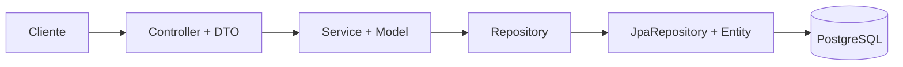
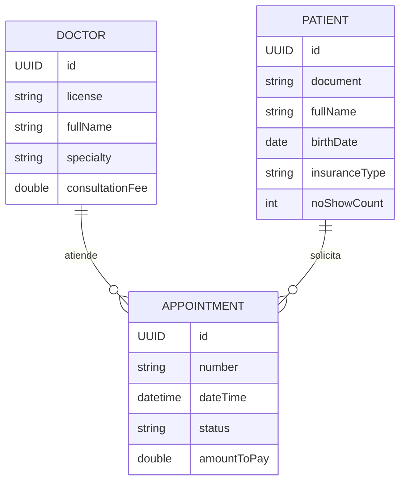
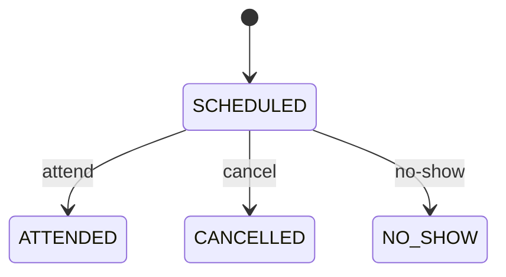

# Taller Práctico Final: Sistema de Citas Médicas (`clinica`)

**Asignatura:** Desarrollo de Software
**Modalidad:** Parejas

---

## 2. Arquitectura obligatoria

```
com.example.clinica
├── controllers/            DoctorController, PatientController, AppointmentController
├── dtos/                   <X>CreateDto, <X>UpdateDto, <X>ResponseDto
├── models/                 Doctor, Patient, Appointment (@Data)
├── entities/               DoctorEntity, PatientEntity, AppointmentEntity
├── mappers/                DTO <-> Model <-> Entity (métodos estáticos)
├── repositories/           <X>Repository (extiende JpaRepository)
├── services/               <X>Service (lógica de negocio, clase concreta)
├── exceptions/             Excepciones propias + GlobalExceptionHandler
└── config/
```



Reglas de la arquitectura:

1. El controlador nunca usa entidades; sólo DTOs y modelos.
2. La lógica de negocio vive **sólo** en el servicio.
3. No se exige crear interfaces propias: el controlador y el servicio usan directamente las clases `<X>Service` y `<X>Repository`.
4. Las entidades JPA no llegan al controlador.
5. Inyección de dependencias **por constructor**.

## 3. Dominio

### 3.1 Entidades

| Entidad | Atributos |
|---|---|
| `Doctor` | id (UUID), license (único), fullName, specialty, consultationFee |
| `Patient` | id (UUID), document (único), fullName, birthDate, insuranceType (`NONE`, `BASIC`, `FULL`), noShowCount |
| `Appointment` | id (UUID), number (único), doctor, patient, dateTime, status, amountToPay |

Relaciones: una `Appointment` pertenece a un `Doctor` y a un `Patient`; un médico y un paciente tienen muchas citas.



### 3.2 Reglas de negocio de la agenda

| # | Regla | Error |
|---|---|---|
| RN1 | Las citas duran 30 min y sólo se agendan en horas en punto o y media (`:00` o `:30`). | 422 |
| RN2 | Sólo se agenda de lunes a viernes, entre 8:00 y 17:00 (la última cita inicia 16:30). | 422 |
| RN3 | No se puede agendar en el pasado. | 422 |
| RN4 | Un médico no puede tener dos citas `SCHEDULED` en el mismo horario. | 409 |
| RN5 | Un paciente no puede tener dos citas `SCHEDULED` el mismo día. | 409 |
| RN6 | Valor a pagar según seguro: `NONE` 100 %, `BASIC` 50 %, `FULL` 0 % de `consultationFee`. | n/a |
| RN7 | Un paciente con 2 o más inasistencias (`NO_SHOW`) no puede agendar. | 422 |
| RN8 | Cancelar sólo es posible si faltan más de 2 horas para la cita y está `SCHEDULED`. | 422 |

### 3.3 Máquina de estados de la cita



Los estados `ATTENDED`, `CANCELLED` y `NO_SHOW` son finales: cualquier otro cambio responde 422. Al marcar `NO_SHOW` se incrementa `noShowCount` del paciente (RN7).

## 4. Requerimientos

### Parte 1: Configuración (10 %)

1. Cree el proyecto en <https://start.spring.io>: Java 21, Maven, Spring Web, Spring Data JPA, Validation, PostgreSQL Driver, Lombok y Actuator. Grupo `com.example`, artefacto `clinica`.
2. Cree la base de datos PostgreSQL `clinica`.
3. En `application.properties` lea usuario y clave de variables de entorno (`${DB_USER}`, `${DB_PASSWORD}`); **no** suba credenciales al repositorio.
4. Verifique que `/actuator/health` responde `UP`.

### Parte 2: Modelo y persistencia (15 %)

1. Cree las 3 entidades JPA con `UUID` como llave primaria, `@ManyToOne` en `AppointmentEntity` y los `enum` `InsuranceType` y `AppointmentStatus` (`@Enumerated(EnumType.STRING)`).
2. Cree los modelos y los mappers `Entity <-> Model` y `Model <-> Dto`.
3. Por cada entidad cree un `<X>Repository` que extienda `JpaRepository`.
4. Incluya el diagrama entidad-relación en el README.

### Parte 3: CRUD de Doctor y Patient (20 %)

| Método | Ruta | Descripción |
|---|---|---|
| `GET` | `/api/doctor` | Listar médicos |
| `GET` | `/api/doctor/{license}` | Consultar por licencia |
| `POST` | `/api/doctor` | Crear |
| `PUT` | `/api/doctor/{license}` | Actualizar nombre, especialidad y tarifa |
| `DELETE` | `/api/doctor/{license}` | Eliminar (rechazar con 422 si tiene citas `SCHEDULED`) |
| `GET` | `/api/patient` | Listar pacientes |
| `GET` | `/api/patient/{document}` | Consultar por documento |
| `POST` | `/api/patient` | Crear |
| `PUT` | `/api/patient/{document}` | Actualizar nombre, fecha de nacimiento y seguro |
| `DELETE` | `/api/patient/{document}` | Eliminar |

Use `CreateDto`, `UpdateDto` y `ResponseDto` distintos. Licencia y documento duplicados responden 409.

### Parte 4: Lógica de citas (25 %)

| Método | Ruta | Descripción |
|---|---|---|
| `POST` | `/api/appointment` | Agenda una cita (aplica RN1 a RN7) |
| `GET` | `/api/appointment/{number}` | Consulta por número |
| `PATCH` | `/api/appointment/{number}/cancel` | Cancela (RN8) |
| `PATCH` | `/api/appointment/{number}/attend` | Marca como atendida |
| `PATCH` | `/api/appointment/{number}/no-show` | Marca inasistencia e incrementa `noShowCount` |

Cuerpo de `POST /api/appointment` (`AppointmentCreateDto`):

```json
{ "doctorLicense": "MED-100", "patientDocument": "1020304050", "dateTime": "2026-12-01T09:30:00" }
```

Requisitos:
- El número de cita se genera en el servicio (por ejemplo `CITA-0001` o un código con UUID).
- `amountToPay` se calcula en el servicio, nunca viene del cliente.
- Los métodos que modifican datos llevan `@Transactional`.
- Todas las reglas se implementan en `AppointmentService`, no en el controlador ni en la entidad.

```json
{ "timestamp": "2026-11-12T10:00:00", "status": 409, "error": "Conflict",
  "message": "El médico MED-100 ya tiene una cita en ese horario", "path": "/api/appointment" }
```

### Parte 5: Consultas (5 %)

Implemente con *derived queries* o `@Query`:
- `GET /api/appointment?doctorLicense=&date=` : citas de un médico en un día (también sirve para verificar RN4).
- `GET /api/appointment/patient/{document}` : historial de citas de un paciente.

## 5. Casos de prueba de referencia (Postman)

Datos base: médico `MED-100` con tarifa 100.000; pacientes `P-1` (`NONE`), `P-2` (`BASIC`), `P-3` (`FULL`). Fecha de referencia: lunes futuro.

| Caso | Entrada | Resultado esperado |
|---|---|---|
| Cita válida, seguro `NONE` | `P-1`, lunes 09:00 | 201, `amountToPay` = 100000 |
| Seguro `BASIC` | `P-2`, lunes 09:30 | `amountToPay` = 50000 |
| Seguro `FULL` | `P-3`, lunes 10:00 | `amountToPay` = 0 |
| Minuto inválido | lunes 09:15 | 422 (RN1) |
| Sábado | sábado 09:00 | 422 (RN2) |
| Fuera de horario | lunes 17:00 / 07:30 | 422 (RN2) |
| En el pasado | fecha ayer | 400 o 422 (RN3) |
| Médico ocupado | otro paciente, lunes 09:00 con `MED-100` | 409 (RN4) |
| Paciente con otra cita ese día | `P-1`, lunes 11:00 | 409 (RN5) |
| Paciente con 2 `NO_SHOW` | cualquier cita | 422 (RN7) |
| Cancelar con 1 h de anticipación | `PATCH .../cancel` | 422 (RN8) |
| Atender una cita ya cancelada | `PATCH .../attend` | 422 |
| Médico inexistente | `MED-999` | 404 |

## 6. Plan de trabajo sugerido

| Etapa | Actividad |
|---|---|
| 1 | Crear repositorio y proyecto, configurar BD |
| 2 | Entidades, enums, modelos, repositorios y mappers |
| 3 | CRUD de `Doctor` y `Patient` |
| 4 | Agendamiento de citas (RN1 a RN7) |
| 5 | Cambios de estado, cancelación (RN8) y consultas |
| 6 | Excepciones globales, pruebas, README y sustentación |

## 7. Entregables

1. Enlace al repositorio (rama `main` actualizada).
2. Colección de Postman exportada con los casos de la sección 5.
3. Captura o reporte de `./mvnw test` exitoso.
4. `README.md` completo.

## 8. Rúbrica

| Criterio | Peso |
|---|---|
| Configuración del proyecto | 10 % |
| Modelo y persistencia | 15 % |
| CRUD y uso correcto de DTOs | 20 % |
| Lógica de citas (RN1 a RN8 y estados) | 25 % |
| Validaciones y manejo de errores | 10 % |
| Consultas | 5 % |
| Pruebas | 15 % |
| **Total** | **100 %** |

Se descuenta si: se exponen entidades en el controlador, hay lógica de negocio en el controlador, se suben credenciales al repositorio o el proyecto no compila o cualquier cosa que rompa la arquitectura del proyecto.

| Nivel | Descripción |
|---|---|
| Excelente (100 %) | Funciona, respeta la arquitectura y las reglas, con pruebas |
| Bueno (75 %) | Funciona con fallos menores o pruebas incompletas |
| Regular (50 %) | Funciona parcialmente o rompe la separación de capas |
| Insuficiente (0–25 %) | No compila o no cumple el requerimiento |
