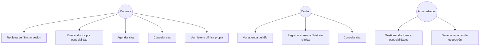
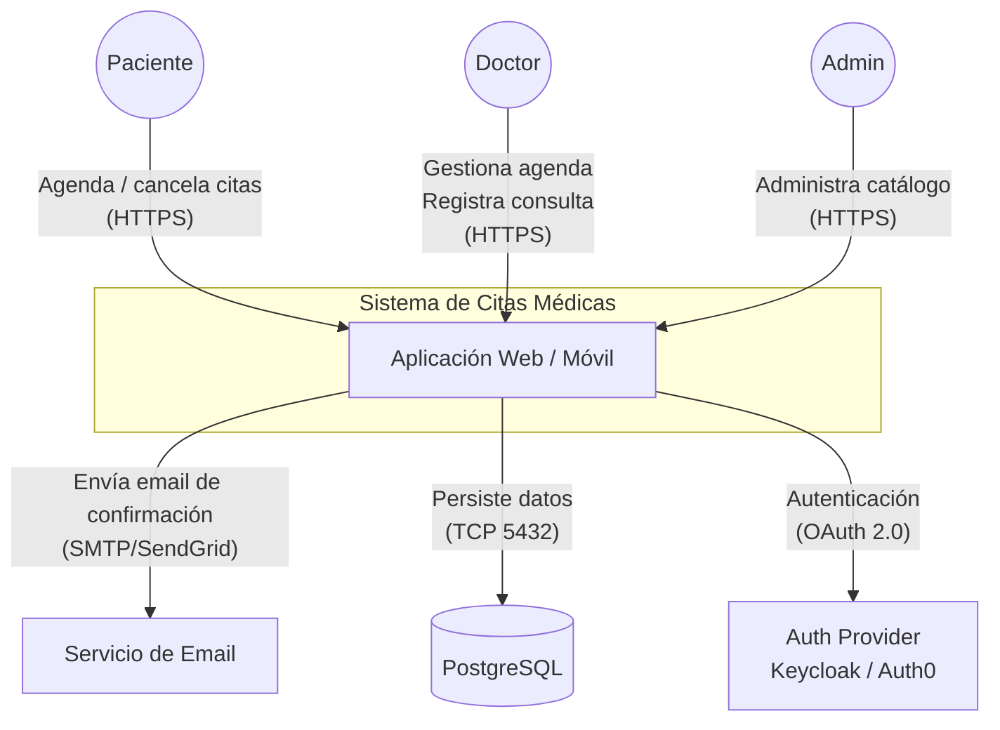
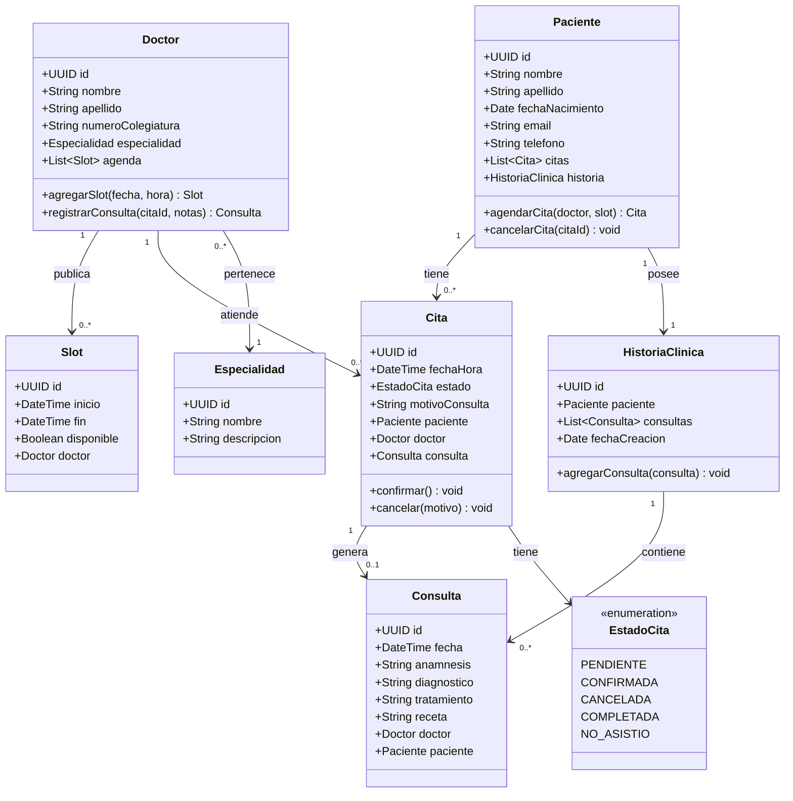
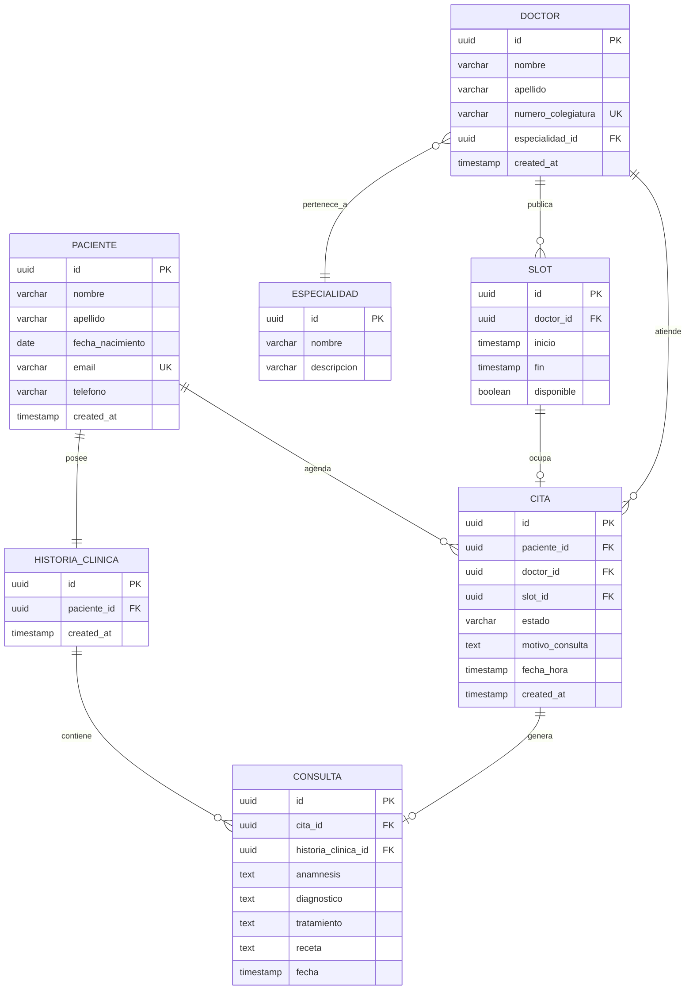
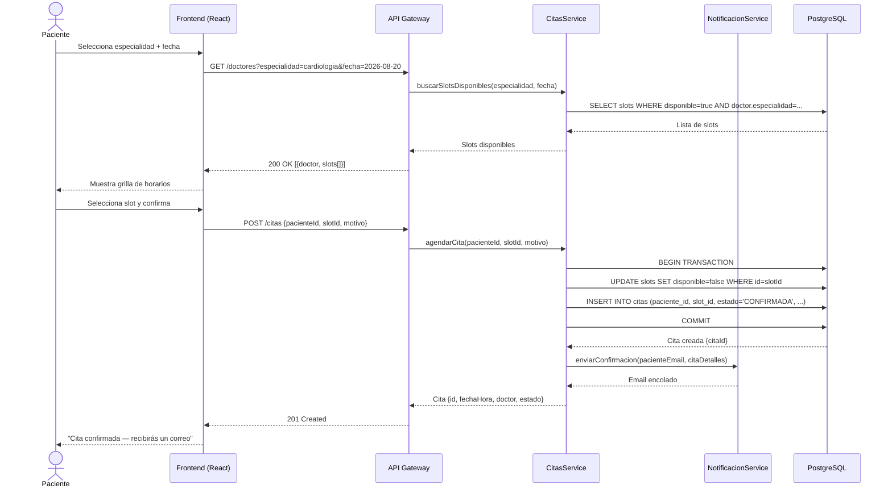

### TALLER

**Actividad: Modelo de dominio**

Para un sistema de pagos de servicios publicos, en donde existen entidades como cuenta, cuenta de ahorros, cuenta corriente, factura, cliente y pago, identificar 6 funcionalidades de negocio.

**Tareas:**
**Fase 1 Requisitos**
- Construir las historias de usuario en jira asociadas a las funcionalidades del sistema de pagos de servicios publicos.
- Construir los casos de uso de las funcionalidades del sistema de pagos de servicios publicos.

**Tareas:**
**Fase 2 Diseño**
- Construir el diagrama de arquitectura.
- Construir el diagrama C4
- Construir el diagrama de clases
- Construir el diagrama entidad relacion
- Construir los diagramas de secuencia

**Fase 3 Implementacion**
- Construccion del diagrama de arquitectura de software (Arquitectura cliente servidor, por capas, hexagonal, limpia, etc)
- Entrega del repositorio con el codigo fuente
- Entrega de los archivos SQL

### Ejemplo: Sistema de Gestión de Citas Médicas

> **Dominio:** Pacientes, Doctores, Citas y Historias Clínicas.  
> A continuación se muestran los artefactos concretos que se producirían en cada fase del ciclo de vida para este sistema.

---

#### Fase 1 — Requisitos

**Historia de usuario (formato Connextra):**

```
Como paciente registrado,
quiero agendar una cita con un doctor por especialidad y fecha disponible
para evitar desplazamientos innecesarios al consultorio.

Criterios de aceptación:
  - El sistema muestra solo horarios disponibles en tiempo real.
  - La confirmación llega por correo en menos de 2 minutos.
  - Solo puedo agendar citas a partir de mañana (no el mismo día).
  - Si el doctor cancela, recibo notificación y se libera el turno.
```

**Casos de uso — Diagrama:**



**Glosario del dominio:**

| Término | Definición |
|---|---|
| **Cita** | Reserva de un slot de tiempo de un doctor para atender a un paciente |
| **Slot** | Bloque de tiempo disponible en la agenda de un doctor |
| **Historia Clínica** | Registro médico acumulado de todas las consultas de un paciente |
| **Especialidad** | Área médica (Cardiología, Pediatría, etc.) asociada a uno o más doctores |
| **Turno** | Jornada laboral de un doctor (mañana / tarde / noche) |

---

#### Fase 2 — Diseño

**Diagrama de contexto C4 — Nivel 1:**



**Diagrama de clases:**



**Diagrama Entidad-Relación:**



**Diagrama de secuencia — Flujo "Agendar Cita":**



#### Fase 3 — Implementación

**Migración de base de datos versionada (Flyway):**

```sql
-- V1__create_core_tables.sql
CREATE EXTENSION IF NOT EXISTS "uuid-ossp";

CREATE TABLE especialidades (
    id          UUID PRIMARY KEY DEFAULT uuid_generate_v4(),
    nombre      VARCHAR(100) NOT NULL UNIQUE,
    descripcion TEXT,
    created_at  TIMESTAMP NOT NULL DEFAULT NOW()
);

CREATE TABLE pacientes (
    id                UUID PRIMARY KEY DEFAULT uuid_generate_v4(),
    nombre            VARCHAR(100) NOT NULL,
    apellido          VARCHAR(100) NOT NULL,
    fecha_nacimiento  DATE NOT NULL,
    email             VARCHAR(255) NOT NULL UNIQUE,
    telefono          VARCHAR(20),
    created_at        TIMESTAMP NOT NULL DEFAULT NOW()
);

CREATE TABLE doctores (
    id                  UUID PRIMARY KEY DEFAULT uuid_generate_v4(),
    nombre              VARCHAR(100) NOT NULL,
    apellido            VARCHAR(100) NOT NULL,
    numero_colegiatura  VARCHAR(50) NOT NULL UNIQUE,
    especialidad_id     UUID NOT NULL REFERENCES especialidades(id),
    created_at          TIMESTAMP NOT NULL DEFAULT NOW()
);

CREATE TABLE slots (
    id          UUID PRIMARY KEY DEFAULT uuid_generate_v4(),
    doctor_id   UUID NOT NULL REFERENCES doctores(id),
    inicio      TIMESTAMP NOT NULL,
    fin         TIMESTAMP NOT NULL,
    disponible  BOOLEAN NOT NULL DEFAULT TRUE,
    CONSTRAINT slot_duracion CHECK (fin > inicio)
);

CREATE TABLE citas (
    id              UUID PRIMARY KEY DEFAULT uuid_generate_v4(),
    paciente_id     UUID NOT NULL REFERENCES pacientes(id),
    doctor_id       UUID NOT NULL REFERENCES doctores(id),
    slot_id         UUID NOT NULL REFERENCES slots(id),
    estado          VARCHAR(20) NOT NULL DEFAULT 'PENDIENTE'
                    CHECK (estado IN ('PENDIENTE','CONFIRMADA','CANCELADA','COMPLETADA','NO_ASISTIO')),
    motivo_consulta TEXT,
    fecha_hora      TIMESTAMP NOT NULL,
    created_at      TIMESTAMP NOT NULL DEFAULT NOW()
);

CREATE TABLE historias_clinicas (
    id          UUID PRIMARY KEY DEFAULT uuid_generate_v4(),
    paciente_id UUID NOT NULL UNIQUE REFERENCES pacientes(id),
    created_at  TIMESTAMP NOT NULL DEFAULT NOW()
);

CREATE TABLE consultas (
    id                  UUID PRIMARY KEY DEFAULT uuid_generate_v4(),
    cita_id             UUID NOT NULL UNIQUE REFERENCES citas(id),
    historia_clinica_id UUID NOT NULL REFERENCES historias_clinicas(id),
    anamnesis           TEXT,
    diagnostico         TEXT NOT NULL,
    tratamiento         TEXT,
    receta              TEXT,
    fecha               TIMESTAMP NOT NULL DEFAULT NOW()
);
```

**Entidad y Repositorio (Java / Spring Boot):**

```java
// Cita.java — Entidad JPA
@Entity
@Table(name = "citas")
public class Cita {

    @Id
    @GeneratedValue(strategy = GenerationType.UUID)
    private UUID id;

    @ManyToOne(fetch = FetchType.LAZY)
    @JoinColumn(name = "paciente_id", nullable = false)
    private Paciente paciente;

    @ManyToOne(fetch = FetchType.LAZY)
    @JoinColumn(name = "doctor_id", nullable = false)
    private Doctor doctor;

    @OneToOne(fetch = FetchType.LAZY)
    @JoinColumn(name = "slot_id", nullable = false)
    private Slot slot;

    @Enumerated(EnumType.STRING)
    @Column(nullable = false)
    private EstadoCita estado = EstadoCita.PENDIENTE;

    @Column(name = "motivo_consulta", length = 500)
    private String motivoConsulta;

    @Column(name = "fecha_hora", nullable = false)
    private LocalDateTime fechaHora;

    public void confirmar() {
        if (this.estado != EstadoCita.PENDIENTE) {
            throw new IllegalStateException("Solo se puede confirmar una cita PENDIENTE");
        }
        this.estado = EstadoCita.CONFIRMADA;
    }

    public void cancelar() {
        if (this.estado == EstadoCita.COMPLETADA) {
            throw new IllegalStateException("No se puede cancelar una cita ya completada");
        }
        this.estado = EstadoCita.CANCELADA;
        this.slot.setDisponible(true);  // liberar el slot
    }
}

// CitaRepository.java
@Repository
public interface CitaRepository extends JpaRepository<Cita, UUID> {

    List<Cita> findByPacienteIdAndEstado(UUID pacienteId, EstadoCita estado);

    @Query("""
        SELECT c FROM Cita c
        WHERE c.doctor.id = :doctorId
          AND c.fechaHora BETWEEN :inicio AND :fin
          AND c.estado NOT IN ('CANCELADA')
        ORDER BY c.fechaHora
    """)
    List<Cita> findAgendaDoctor(
        @Param("doctorId") UUID doctorId,
        @Param("inicio") LocalDateTime inicio,
        @Param("fin") LocalDateTime fin
    );
}

// CitaService.java — Caso de uso: agendar cita
@Service
@Transactional
public class CitaService {

    private final CitaRepository citaRepo;
    private final SlotRepository slotRepo;
    private final NotificacionService notificacionService;

    public CitaService(CitaRepository citaRepo,
                       SlotRepository slotRepo,
                       NotificacionService notificacionService) {
        this.citaRepo = citaRepo;
        this.slotRepo = slotRepo;
        this.notificacionService = notificacionService;
    }

    public Cita agendarCita(UUID pacienteId, UUID slotId, String motivo) {
        Slot slot = slotRepo.findByIdWithLock(slotId)
            .orElseThrow(() -> new RecursoNoEncontradoException("Slot no encontrado"));

        if (!slot.isDisponible()) {
            throw new SlotNoDisponibleException("El horario seleccionado ya no está disponible");
        }

        slot.setDisponible(false);

        Cita cita = new Cita();
        cita.setPaciente(new Paciente(pacienteId));
        cita.setDoctor(slot.getDoctor());
        cita.setSlot(slot);
        cita.setFechaHora(slot.getInicio());
        cita.setMotivoConsulta(motivo);
        cita.confirmar();

        Cita citaGuardada = citaRepo.save(cita);
        notificacionService.enviarConfirmacionCita(citaGuardada);
        return citaGuardada;
    }
}
```