# Guía paso a paso: Sistema de Clientes, Productos y Facturas (Java por consola)

Aplicación de consola en Java, **completamente en memoria (sin base de datos)**, para gestionar **Clientes**, **Productos** y **Facturas** (una factura pertenece a un cliente y contiene varios productos), diseñada respetando los **principios SOLID**. Cada factura calcula su **subtotal**, aplica un **porcentaje de impuesto** configurable y obtiene el **valor del impuesto** y el **total** a partir de esos datos. Incluye ingeniería de requerimientos completa: diagrama de casos de uso, catálogo, especificación de casos de uso, historias de usuario, diagrama de clases y diagramas de secuencia.

> Al no existir persistencia externa, no se usa el patrón repositorio: cada servicio mantiene su propia colección en memoria (`Map`/`List`) como parte de su responsabilidad.

---

## 1. Requisitos previos

- JDK 17+
- Maven 3.9+ (o compilar manualmente con `javac`)
- IDE (IntelliJ / VS Code con extensión Java)

---

## 2. Ingeniería de requerimientos

### 2.1 Historias de usuario

Una **historia de usuario** es una descripción breve e informal de un requisito, escrita desde la perspectiva de quien usará el sistema, siguiendo el formato "Como [rol], quiero [funcionalidad], para [beneficio/objetivo]". Su propósito es capturar la intención de negocio sin entrar en detalles técnicos de implementación, dejando que el equipo defina el "cómo" durante el diseño. Cada historia se acompaña de **criterios de aceptación**, que son condiciones verificables que determinan cuándo la historia se considera correctamente implementada.

| ID | Historia de usuario | Criterios de aceptación |
|---|---|---|
| HU-01 | Como usuario, quiero registrar un cliente con nombre, documento y email, para poder asociarlo a futuras facturas. | Se rechaza el registro si el documento ya existe o los campos obligatorios están vacíos. |
| HU-02 | Como usuario, quiero listar y buscar clientes por documento, para verificar sus datos antes de facturar. | El sistema muestra un mensaje claro si el cliente no existe. |
| HU-03 | Como usuario, quiero registrar un producto con nombre, precio y stock, para poder venderlo en una factura. | El precio y el stock deben ser mayores o iguales a cero; no se permite guardar valores negativos. |
| HU-04 | Como usuario, quiero listar y buscar productos por código, para conocer su disponibilidad. | El sistema muestra un mensaje claro si el producto no existe. |
| HU-05 | Como usuario, quiero crear una factura asociada a un cliente existente indicando el porcentaje de impuesto a aplicar, para iniciar una venta. | No se puede crear una factura si el cliente no existe; el porcentaje de impuesto debe ser mayor o igual a cero. |
| HU-06 | Como usuario, quiero agregar uno o varios productos a una factura indicando la cantidad, para calcular el subtotal de la venta. | No se puede agregar un producto con cantidad mayor al stock disponible; el stock se descuenta al agregar el ítem. |
| HU-07 | Como usuario, quiero ver el detalle de una factura (cliente, productos, cantidades, subtotal, porcentaje e importe del impuesto, y total), para confirmar la venta realizada. | El impuesto debe ser el subtotal multiplicado por el porcentaje de la factura, y el total debe ser la suma del subtotal más el impuesto. |
| HU-08 | Como usuario, quiero ver un menú por consola que me permita navegar entre las opciones de clientes, productos y facturas, para operar el sistema sin conocer comandos técnicos. | El menú se repite hasta que el usuario elige salir; las opciones inválidas muestran un mensaje de error sin cerrar el programa. |

### 2.2 Diagrama de casos de uso

El **diagrama de casos de uso** es una representación gráfica (UML) que muestra, de forma general, las funcionalidades que el sistema ofrece y quiénes las utilizan. Los **actores** (representados como figuras o círculos) son los usuarios o sistemas externos que interactúan con la aplicación, y los **casos de uso** (los óvalos) son las acciones o servicios que el sistema realiza para ellos. Las relaciones `include` indican que un caso de uso reutiliza el comportamiento de otro (por ejemplo, para crear una factura primero se necesita buscar al cliente). Este diagrama sirve como mapa inicial del alcance funcional del sistema, antes de entrar en el detalle de cada operación.

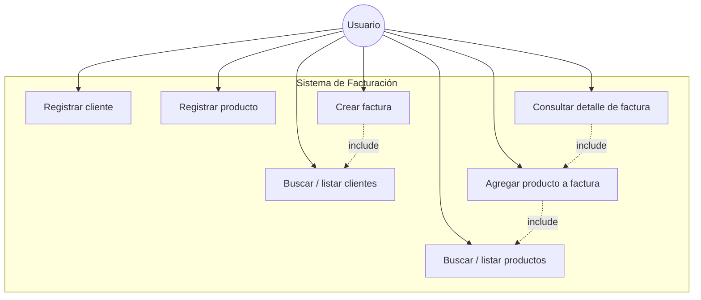

### 2.3 Catálogo de casos de uso

El **catálogo de casos de uso** es una tabla resumen que enumera e identifica cada caso de uso detectado en el diagrama, asignándole un código único, un nombre, el actor responsable, una descripción breve de su propósito y una prioridad de implementación. Funciona como índice de referencia rápida para el equipo de desarrollo y como punto de trazabilidad entre los requisitos, las historias de usuario y las especificaciones detalladas que se documentan a continuación.

| ID | Nombre | Actor | Descripción breve | Prioridad |
|---|---|---|---|---|
| CU-01 | Registrar cliente | Usuario | Crear un nuevo cliente en el sistema. | Alta |
| CU-02 | Buscar/listar clientes | Usuario | Consultar clientes registrados o buscar uno por documento. | Media |
| CU-03 | Registrar producto | Usuario | Crear un nuevo producto con precio y stock. | Alta |
| CU-04 | Buscar/listar productos | Usuario | Consultar productos registrados o buscar uno por código. | Media |
| CU-05 | Crear factura | Usuario | Iniciar una factura asociándola a un cliente existente. | Alta |
| CU-06 | Agregar producto a factura | Usuario | Añadir un producto y su cantidad a una factura, validando y descontando stock. | Alta |
| CU-07 | Consultar detalle de factura | Usuario | Mostrar cliente, ítems, subtotales y total de una factura. | Media |

### 2.4 Especificación de casos de uso

La **especificación de casos de uso** desarrolla en detalle cada entrada del catálogo: describe el actor principal, las **precondiciones** que deben cumplirse antes de ejecutar el caso de uso, el **flujo principal** (la secuencia de pasos en el escenario exitoso), los **flujos alternativos** (situaciones de error o variantes del camino normal) y la **postcondición** (el estado del sistema una vez finalizado el caso de uso con éxito). Esta especificación es la base para diseñar la lógica de negocio de los servicios y para construir los diagramas de secuencia correspondientes.

#### CU-01: Registrar cliente

- **Actor principal**: Usuario.
- **Precondición**: El sistema está en ejecución y muestra el menú principal.
- **Flujo principal**:
  1. El usuario selecciona la opción "Registrar cliente".
  2. El sistema solicita nombre, documento y email.
  3. El usuario ingresa los datos.
  4. El sistema valida que el documento no exista y que los campos no estén vacíos.
  5. El sistema guarda el cliente y muestra un mensaje de confirmación.
- **Flujos alternativos**:
  - 4a. Si el documento ya existe, el sistema muestra un error y vuelve al menú.
  - 4b. Si algún campo obligatorio está vacío, el sistema solicita nuevamente el dato.
- **Postcondición**: El cliente queda almacenado y disponible para facturación.

#### CU-02: Buscar/listar clientes

- **Actor principal**: Usuario.
- **Precondición**: Existen o no clientes registrados.
- **Flujo principal**:
  1. El usuario selecciona "Listar clientes" o "Buscar cliente por documento".
  2. Si es búsqueda, el usuario ingresa el documento.
  3. El sistema muestra el cliente encontrado o la lista completa.
- **Flujos alternativos**:
  - 3a. Si no hay clientes o no se encuentra el documento, el sistema muestra un mensaje informativo.
- **Postcondición**: Ninguna (operación de solo lectura).

#### CU-03: Registrar producto

- **Actor principal**: Usuario.
- **Precondición**: El sistema está en ejecución.
- **Flujo principal**:
  1. El usuario selecciona "Registrar producto".
  2. El sistema solicita nombre, precio y stock inicial.
  3. El usuario ingresa los datos.
  4. El sistema valida que precio y stock sean numéricos y no negativos.
  5. El sistema guarda el producto y muestra un mensaje de confirmación con el código asignado.
- **Flujos alternativos**:
  - 4a. Si el precio o el stock son negativos o no numéricos, el sistema solicita nuevamente el dato.
- **Postcondición**: El producto queda almacenado y disponible para facturación.

#### CU-04: Buscar/listar productos

- **Actor principal**: Usuario.
- **Precondición**: Existen o no productos registrados.
- **Flujo principal**:
  1. El usuario selecciona "Listar productos" o "Buscar producto por código".
  2. Si es búsqueda, el usuario ingresa el código.
  3. El sistema muestra el producto encontrado (con stock disponible) o la lista completa.
- **Flujos alternativos**:
  - 3a. Si no hay productos o no se encuentra el código, el sistema muestra un mensaje informativo.
- **Postcondición**: Ninguna (operación de solo lectura).

#### CU-05: Crear factura

- **Actor principal**: Usuario.
- **Precondición**: Debe existir al menos un cliente registrado.
- **Flujo principal**:
  1. El usuario selecciona "Crear factura".
  2. El sistema solicita el documento del cliente (incluye CU-02) y el porcentaje de impuesto a aplicar.
  3. El sistema valida que el cliente exista y que el porcentaje de impuesto sea mayor o igual a cero.
  4. El sistema crea la factura con fecha actual, el porcentaje de impuesto indicado, y subtotal/impuesto/total en cero, dejándola abierta para agregar productos.
- **Flujos alternativos**:
  - 3a. Si el cliente no existe, el sistema muestra un error y vuelve al menú.
  - 3b. Si el porcentaje de impuesto es negativo, el sistema solicita nuevamente el valor.
- **Postcondición**: Se crea una factura vacía asociada al cliente, con su porcentaje de impuesto definido.

#### CU-06: Agregar producto a factura

- **Actor principal**: Usuario.
- **Precondición**: Existe una factura creada y abierta; existen productos con stock disponible.
- **Flujo principal**:
  1. El usuario selecciona "Agregar producto a factura".
  2. El sistema solicita el código del producto (incluye CU-04) y la cantidad.
  3. El sistema valida que el producto exista y que el stock sea suficiente.
  4. El sistema calcula el subtotal, descuenta el stock y agrega el ítem a la factura.
  5. El sistema recalcula y muestra el total actualizado de la factura.
- **Flujos alternativos**:
  - 3a. Si el producto no existe, el sistema muestra un error.
  - 3b. Si la cantidad solicitada supera el stock disponible, el sistema muestra un error y no modifica el stock.
- **Postcondición**: La factura contiene el nuevo ítem y el stock del producto queda actualizado.

#### CU-07: Consultar detalle de factura

- **Actor principal**: Usuario.
- **Precondición**: Existe al menos una factura creada.
- **Flujo principal**:
  1. El usuario selecciona "Consultar factura" e ingresa el número de factura.
  2. El sistema muestra los datos del cliente, cada ítem (producto, cantidad, precio unitario, subtotal), el subtotal de la factura, el porcentaje e importe del impuesto, y el total.
- **Flujos alternativos**:
  - 2a. Si la factura no existe, el sistema muestra un mensaje de error.
- **Postcondición**: Ninguna (operación de solo lectura).

---

## 3. Diseño con principios SOLID

| Principio | Aplicación en el sistema |
|---|---|
| **S**ingle Responsibility | Cada clase tiene una única razón para cambiar: los modelos solo representan datos (incluido el cálculo de subtotal/impuesto/total en `Factura`), los servicios contienen la lógica de negocio junto con su propia colección en memoria, y las clases de menú solo gestionan la interacción por consola. |
| **O**pen/Closed | `ClienteService`, `ProductoService` y `FacturaService` se definen como interfaces; se pueden agregar nuevas implementaciones (ej. con otra estructura de almacenamiento en memoria) sin modificar `MenuConsola` ni las demás clases que dependen de ellas. |
| **L**iskov Substitution | Cualquier implementación de `ClienteService`, `ProductoService` o `FacturaService` puede sustituir a la interfaz sin romper el comportamiento esperado por `MenuConsola` o por `FacturaServiceImpl`. |
| **I**nterface Segregation | Se definen interfaces pequeñas y específicas por entidad (`ClienteService`, `ProductoService`, `FacturaService`) en lugar de una única interfaz genérica con métodos que no todas las clases necesitan. |
| **D**ependency Inversion | `FacturaServiceImpl` y `MenuConsola` dependen de las abstracciones `ClienteService` y `ProductoService`, no de sus implementaciones concretas; las dependencias se inyectan por constructor desde `Main`. |

---

## 4. Estructura de paquetes

```
com.example.facturacion
├── Main.java                  -> Punto de entrada, arma el menú y las dependencias
├── model
│   ├── Cliente.java
│   ├── Producto.java
│   ├── Factura.java            -> Calcula subtotal, impuesto y total
│   └── FacturaItem.java
├── service
│   ├── ClienteService.java
│   ├── ProductoService.java
│   ├── FacturaService.java
│   └── impl
│       ├── ClienteServiceImpl.java   -> Mantiene los clientes en un Map en memoria
│       ├── ProductoServiceImpl.java  -> Mantiene los productos en un Map en memoria
│       └── FacturaServiceImpl.java   -> Mantiene las facturas en un Map en memoria
├── exception
│   ├── RecursoNoEncontradoException.java
│   └── StockInsuficienteException.java
└── ui
    └── MenuConsola.java        -> Interacción con el usuario (Scanner)
```

> No hay paquete `repository`: al no existir base de datos, cada `*ServiceImpl` guarda sus datos en una colección en memoria (`Map`) como parte de su propia responsabilidad.

---

## 5. Diagrama de clases

El **diagrama de clases** es un diagrama estructural de UML que muestra las clases e interfaces del sistema, sus atributos, sus métodos y las relaciones entre ellas (herencia/implementación, asociación, composición, dependencia). A diferencia del diagrama de casos de uso, que describe *qué* hace el sistema desde la perspectiva del usuario, el diagrama de clases describe *cómo* está organizado internamente el código: qué responsabilidades tiene cada clase y cómo colaboran entre sí para cumplir los casos de uso.

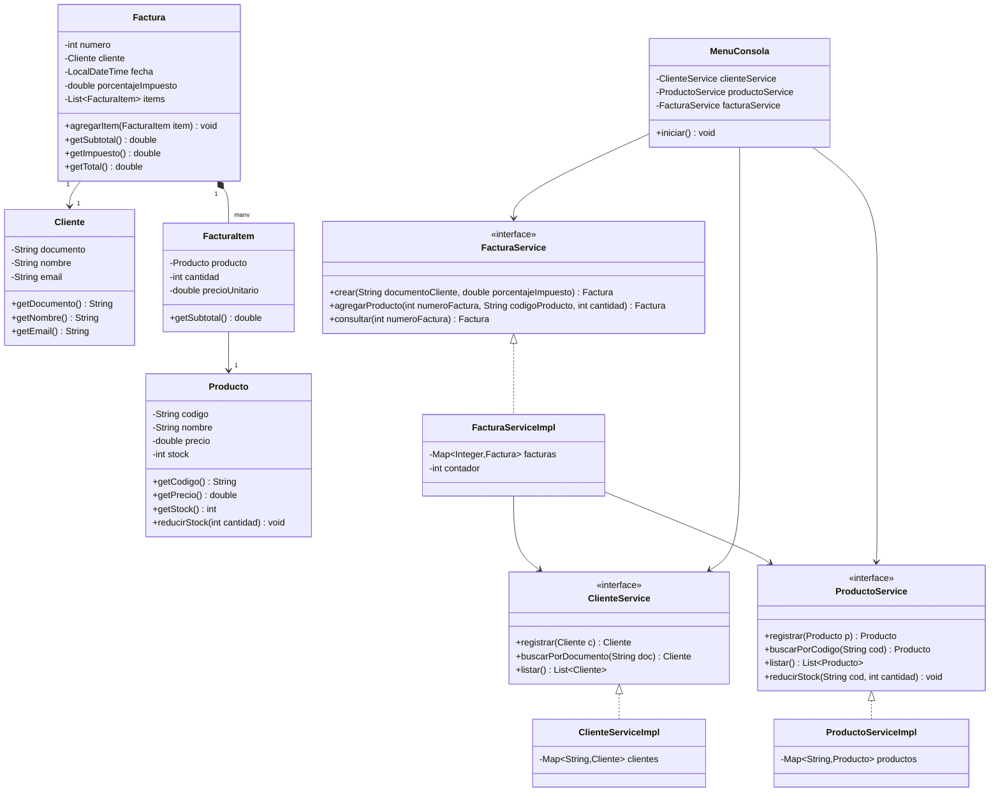

---

## 6. Diagramas de secuencia

Un **diagrama de secuencia** es un diagrama de comportamiento de UML que muestra, en orden cronológico (de arriba hacia abajo), cómo interactúan los objetos/participantes de un caso de uso específico mediante el intercambio de mensajes (llamadas a métodos y sus respuestas). Es útil para verificar que el diseño de clases soporta correctamente el flujo principal y los flujos alternativos definidos en la especificación de casos de uso, ya que hace explícito el orden de las llamadas, las condiciones (`alt`) y qué participante es responsable de cada acción.

### 6.1 Registrar cliente (CU-01)

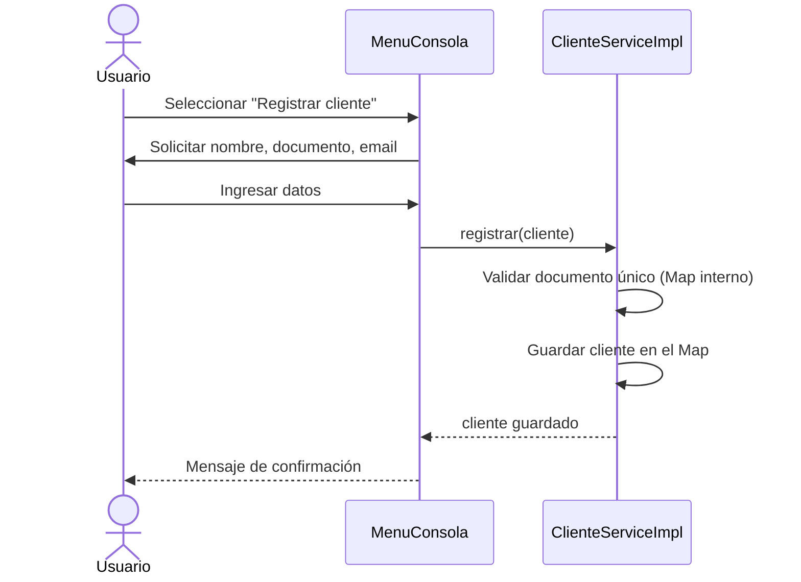

### 6.2 Crear factura (CU-05)

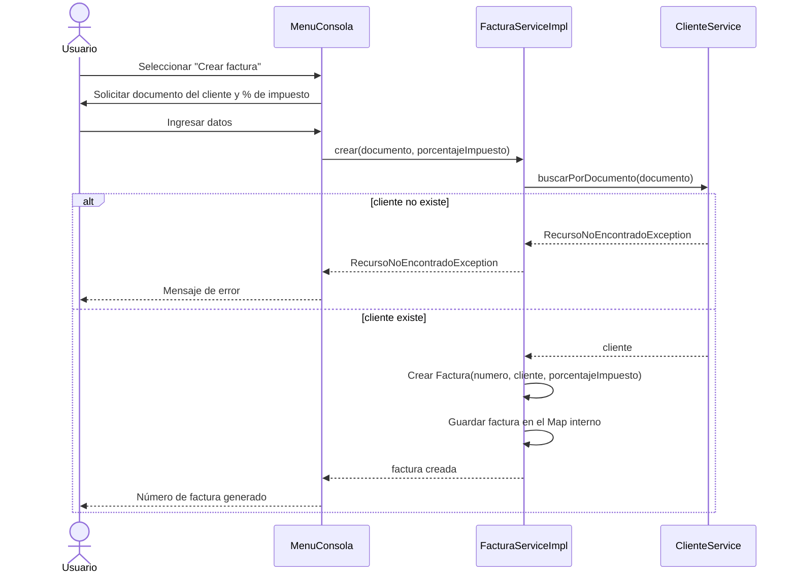

### 6.3 Agregar producto a factura (CU-06)

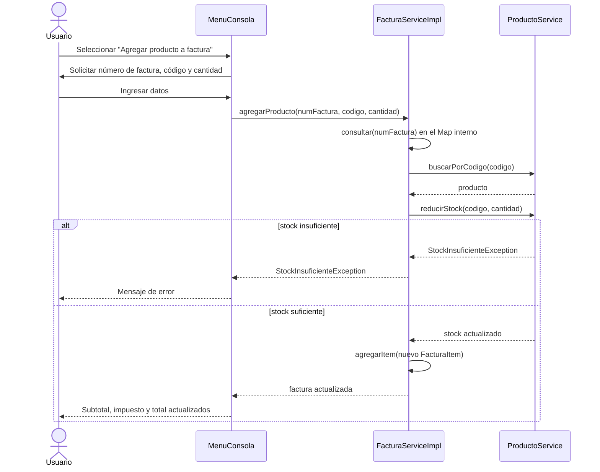

### 6.4 Consultar detalle de factura (CU-07)

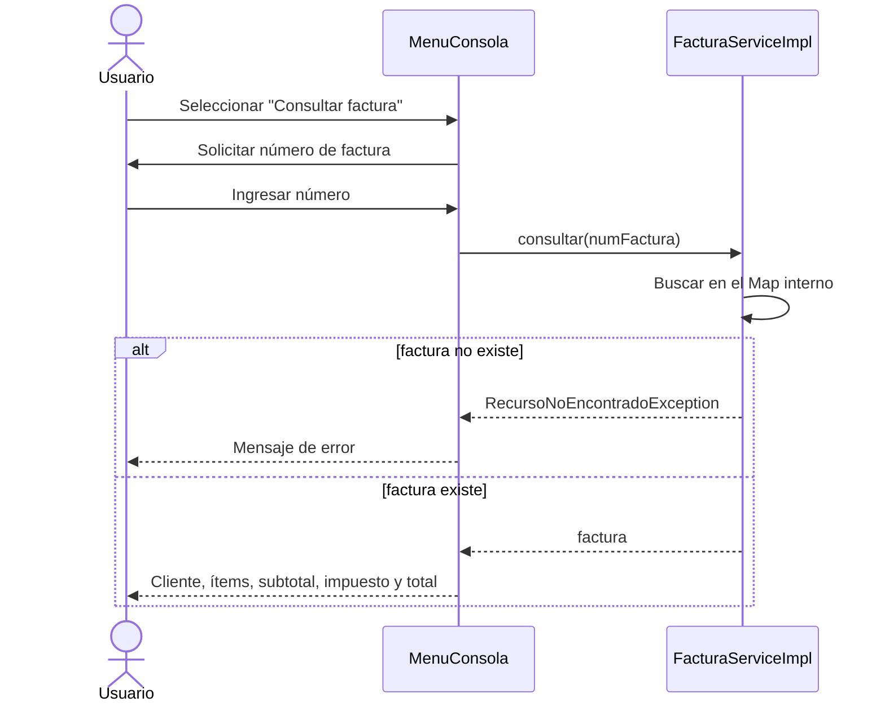

---

## 7. Modelos (`model`)

`model/Cliente.java`:

```java
public class Cliente {

    private final String documento;
    private final String nombre;
    private final String email;

    public Cliente(String documento, String nombre, String email) {
        this.documento = documento;
        this.nombre = nombre;
        this.email = email;
    }

    public String getDocumento() { return documento; }
    public String getNombre() { return nombre; }
    public String getEmail() { return email; }

    @Override
    public String toString() {
        return "Cliente{documento='%s', nombre='%s', email='%s'}"
                .formatted(documento, nombre, email);
    }
}
```

`model/Producto.java`:

```java
public class Producto {

    private final String codigo;
    private final String nombre;
    private final double precio;
    private int stock;

    public Producto(String codigo, String nombre, double precio, int stock) {
        this.codigo = codigo;
        this.nombre = nombre;
        this.precio = precio;
        this.stock = stock;
    }

    public String getCodigo() { return codigo; }
    public String getNombre() { return nombre; }
    public double getPrecio() { return precio; }
    public int getStock() { return stock; }

    public void reducirStock(int cantidad) {
        if (cantidad > this.stock) {
            throw new IllegalArgumentException("Cantidad supera el stock disponible");
        }
        this.stock -= cantidad;
    }

    @Override
    public String toString() {
        return "Producto{codigo='%s', nombre='%s', precio=%.2f, stock=%d}"
                .formatted(codigo, nombre, precio, stock);
    }
}
```

`model/FacturaItem.java`:

```java
public class FacturaItem {

    private final Producto producto;
    private final int cantidad;
    private final double precioUnitario;

    public FacturaItem(Producto producto, int cantidad, double precioUnitario) {
        this.producto = producto;
        this.cantidad = cantidad;
        this.precioUnitario = precioUnitario;
    }

    public Producto getProducto() { return producto; }
    public int getCantidad() { return cantidad; }
    public double getPrecioUnitario() { return precioUnitario; }

    public double getSubtotal() {
        return precioUnitario * cantidad;
    }

    @Override
    public String toString() {
        return "  - %s x%d @ %.2f = %.2f".formatted(
                producto.getNombre(), cantidad, precioUnitario, getSubtotal());
    }
}
```

`model/Factura.java`:

```java
public class Factura {

    private final int numero;
    private final Cliente cliente;
    private final LocalDateTime fecha;
    private final double porcentajeImpuesto;
    private final List<FacturaItem> items = new ArrayList<>();

    public Factura(int numero, Cliente cliente, double porcentajeImpuesto) {
        if (porcentajeImpuesto < 0) {
            throw new IllegalArgumentException("El porcentaje de impuesto no puede ser negativo");
        }
        this.numero = numero;
        this.cliente = cliente;
        this.fecha = LocalDateTime.now();
        this.porcentajeImpuesto = porcentajeImpuesto;
    }

    public int getNumero() { return numero; }
    public Cliente getCliente() { return cliente; }
    public LocalDateTime getFecha() { return fecha; }
    public double getPorcentajeImpuesto() { return porcentajeImpuesto; }
    public List<FacturaItem> getItems() { return List.copyOf(items); }

    public void agregarItem(FacturaItem item) {
        items.add(item);
    }

    public double getSubtotal() {
        return items.stream().mapToDouble(FacturaItem::getSubtotal).sum();
    }

    public double getImpuesto() {
        return getSubtotal() * porcentajeImpuesto / 100;
    }

    public double getTotal() {
        return getSubtotal() + getImpuesto();
    }
}
```

---

## 8. Excepciones (`exception`)

```java
public class RecursoNoEncontradoException extends RuntimeException {
    public RecursoNoEncontradoException(String mensaje) { super(mensaje); }
}
```

```java
public class StockInsuficienteException extends RuntimeException {
    public StockInsuficienteException(String mensaje) { super(mensaje); }
}
```

---

## 9. Servicios (`service`) — Single Responsibility + Dependency Inversion

Al no existir base de datos, cada implementación de servicio mantiene su propia colección en memoria (`Map`) y expone únicamente operaciones de negocio a través de su interfaz.

`service/ClienteService.java`:

```java
public interface ClienteService {
    Cliente registrar(Cliente cliente);
    Cliente buscarPorDocumento(String documento);
    List<Cliente> listar();
}
```

`service/impl/ClienteServiceImpl.java`:

```java
public class ClienteServiceImpl implements ClienteService {

    private final Map<String, Cliente> clientes = new LinkedHashMap<>();

    @Override
    public Cliente registrar(Cliente cliente) {
        if (clientes.containsKey(cliente.getDocumento())) {
            throw new IllegalArgumentException("Ya existe un cliente con ese documento");
        }
        clientes.put(cliente.getDocumento(), cliente);
        return cliente;
    }

    @Override
    public Cliente buscarPorDocumento(String documento) {
        Cliente cliente = clientes.get(documento);
        if (cliente == null) {
            throw new RecursoNoEncontradoException("Cliente no encontrado: " + documento);
        }
        return cliente;
    }

    @Override
    public List<Cliente> listar() {
        return new ArrayList<>(clientes.values());
    }
}
```

`service/ProductoService.java`:

```java
public interface ProductoService {
    Producto registrar(Producto producto);
    Producto buscarPorCodigo(String codigo);
    List<Producto> listar();
    void reducirStock(String codigo, int cantidad);
}
```

`service/impl/ProductoServiceImpl.java`:

```java
public class ProductoServiceImpl implements ProductoService {

    private final Map<String, Producto> productos = new LinkedHashMap<>();

    @Override
    public Producto registrar(Producto producto) {
        if (producto.getPrecio() < 0 || producto.getStock() < 0) {
            throw new IllegalArgumentException("Precio y stock deben ser mayores o iguales a cero");
        }
        productos.put(producto.getCodigo(), producto);
        return producto;
    }

    @Override
    public Producto buscarPorCodigo(String codigo) {
        Producto producto = productos.get(codigo);
        if (producto == null) {
            throw new RecursoNoEncontradoException("Producto no encontrado: " + codigo);
        }
        return producto;
    }

    @Override
    public List<Producto> listar() {
        return new ArrayList<>(productos.values());
    }

    @Override
    public void reducirStock(String codigo, int cantidad) {
        Producto producto = buscarPorCodigo(codigo);
        if (producto.getStock() < cantidad) {
            throw new StockInsuficienteException("Stock insuficiente para " + producto.getNombre());
        }
        producto.reducirStock(cantidad);
    }
}
```

`service/FacturaService.java`:

```java
public interface FacturaService {
    Factura crear(String documentoCliente, double porcentajeImpuesto);
    Factura agregarProducto(int numeroFactura, String codigoProducto, int cantidad);
    Factura consultar(int numeroFactura);
}
```

`service/impl/FacturaServiceImpl.java`:

```java
public class FacturaServiceImpl implements FacturaService {

    private final Map<Integer, Factura> facturas = new LinkedHashMap<>();
    private final ClienteService clienteService;
    private final ProductoService productoService;
    private int contador = 0;

    public FacturaServiceImpl(ClienteService clienteService, ProductoService productoService) {
        this.clienteService = clienteService;
        this.productoService = productoService;
    }

    @Override
    public Factura crear(String documentoCliente, double porcentajeImpuesto) {
        Cliente cliente = clienteService.buscarPorDocumento(documentoCliente);
        Factura factura = new Factura(++contador, cliente, porcentajeImpuesto);
        facturas.put(factura.getNumero(), factura);
        return factura;
    }

    @Override
    public Factura agregarProducto(int numeroFactura, String codigoProducto, int cantidad) {
        Factura factura = consultar(numeroFactura);
        Producto producto = productoService.buscarPorCodigo(codigoProducto);

        productoService.reducirStock(codigoProducto, cantidad);
        factura.agregarItem(new FacturaItem(producto, cantidad, producto.getPrecio()));
        return factura;
    }

    @Override
    public Factura consultar(int numeroFactura) {
        Factura factura = facturas.get(numeroFactura);
        if (factura == null) {
            throw new RecursoNoEncontradoException("Factura no encontrada: " + numeroFactura);
        }
        return factura;
    }
}
```

---

## 10. Interfaz de consola (`ui/MenuConsola.java`)

```java
public class MenuConsola {

    private final Scanner scanner = new Scanner(System.in);
    private final ClienteService clienteService;
    private final ProductoService productoService;
    private final FacturaService facturaService;

    public MenuConsola(ClienteService clienteService,
                        ProductoService productoService,
                        FacturaService facturaService) {
        this.clienteService = clienteService;
        this.productoService = productoService;
        this.facturaService = facturaService;
    }

    public void iniciar() {
        boolean salir = false;
        while (!salir) {
            mostrarMenu();
            String opcion = scanner.nextLine().trim();
            try {
                switch (opcion) {
                    case "1" -> registrarCliente();
                    case "2" -> listarClientes();
                    case "3" -> registrarProducto();
                    case "4" -> listarProductos();
                    case "5" -> crearFactura();
                    case "6" -> agregarProductoAFactura();
                    case "7" -> consultarFactura();
                    case "0" -> salir = true;
                    default -> System.out.println("Opción inválida. Intente de nuevo.");
                }
            } catch (RecursoNoEncontradoException | StockInsuficienteException
                     | IllegalArgumentException ex) {
                System.out.println("Error: " + ex.getMessage());
            }
        }
        System.out.println("Programa finalizado.");
    }

    private void mostrarMenu() {
        System.out.println("""

                === Sistema de Facturación ===
                1. Registrar cliente
                2. Listar clientes
                3. Registrar producto
                4. Listar productos
                5. Crear factura
                6. Agregar producto a factura
                7. Consultar factura
                0. Salir
                Seleccione una opción:""");
    }

    private void registrarCliente() {
        System.out.print("Documento: ");
        String documento = scanner.nextLine().trim();
        System.out.print("Nombre: ");
        String nombre = scanner.nextLine().trim();
        System.out.print("Email: ");
        String email = scanner.nextLine().trim();

        Cliente cliente = clienteService.registrar(new Cliente(documento, nombre, email));
        System.out.println("Cliente registrado: " + cliente);
    }

    private void listarClientes() {
        List<Cliente> clientes = clienteService.listar();
        if (clientes.isEmpty()) {
            System.out.println("No hay clientes registrados.");
            return;
        }
        clientes.forEach(System.out::println);
    }

    private void registrarProducto() {
        System.out.print("Código: ");
        String codigo = scanner.nextLine().trim();
        System.out.print("Nombre: ");
        String nombre = scanner.nextLine().trim();
        System.out.print("Precio: ");
        double precio = Double.parseDouble(scanner.nextLine().trim());
        System.out.print("Stock inicial: ");
        int stock = Integer.parseInt(scanner.nextLine().trim());

        Producto producto = productoService.registrar(new Producto(codigo, nombre, precio, stock));
        System.out.println("Producto registrado: " + producto);
    }

    private void listarProductos() {
        List<Producto> productos = productoService.listar();
        if (productos.isEmpty()) {
            System.out.println("No hay productos registrados.");
            return;
        }
        productos.forEach(System.out::println);
    }

    private void crearFactura() {
        System.out.print("Documento del cliente: ");
        String documento = scanner.nextLine().trim();
        System.out.print("Porcentaje de impuesto (ej. 19): ");
        double porcentajeImpuesto = Double.parseDouble(scanner.nextLine().trim());

        Factura factura = facturaService.crear(documento, porcentajeImpuesto);
        System.out.println("Factura creada con número: " + factura.getNumero());
    }

    private void agregarProductoAFactura() {
        System.out.print("Número de factura: ");
        int numero = Integer.parseInt(scanner.nextLine().trim());
        System.out.print("Código de producto: ");
        String codigo = scanner.nextLine().trim();
        System.out.print("Cantidad: ");
        int cantidad = Integer.parseInt(scanner.nextLine().trim());

        Factura factura = facturaService.agregarProducto(numero, codigo, cantidad);
        System.out.printf("Producto agregado. Subtotal: %.2f | Impuesto: %.2f | Total: %.2f%n",
                factura.getSubtotal(), factura.getImpuesto(), factura.getTotal());
    }

    private void consultarFactura() {
        System.out.print("Número de factura: ");
        int numero = Integer.parseInt(scanner.nextLine().trim());
        Factura factura = facturaService.consultar(numero);

        System.out.println("Factura #" + factura.getNumero());
        System.out.println("Cliente: " + factura.getCliente().getNombre());
        System.out.println("Fecha: " + factura.getFecha());
        System.out.println("Items:");
        factura.getItems().forEach(System.out::println);
        System.out.printf("Subtotal: %.2f%n", factura.getSubtotal());
        System.out.printf("Impuesto (%.2f%%): %.2f%n", factura.getPorcentajeImpuesto(), factura.getImpuesto());
        System.out.printf("Total: %.2f%n", factura.getTotal());
    }
}
```

---

## 11. Punto de entrada (`Main.java`)

```java
public class Main {
    public static void main(String[] args) {
        ClienteService clienteService = new ClienteServiceImpl();
        ProductoService productoService = new ProductoServiceImpl();
        FacturaService facturaService = new FacturaServiceImpl(clienteService, productoService);

        MenuConsola menu = new MenuConsola(clienteService, productoService, facturaService);
        menu.iniciar();
    }
}
```

---

## 12. Compilación y ejecución

### Con Maven

`pom.xml` mínimo:

```xml
<project xmlns="http://maven.apache.org/POM/4.0.0">
    <modelVersion>4.0.0</modelVersion>
    <groupId>com.example</groupId>
    <artifactId>facturacion</artifactId>
    <version>1.0.0</version>
    <properties>
        <maven.compiler.source>17</maven.compiler.source>
        <maven.compiler.target>17</maven.compiler.target>
    </properties>
</project>
```

```bash
mvn compile
mvn exec:java -Dexec.mainClass="com.example.facturacion.Main"
```

### Sin Maven (javac directo)

```bash
find src -name "*.java" > sources.txt
javac -d out @sources.txt
java -cp out com.example.facturacion.Main
```

---

## 13. Resumen del flujo completo

1. Levantar historias de usuario y catálogo de casos de uso a partir de las reglas de negocio (cliente, producto, factura, porcentaje de impuesto).
2. Especificar cada caso de uso con flujo principal y alternativos.
3. Diseñar el modelo de dominio (`Cliente`, `Producto`, `Factura`, `FacturaItem`), incluyendo en `Factura` el cálculo de subtotal, impuesto y total.
4. Definir interfaces de servicio con la lógica de negocio y las validaciones (documento único, stock suficiente, existencia de cliente/producto, porcentaje de impuesto no negativo), cada una con su propia colección en memoria (`Map`).
5. Inyectar las dependencias por constructor desde `Main` (`FacturaServiceImpl` depende de `ClienteService` y `ProductoService`), respetando el principio de inversión de dependencias.
6. Construir el menú de consola (`Scanner`) que orquesta las operaciones y traduce las excepciones de negocio en mensajes claros para el usuario.
7. Verificar cada flujo contra los diagramas de secuencia y los criterios de aceptación de las historias de usuario.

</content>

---

Ejercicio Sistema de notas
Es un sistema que tiene estudiantes, profesores, materias, y cada materia tiene una nota para cada estudiante

# Guía paso a paso: Sistema de Notas (Estudiantes, Profesores y Materias) en Java por consola

Aplicación de consola en Java, **completamente en memoria (sin base de datos)**, para gestionar **Estudiantes**, **Profesores** y **Materias** (una materia es dictada por un profesor y tiene inscritos varios estudiantes, cada uno con su propia nota), diseñada respetando los **principios SOLID**. Incluye ingeniería de requerimientos completa: historias de usuario, diagrama de casos de uso, catálogo, especificación de casos de uso, diagrama de clases y diagramas de secuencia.

> Al no existir persistencia externa, no se usa el patrón repositorio: cada servicio mantiene su propia colección en memoria (`Map`/`List`) como parte de su responsabilidad.

---

## 1. Requisitos previos

- JDK 17+
- Maven 3.9+ (o compilar manualmente con `javac`)
- IDE (IntelliJ / VS Code con extensión Java)

---

## 2. Ingeniería de requerimientos

### 2.1 Historias de usuario

| ID | Historia de usuario | Criterios de aceptación |
|---|---|---|
| HU-01 | Como usuario, quiero registrar un estudiante con nombre y documento, para poder inscribirlo en materias. | Se rechaza el registro si el documento ya existe o los campos obligatorios están vacíos. |
| HU-02 | Como usuario, quiero listar y buscar estudiantes por documento, para verificar sus datos antes de inscribirlos. | El sistema muestra un mensaje claro si el estudiante no existe. |
| HU-03 | Como usuario, quiero registrar un profesor con nombre y documento, para poder asignarlo como responsable de una materia. | Se rechaza el registro si el documento ya existe o los campos obligatorios están vacíos. |
| HU-04 | Como usuario, quiero listar y buscar profesores por documento, para conocer quién dicta cada materia. | El sistema muestra un mensaje claro si el profesor no existe. |
| HU-05 | Como usuario, quiero registrar una materia con nombre y un profesor asignado, para poder inscribir estudiantes en ella. | No se puede crear una materia si el profesor no existe; el nombre no puede estar vacío. |
| HU-06 | Como usuario, quiero inscribir un estudiante existente en una materia, para luego poder registrarle una nota. | No se puede inscribir un estudiante que no existe ni inscribirlo dos veces en la misma materia. |
| HU-07 | Como usuario, quiero registrar o actualizar la nota de un estudiante inscrito en una materia, para llevar el control de su desempeño. | La nota debe estar entre 0.0 y 5.0; no se puede calificar a un estudiante no inscrito en la materia. |
| HU-08 | Como usuario, quiero consultar el detalle de una materia (profesor, estudiantes inscritos y su nota, y el promedio del grupo), para hacer seguimiento académico. | El promedio se calcula solo sobre los estudiantes que ya tienen nota registrada. |
| HU-09 | Como usuario, quiero ver un menú por consola que me permita navegar entre las opciones de estudiantes, profesores y materias, para operar el sistema sin conocer comandos técnicos. | El menú se repite hasta que el usuario elige salir; las opciones inválidas muestran un mensaje de error sin cerrar el programa. |

### 2.2 Diagrama de casos de uso

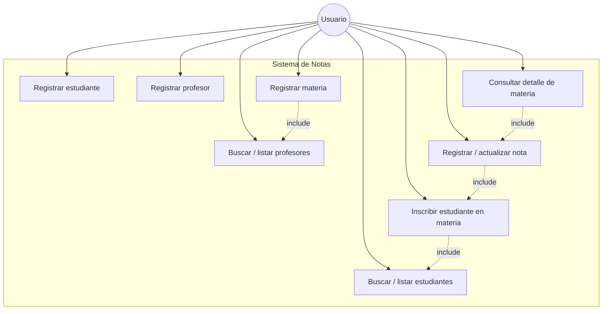

### 2.3 Catálogo de casos de uso

| ID | Nombre | Actor | Descripción breve | Prioridad |
|---|---|---|---|---|
| CU-01 | Registrar estudiante | Usuario | Crear un nuevo estudiante en el sistema. | Alta |
| CU-02 | Buscar/listar estudiantes | Usuario | Consultar estudiantes registrados o buscar uno por documento. | Media |
| CU-03 | Registrar profesor | Usuario | Crear un nuevo profesor en el sistema. | Alta |
| CU-04 | Buscar/listar profesores | Usuario | Consultar profesores registrados o buscar uno por documento. | Media |
| CU-05 | Registrar materia | Usuario | Crear una nueva materia asignándole un profesor. | Alta |
| CU-06 | Inscribir estudiante en materia | Usuario | Añadir un estudiante existente a una materia existente. | Alta |
| CU-07 | Registrar/actualizar nota | Usuario | Asignar o modificar la nota de un estudiante inscrito en una materia. | Alta |
| CU-08 | Consultar detalle de materia | Usuario | Mostrar profesor, estudiantes inscritos, notas y promedio de una materia. | Media |

### 2.4 Especificación de casos de uso

#### CU-01: Registrar estudiante

- **Actor principal**: Usuario.
- **Precondición**: El sistema está en ejecución y muestra el menú principal.
- **Flujo principal**:
  1. El usuario selecciona la opción "Registrar estudiante".
  2. El sistema solicita nombre y documento.
  3. El usuario ingresa los datos.
  4. El sistema valida que el documento no exista y que los campos no estén vacíos.
  5. El sistema guarda el estudiante y muestra un mensaje de confirmación.
- **Flujos alternativos**:
  - 4a. Si el documento ya existe, el sistema muestra un error y vuelve al menú.
  - 4b. Si algún campo obligatorio está vacío, el sistema solicita nuevamente el dato.
- **Postcondición**: El estudiante queda almacenado y disponible para inscripción en materias.

#### CU-02: Buscar/listar estudiantes

- **Actor principal**: Usuario.
- **Precondición**: Existen o no estudiantes registrados.
- **Flujo principal**:
  1. El usuario selecciona "Listar estudiantes" o "Buscar estudiante por documento".
  2. Si es búsqueda, el usuario ingresa el documento.
  3. El sistema muestra el estudiante encontrado o la lista completa.
- **Flujos alternativos**:
  - 3a. Si no hay estudiantes o no se encuentra el documento, el sistema muestra un mensaje informativo.
- **Postcondición**: Ninguna (operación de solo lectura).

#### CU-03: Registrar profesor

- **Actor principal**: Usuario.
- **Precondición**: El sistema está en ejecución.
- **Flujo principal**:
  1. El usuario selecciona "Registrar profesor".
  2. El sistema solicita nombre y documento.
  3. El usuario ingresa los datos.
  4. El sistema valida que el documento no exista y que los campos no estén vacíos.
  5. El sistema guarda el profesor y muestra un mensaje de confirmación.
- **Flujos alternativos**:
  - 4a. Si el documento ya existe, el sistema muestra un error y vuelve al menú.
- **Postcondición**: El profesor queda almacenado y disponible para ser asignado a materias.

#### CU-04: Buscar/listar profesores

- **Actor principal**: Usuario.
- **Precondición**: Existen o no profesores registrados.
- **Flujo principal**:
  1. El usuario selecciona "Listar profesores" o "Buscar profesor por documento".
  2. Si es búsqueda, el usuario ingresa el documento.
  3. El sistema muestra el profesor encontrado o la lista completa.
- **Flujos alternativos**:
  - 3a. Si no hay profesores o no se encuentra el documento, el sistema muestra un mensaje informativo.
- **Postcondición**: Ninguna (operación de solo lectura).

#### CU-05: Registrar materia

- **Actor principal**: Usuario.
- **Precondición**: Debe existir al menos un profesor registrado.
- **Flujo principal**:
  1. El usuario selecciona "Registrar materia".
  2. El sistema solicita nombre de la materia y documento del profesor (incluye CU-04).
  3. El sistema valida que el profesor exista y que el nombre no esté vacío.
  4. El sistema crea la materia y muestra un mensaje de confirmación con el código asignado.
- **Flujos alternativos**:
  - 3a. Si el profesor no existe, el sistema muestra un error y vuelve al menú.
- **Postcondición**: Se crea una materia sin estudiantes inscritos, asociada al profesor.

#### CU-06: Inscribir estudiante en materia

- **Actor principal**: Usuario.
- **Precondición**: Existe al menos una materia y al menos un estudiante registrado.
- **Flujo principal**:
  1. El usuario selecciona "Inscribir estudiante en materia".
  2. El sistema solicita el código de la materia y el documento del estudiante (incluye CU-02).
  3. El sistema valida que la materia y el estudiante existan y que el estudiante no esté ya inscrito.
  4. El sistema agrega al estudiante a la materia sin nota asignada.
- **Flujos alternativos**:
  - 3a. Si la materia o el estudiante no existen, el sistema muestra un error.
  - 3b. Si el estudiante ya está inscrito, el sistema muestra un error.
- **Postcondición**: El estudiante queda inscrito en la materia, pendiente de nota.

#### CU-07: Registrar/actualizar nota

- **Actor principal**: Usuario.
- **Precondición**: El estudiante está inscrito en la materia.
- **Flujo principal**:
  1. El usuario selecciona "Registrar nota".
  2. El sistema solicita el código de la materia, el documento del estudiante y la nota (incluye CU-06).
  3. El sistema valida que el estudiante esté inscrito en la materia y que la nota esté entre 0.0 y 5.0.
  4. El sistema guarda o actualiza la nota del estudiante en esa materia.
- **Flujos alternativos**:
  - 3a. Si el estudiante no está inscrito en la materia, el sistema muestra un error.
  - 3b. Si la nota está fuera de rango, el sistema solicita nuevamente el valor.
- **Postcondición**: La nota del estudiante en la materia queda registrada o actualizada.

#### CU-08: Consultar detalle de materia

- **Actor principal**: Usuario.
- **Precondición**: Existe al menos una materia creada.
- **Flujo principal**:
  1. El usuario selecciona "Consultar materia" e ingresa el código de la materia.
  2. El sistema muestra el profesor, cada estudiante inscrito con su nota (o "sin nota" si no tiene) y el promedio del grupo.
- **Flujos alternativos**:
  - 2a. Si la materia no existe, el sistema muestra un mensaje de error.
- **Postcondición**: Ninguna (operación de solo lectura).

---

## 3. Diseño con principios SOLID

| Principio | Aplicación en el sistema |
|---|---|
| **S**ingle Responsibility | Cada clase tiene una única razón para cambiar: los modelos solo representan datos (incluido el cálculo del promedio en `Materia`), los servicios contienen la lógica de negocio junto con su propia colección en memoria, y las clases de menú solo gestionan la interacción por consola. |
| **O**pen/Closed | `EstudianteService`, `ProfesorService` y `MateriaService` se definen como interfaces; se pueden agregar nuevas implementaciones sin modificar `MenuConsola` ni las demás clases que dependen de ellas. |
| **L**iskov Substitution | Cualquier implementación de `EstudianteService`, `ProfesorService` o `MateriaService` puede sustituir a la interfaz sin romper el comportamiento esperado por `MenuConsola` o por `MateriaServiceImpl`. |
| **I**nterface Segregation | Se definen interfaces pequeñas y específicas por entidad (`EstudianteService`, `ProfesorService`, `MateriaService`) en lugar de una única interfaz genérica con métodos que no todas las clases necesitan. |
| **D**ependency Inversion | `MateriaServiceImpl` y `MenuConsola` dependen de las abstracciones `EstudianteService` y `ProfesorService`, no de sus implementaciones concretas; las dependencias se inyectan por constructor desde `Main`. |

---

## 4. Estructura de paquetes

```
com.example.notas
├── Main.java                  -> Punto de entrada, arma el menú y las dependencias
├── model
│   ├── Estudiante.java
│   ├── Profesor.java
│   ├── Materia.java             -> Mantiene inscritos y calcula el promedio
│   └── Inscripcion.java         -> Relaciona un estudiante con su nota dentro de una materia
├── service
│   ├── EstudianteService.java
│   ├── ProfesorService.java
│   ├── MateriaService.java
│   └── impl
│       ├── EstudianteServiceImpl.java  -> Mantiene los estudiantes en un Map en memoria
│       ├── ProfesorServiceImpl.java    -> Mantiene los profesores en un Map en memoria
│       └── MateriaServiceImpl.java     -> Mantiene las materias en un Map en memoria
├── exception
│   ├── RecursoNoEncontradoException.java
│   ├── InscripcionDuplicadaException.java
│   └── NotaInvalidaException.java
└── ui
    └── MenuConsola.java        -> Interacción con el usuario (Scanner)
```

> No hay paquete `repository`: al no existir base de datos, cada `*ServiceImpl` guarda sus datos en una colección en memoria (`Map`) como parte de su propia responsabilidad.

---

## 5. Diagrama de clases

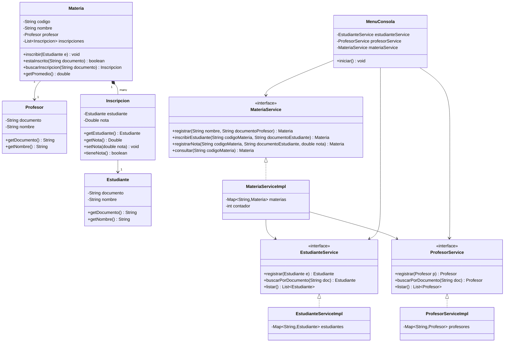

---

## 6. Diagramas de secuencia

### 6.1 Registrar materia (CU-05)

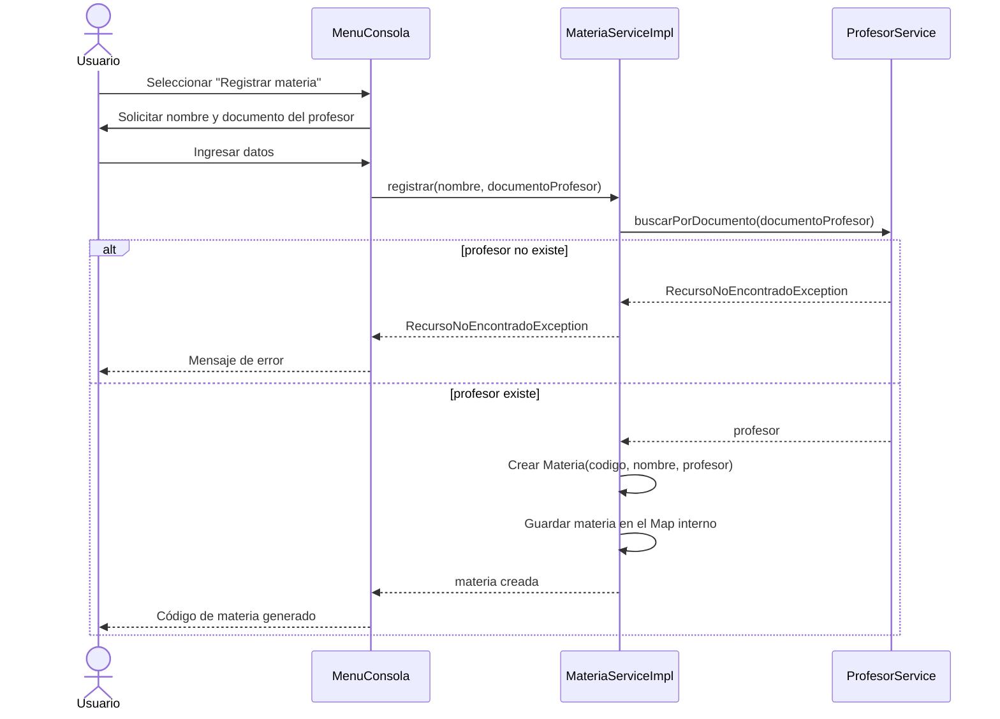

### 6.2 Inscribir estudiante en materia (CU-06)

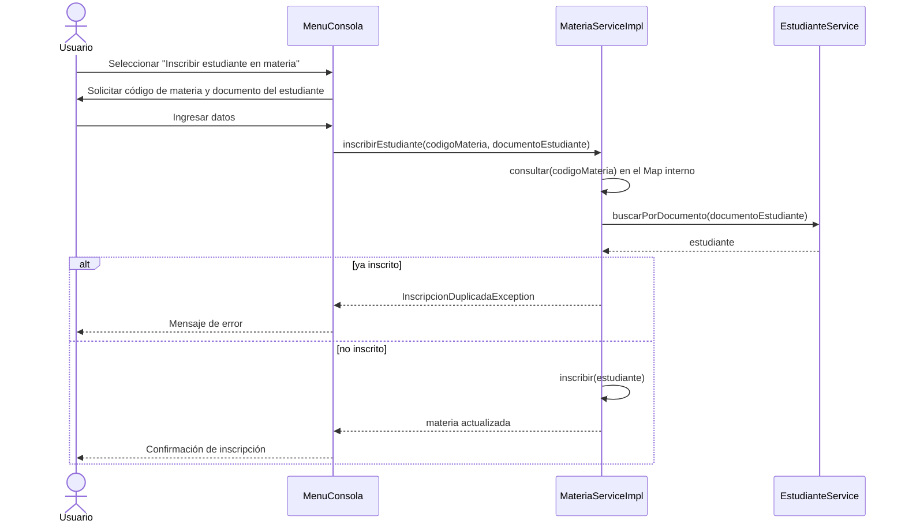

### 6.3 Registrar nota (CU-07)

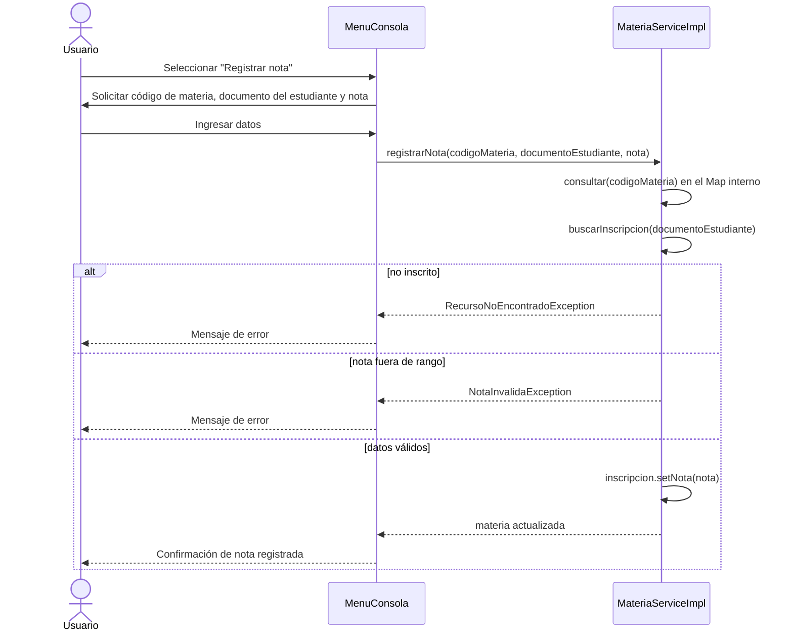

### 6.4 Consultar detalle de materia (CU-08)

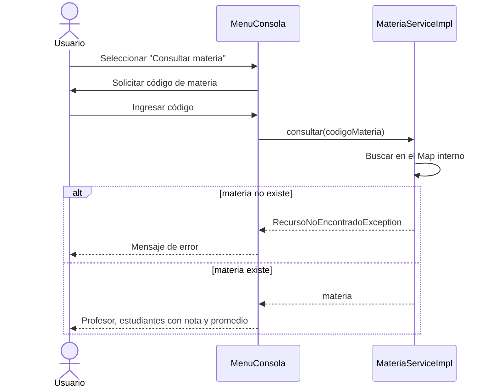

---

## 7. Modelos (`model`)

`model/Estudiante.java`:

```java
public class Estudiante {

    private final String documento;
    private final String nombre;

    public Estudiante(String documento, String nombre) {
        this.documento = documento;
        this.nombre = nombre;
    }

    public String getDocumento() { return documento; }
    public String getNombre() { return nombre; }

    @Override
    public String toString() {
        return "Estudiante{documento='%s', nombre='%s'}".formatted(documento, nombre);
    }
}
```

`model/Profesor.java`:

```java
public class Profesor {

    private final String documento;
    private final String nombre;

    public Profesor(String documento, String nombre) {
        this.documento = documento;
        this.nombre = nombre;
    }

    public String getDocumento() { return documento; }
    public String getNombre() { return nombre; }

    @Override
    public String toString() {
        return "Profesor{documento='%s', nombre='%s'}".formatted(documento, nombre);
    }
}
```

`model/Inscripcion.java`:

```java
public class Inscripcion {

    private final Estudiante estudiante;
    private Double nota;

    public Inscripcion(Estudiante estudiante) {
        this.estudiante = estudiante;
        this.nota = null;
    }

    public Estudiante getEstudiante() { return estudiante; }
    public Double getNota() { return nota; }
    public boolean tieneNota() { return nota != null; }

    public void setNota(double nota) {
        if (nota < 0.0 || nota > 5.0) {
            throw new IllegalArgumentException("La nota debe estar entre 0.0 y 5.0");
        }
        this.nota = nota;
    }

    @Override
    public String toString() {
        return "  - %s: %s".formatted(estudiante.getNombre(), tieneNota() ? nota : "sin nota");
    }
}
```

`model/Materia.java`:

```java
public class Materia {

    private final String codigo;
    private final String nombre;
    private final Profesor profesor;
    private final List<Inscripcion> inscripciones = new ArrayList<>();

    public Materia(String codigo, String nombre, Profesor profesor) {
        this.codigo = codigo;
        this.nombre = nombre;
        this.profesor = profesor;
    }

    public String getCodigo() { return codigo; }
    public String getNombre() { return nombre; }
    public Profesor getProfesor() { return profesor; }
    public List<Inscripcion> getInscripciones() { return List.copyOf(inscripciones); }

    public boolean estaInscrito(String documentoEstudiante) {
        return inscripciones.stream()
                .anyMatch(i -> i.getEstudiante().getDocumento().equals(documentoEstudiante));
    }

    public void inscribir(Estudiante estudiante) {
        if (estaInscrito(estudiante.getDocumento())) {
            throw new InscripcionDuplicadaException(
                    "El estudiante ya está inscrito en la materia: " + estudiante.getDocumento());
        }
        inscripciones.add(new Inscripcion(estudiante));
    }

    public Inscripcion buscarInscripcion(String documentoEstudiante) {
        return inscripciones.stream()
                .filter(i -> i.getEstudiante().getDocumento().equals(documentoEstudiante))
                .findFirst()
                .orElseThrow(() -> new RecursoNoEncontradoException(
                        "El estudiante no está inscrito en la materia: " + documentoEstudiante));
    }

    public double getPromedio() {
        return inscripciones.stream()
                .filter(Inscripcion::tieneNota)
                .mapToDouble(Inscripcion::getNota)
                .average()
                .orElse(0.0);
    }
}
```

---

## 8. Excepciones (`exception`)

```java
public class RecursoNoEncontradoException extends RuntimeException {
    public RecursoNoEncontradoException(String mensaje) { super(mensaje); }
}
```

```java
public class InscripcionDuplicadaException extends RuntimeException {
    public InscripcionDuplicadaException(String mensaje) { super(mensaje); }
}
```

```java
public class NotaInvalidaException extends RuntimeException {
    public NotaInvalidaException(String mensaje) { super(mensaje); }
}
```

---

## 9. Servicios (`service`) — Single Responsibility + Dependency Inversion

`service/EstudianteService.java`:

```java
public interface EstudianteService {
    Estudiante registrar(Estudiante estudiante);
    Estudiante buscarPorDocumento(String documento);
    List<Estudiante> listar();
}
```

`service/impl/EstudianteServiceImpl.java`:

```java
public class EstudianteServiceImpl implements EstudianteService {

    private final Map<String, Estudiante> estudiantes = new LinkedHashMap<>();

    @Override
    public Estudiante registrar(Estudiante estudiante) {
        if (estudiantes.containsKey(estudiante.getDocumento())) {
            throw new IllegalArgumentException("Ya existe un estudiante con ese documento");
        }
        estudiantes.put(estudiante.getDocumento(), estudiante);
        return estudiante;
    }

    @Override
    public Estudiante buscarPorDocumento(String documento) {
        Estudiante estudiante = estudiantes.get(documento);
        if (estudiante == null) {
            throw new RecursoNoEncontradoException("Estudiante no encontrado: " + documento);
        }
        return estudiante;
    }

    @Override
    public List<Estudiante> listar() {
        return new ArrayList<>(estudiantes.values());
    }
}
```

`service/ProfesorService.java`:

```java
public interface ProfesorService {
    Profesor registrar(Profesor profesor);
    Profesor buscarPorDocumento(String documento);
    List<Profesor> listar();
}
```

`service/impl/ProfesorServiceImpl.java`:

```java
public class ProfesorServiceImpl implements ProfesorService {

    private final Map<String, Profesor> profesores = new LinkedHashMap<>();

    @Override
    public Profesor registrar(Profesor profesor) {
        if (profesores.containsKey(profesor.getDocumento())) {
            throw new IllegalArgumentException("Ya existe un profesor con ese documento");
        }
        profesores.put(profesor.getDocumento(), profesor);
        return profesor;
    }

    @Override
    public Profesor buscarPorDocumento(String documento) {
        Profesor profesor = profesores.get(documento);
        if (profesor == null) {
            throw new RecursoNoEncontradoException("Profesor no encontrado: " + documento);
        }
        return profesor;
    }

    @Override
    public List<Profesor> listar() {
        return new ArrayList<>(profesores.values());
    }
}
```

`service/MateriaService.java`:

```java
public interface MateriaService {
    Materia registrar(String nombre, String documentoProfesor);
    Materia inscribirEstudiante(String codigoMateria, String documentoEstudiante);
    Materia registrarNota(String codigoMateria, String documentoEstudiante, double nota);
    Materia consultar(String codigoMateria);
}
```

`service/impl/MateriaServiceImpl.java`:

```java
public class MateriaServiceImpl implements MateriaService {

    private final Map<String, Materia> materias = new LinkedHashMap<>();
    private final EstudianteService estudianteService;
    private final ProfesorService profesorService;
    private int contador = 0;

    public MateriaServiceImpl(EstudianteService estudianteService, ProfesorService profesorService) {
        this.estudianteService = estudianteService;
        this.profesorService = profesorService;
    }

    @Override
    public Materia registrar(String nombre, String documentoProfesor) {
        Profesor profesor = profesorService.buscarPorDocumento(documentoProfesor);
        String codigo = "MAT-" + (++contador);
        Materia materia = new Materia(codigo, nombre, profesor);
        materias.put(codigo, materia);
        return materia;
    }

    @Override
    public Materia inscribirEstudiante(String codigoMateria, String documentoEstudiante) {
        Materia materia = consultar(codigoMateria);
        Estudiante estudiante = estudianteService.buscarPorDocumento(documentoEstudiante);
        materia.inscribir(estudiante);
        return materia;
    }

    @Override
    public Materia registrarNota(String codigoMateria, String documentoEstudiante, double nota) {
        Materia materia = consultar(codigoMateria);
        Inscripcion inscripcion = materia.buscarInscripcion(documentoEstudiante);
        try {
            inscripcion.setNota(nota);
        } catch (IllegalArgumentException ex) {
            throw new NotaInvalidaException(ex.getMessage());
        }
        return materia;
    }

    @Override
    public Materia consultar(String codigoMateria) {
        Materia materia = materias.get(codigoMateria);
        if (materia == null) {
            throw new RecursoNoEncontradoException("Materia no encontrada: " + codigoMateria);
        }
        return materia;
    }
}
```

---

## 10. Interfaz de consola (`ui/MenuConsola.java`)

```java
public class MenuConsola {

    private final Scanner scanner = new Scanner(System.in);
    private final EstudianteService estudianteService;
    private final ProfesorService profesorService;
    private final MateriaService materiaService;

    public MenuConsola(EstudianteService estudianteService,
                        ProfesorService profesorService,
                        MateriaService materiaService) {
        this.estudianteService = estudianteService;
        this.profesorService = profesorService;
        this.materiaService = materiaService;
    }

    public void iniciar() {
        boolean salir = false;
        while (!salir) {
            mostrarMenu();
            String opcion = scanner.nextLine().trim();
            try {
                switch (opcion) {
                    case "1" -> registrarEstudiante();
                    case "2" -> listarEstudiantes();
                    case "3" -> registrarProfesor();
                    case "4" -> listarProfesores();
                    case "5" -> registrarMateria();
                    case "6" -> inscribirEstudiante();
                    case "7" -> registrarNota();
                    case "8" -> consultarMateria();
                    case "0" -> salir = true;
                    default -> System.out.println("Opción inválida. Intente de nuevo.");
                }
            } catch (RecursoNoEncontradoException | InscripcionDuplicadaException
                     | NotaInvalidaException | IllegalArgumentException ex) {
                System.out.println("Error: " + ex.getMessage());
            }
        }
        System.out.println("Programa finalizado.");
    }

    private void mostrarMenu() {
        System.out.println("""

                === Sistema de Notas ===
                1. Registrar estudiante
                2. Listar estudiantes
                3. Registrar profesor
                4. Listar profesores
                5. Registrar materia
                6. Inscribir estudiante en materia
                7. Registrar nota
                8. Consultar materia
                0. Salir
                Seleccione una opción:""");
    }

    private void registrarEstudiante() {
        System.out.print("Documento: ");
        String documento = scanner.nextLine().trim();
        System.out.print("Nombre: ");
        String nombre = scanner.nextLine().trim();

        Estudiante estudiante = estudianteService.registrar(new Estudiante(documento, nombre));
        System.out.println("Estudiante registrado: " + estudiante);
    }

    private void listarEstudiantes() {
        List<Estudiante> estudiantes = estudianteService.listar();
        if (estudiantes.isEmpty()) {
            System.out.println("No hay estudiantes registrados.");
            return;
        }
        estudiantes.forEach(System.out::println);
    }

    private void registrarProfesor() {
        System.out.print("Documento: ");
        String documento = scanner.nextLine().trim();
        System.out.print("Nombre: ");
        String nombre = scanner.nextLine().trim();

        Profesor profesor = profesorService.registrar(new Profesor(documento, nombre));
        System.out.println("Profesor registrado: " + profesor);
    }

    private void listarProfesores() {
        List<Profesor> profesores = profesorService.listar();
        if (profesores.isEmpty()) {
            System.out.println("No hay profesores registrados.");
            return;
        }
        profesores.forEach(System.out::println);
    }

    private void registrarMateria() {
        System.out.print("Nombre de la materia: ");
        String nombre = scanner.nextLine().trim();
        System.out.print("Documento del profesor: ");
        String documentoProfesor = scanner.nextLine().trim();

        Materia materia = materiaService.registrar(nombre, documentoProfesor);
        System.out.println("Materia registrada con código: " + materia.getCodigo());
    }

    private void inscribirEstudiante() {
        System.out.print("Código de materia: ");
        String codigo = scanner.nextLine().trim();
        System.out.print("Documento del estudiante: ");
        String documento = scanner.nextLine().trim();

        materiaService.inscribirEstudiante(codigo, documento);
        System.out.println("Estudiante inscrito correctamente.");
    }

    private void registrarNota() {
        System.out.print("Código de materia: ");
        String codigo = scanner.nextLine().trim();
        System.out.print("Documento del estudiante: ");
        String documento = scanner.nextLine().trim();
        System.out.print("Nota (0.0 - 5.0): ");
        double nota = Double.parseDouble(scanner.nextLine().trim());

        materiaService.registrarNota(codigo, documento, nota);
        System.out.println("Nota registrada correctamente.");
    }

    private void consultarMateria() {
        System.out.print("Código de materia: ");
        String codigo = scanner.nextLine().trim();
        Materia materia = materiaService.consultar(codigo);

        System.out.println("Materia: " + materia.getNombre() + " (" + materia.getCodigo() + ")");
        System.out.println("Profesor: " + materia.getProfesor().getNombre());
        System.out.println("Estudiantes inscritos:");
        materia.getInscripciones().forEach(System.out::println);
        System.out.printf("Promedio del grupo: %.2f%n", materia.getPromedio());
    }
}
```

---

## 11. Punto de entrada (`Main.java`)

```java
public class Main {
    public static void main(String[] args) {
        EstudianteService estudianteService = new EstudianteServiceImpl();
        ProfesorService profesorService = new ProfesorServiceImpl();
        MateriaService materiaService = new MateriaServiceImpl(estudianteService, profesorService);

        MenuConsola menu = new MenuConsola(estudianteService, profesorService, materiaService);
        menu.iniciar();
    }
}
```

---

## 12. Compilación y ejecución

### Con Maven

`pom.xml` mínimo:

```xml
<project xmlns="http://maven.apache.org/POM/4.0.0">
    <modelVersion>4.0.0</modelVersion>
    <groupId>com.example</groupId>
    <artifactId>notas</artifactId>
    <version>1.0.0</version>
    <properties>
        <maven.compiler.source>17</maven.compiler.source>
        <maven.compiler.target>17</maven.compiler.target>
    </properties>
</project>
```

```bash
mvn compile
mvn exec:java -Dexec.mainClass="com.example.notas.Main"
```

### Sin Maven (javac directo)

```bash
find src -name "*.java" > sources.txt
javac -d out @sources.txt
java -cp out com.example.notas.Main
```

---

## 13. Resumen del flujo completo

1. Levantar historias de usuario y catálogo de casos de uso a partir de las reglas de negocio (estudiante, profesor, materia, nota entre 0.0 y 5.0).
2. Especificar cada caso de uso con flujo principal y alternativos.
3. Diseñar el modelo de dominio (`Estudiante`, `Profesor`, `Materia`, `Inscripcion`), incluyendo en `Materia` la relación con `Inscripcion` y el cálculo del promedio.
4. Definir interfaces de servicio con la lógica de negocio y las validaciones (documento único, existencia de profesor/estudiante/materia, no duplicar inscripción, nota en rango válido), cada una con su propia colección en memoria (`Map`).
5. Inyectar las dependencias por constructor desde `Main` (`MateriaServiceImpl` depende de `EstudianteService` y `ProfesorService`), respetando el principio de inversión de dependencias.
6. Construir el menú de consola (`Scanner`) que orquesta las operaciones y traduce las excepciones de negocio en mensajes claros para el usuario.
7. Verificar cada flujo contra los diagramas de secuencia y los criterios de aceptación de las historias de usuario.
