# Tercer corte: diagramas de secuencia del sistema de facturación

## 2. Qué es un diagrama de secuencia

Un diagrama de secuencia es un diagrama de interacción UML que muestra **qué participantes se comunican, mediante qué mensajes y en qué orden**, durante un escenario.

Se lee de arriba hacia abajo. Los participantes se distribuyen horizontalmente y cada uno tiene una línea de vida vertical. Una flecha comunica un mensaje entre participantes.

La posición vertical representa orden, no una escala de segundos. Sin restricciones temporales explícitas, la distancia entre flechas no indica duración. UML describe ordenaciones de eventos; estos diagramas se leen como una secuencia simple porque el proyecto utiliza llamadas síncronas en un único hilo de ejecución.

### Diferencia con otros diagramas

| Diagrama | Pregunta principal | Ejemplo en este proyecto |
|---|---|---|
| Casos de uso | ¿Qué objetivo busca un actor? | Registrar un cliente. |
| Clases | ¿Qué estructura y relaciones existen? | Una `Factura` referencia un `Cliente` y una lista de `Producto`. |
| Secuencia | ¿Quién llama a quién y en qué orden? | `Menu` llama a `ClienteOperacion`, que crea un `Cliente`. |

Un caso de uso puede necesitar varios escenarios y, por tanto, varios diagramas: éxito, datos inválidos y resultado no encontrado. Un diagrama no debe intentar representar toda la aplicación con todos sus detalles a la vez.

### Diagrama de sistema y diagrama de diseño

Los diagramas siguientes son principalmente **de diseño, reconstruidos desde el código**. El usuario es el actor; `Menu`, las operaciones, los modelos y las listas son participantes internos.

## 3. Conceptos técnicos y notación utilizada

Los diagramas usan Mermaid dentro de bloques `mermaid`. Para verlos gráficamente en VS Code se necesita una vista previa de Markdown con soporte Mermaid. Mermaid permite representar la interacción, pero no sustituye todas las posibilidades de una herramienta UML especializada.

| Concepto | Notación Mermaid | Significado y cuidado técnico |
|---|---|---|
| Actor | `actor U as Usuario` | Rol externo que inicia o participa en un escenario. No es una clase Java del proyecto. |
| Participante | `participant CO as co:ClienteOperacion` | Objeto o elemento que recibe mensajes. El alias identifica la línea de vida. |
| Línea de vida | Línea vertical bajo el participante | Existencia del participante durante la interacción; no representa una variable local. |
| Llamada síncrona | `M->>CO: buscarCliente(id)` | El emisor espera que la llamada termine. Se usa para las llamadas Java de este proyecto. |
| Respuesta | `CO-->>M: cliente o null` | Devuelve el control y, cuando corresponde, un valor. |
| Activación | `activate CO` / `deactivate CO` | Intervalo en que una llamada está siendo atendida. No es el tiempo total de vida del objeto. |
| Autollamada | `M->>M: registrarCliente()` | Un método invoca otro sobre el mismo objeto. |
| Creación | `create participant C as cliente:Cliente` y `CO->>C: new Cliente()` | La línea de vida empieza al crearse el objeto, no antes. |
| Alternativa | `alt condición` / `else` / `end` | Caminos excluyentes según una guarda. Una guarda debe ser comprensible y comprobable. |
| Opción | `opt condición` / `end` | Un bloque que puede ocurrir o no; no equivale a una alternativa completa de dos ramas. |
| Repetición | `loop condición` / `end` | Iteración controlada por una condición; puede ejecutarse cero veces. |
| Ruptura de interacción | `break condición` / `end` | UML permite abandonar el fragmento envolvente. Su alcance debe especificarse; no equivale automáticamente a un `break` Java. |
| Nota | `Note over M,CO: texto` | Aclara supuestos, estado o detalle omitido. No representa una llamada de método. |

### Precisiones

1. **Objeto y clase no son lo mismo.** `cliente:Cliente` representa una instancia. En un recorrido de una lista, una línea etiquetada como “cliente actual” representa esquemáticamente el objeto de la iteración; no significa que toda la lista sea un único cliente.
2. **Activación y existencia son diferentes.** El objeto puede seguir vivo después de terminar un método. Una lista conserva referencias a los modelos registrados.
3. **`void` no significa “sin retorno de control”.** La llamada termina y el emisor continúa, pero no recibe un dato. Las respuestas `fin (void)` son explicativas, no valores Java.
4. **Una expresión local no necesita otra línea de vida.** La suma del subtotal se expresa en una nota. No se inventa un objeto “Calculadora” que no existe.
5. **Las listas no son bases de datos.** Una línea `clientes:ArrayList` representa almacenamiento en memoria. Su `add()` no implica persistencia ni una transacción.
6. **Una solicitud de usuario es conceptual.** Las flechas `Usuario → Menu` expresan la selección o entrega de datos, no una invocación Java desde una clase `Usuario`.
7. **No se confunde visibilidad con disponibilidad.** Que un método sea `public` no demuestra que el menú lo invoque.
8. **Los diagramas tienen un nivel de abstracción declarado.** Se omiten algunas llamadas repetidas a `get(i)`, `size()`, setters con retorno `void` y detalles de `Scanner` para favorecer la enseñanza. No se altera el comportamiento.

En las búsquedas se dibuja el recorrido interno de manera esquemática y se muestra **una sola respuesta después del bloque**. La guarda “hasta la primera coincidencia” representa el `return` anticipado del código. No se dibujan retornos dentro de un `loop` que parezca seguir ejecutándose, ni se usa un `break` que pudiera eliminar también la presentación del resultado en el llamador.

## 4. Reconocimiento del proyecto antes de dibujar

### 4.1. Participantes y responsabilidades

| Participante | Responsabilidad real | Fuente |
|---|---|---|
| `App` | Crear el menú y llamar a `mostrarMenu()`. | [App.java](sistema-facturacion-software/src/App.java) |
| `Menu` | Mostrar opciones, leer entradas y presentar clientes/productos. | [Menu.java](sistema-facturacion-software/src/Menu.java) |
| `ClienteOperacion` | Registrar, buscar y devolver la lista de clientes. | [ClienteOperacion.java](sistema-facturacion-software/src/ClienteOperacion.java) |
| `ProductoOperacion` | Registrar, buscar y devolver la lista de productos. | [ProductoOperacion.java](sistema-facturacion-software/src/ProductoOperacion.java) |
| `FacturaOperacion` | Registrar, asociar, buscar y calcular sobre facturas. | [FacturaOperacion.java](sistema-facturacion-software/src/FacturaOperacion.java) |
| `Cliente` | Mantener nombre, identificación, correo y dirección. | [Cliente.java](sistema-facturacion-software/src/Cliente.java) |
| `Producto` | Mantener código, nombre, precio y stock. | [Producto.java](sistema-facturacion-software/src/Producto.java) |
| `Factura` | Mantener consecutivo, fecha, importes y referencias a cliente/productos. | [Factura.java](sistema-facturacion-software/src/Factura.java) |
| `Scanner` y `System.out` | Leer y escribir en consola. | [Menu.java](sistema-facturacion-software/src/Menu.java) |
| Listas internas | Conservar objetos mientras vive su instancia de operaciones. | Clases de operaciones anteriores. |

Es posible analizar estas responsabilidades usando las categorías **boundary**, **control** y **entity**: `Menu` funciona como frontera de consola, las operaciones coordinan acciones y los modelos conservan datos. Son categorías de análisis, no estereotipos declarados en Java ni prueba de una arquitectura MVC completa.

### 4.2. Inventario de escenarios

| ID | Escenario | Punto de entrada | Disponible desde el menú |
|---|---|---|---|
| DS-01 | Arrancar y seleccionar una opción | `App.main()` / `Menu.mostrarMenu()` | Sí. |
| DS-02 | Registrar cliente | `Menu.registrarCliente()` | Opción 1. |
| DS-03 | Buscar cliente | `Menu.buscarCliente()` | Opción 2. |
| DS-04 | Listar clientes | `Menu.listarClientes()` | Opción 3. |
| DS-05 | Registrar producto | `Menu.registrarProducto()` | Opción 4. |
| DS-06 | Buscar producto | `Menu.buscarProducto()` | Opción 5. |
| DS-07 | Listar productos | `Menu.listarProductos()` | Opción 6. |
| DS-08 | Registrar factura | `FacturaOperacion.registrarFactura()` | No. |
| DS-09 | Asociar cliente | `FacturaOperacion.agregarCliente()` | No. |
| DS-10 | Agregar producto a factura | `FacturaOperacion.agregarProducto()` | No. |
| DS-11 | Buscar factura | `FacturaOperacion.buscarFactura()` | No. |
| DS-12 | Calcular subtotal | `FacturaOperacion.calcularSubtotal()` | No. |
| DS-13 | Calcular impuesto | `FacturaOperacion.calcularImpuesto()` | No. |
| DS-14 | Calcular total | `FacturaOperacion.calcularTotal()` | No. |

## 5. Método paso a paso para construir los diagramas

### Paso 1. Delimitar el objetivo

Escribir una frase concreta, por ejemplo: “El usuario registra un cliente proporcionando nombre, identificación, correo y dirección”. No utilizar objetivos demasiado amplios como “administrar todo el sistema”.

### Paso 2. Establecer precondiciones y resultados

Para el registro: el menú y `ClienteOperacion` existen, y las entradas permiten convertir la identificación a `int`. El resultado es un nuevo objeto agregado a la lista interna. No debe prometerse una confirmación visual porque el programa no la imprime.

Distinguir **precondición de escenario** de **validación implementada**: suponer entradas válidas para explicar el camino normal no significa que el sistema valide el correo o la unicidad.

### Paso 3. Encontrar el disparador y el método de entrada

Localizar el caso del `switch` y seguir la llamada. Si el caso está comentado, no se puede utilizar como disparador implementado; se debe delimitar la operación como una llamada directa a la API Java.

### Paso 4. Identificar emisores y receptores

Para cada expresión de llamada, preguntar: “¿Qué objeto ejecuta esta instrucción y qué objeto recibe el método?”. En `clienteOperacion.registrarCliente(...)`, el emisor es `Menu` y el receptor es su instancia de `ClienteOperacion`.

### Paso 5. Ordenar mensajes y datos

Mantener el orden del código. El cliente se construye antes de ejecutar sus setters y antes de `clientes.add(cliente)`. Los datos de entrada deben aparecer en la llamada que los recibe.

### Paso 6. Convertir estructuras de control

| Elemento Java | Representación recomendada |
|---|---|
| `if` / `else` | `alt` con guardas. |
| `if` sin `else` | `opt`, si solo interesa el bloque condicional. |
| `for` / `while` | `loop` con condición o descripción de recorrido. |
| `return objeto` | Respuesta con ese objeto; indicar si termina anticipadamente. |
| `return null` | Respuesta ausente y tratamiento del llamador. |
| `new Clase()` | Creación de participante cuando se muestra a nivel de diseño. |
| Operación aritmética local | Nota con fórmula o autollamada conceptual claramente señalada. |
| Excepción no capturada | Camino interrumpido; no inventar un mensaje de recuperación. |

### Paso 7. Revisar estado y referencias

Precisar qué cambia: el registro añade un objeto; la búsqueda no lo modifica; `agregarCliente()` reemplaza una referencia; `agregarProducto()` modifica una lista; los cálculos escriben importes en la factura.

### Paso 8. Comprobar el diagrama contra el código

Revisar nombres, parámetros, orden, retornos, guardas y alcance de los ciclos. Verificar especialmente si hay `return` anticipado, si se actualizan todas las coincidencias y si una operación llama realmente a otra.

### Paso 9. Derivar pruebas

Cada alternativa debe sugerir una prueba: encontrado/no encontrado, lista vacía/no vacía, identificación válida/inválida. La trazabilidad debe funcionar en ambos sentidos: del requisito al diagrama y del mensaje del diagrama a su implementación.

## 6. Diagramas de secuencia de la aplicación

### DS-01. Arranque, menú y despacho

**Objetivo:** explicar quién inicia la aplicación y cómo se seleccionan los escenarios.

**Fuente:** [App.java](sistema-facturacion-software/src/App.java#L1-L6) y [Menu.java](sistema-facturacion-software/src/Menu.java#L5-L52).

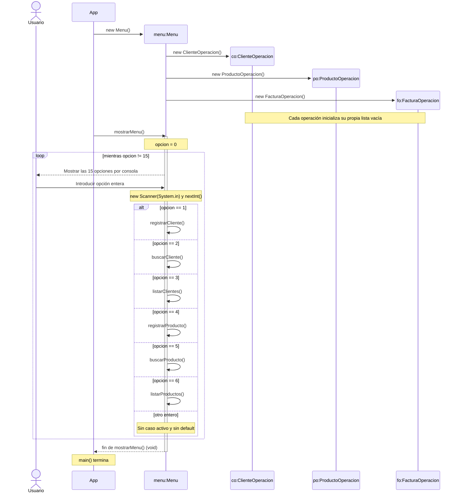

**Cómo se construye:**

1. Partir de `main()`, que crea `Menu` y llama a `mostrarMenu()`.
2. Incorporar los tres objetos de operaciones: se crean al inicializar los campos de `Menu`, antes de entrar al método.
3. Transformar `while(opcion != 15)` en `loop`.
4. Transformar los seis casos activos del `switch` en alternativas. Las autollamadas corresponden a métodos del mismo `Menu`.
5. Dejar visible que los demás enteros no ejecutan una acción. Al leer 15, esa iteración no despacha un caso y la siguiente evaluación del `while` finaliza el método.

**Concepto clave:** crear `FacturaOperacion` no hace accesibles sus métodos desde la consola. Además, si `nextInt()` recibe una entrada incompatible, puede lanzar `InputMismatchException`; el diagrama muestra el camino normal, no un manejo de errores inexistente.

### DS-02. Registrar cliente

**Precondición del camino normal:** identificación convertible a `int`.

**Resultado:** un nuevo cliente agregado a la lista. No hay verificación de duplicados ni confirmación de éxito.

**Fuente:** [captura en el menú](sistema-facturacion-software/src/Menu.java#L54-L66) y [registro del cliente](sistema-facturacion-software/src/ClienteOperacion.java#L7-L14).

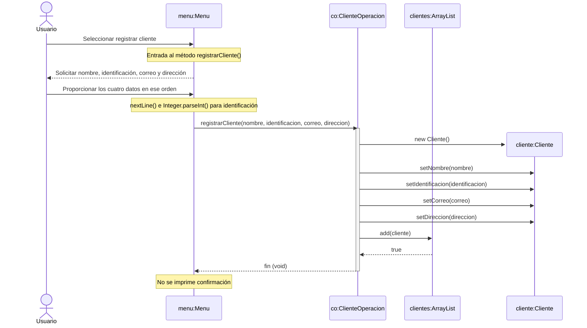

**Cómo se construye:** separar captura de datos, creación del modelo y almacenamiento. Ubicar la conversión numérica en `Menu`, no en `ClienteOperacion`. Iniciar la vida de `Cliente` en `new Cliente()` y representar los setters en su orden real.

**Conceptos técnicos:** `add()` de `ArrayList` devuelve `true`, aunque la operación ignora ese valor; la operación completa devuelve `void`. La lista conserva una referencia al cliente, no una copia. Un identificador duplicado también se agrega porque no existe una búsqueda previa de unicidad.

**Camino alternativo:** si `Integer.parseInt()` falla, se lanza `NumberFormatException` antes de llamar a `registrarCliente(...)`; ese intento no crea ni agrega un cliente. No hay `try/catch` ni solicitud automática de reintento.

### DS-03. Buscar cliente: encontrado o ausente

**Resultado:** primer cliente coincidente o `null`; el menú presenta el resultado.

**Fuente:** [búsqueda interna](sistema-facturacion-software/src/ClienteOperacion.java#L16-L23) y [presentación](sistema-facturacion-software/src/Menu.java#L68-L81).

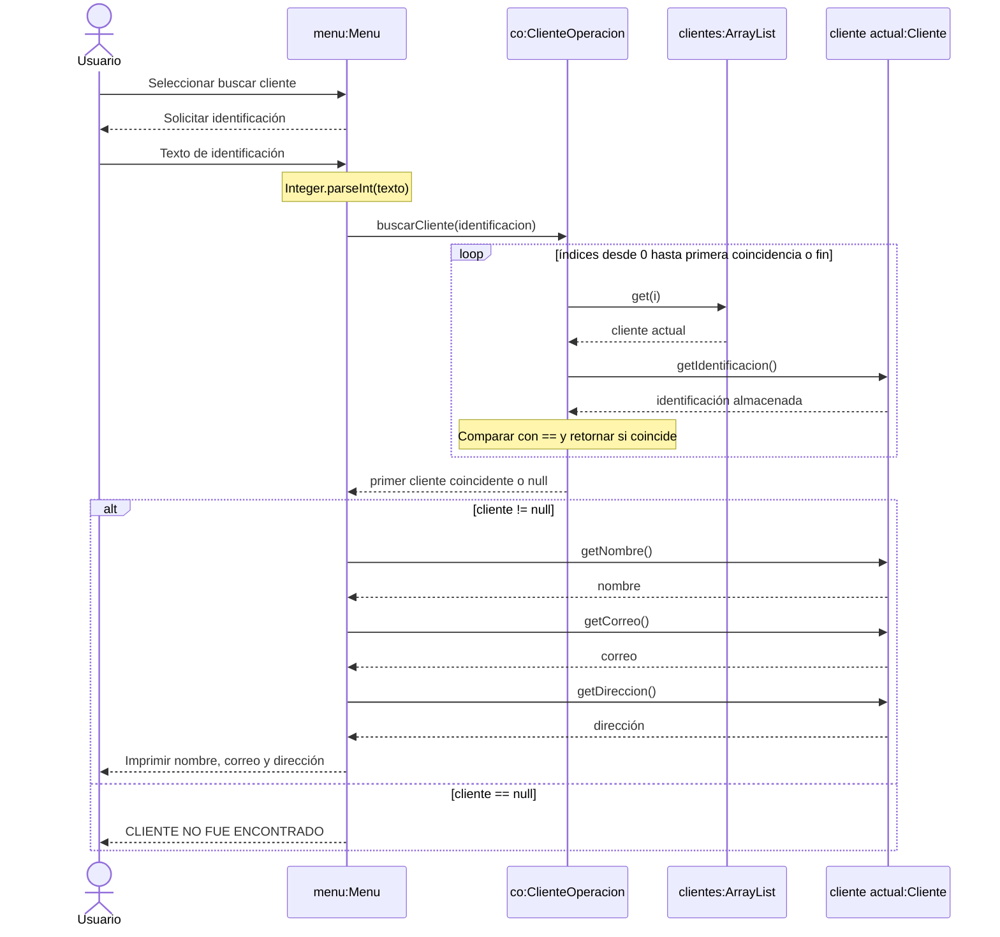

**Cómo se construye:** primero representar el recorrido de la operación, luego su respuesta y finalmente el `if/else` del menú. El recorrido puede tener cero iteraciones si la lista está vacía. La salida del bucle es una abstracción del `return` anticipado: el Java no utiliza una variable “encontrado” ni un `break` literal.

**Conceptos técnicos:** búsqueda lineal con costo temporal $O(n)$ en el peor caso; comparación de dos `int` con `==`; retorno de referencia al objeto almacenado; obligación del llamador de interpretar `null`. Si hay identificaciones duplicadas, solo se devuelve la primera coincidencia.

**Detalle de abstracción:** el código intercala cada getter con su `println()`. Aquí se agrupa la presentación en una respuesta conceptual al usuario; no se cambia el orden de lectura de los campos.

### DS-04. Listar clientes

**Resultado:** imprimir cada cliente; con lista vacía no se imprime un aviso.

**Fuente:** [retorno de lista](sistema-facturacion-software/src/ClienteOperacion.java#L25-L27) y [recorrido del menú](sistema-facturacion-software/src/Menu.java#L83-L91).

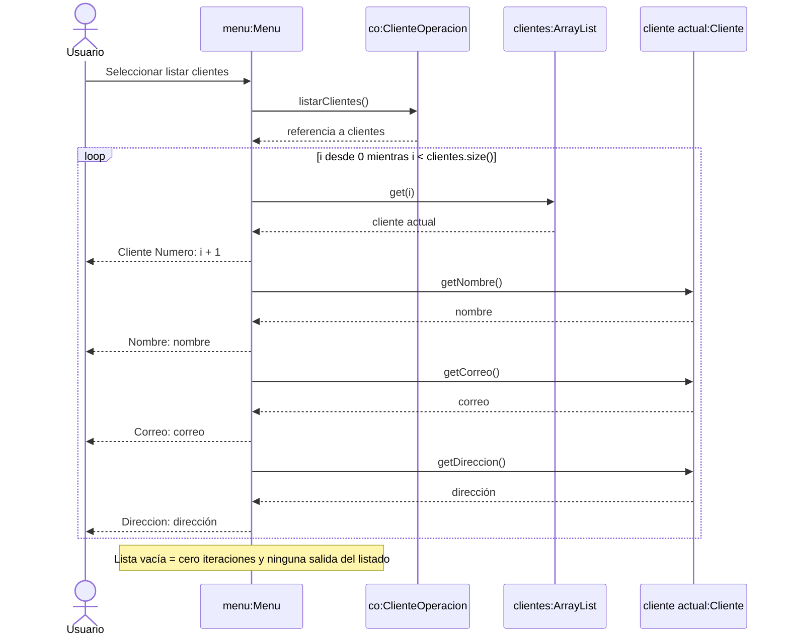

**Cómo se construye:** no ubicar el ciclo de presentación en `ClienteOperacion`; su método únicamente devuelve la lista. El `loop` pertenece a `Menu`. Se omiten los `get(i)` repetidos antes de cada getter y las consultas de `size()`.

**Conceptos técnicos:** `i + 1` es numeración de presentación, no identificación del cliente. Retornar la lista interna expone una referencia mutable: un llamador puede modificar el almacenamiento si usa esa referencia.

### DS-05. Registrar producto

**Precondición del camino normal:** precio convertible a `double` y stock convertible a `int`.

**Fuente:** [entrada por consola](sistema-facturacion-software/src/Menu.java#L93-L105) y [registro](sistema-facturacion-software/src/ProductoOperacion.java#L7-L14).

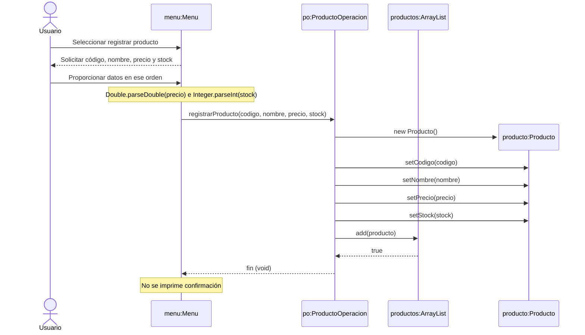

**Cómo se construye:** seguir el patrón del registro de clientes, pero conservar los parámetros y setters de `Producto`. No reutilizar nombres de atributos de cliente ni añadir validaciones inexistentes.

**Conceptos técnicos:** conversión de tipos no equivale a validación de negocio. Se pueden almacenar precios y existencias negativos, códigos repetidos y cadenas vacías. `Double.parseDouble()` también puede aceptar valores no finitos como `NaN` e infinito. Una conversión fallida interrumpe la captura antes de registrar.

### DS-06. Buscar producto

**Resultado:** primer producto cuyo código coincide o `null`. Si no existe, el menú no imprime un mensaje específico.

**Fuente:** [búsqueda por código](sistema-facturacion-software/src/ProductoOperacion.java#L16-L23) y [presentación](sistema-facturacion-software/src/Menu.java#L107-L118).

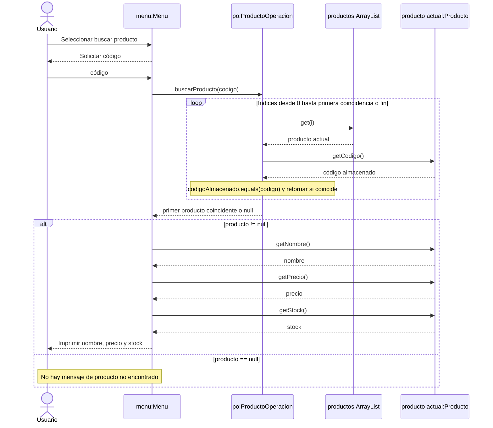

**Cómo se construye:** reutilizar la estructura de búsqueda, pero cambiar la condición. La comparación de código usa `String.equals()`, no `==`. El `else` del diagrama documenta la ausencia de salida; no implica que exista un bloque `else` en el código.

**Conceptos técnicos:** `equals()` compara contenido, distingue mayúsculas y minúsculas y no elimina espacios. Si un código almacenado fuera `null`, la llamada a `equals()` podría lanzar `NullPointerException`. Esta situación es posible mediante llamadas directas a las operaciones o modificación de modelos, aunque `nextLine()` no devuelve `null` como dato normal de consola.

### DS-07. Listar productos

**Fuente:** [retorno de productos](sistema-facturacion-software/src/ProductoOperacion.java#L25-L27) y [presentación del listado](sistema-facturacion-software/src/Menu.java#L120-L128).

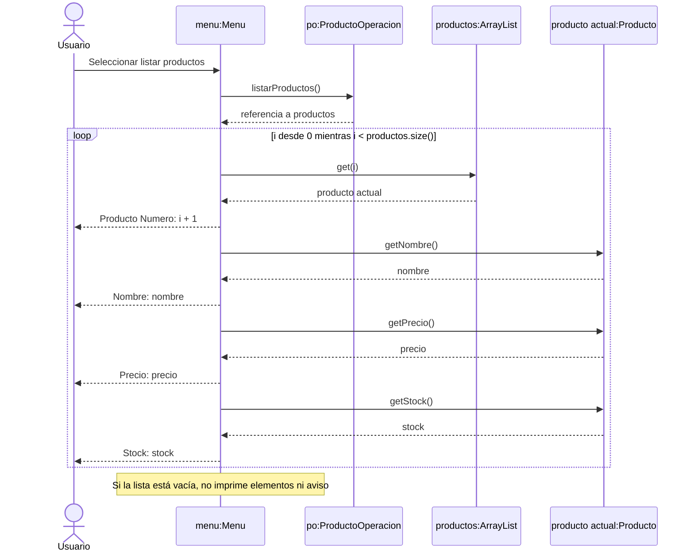

**Cómo se construye:** distinguir quién entrega la colección de quién la recorre y presenta. Comparar con DS-04 para reconocer un patrón de colaboración sin confundir los atributos de los modelos.

**Conceptos técnicos:** devolver `List<Producto>` no significa producir una copia. Las consultas no modifican el stock. La presentación tampoco imprime el código del producto.

## 7. Diagramas de operaciones de facturación

En esta sección, `X` es un **llamador externo al objeto `FacturaOperacion`**, no una clase existente llamada `Llamador`. Puede representar un código de prueba que prepara datos e invoca métodos. No se utiliza `Menu` como emisor porque esas llamadas no están conectadas en la aplicación actual.

Los diagramas presuponen que existe una instancia de `FacturaOperacion`. Para las operaciones que recorren productos, el camino normal supone una lista no nula, elementos no nulos y, en la adición, una lista que admite `add()`.

### DS-08. Registrar factura

**Entradas:** consecutivo, fecha, impuesto, subtotal, total, lista de productos y cliente.

**Resultado:** nueva factura almacenada; no se calculan ni validan los importes.

**Fuente:** [registro de factura](sistema-facturacion-software/src/FacturaOperacion.java#L8-L18) y [modelo de factura](sistema-facturacion-software/src/Factura.java).

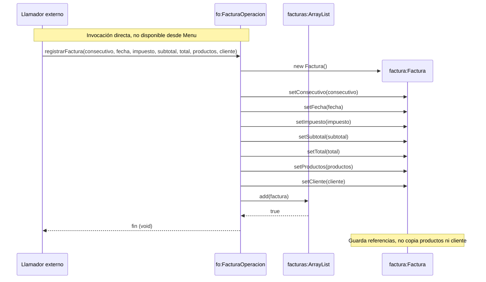

**Cómo se construye:** leer la firma completa antes de dibujar. No sustituir los montos de entrada por llamadas de cálculo, porque `registrarFactura()` únicamente asigna atributos y agrega la factura.

**Conceptos técnicos:** el consecutivo y la fecha los suministra el llamador; no se generan automáticamente. Los modelos no declaran un constructor propio: Java proporciona el constructor sin argumentos. `setProductos()` y `setCliente()` conservan referencias a objetos ya existentes, por lo que no corresponde dibujar su creación dentro de este método.

**Límite importante:** `new Factura()` deja inicialmente `productos` en `null`; la lista no se inicializa por sí sola. Se pueden registrar referencias nulas y consecutivos duplicados. Si el llamador comparte una misma lista entre dos facturas, modificarla puede afectar a ambas.

### DS-09. Asociar o reemplazar el cliente de una factura

**Resultado:** asignar el cliente recibido a **todas** las facturas con el consecutivo indicado.

**Fuente:** [agregarCliente()](sistema-facturacion-software/src/FacturaOperacion.java#L20-L26).

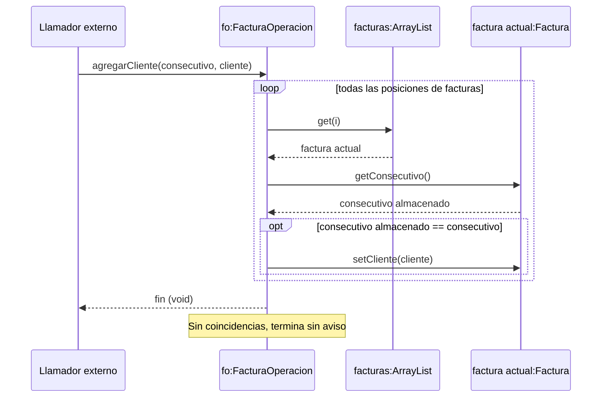

**Cómo se construye:** transformar el `for` en un recorrido completo y el `if` sin `else` en `opt`. No colocar un retorno anticipado al encontrar una coincidencia: el código no lo tiene.

**Conceptos técnicos:** pese a llamarse “agregar”, el método sustituye la referencia anterior mediante un setter. No busca al cliente por identificación ni consulta `ClienteOperacion`; recibe un objeto ya preparado. Acepta `null` y, si existen consecutivos duplicados, modifica todas las coincidencias.

### DS-10. Agregar un producto a una factura

**Resultado:** añadir la referencia del producto a la lista de cada factura coincidente.

**Fuente:** [agregarProducto()](sistema-facturacion-software/src/FacturaOperacion.java#L28-L34).

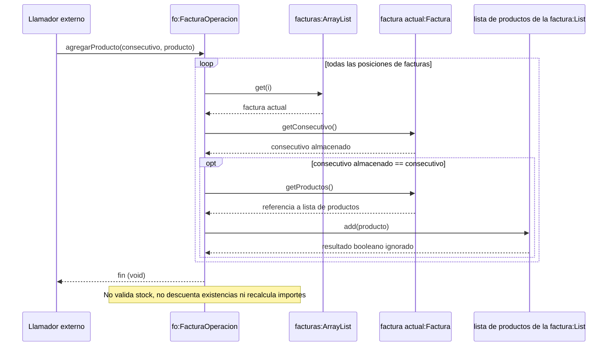

**Cómo se construye:** descomponer la expresión encadenada `facturas.get(i).getProductos().add(producto)` en receptores sucesivos: lista de facturas, factura y lista de productos. El objeto que ejecuta `add()` es la lista, no `Factura` ni `Producto`.

**Conceptos técnicos:** se modifica una colección mutable, sin cantidad de venta explícita. Agregar dos veces el mismo objeto produce dos apariciones si la lista lo admite. Si no existe una factura coincidente, no se informa. Con lista nula puede ocurrir `NullPointerException`; con una lista no modificable puede ocurrir `UnsupportedOperationException`. No hay recuperación implementada.

### DS-11. Buscar factura

**Resultado:** primera factura coincidente o `null`.

**Fuente:** [buscarFactura()](sistema-facturacion-software/src/FacturaOperacion.java#L36-L43).

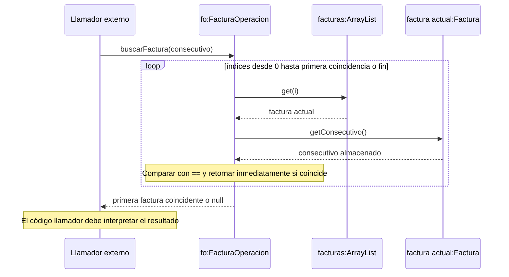

**Cómo se construye:** seguir el mismo patrón de búsqueda de cliente. No agregar impresiones: este método no realiza presentación y no tiene un consumidor activo en `Menu`.

**Concepto clave:** las búsquedas se detienen en la primera coincidencia, pero las asociaciones y los cálculos recorren todas las facturas. Esta diferencia debe reflejarse en las condiciones de los `loop`, especialmente si hay consecutivos duplicados.

### DS-12. Calcular subtotal

**Resultado:** escribir en cada factura coincidente la suma de los precios de sus productos.

**Fuente:** [calcularSubtotal()](sistema-facturacion-software/src/FacturaOperacion.java#L58-L68).

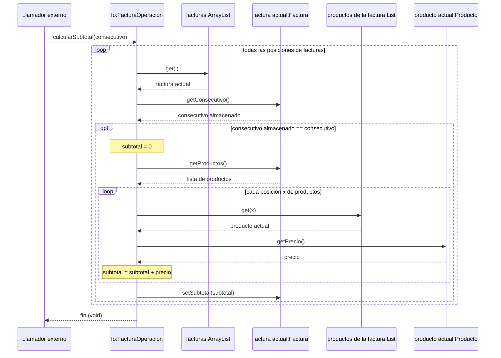

**Cómo se construye:** reconocer dos ciclos anidados: el externo localiza facturas y el interno recorre productos solo cuando el consecutivo coincide. Inicializar el acumulador dentro de la condición de coincidencia, antes del ciclo de productos. Escribir el resultado después de terminar ese ciclo.

**Fórmula implementada**, para $m$ apariciones con precios $p_x$:

$$
S = \sum_{x=0}^{m-1} p_x
$$

**Conceptos técnicos:** cada aparición aporta un precio; no existe una multiplicación por cantidad. `stock` representa existencias del producto, no cantidad vendida. Con una lista vacía se almacena cero. No se modifican impuesto ni total. Se omiten las reevaluaciones repetidas de `get(i)`, `getProductos()` y `size()` presentes en el Java.

### DS-13. Calcular impuesto

**Resultado:** escribir un impuesto del 19 % calculado sobre cada precio de la lista.

**Fuente:** [calcularImpuesto()](sistema-facturacion-software/src/FacturaOperacion.java#L45-L56).

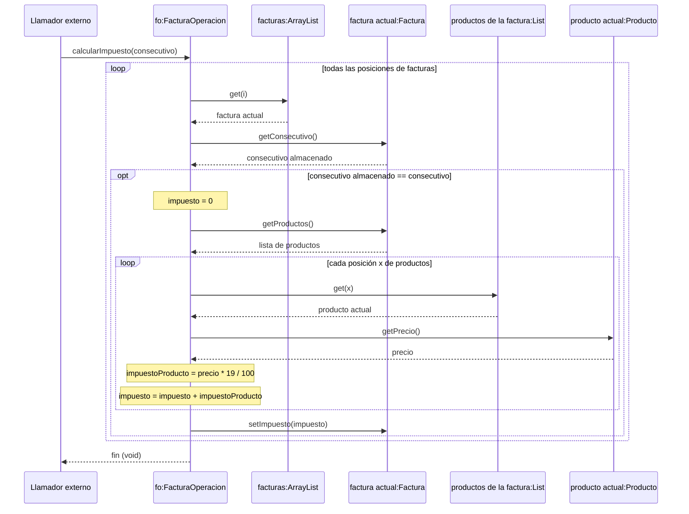

**Cómo se construye:** partir de la estructura de DS-12, cambiar acumulador, expresión y setter, y mantener el cálculo por producto. No dibujar una llamada a `getSubtotal()`, porque el método no consulta ese atributo.

$$
I = \sum_{x=0}^{m-1} \frac{p_x \cdot 19}{100}
$$

**Conceptos técnicos:** aunque 19 y 100 sean literales enteros, la expresión utiliza `double` porque `getPrecio()` devuelve ese tipo; no hay una división entera que elimine decimales. En aritmética exacta equivale al 19 % del subtotal, pero con coma flotante el orden de operaciones puede producir diferencias pequeñas. No hay política explícita de redondeo. La tasa fija describe el código, no una regla tributaria universal.

### DS-14. Calcular total

**Resultado:** sumar el subtotal y el impuesto **ya almacenados** y escribir el total.

**Fuente:** [calcularTotal()](sistema-facturacion-software/src/FacturaOperacion.java#L70-L79).

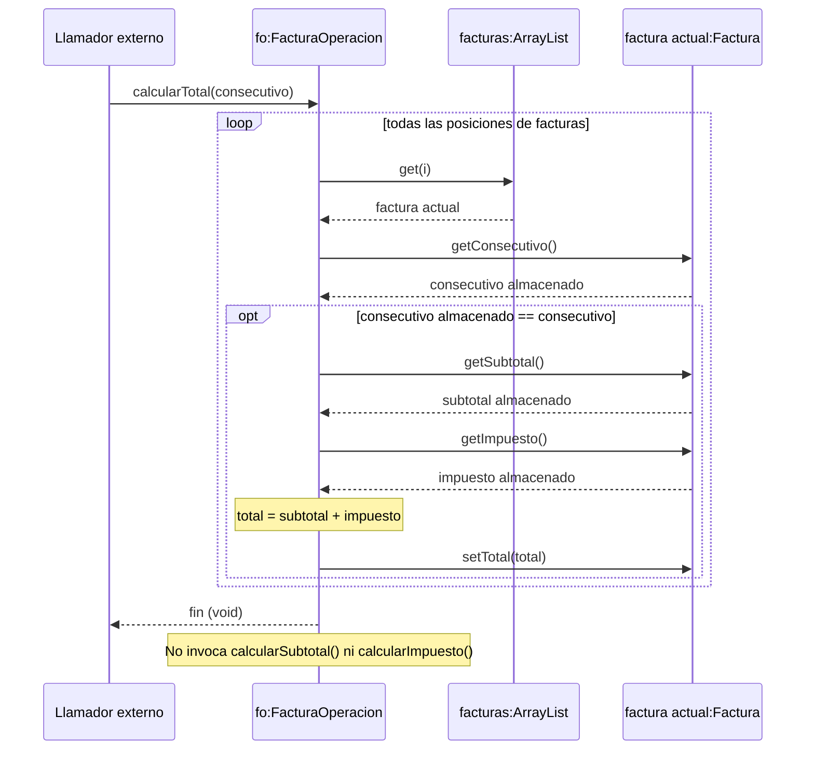

**Cómo se construye:** no asumir que el nombre “calcular total” implica recalcular todos los importes. Dibujar únicamente los getters y el setter que existen. La fórmula toma estado previo, no precios de los productos.

$$
T = S_{\text{almacenado}} + I_{\text{almacenado}}
$$

**Concepto clave:** el resultado puede estar desactualizado si se agregaron productos o se cambiaron precios sin recalcular antes los otros importes. El método tampoco verifica que el subtotal y el impuesto sean coherentes con el contenido de la factura.

## 8. Ejemplo integrador para explicar el orden de las llamadas

### 8.1. Datos de trabajo

Suponer un cliente existente y dos productos con precios de 10 000 y 5 000. Un llamador prepara una lista mutable vacía, registra la factura con consecutivo 1 e importes iniciales cero, añade los productos y luego ejecuta los cálculos.

**Este es un escenario propuesto para un código de prueba; su coordinación no existe actualmente en `App` ni en `Menu`.** Cada método invocado sí existe en `FacturaOperacion`.

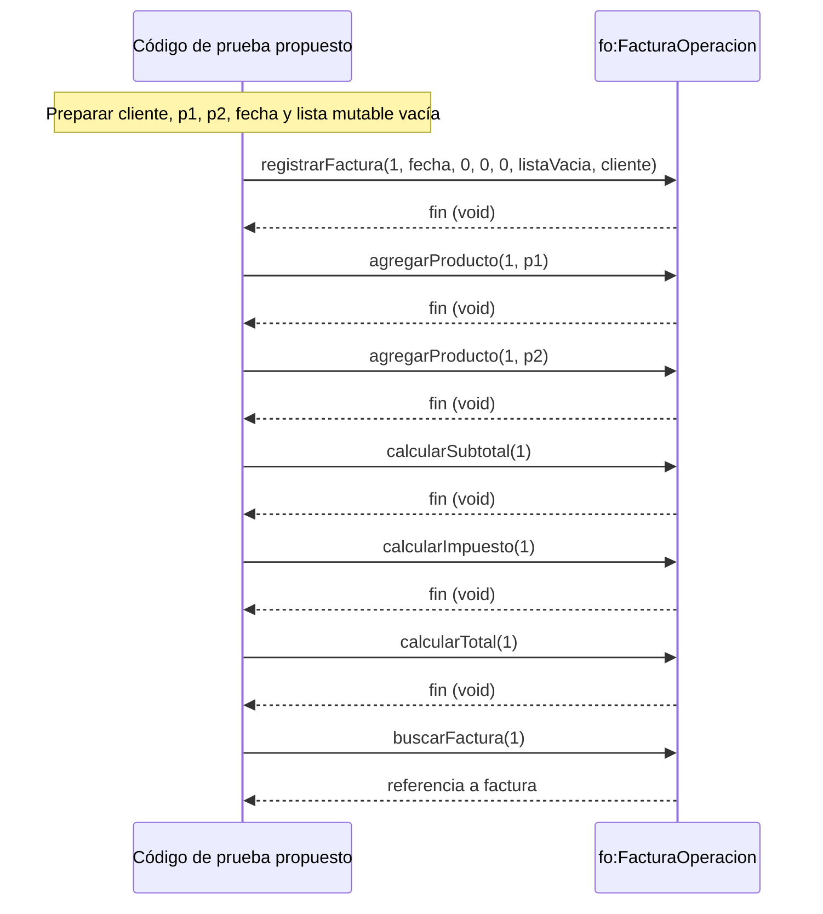

Los detalles internos de esas llamadas se desarrollan en DS-08 y DS-10 a DS-14. Este diagrama cambia el nivel de abstracción: muestra la coordinación externa y no vuelve a dibujar todos los getters o las listas.

### 8.2. Traza del estado esperado

| Después de la llamada | Productos | Subtotal | Impuesto | Total |
|---|---:|---:|---:|---:|
| `registrarFactura(...)` | 0 | 0 | 0 | 0 |
| `agregarProducto(1, p1)` | 1 | 0 | 0 | 0 |
| `agregarProducto(1, p2)` | 2 | 0 | 0 | 0 |
| `calcularSubtotal(1)` | 2 | 15 000 | 0 | 0 |
| `calcularImpuesto(1)` | 2 | 15 000 | 2 850 | 0 |
| `calcularTotal(1)` | 2 | 15 000 | 2 850 | 17 850 |

$$
S = 10\,000 + 5\,000 = 15\,000
$$

$$
I = 10\,000 \cdot 0.19 + 5\,000 \cdot 0.19 = 2\,850
$$

$$
T = 15\,000 + 2\,850 = 17\,850
$$

### 8.3. Preguntas para discutir

- **¿Se puede calcular impuesto antes del subtotal?** Sí. Ambos leen precios de los productos y son independientes entre sí en esta implementación.
- **¿Se puede calcular total antes de los otros cálculos?** El método se puede invocar, pero sumará los valores que estén almacenados en ese momento. No garantizará correspondencia con los productos.
- **¿Qué ocurre si se añade otro producto después?** Cambia la lista, pero permanecen los importes anteriores hasta ejecutar los cálculos necesarios otra vez.
- **¿Qué ocurre si cambia el precio del producto del catálogo?** La factura referencia el mismo objeto si se le suministró ese producto; un nuevo cálculo puede usar el precio modificado. No se conserva un precio histórico de venta.
- **¿Qué ocurre con un consecutivo duplicado?** Los métodos de asociación y cálculo modifican todas las coincidencias, mientras la búsqueda devuelve solo la primera.

## 9. Consideraciones técnicas y limitaciones detectadas

Estas observaciones sirven para evaluar el sistema y proponer requisitos. **No son mejoras implementadas por los diagramas.**

| Aspecto | Comportamiento actual | Consecuencia y posible requisito |
|---|---|---|
| Acceso a facturación | Casos del menú comentados. | Conectar cada opción con una implementación completa y probar su recorrido. |
| Listado de facturas | No existe el método. | Definir contenido y comportamiento del listado antes de implementarlo. |
| Persistencia | Listas en memoria por instancia. | Los datos no se conservan tras finalizar el proceso; definir si se requiere persistencia. |
| Unicidad | No se controlan identificaciones, códigos ni consecutivos repetidos. | Definir claves únicas y respuesta ante duplicados. |
| Entrada numérica | Conversiones y lectura sin captura de excepciones. | Definir mensajes, reintentos y política de rechazo de entradas inválidas. |
| Lectura de consola | Se crean varios `Scanner` sobre `System.in`, incluyendo uno por iteración. | Puede generar problemas de consumo/buffering; conviene centralizar la lectura. No asumir que todas las entradas se consumirán correctamente. |
| Resultado ausente | Cliente muestra aviso; producto no; factura devuelve `null`. | Establecer una política consistente de notificación y retorno. |
| Datos de negocio | Sin validación de correo, rangos, valores finitos o referencias nulas. | Especificar invariantes y validar en una capa adecuada. |
| Stock | Se almacena, pero no se consulta ni descuenta al facturar. | Definir disponibilidad, cantidad vendida y actualización de inventario. |
| Detalle de factura | Solo se conserva `List<Producto>`. | Considerar un detalle con producto, cantidad, precio de venta y tasa aplicable. |
| Referencias compartidas | Se guardan objetos/listas sin copiar. | Cambios externos pueden afectar facturas; definir propiedad y encapsulación. |
| Dinero | Se usa `double`, sin redondeo explícito. | Considerar `BigDecimal`, escala y modo de redondeo acordes con los requisitos. |
| Coherencia de importes | Registro admite montos arbitrarios; cálculos separados. | Definir una operación que coordine cálculos y mantenga invariantes. |
| Atomicidad | Cada coincidencia se modifica durante el recorrido. | Una excepción puede dejar actualizaciones parciales; no hay transacción ni reversión. |
| Concurrencia | No hay mecanismos de sincronización. | No inferir seguridad entre hilos si se reutiliza el código en otro entorno. |

### Costo de las operaciones

Con listas `ArrayList`, las búsquedas tienen costo $O(n)$ en el peor caso. El registro mediante `add()` tiene costo amortizado $O(1)$. Las asociaciones recorren las $n$ facturas: $O(n)$, suponiendo adición amortizada constante a una lista tipo `ArrayList`.

El subtotal y el impuesto cuestan:

$$
O\left(n + \sum_{f \in C} m_f\right)
$$

donde $C$ es el conjunto de facturas coincidentes y $m_f$ es la cantidad de apariciones de productos en cada una. Esta expresión supone acceso por índice constante a las listas de productos. Como el método recibe `List<Producto>`, otra implementación, por ejemplo una lista enlazada, puede cambiar el costo de los accesos `get(x)`.

`calcularTotal()` recorre facturas y lee dos atributos por coincidencia: $O(n)$. Estas complejidades describen el código actual; un diagrama por sí solo no demuestra eficiencia ni corrección.

## 10. Errores frecuentes al construir diagramas de secuencia

1. **Inventar participantes.** Dibujar repositorios, servicios web o base de datos sin evidencia en este proyecto.
2. **Inventar mensajes.** Dibujar `validarStock()` o `listarFacturas()` como llamadas existentes.
3. **Confundir anuncio con implementación.** Hacer que `Menu` registre facturas aunque su caso esté comentado.
4. **Confundir objetos y atributos.** Crear una línea de vida para `subtotal` cuando solo es una variable local.
5. **Usar la misma condición en todas las búsquedas.** La identificación usa `==`; el código del producto usa `equals()`.
6. **Ocultar resultados ausentes.** Dibujar únicamente el éxito y no explicar el retorno `null`.
7. **Dibujar un bucle interminable después de un retorno.** No especificar que la búsqueda termina en la primera coincidencia.
8. **Detener asociaciones en la primera coincidencia.** El Java las aplica a todas las facturas coincidentes.
9. **Representar cálculos como mensajes a objetos inexistentes.** La aritmética se realiza dentro de `FacturaOperacion`.
10. **Añadir cálculo automático al total.** `calcularTotal()` no llama a los otros métodos.
11. **Interpretar stock como cantidad facturada.** No existe un detalle con cantidad de venta.
12. **Interpretar una lista como persistencia.** Una colección en memoria no es una base de datos.
13. **Mezclar niveles sin advertencia.** Mostrar al mismo tiempo cada lectura del teclado, reglas de negocio completas y detalles de bibliotecas hasta volver ilegible el escenario.
14. **Dibujar recuperación inexistente.** Un error de conversión no devuelve al usuario un mensaje amigable implementado; la excepción no se captura.
15. **Creer que el diagrama prueba el programa.** Es un modelo derivado de lectura; requiere verificación y pruebas adicionales.

## 11. Guía sugerida para una clase de 100 minutos

| Tiempo | Actividad | Producto esperado |
|---|---|---|
| 0–10 min | Presentar objetivo, participantes y limitación del menú. | Comprensión del alcance real. |
| 10–25 min | Explicar líneas de vida, mensajes, activaciones y fragmentos. | Lectura correcta de la notación. |
| 25–40 min | Construir DS-02 con el grupo siguiendo el código. | Registro de cliente trazable. |
| 40–55 min | Construir DS-03 y discutir `null`, duplicados y retorno temprano. | Búsqueda con caminos alternativos. |
| 55–75 min | Construir DS-10 y DS-12; identificar expresiones encadenadas y ciclos anidados. | Comprensión del receptor real y acumuladores. |
| 75–85 min | Resolver la traza integradora y alterar el orden de cálculo. | Explicación de dependencias de estado. |
| 85–100 min | Trabajo por parejas y revisión con lista de comprobación. | Diagrama justificado y casos de prueba. |

### Guion para construir DS-02 frente al grupo

1. Preguntar: **“¿Quién inicia el escenario?”** El usuario, mediante la selección del menú.
2. Preguntar: **“¿Qué objeto captura los datos?”** `Menu`, utilizando `Scanner`.
3. Preguntar: **“¿Dónde se crea el cliente?”** En `ClienteOperacion`, no en `Menu`.
4. Marcar en la fuente `new Cliente()` y hacer que la línea de vida comience en ese mensaje.
5. Añadir cada setter y solicitar que el grupo indique qué atributo cambia.
6. Añadir `clientes.add(cliente)` y preguntar si implica guardar en disco. La respuesta es no.
7. Dibujar la respuesta de control y preguntar si el método entrega el cliente al menú. La respuesta es no: devuelve `void`.
8. Preguntar por el mensaje de éxito y comprobar que no existe.
9. Introducir una identificación inválida y ubicar el punto en que el escenario se interrumpe.

### Actividades para estudiantes

**Actividad A — búsqueda de producto:** reconstruir DS-06 sin copiarlo. Justificar `equals()`, el corte en la primera coincidencia y la ausencia de aviso cuando se retorna `null`.

**Actividad B — diagrama más detallado:** ampliar DS-02 incorporando `Scanner` y `System.out` como participantes. Mostrar cada `nextLine()` y `println()` en su orden. Representar `Integer.parseInt()` como operación local anotada o como llamada estática si se elige incluir esa clase; no inventar un servicio de validación.

**Actividad C — datos duplicados:** suponer dos facturas con consecutivo 10 y listas distintas. Dibujar `agregarProducto(10, producto)` y explicar por qué actualiza dos listas. Comparar luego con `buscarFactura(10)`.

**Actividad D — fallo por lista nula:** analizar una factura registrada con `productos == null`. Ubicar la excepción en DS-10. Mostrar que no existe captura ni reversión y que el final normal del método no se alcanza por ese camino.

**Actividad E — rediseño separado:** proponer validación de stock y un detalle con cantidad. Entregar un diagrama titulado **“Propuesta de diseño, no implementada”**, con nuevos participantes y mensajes claramente diferenciados del modelo actual.

### Rúbrica de evaluación

| Criterio | Peso |
|---|---:|
| Fidelidad al código y alcance correctamente declarado | 30 % |
| Participantes, responsabilidades y receptores de mensajes correctos | 20 % |
| Orden, parámetros, respuestas y cambios de estado | 20 % |
| Guardas, ciclos y caminos alternativos coherentes | 20 % |
| Claridad, trazabilidad y explicación técnica | 10 % |

## 12. Pruebas derivadas de los escenarios

Los siguientes son casos sugeridos, **no resultados de pruebas ejecutadas**.

| Escenario | Datos o condición | Resultado esperado según el código |
|---|---|---|
| DS-02 | Identificación convertible a entero | Se agrega un cliente. |
| DS-02 | Identificación no numérica en consola | `NumberFormatException` antes del registro. |
| DS-02 | Identificación ya registrada | Se agrega otro cliente; no se rechaza. |
| DS-03 | Cliente existente | Se devuelve el primero y se imprimen nombre, correo y dirección. |
| DS-03 | Identificación ausente | Se imprime `CLIENTE NO FUE ENCONTRADO`. |
| DS-04 / DS-07 | Lista vacía | Cero iteraciones y ninguna salida del listado. |
| DS-05 | Precio negativo y stock negativo convertibles | Se almacenan sin validación de rango. |
| DS-06 | Código distinto solo en mayúsculas/minúsculas | No coincide mediante `equals()`. |
| DS-06 | Código ausente | Se retorna `null` y no se imprime aviso específico. |
| DS-08 | Consecutivo repetido | Se agrega otra factura. |
| DS-09 / DS-10 | Consecutivo inexistente | Finalización silenciosa sin cambios. |
| DS-09 / DS-10 | Dos coincidencias | Ambas facturas se modifican, salvo interrupción por una excepción. |
| DS-10 | Lista nula en una coincidencia | `NullPointerException`. |
| DS-10 | Lista no modificable | Puede ocurrir `UnsupportedOperationException`. |
| DS-11 | Dos facturas con el mismo consecutivo | Se devuelve la primera. |
| DS-12 / DS-13 | Lista de productos vacía | Se almacena cero en el importe correspondiente. |
| DS-12 / DS-13 | Precios 10 000 y 5 000 | Subtotal 15 000 e impuesto 2 850, respectivamente. |
| DS-14 | Subtotal 15 000 e impuesto 2 850 almacenados | Total 17 850. |
| DS-14 | Productos añadidos sin recalcular importes | Se suman los importes anteriores. |
| DS-01 | Opción entera 7 a 14 | No hay operación activa; vuelve a mostrarse el menú. |
| DS-01 | Opción 15 | Finaliza el ciclo y luego `main()`. |

Para pruebas automatizadas de operaciones, utilizar instancias nuevas para aislar las listas de cada prueba. Verificar `double` con una tolerancia apropiada cuando exista error de representación. Las pruebas de consola también deben considerar el uso de varios `Scanner` sobre el mismo flujo de entrada.

## 13. Lista final de comprobación

- [ ] El escenario tiene un objetivo, un disparador y un resultado definido.
- [ ] Se distingue operación disponible en consola de llamada directa a la API.
- [ ] Cada participante tiene una responsabilidad identificable.
- [ ] Cada mensaje real corresponde a un método existente y al receptor correcto.
- [ ] Las entradas del actor y las salidas conceptuales están declaradas como abstracción.
- [ ] Los parámetros, el orden y el tipo de respuesta son fieles a la fuente.
- [ ] La creación del objeto se representa donde corresponde.
- [ ] Las guardas expresan condiciones claras.
- [ ] Los ciclos pueden representar cero iteraciones y respetan retornos anticipados.
- [ ] Se diferencia primera coincidencia de todas las coincidencias.
- [ ] Se explica `null` y no se inventa recuperación de excepciones.
- [ ] Se identifican cambios de estado y referencias compartidas.
- [ ] Las simplificaciones no alteran el comportamiento del código.
- [ ] Las mejoras propuestas están separadas y etiquetadas.
- [ ] Hay casos de prueba derivados de los caminos principales y alternativos.

## 14. Cierre conceptual

La idea central no es dibujar flechas por cada línea de Java, sino **hacer explícita una colaboración verificable entre participantes**. En este proyecto, el menú captura y presenta; las operaciones registran, buscan o calculan; los modelos conservan datos; las listas mantienen referencias en memoria.

Un buen diagrama permite responder cuatro preguntas: **¿quién recibe la solicitud?, ¿qué mensajes se envían?, ¿qué condiciones alteran el recorrido?, ¿qué estado o resultado queda al terminar?** Cuando esas respuestas coinciden con la fuente y con el alcance declarado, el diagrama sirve para enseñar, revisar requisitos y diseñar pruebas.
